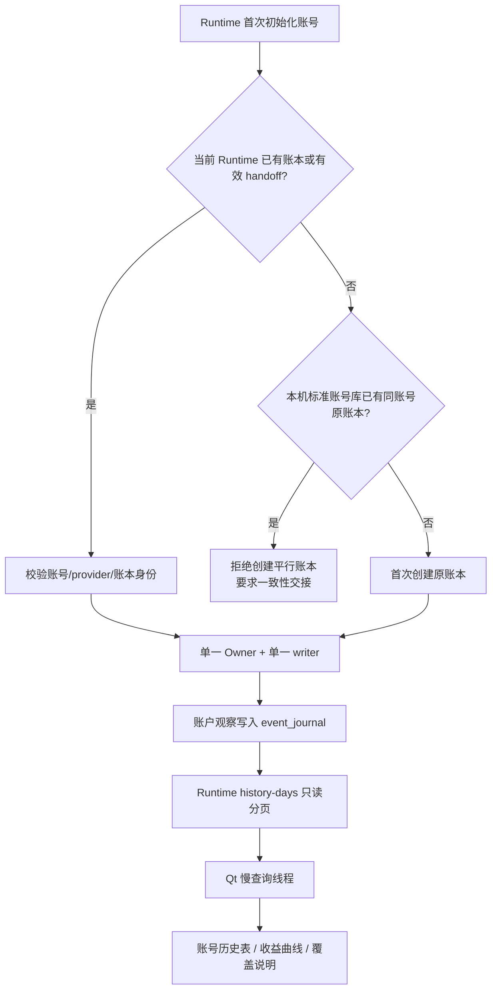
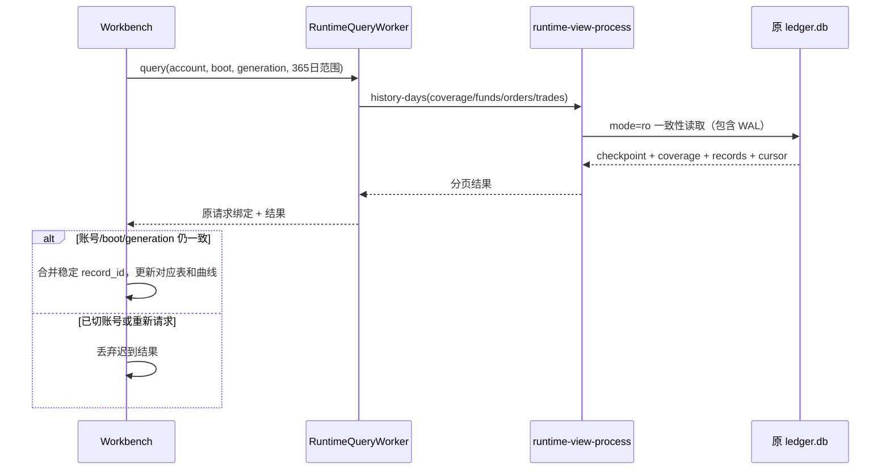
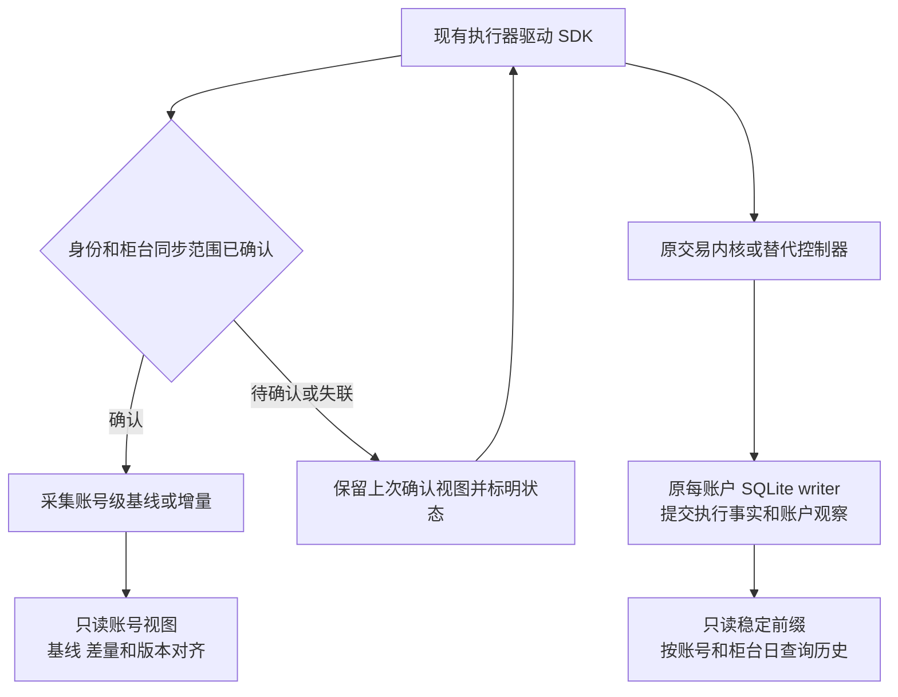
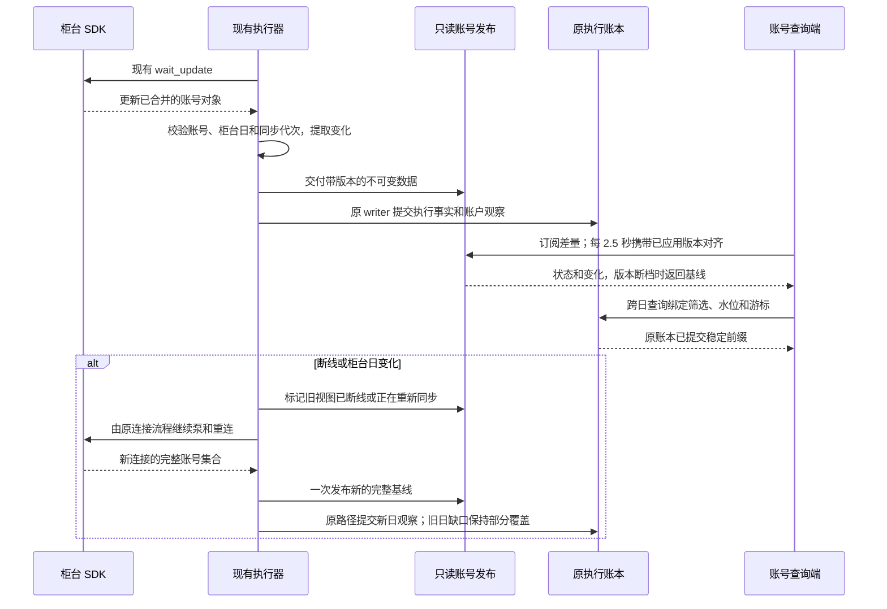

# OnlineTrader 账号数据同步逻辑设计

2026-11-19 · Trading Runtime 实施说明 · 源码基线 `10b915fa23f33860712ec491a7aa74d015c46203`（dev36，合入 F5 时钟和行情稳定性修改）。

## 2026-11-19：单账本与 Workbench 历史接入修复

现场排查发现，同一台电脑上的同一 TQKQ 账号可以在桌面账号库和一个全新便携 Runtime 目录中分别初始化 `ledger.db`。账号锁阻止两个执行 Owner 同时运行，但不会阻止它们先后使用两份不同账本。结果是新 Runtime 只看到自身启动后的资金观察，Workbench 的收益曲线丢失原账本已记录日期；同时页面把“自有成交/自有终态订单”简称为“成交记录/历史订单”，容易被误解成柜台账号全历史。

本次修复遵循以下决定：

1. **同机已初始化账号不得静默创建平行账本。** 便携 Runtime 首次初始化前检查本机标准 OnlineTrader 账号库。若同一规范账号已有有效原账本，而当前 Runtime 目录没有经验证的 handoff，则拒绝启动并要求走一致性交接；不自动复制热库、不删除 WAL、不合并两份执行事实。
2. **Workbench 历史只经 Runtime 查询。** Qt 不直接打开 SQLite。Runtime `history-days` 返回的资金、柜台委托、柜台成交和覆盖状态由独立慢查询线程读取，结果绑定账号、Owner boot、日期范围和查询 generation；迟到的旧账号结果丢弃。
3. **自有事实和柜台观察分开展示。** 当前委托、自有成交、自有终态订单继续来自 Runtime 实时投影；新增账号委托历史、账号成交历史和覆盖说明来自原账本中的完整账户观察。外部成交不写入 `fill_facts`，不取得策略所有权，也不触发保护。
4. **收益曲线使用原账本资金历史。** Workbench 将 `history-days/funds` 的每日最后完整观察并入曲线，按交易日去重；当前 Runtime 投影的更新值优先。没有观察或结算来源的日期明确显示为未覆盖，不从成交或余额倒推。
5. **旧日柜台缺口不在本次自动补造。** TqSdk `get_trade()` 只提供当前交易日成交。QPro 8815 可以提供已经同步、解析的结算资金、成交和日终持仓，但需要显式账户映射、覆盖范围和来源身份；在完成独立导入合同前只保留现有 `COMPARISON_ONLY` 能力，不把未核实结果写入执行账本。

状态与失败合同：账号历史缓存是只读展示状态，不参与交易裁决；`NOT_OBSERVED`、查询超时、容量限制或 Runtime 断线不得清空最后可信结果并声称“无历史”。并行账本检测失败使用明确错误停止首次初始化。兼容回退只需移除 Workbench 历史接入；已有账本和事件 schema 不迁移、不重写。当前正在运行的 Owner 不因源码更新自动切库，实际迁移必须另行停止、核对并执行一致性交接。

最终采用原每账户 SQLite 执行账本，不创建单独的 `runtime.sqlite3` 或账号历史档案。运行中的全账户截面、停机最终观察和策略自有成交写入原 writer 已有的事实链；查询端只读稳定前缀。全新运行目录只带配置并在首次启动建原账本，换机交接携带配置和该原账本的一致性副本。已经初始化的账户把运行配置和原账本视为共同的可恢复状态：配置表达未来运行意图，账本保存已经发生且需要恢复、核对或审计的事实。

## 目标与现状

账号在线期间，持仓、委托、逐笔成交和可取得的资金字段随柜台回报持续更新。Runtime 在新版本可用时主动推送，客户端每 2.5 秒按版本和摘要对齐。换机登录同一账号后，先同步当前柜台日及当前持仓；跨日历史读取随配置交接的原执行账本，仍缺的日期只能由已经核实的数据源补齐。查询范围为该账号收到的全部记录，包含其他客户端成交和策略配置之外的合约。

| 现行路径 | 当前实现与接入点 |
| --- | --- |
| `runtime run` / `status` / `account --attached` / `history` | [独立运行入口](../src/online_trader/runtime/standalone.py)复用原 Kernel owner；[接口进程](../src/online_trader/runtime/view_process.py)独立提供状态、账户和历史读取。全账户截面来自原执行器同一轮 SDK 更新，不建立第二连接或第二 sender。 |
| 普通工作台 F5 / `desktop-start` | 原 Kernel 的 [DSV 循环](../src/online_trader/runtime/dsv_simulation.py)继续驱动 SDK。普通入口与独立入口共享业务实现和账户排他锁，不能同时成为同账号 sender。 |
| 工作台状态 | [原 owner 投影](../src/online_trader/transport/workbench_snapshot.py)由 [ControlServer](../src/online_trader/kernel/server.py)构建；Runtime 接口主动发送差量，客户端每 2.5 秒用版本和摘要对齐。工作台只消费副本，不拥有 SDK 或 SQLite writer。 |
| `dsv replacement-run` / `simnow replacement-run` | [SDK 适配器](../src/online_trader/dsv_runtime/sdk_adapter.py) 已读原生委托和成交，再按所有权生成策略事实。后续从同一适配器读数点接入账号视图，使用替代链自己的柜台日和连接证明。 |
| 旧记录与业务恢复 | [原单终态留档](../src/online_trader/kernel/day_recovery.py) 服务于已有责任的核对。11 月 18 日 dev34 新账本收到柜台历史时，塑料、沥青原有日停仍未继承。策略继续运行须走原账本恢复与原入场授权。 [换机现场记录](refactor/dsv-parity-20261114/31-dev34-simnow-handoff-and-closeout.md) |

天勤 SDK 3.10.4 用 `wait_update()` 将服务端变化合入内存对象。快期专业版的历史绩效服务读取已经同步、解析的结算数据。本方案沿用盘中先取全量、再消费变化，以及按交易日查询历史的做法。 [TqSdk 数据流](https://doc.shinnytech.com/tqsdk/latest/dev_framework.html) · [快期历史绩效](https://publish2.shinnytech.com/doc/qpro/latest/ai_editor/qpro_performance_guide.html)

## 所有权和更新流程

现有执行器是 SDK 的唯一驱动者。账号同步在其已有读数点采集同一轮原生数据，复用等待、状态和账号绑定。工作台和接口进程只接收脱离 SDK 引用的只读数据。独立账号查询通过单独的本机命名管道读取同一 owner 发布的完整截面；跨日查询读取原 SQLite 的已提交前缀。交易路径继续从原执行链读取事实和提交订单。

实时同步从现有执行器已连接该账号时开始，开仓权限为 `DISARMED` 时也能同步。仅打开工作台或执行器已退出时提供历史查询，并标明账号未连接。若后续要支持打开软件即自动连账号，还需评审独立于策略启动的连接生命周期与同账号 owner 交接。

### 秒级同步合同

- 首次登录、重连、切账号或换日时，等当前路径确认账户全量同步边界后，一次发布同一柜台日、同一连接代次的基线。盘中在已有 SDK 轮次中发现变化，接口进程生成有序差量并主动推送。首次读取、增量超出保留窗口或基线代次变化时，重取完整基线；无变化时 2.5 秒对齐返回当前版本。
- 同步边界使用原路径的连接状态、SDK 交易数据收齐证据、稳定的账户身份和可核对柜台日。普通工作台复用网关的交易数据完成信号，替代链复用其适配器的连接与柜台日校验。账号视图完整性仅代表已取得的柜台查询范围，执行链仍按各自的委托、持仓和业务事实要求核对。
- 记录显示仍以 **SDK 已合并回报 → 查询端应用对应版本 P99 ≤ 1 秒**作为后续正常负载评审目标。Runtime 在更新时主动推送差量；客户端每 2.5 秒提供最后已应用版本和摘要做保底对齐。首次全量、重连和历史查询各自计时，不能用界面定时器代替源端进度。
- 所有 SDK 读取在原线程进行。在 SDK 轮次中复用已读取的对象，优先复制变化的行。初始全量、序列化及历史分页分别记录耗时。接口进程的查询有并发、时限和帧容量，不能把全账本扫描带进订单循环。Standalone 候选把 Workbench 最新策略决定改为 SQLite 提交确认后的内存展示缓存，完整账户截面约每 2.5 秒采集，Workbench/行情投影约每 750 ms 发布并在后台编码；这些仅减少读侧开销，不改变策略、报撤单和保护频率。按现有 dev36 的 SDK 泵间隔、owner 慢轮次诊断检查影响。 [dev36 时钟实施及诊断](clock-timer-implementation-20261117.md)

## 只读数据契约

| 对象 | 身份和语义 |
| --- | --- |
| 快照头 | 带 `account_key`、环境、`gateway_identity`、owner 启动身份、连接代次、确认柜台日、基线标识及记录版本。附最近一次成功完成账号观察的时间、最近数据变化时间、数据覆盖状态及缺失原因。同一运行内通过单调时间量延迟，跨重启用新基线。 |
| 持仓 | 账号内按合约、方向汇总，保留今仓、昨仓、均价、可取得的盈亏。明确确认的归零撤下当前持仓行。隔夜持仓仍可查，开仓成交号或批次未提供时字段为空。 |
| 委托 | 以账号、环境、网关、可证原柜台日和柜台委托身份定位。保存合约、方向、开平、价、原始和剩余量、已知成交量、状态、报单时间与柜台消息。部分成交保留在活动委托中。终态细类按柜台证据确定，`FINISHED` 但分类字段不足时显示「已结束，原因待核」。 |
| 逐笔成交 | 以账号、环境、网关、可证成交柜台日及柜台成交身份去重，保留原委托关联、合约、方向、开平、价量及原生时间。保留 SDK 标识及可得的交易所标识，据正式身份关联。重复回报幂等，原生身份相同而事实冲突时保留原确认行及冲突证据，标记待核。 |
| 资金 | 保存已取得的权益、可用、保证金和手续费等字段及观测时间，空缺保持未知。价格和金额用受支持的十进制表示。外部记录是否属于策略由原账本的明确关联决定，缺关联时保留柜台来源。 |
| 历史查询 | 输入绑定账号、柜台日范围、可选合约和游标。返回稳定分页、记录来源、读取时的已提交版本和逐日覆盖。结算来源缺原委托号或逐笔时间时如实保留，只有身份可证时与原生记录关联。 |

连接代次和原账本业务键分别服务于新鲜度及业务身份。同一个订单重连后继续使用原业务键。原始时间先用柜台日或已有明确日历证据定归属，策略范围外的合约同样保留。无法确认日期的记录以「归属待核」显示，取得证据后才归到对应历史日。夜盘使用对应的柜台交易日，换日应用同时切换当日委托和成交；当前持仓按新基线重新同步。

### 连接与账本状态

| 事件 | 账号视图 | 账本与恢复 |
| --- | --- | --- |
| 首次登录，尚未收到完整数据 | 同步中。可展示经账号校验的缓存及时间。 | 空集合等范围齐全后才确认为零。任何残留的 SDK 默认占位对象均排除。 |
| 同日连接中断或 owner 停止推进 | 保留最后确认基线，标识「已断线」或「更新停滞」及数据时间。 | 同日重连完成后按原生 ID 补差。缺失旧委托继续待核，保留最后已知状态。 |
| 柜台日切换 | 旧数据明确标旧日，等待新日基线后一次切换。 | 旧日已提交记录持续可查。若旧日结尾缺可证明的终态覆盖，保留部分覆盖，后续补证。 |
| 原账本写入失败或查询达到容量 | 原 writer 失败按执行路径停用后续提交并保留诊断；读侧容量或超时只失败当前查询。 | 保留已提交水位。缩小分页可重试；不把未提交观察或空集合补造成历史事实。 |

## 历史存储、兼容与回退

最终选择**直接查询原每账户 SQLite 执行账本**。完整账户观察写入原事件日志，自有逐笔来自原 `fill_facts`，不建立第二 writer 或第二 schema。查询按账户、日期范围、分区、合约和游标绑定原账本水位；资金与持仓取每日最后完整观察，原生委托和成交按观察日及原生身份去重，自有成交保留其已核证交易日。逐日覆盖明确区分有完整观察的部分覆盖、不完整观察、仅有账本事实及完全未观察，永不把局部样本称为完整柜台日。

- 运行中读取使用 SQLite 正常 WAL 锁和一致性快照。无 owner、无 WAL/SHM 的冷账本在持有账户启动锁期间使用不可变只读连接，查询不在交接目录生成侧文件。已有未 checkpoint 的非空 WAL 仍用标准只读连接，不能用 `immutable=1` 忽略已提交事实。冷历史 reader 先通过独立 reader gate 串行，再判断账户执行 owner；这样第二个只读查询不会被误判成活跃 writer。等待 reader gate 的时间不占 SQL 查询自身的执行预算。
- 分页游标绑定账户、筛选、原事件水位和水位身份。追加写入不移动旧游标；一致性副本可以继续相同查询。查询有最大日期范围、记录数、执行时间和响应大小，超限返回明确错误且不影响下一次读取。
- 换机使用原账本的一致性备份。清单记录配置、账号、原账本及摘要。目标机先校验身份和完整性，再由原运行入口核对柜台事实；查询副本不是执行权，源 owner 未停止时不能接管。
- 旧日未观察的资金、持仓、委托和成交不能从策略事实推导。缺口只能由经核验的结算、逐笔或柜台历史来源补齐；当前实现只报告覆盖，不自动导入外部历史。

## 诊断与验收

利用现有状态查询和诊断体系，记录账号摘要、owner 身份、柜台日、连接代次、基线和版本、各集合数量、原生观察至发布的延迟及原账本水位。同步阶段变化、覆盖缺口和写失败记录具体原因，重复的正常刷新计入汇总。用同一个基线和记录版本关联 SDK 收到、账号视图发布、读端应用和账本提交。查询端可直接读到最近成功观察时间和当前失败阶段。

| 后续验收场景 | 通过条件 |
| --- | --- |
| 普通工作台 SimNow、TqKq 的完整登录 | 经实际入口同步。与同一柜台账号核对有仓及空仓、挂单、部分成交、撤单及多笔成交。账号其他客户端及策略范围之外的真实记录可读。 |
| 盘中延迟和负载 | 按 SDK 合并至读端应用测量，正常负载 P99 ≤ 1 秒，活跃阶段不累积刷新请求。报告基线、新版本和当前 SDK 泵间隔、owner 慢轮次及报单发送时序，确认账号读写压力没有拖慢原执行链。 |
| 断线、同日换机和更换账号 | 断线保留上次数据及时间，重连全量前不确认空仓。新机同账号读到柜台当日数据，已见逐笔和委托没有重复。切账号后清除前账号展示绑定，拒绝迟到的旧账号结果。 |
| 夜盘、换日、旧账本和失败恢复 | 新旧日归属正确。覆盖错误账号、异常终止、冷热 WAL、旧查询入口、容量及超时，校验已提交记录、缺口和恢复后的实际查询结果。 |
| 执行边界 | 账号查询、备份和历史补录无报撤单；外部仓位与历史成交保持原归属，不触发保护接管、不解除未知委托占量。原日停和原保护继续由交易账本证明。 |

当前 Trading Runtime 已完成 SimNow 附着账户读取、无 Qt 策略和人工交易、原账本跨日查询及一致性交接源码。Windows 独立离线覆盖了冷热 WAL、稳定分页、容量、超时和新旧查询入口；真实 SimNow 覆盖了当前账户截面和停机核对。P99 延迟、TqKq 在线、真实资金账户、另一台电脑和最终制品仍需各自授权与验收。本文记录已经实现的 Runtime 数据路径，不把 Workbench 显示或 DSV replacement 切换列为已完成。
