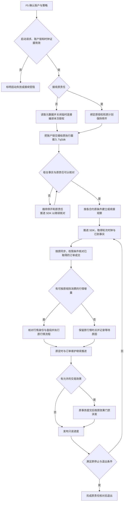
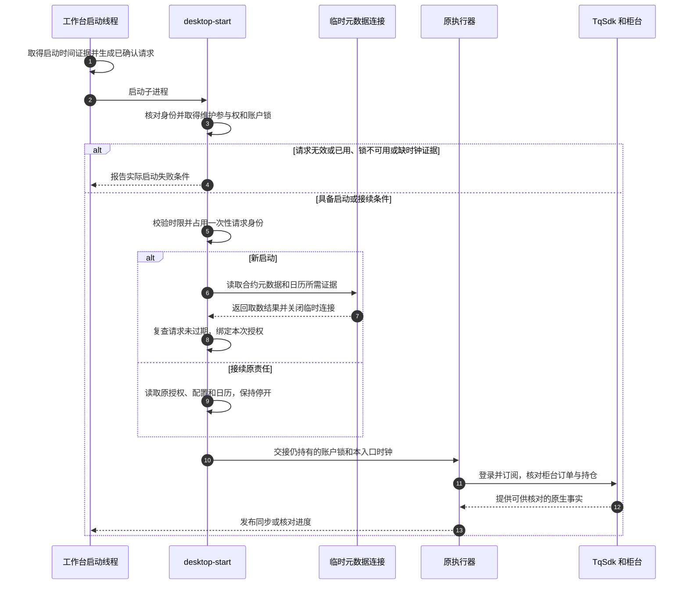
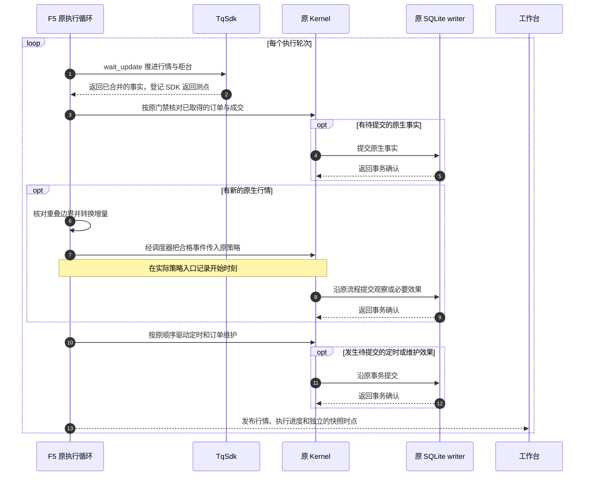
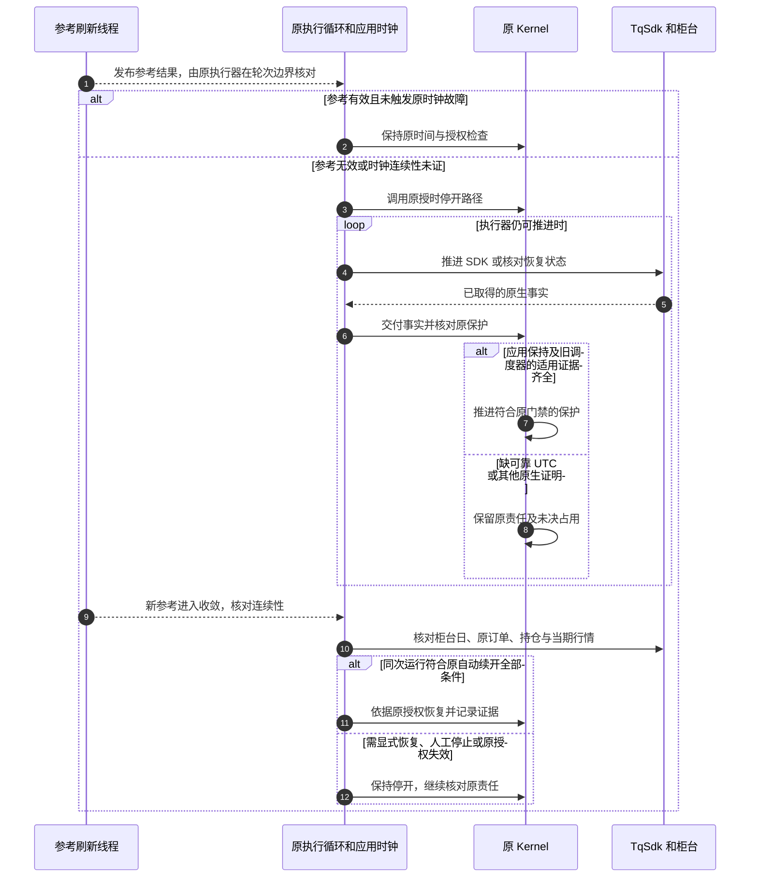
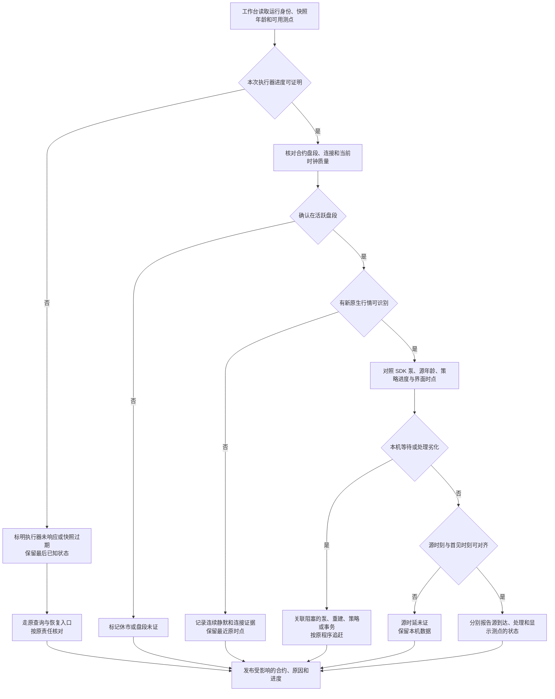
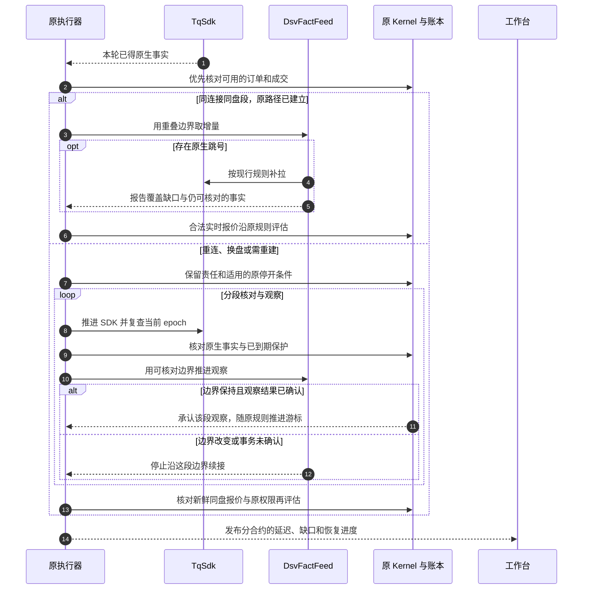
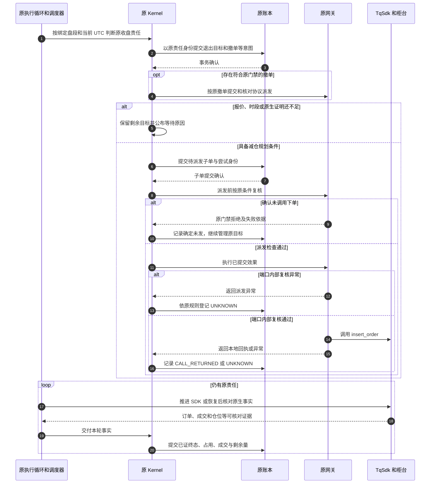
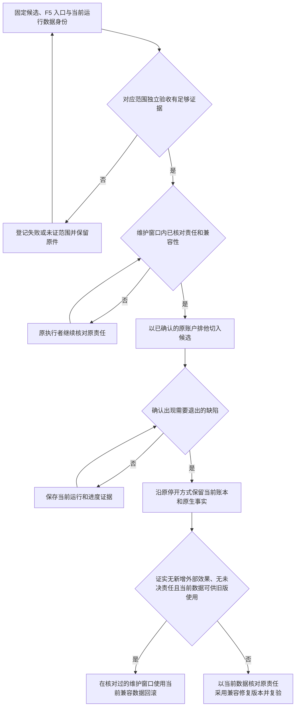

# OnlineTrader 时钟准确性与行情稳定性实施方案

初版 2026-11-18 · 第 2 版复审及首批候选记录 · 主线基线 `0cfd8270e3a55d00e4d31320e4acb7efcee3f360`

## 1. 用户目标和交付范围

普通工作台 F5 启动后，在正常行情线路和目标 Windows 设备上从开盘持续运行到收盘。应用用误差可解释的 UTC 判断交易时间，按合约识别合法的新鲜行情，策略处理延迟保持在预算内。盘中变慢时，工作台能给出受影响的合约、首次异常时点、原因和恢复进度。行情或时钟异常时，已有委托、持仓和退出责任持续按原入口的核对机制处理。

| 事项 | 实施决定 |
| --- | --- |
| 首发入口 | 普通工作台 F5 → `desktop-start` → `dsv_simulation.run` → `DSV_LEGACY_KERNEL`。以目标 Windows x64、Python 3.13、TqSdk 3.10.4 和当前配置为基线。 |
| 行情与时钟 | TqSdk 继续提供生产行情和柜台事实。复用 `CalibratedClock`、`ClockSample`、可信时间保持、原生 Tick 游标和现有工作台行情通道。 |
| 共用改动的责任 | 改动触及旧链共用代码时，覆盖 `dsv run` 与 `simnow run`。触及共享时钟或底层网关时，核对 `simulation run`、两条 `replacement-run` 和受影响的桌面定时入口。各入口沿各自既有 owner 和恢复契约验收。 |
| CTP 的启动条件 | 同机证据指向上游延迟，或 TqSdk 的源时间证据持续不足时，评估经授权的 CTP 只读对照。数据源切换另案评审，生产放行以 F5 + TqSdk 的证据为准。 |
| 数据与权限 | 使用现有账户锁、原 Kernel、原 SQLite writer、原日历和原保护。诊断输入只有观测权限。保持原 DSV 普通开仓、盘中缺号、保护、收盘及原停开合同。任何拟议交易差异必须列出证据、影响和批准记录。 |

11 月 17 日只读复现中，1,523 个更新有 1,333 个因时间戳领先本机而被拒，以同轮 NTP 时间重算后全部通过。这验证了慢钟造成的误拒机制。早盘缺失轮次缺原始戳。11 月 18 日 dev34 普通工作台在 14:59:40 触发退出，21 个减仓子单全部在发送前中止，最后一份完整柜台快照仍有 30 手空仓。现场构建提交未知，现有记录只证明中止发生在发送前。开发应分别验证时钟误判、盘中积压与发送前报价拒绝。 [慢钟复测](refactor/dsv-parity-20261114/29-clock-stability-and-four-contract-retest.md#原因与校时结果) · [收盘证据](refactor/dsv-parity-20261114/31-dev34-simnow-handoff-and-closeout.md#三项收盘复核)

主线已接入应用 UTC。旧链已有原生 Tick 增量读取、同会话缺号处理及分段重建，替代链已有单调计时和无报价维护。首批从实际 F5 的采集、策略入口、派发和工作台取证，逐项关闭源码与现场证据之间的缺口。 [时钟实施说明](clock-timer-implementation-20261117.md) · [24 小时修复进度](24h-critical-reliability-repair-plan-20261117.md#14-后续实现进度与现有规则复用) · [V2.1 开发规格](clock-and-timer-development-plan-20261117.md)

## 2. 执行责任和主流程

| 环节 | 现有责任方与接入点 | 方案职责 |
| --- | --- | --- |
| 启动和恢复 | `desktop/startup.py`、`runtime/desktop_bootstrap.py` | 生成和核对有时限的启动请求。新启动在账户锁内完成元数据取数再交接给原执行器。恢复使用原授权、原账本和原退出计划，启动保持停开。 |
| SDK 推进与行情事实 | `DsvSimulationSession`、`TqKqDsvPort`、`DsvFactFeed` | 原循环推进 SDK，记录每轮和每合约的原生事实边界、时间、连续性和处理预算。 |
| 策略、委托与持仓 | 原 Kernel、原调度器和 SQLite writer | 在原同步及权限条件下处理本轮已取得的原生事实，按既有顺序评估行情并驱动定时维护。所有正式效果使用原事务及派发链。 |
| 授时 | `CalibratedClock` 与原参考刷新线程 | 启动时取得本入口所需的校准或保持证据。运行中刷新线程只报结果，原执行器在轮次边界安装。同轮决策读同一时间样本。 |
| 状态发布 | `MarketMonitor`、工作台行情 IPC | 发布有界的只读快照。工作台可独立检出快照过期，交易状态仍由原执行器确认。 |

### 图 1 · 从 F5 启动到持续运行

图 1 表示正常轮次及其无报价分支。各边界仍分别提交并核对回执，具体顺序见图 3 和图 7。运行中发生失联、换日或时钟故障时，同一执行器转入图 4 至图 6 的核对流程。无行情也要驱动已到期的原维护，必要撤单可随原效果链提交和派发。缺少合法价格的平仓留在原退出目标下等待。正常轮次仍保持先核对已得原生事实，再按原顺序消费行情、驱动调度器与原生事实处理的优先级。新切片可能改变顺序时，先用冻结 DSV 和原生事实对照。 [旧链执行循环](../src/online_trader/runtime/dsv_simulation.py) · [旧链调度器](../src/online_trader/kernel/scheduler.py) · [替代链调度对照](refactor/dsv-parity-20261114/15-strategy-sdk-schedule.md)

### 图 2 · 启动请求、临时取数与原责任接续

启动线程取得的时间用于生成请求，子进程自己的应用 UTC 用于校验请求时限。请求身份在临时取数之前占用，取数后再复查时限。临时连接仅取数，先关闭，再启动原交易连接。重复请求、时钟失败或元数据不完整的分支都沿原入口返回原因。 [工作台请求](../src/online_trader/desktop/startup.py) · [启动和账户锁交接](../src/online_trader/runtime/desktop_bootstrap.py)

### 图 3 · 每轮行情从 SDK 到策略和工作台

## 3. 时钟样本和恢复

| 时间证据 | 采集和用法 |
| --- | --- |
| 决策 UTC | 复用 `CalibratedClock`。当前轮次按原入口封存 `ClockSample`，用于日历、盘段、授权和业务判断。发送前的各项复核仍按现有责任边界取时。保留 `clock_epoch`、参考批次、参考年龄及采样夹持跨度。 |
| 本机用时 | 用同单调域的差计算调度、等待和处理时长。休眠或长调度间隔单列，唤醒先核对 UTC、会话和原责任。进程重启或换机沿原恢复规则处理，单调量不得用于重置或延长已有期限。 |
| 源报价时刻 | 保留原生字符串或整数纳秒与规范 UTC。诊断保留原精度及带符号差，策略仍按各入口比较精度、适用年龄及配置 0 语义处理。 |
| 系统时刻 | 仅供 Windows 偏移证据、兼容日志及 SDK Unix deadline。系统时间变化与应用 UTC 校准变化分别记录。 |
| 冷恢复锚点 | `ProtectionClockAnchor` 绑定原账户、原账本路径与操作系统启动身份。只在可核对的原责任和有效保持锚点条件下接续。应用 UTC 和保持证据均不存在时沿原入口报告启动或接续受阻。 |

当前主线用 RTT 一半与源间差估计参考误差，再考虑锚点年龄和剩余校正。它提供运行质量估算，单独使用不足以证明发布用绝对误差上界。验收用独立且可追溯的参考读取同一单调时点或夹持配对，其误差上界由参考源的同步质量、网络及采样不确定性给出。应用 UTC 保守误差可取两者差绝对值加参考误差与配对误差，使用锚点外推时另计已证明的漂移和剩余校正，避免重复计算同一误差项。跨参考变更、唤醒或证据过期时重建可信区间。两组网络参考若共用同一未证上游，不构成独立验证。 100 毫秒仍是性能测量的初始建议预算，由目标机器和实测确认。 [应用授时实现](../src/online_trader/scheduling/reference.py) · [NTP 同步距离](https://www.rfc-editor.org/rfc/rfc5905.html#appendix-A.5.5.2) · [Windows 单调计数与休眠](https://learn.microsoft.com/en-us/windows/win32/sysinfo/acquiring-high-resolution-time-stamps)

| 事件 | 开仓条件 | 已有委托、持仓和退出 | 恢复条件 |
| --- | --- | --- | --- |
| 单台请求失败，整轮仍提交一致且在误差范围内的参考 | 继续按原交易规则判断 | 按现有规则执行 | 记录失败源及有效参考批次 |
| 整轮无可用参考、样本过期、校准冲突或原刷新时限超出 | 沿原授时停开路径 | 在应用保持证明及旧链当前盘段、原生事实、原责任条件允许时推进保护。原生回报和有身份的撤单沿既有通道核对 | 新参考需满足原一致性及渐进收敛条件。记录冲突前后的参考证据 |
| 保护保持预算到期或连续性不能证明 | 保持停开 | 保留原目标、已提交效果和未决占用。需要可靠 UTC 的新委托等待。旧调度器的单调投影、原盘段与原生证明是附加核对，仍受原发送门禁约束 | 核对 UTC、当前盘段、原账本与柜台事实。需显式恢复的故障走原入口 |
| 授时重新稳定 | 仅同进程、原自动策略确因授时停开，连续稳定至少 2 秒，且授权、停开代次、柜台日、策略/行情 epoch 与原生行情、订单持仓核对均满足时才可能自动恢复 | 按核对事实续管原责任 | 原因和恢复依据入原记录。人工停止、重启、换日和显式故障清除自动恢复资格 |

现有参数以源码比较符核对。正常刷新约 120 秒，异常约 10 秒重试。开仓参考年龄需小于 300 秒，并满足最近一次轮询和剩余校正条件。保护保持年龄需小于 900 秒，且估算误差含已用保持漂移、剩余校正需在 1 秒预算内。`entry_ready`、`protection_ready`、旧调度器故障状态和测量质量各自记录。诊断打印、轮转或只读对时记录写入失败只影响可观测性。用于原责任接续的保护锚点持久化另按现有契约处理。 [状态与阈值](clock-timer-implementation-20261117.md#时间合同) · [保持上限](../src/online_trader/scheduling/holdover.py) · [旧链故障保护](../src/online_trader/kernel/scheduler.py)

### 图 4 · 授时异常、保持和恢复

### SDK 等待与系统跳钟

TqSdk 3.10.4 在内部再用当前 `time.time()` 将 Unix deadline 换成事件循环等待时长，墙钟在两次读值之间回拨可能拉长单次等待。还需区分内部任务或整批数据合并阻塞，以及两次调用之间本地轮次耗时。初始方案保持锁定 SDK，按实际入口采集调用进入、真实返回、相邻泵间隔和写账等待。若故障注入证实需要改等待机制，先验证锁定版本支持的单线程唤醒方式及 SDK 网络和待发命令的推进行为。只有短切片或外层定时器时，仍须验证同步调用实测上界。超出该范围或没有支持的接口，另评估 SDK 层调整并保留该项未证记录。禁止跨线程并发调用同一 SDK 或以另一个发送者接管未核对责任。 [已有 Windows 注入探针](clock-timer-implementation-20261117.md#诊断参数与证据) · [锁定版本 SDK 定时契约](https://doc.shinnytech.com/tqsdk/latest/advanced/timer.html)

## 4. 行情接纳、积压与断线恢复

### 行情数据合同

| 数据 | 采集和处理边界 |
| --- | --- |
| 原生行情身份 | 通过运行身份、行情来源、`source_epoch`、合约、柜台日、盘段和 `native_tick_id` 关联 Tick。原生纳秒戳和原字段保留。Quote 快照单独标记原始时间、盘口、首次观察及对应的 SDK 轮次，配对须能证明同一事实。行情和时钟 epoch 分别使用。 |
| SDK 首见测点 | 在底层 `TqApi.wait_update` 返回、已合并更新可读时立即采单调时刻，并在同一时钟域取得适用 UTC。此前完成的是 SDK 可见，尚无网络接收时刻。端口通知解析、换月取数、Tick 转换、账户查询和回放各记用时。续传轮次使用实时采样，避免把已封存的上轮时间当成本次返回时间。 |
| 策略开始测点 | 以原路径的 `DsvStrategyRuntime.on_market` 实际进入为准。记录前置过滤、实时消费、仅观察重建和最终接纳各自结果。现有 `strategy_start` 在准备账户/合约输入前，作为单独的应用准备测点。需要 UTC 时活采或从可核对的同域样本投影，计入投影误差。 |
| 采集和消费对账 | 在时效过滤和策略处理前记 SDK 已证实时增量及候选身份。运行中分别推进已见和已接纳游标。回放、路由变更、处理失败、年龄拒绝、重复、缺号及诊断丢样各自记。原生 ID 差可说明缺口，不能直接当作积压条数。 |
| 报价质量 | 区分连接是否已同步、最近原生报价、策略接纳报价和按用途执行的报价。账户更新和缓存重读不刷新任何报价时点。交易时效、盘段、盘口及路径的生效判定仍用原入口。诊断不能授予交易权限。 |

用现有 `ClockSample`、原生 Tick 完整身份和观测接口串起测点。若 SDK 返回时无法证明某行新出现，或 Quote 与 Tick 配对冲突，记录所在区间和证据缺口，避免以回放或工作台“最新”补造原时刻。工作台副本和轻量诊断使用现有版本与纳秒字符串格式。 [SDK 泵边界](../src/online_trader/gateway/tqkq.py) · [实际策略输入](../src/online_trader/kernel/dsv_strategy.py) · [行情监控采样](../src/online_trader/runtime/market_monitor.py)

### 图 5 · 定位行情延迟与执行器停滞

这些原因可同时成立。首次可见已迟包含上游传输、SDK 内等待与数据合并。单靠应用测点无法拆开这几段。先结合泵间隔、调用耗时与本机处理证据缩小范围，必要时按 S5 取同机只读对照。无新更新可见时，只在有同步或外部对照证据时定性为断流或自然静默，其他情况给出“当前无可证明的新行情”。

工作台用现有只读快照年龄检查发现执行器停滞。主循环卡在 SDK、事务或系统等待中时，界面仍可标注进度未知和最近时点。只读超时不推定已断开交易、订单已撤或持仓已平，也不启动新执行者。原过程恢复后，按运行身份、柜台快照和实际控制回执取消提示。 [快照新鲜度上限](../src/online_trader/transport/workbench_snapshot.py) · [工作台失联与重连](../src/online_trader/desktop/workbench.py)

### 追赶和恢复规则

1. 已证明当前盘段观察路径时，沿原游标读取重叠边界及后续增量。把订阅补拉、全量窗口转换、快照事实整理与写盘分开计时。保留合约内原生序与原轮次中的业务优先级。
2. 同连接同盘段已有路径时，原生跳号按现行规则发起补拉，仍允许已核对的新鲜实时报价按原规则评估。冷启动、切盘、换 epoch 或检查点不能续接按原观察起点合同，缺证按原入口停开。重连先确认原订单、逐笔、柜台持仓及占用。新源行情与盘段证明符合现有合同后，续接观察或从合法新起点观察。 [策略合同](strategy-contract.md)
3. 复用分段回放和原启动追赶上限。当前 256 条进度检查和 8 秒追赶窗口是原机制，外层期限不等于同步函数的返回上限。若测得重建挤压实时推进，再以条数和单调预算组合切片，20 毫秒为初测建议。切片之间驱动原生订单、成交与原保护。若 SDK 源 epoch、盘段、原观察边界或接纳依赖发生变化，停止沿原边界继续，按原提交证据重新核对。回放游标只在原观察结果确认后前进。
4. 历史回放、积压过时的事实和复盘首帧按现有观察与时效合同处理。之后用真正实时且同盘的报价重验。记录完整覆盖、可追赶和已经丢失三种结果。诊断/UI 缓冲可合并且须有丢样计数，现行策略所需事实不得为追求指标丢弃。
5. 休市、集合竞价、午休复盘、夜盘跨自然日和柜台日变更分开判断。连接已恢复、行情有更新、柜台状态已同步及原权限恢复独立。柜台日仍待证明时保留原账户与今昨仓核对。既有退出走自身门禁，观测路径缺失不得扩大为全局放弃保护。 [分段恢复](../src/online_trader/runtime/dsv_simulation.py) · [原生增量与补拉](../src/online_trader/gateway/tqkq_dsv.py)

### 图 6 · 高峰追赶、重连与恢复评估

## 5. 收盘退出与临发单校验

在已核对的旧链原周期和绑定盘段中，`ScheduledRuntime` 按原日历与原阈值判定收盘责任。即使没有报价，满足现有条件仍可登记原退出目标、保留名义参考价未定状态，并处理符合条件的撤单。错过收盘窗口登记原事件和剩余责任，报价与当前盘段再次满足时才形成相应的可发送效果。柜台终态以原生事实核对为准。 [调度与收盘身份](../src/online_trader/kernel/scheduler.py) · [收盘目标和参考价处理](../src/online_trader/kernel/execution.py)

`E_NATIVE_QUOTE_NOT_CURRENT` 在旧网关可以来自当前原生报价门禁，也可出现在开仓盘段复核，不能仅凭错误码把尾盘未发归因为时钟偏差。对照现场提交后的退出身份、子单与尝试身份，采集决策与复核两处各自的应用 UTC、原生报价时间和身份、适用年龄、盘段/柜台日、盘口/价量、委托价及档位。保留不同用途的原规则。普通开仓、自动减仓、已授权指定价手工减仓以及旧链时钟故障下的保护分别核对。 [旧网关发送前验证](../src/online_trader/gateway/tqkq_dsv.py) · [现场失败记录](refactor/dsv-parity-20261114/31-dev34-simnow-handoff-and-closeout.md#三项收盘复核)

| 当前进度 | 行为与证据 |
| --- | --- |
| 退出目标已提交，尚无合法报价、盘段或充分原生事实 | 保留同一退出目标、原名义口径和剩余责任，给出可核对的等待原因。已有撤单、逐笔和终态继续依原证据处理。 |
| 已提交 `SEND_POSSIBLE`，Kernel 派发前拦截 | 只有证明未尝试 SDK 时记录 `DEFINITELY_NOT_SENT`。记录失败检查与数据，沿原规则对同一退出目标重评。重复中止先核对报价、盘段、时钟质量、剩余量或等待边界是否发生变化。针对无进展的重复中止是否合并重评，须先走读原重试和收盘阶梯，明确影响与回归条件。 |
| 进入端口派发 | 端口按原规则再校验并调用 `insert_order`。本地回执 `CALL_RETURNED`、可观察的实际出站/柜台回报和最终结果分别记录。当前端口复核异常或 SDK 调用异常走原 `UNKNOWN`。任何扩大“确定未发”范围的改动须证明具体调用边界。 |
| 提交后执行器中止、调用数据不完整或 `UNKNOWN` | 照原例外恢复核对。以原子单、尝试和账户身份查证，保留未决占用。看到超时、撤单请求或暂时查不到都不能提前释放数量或补发。 |
| 有原生回报或成交 | 区分拒绝、未成交、部分成交和全部成交。用原控制器按同一剩余目标处理活动单和未决量，保持上期所等按今昨仓核对的原平仓路由。成交、已确认数量、原生订单终态与仓位一致才进入原结案。 |

设计首先复现最先失败的检查。响应速度优化沿原时间、价格、授权和剩余量定义。相同目标可以跨轮等待和核对，旧价与报价缺失不赋予新报单权限。 [旧 Kernel 派发与确认结果](../src/online_trader/kernel/engine.py) · [原平仓路由](../src/online_trader/execution/close_routes.py)

### 图 7 · 收盘责任、两处复核与原生终态

现有派发链还有 Kernel 本地复核。图中的“原门禁拒绝”也包括此处的确定未发。实际流程可多次驱动回报和保护。与时间或行情故障并发时继续使用同一责任和原生证据。崩溃发生在已提交待派发与回执提交之间时，由原恢复入口核对，不能从重启先后推定 SDK 是否已调用。

## 6. 观测、性能判据和工作台

### 可复核指标

| 指标 | 起点 → 终点 | 首版拟验收口径 |
| --- | --- | --- |
| UTC 准确性 | 同时点的应用 UTC 与独立可追溯参考 | 记录偏差区间、参考来源与年龄、保持和重校准过程。初测误差预算 100 毫秒，验收前用目标环境定稿。该值用于测量质量，交易遵循原时钟状态和用途合同。 |
| M1 源事件到策略 | 有可证字段语义与误差的原始源时刻 → 实际策略入口 | 在声明的 F5 正常活跃盘段按合约 P99 ≤ 1,000 毫秒。采用下述区间与分母判断。单列断流、覆盖缺口和分段结果。 |
| M2 本机处理等待 | 同事件首次 SDK 可见 → 实际策略入口 | 用同域单调计数，初测 P99 ≤ 100 毫秒。SDK 调用耗时和相邻推进间隔在首见之前单列，应用前置过滤及提交等待各有测点。 |
| M3 用户可见的刷新 | 轻量快照已可用 → 客户端显示对应版本 | 通过现有约 1 秒行情轮询对照接收和渲染时间，显示合并规则单列。普通工作台全量快照仍按原通道发布。跨进程相减须有同机单调域证明。 |
| 连续性与资源 | 开盘高峰、运行后段、尾盘及恢复过程 | 记录订阅/同步覆盖、未更新区间、已证积压、最老待处理时间以及 CPU、内存、DB/WAL 和写盘耗时。连续性不可证时单列范围。 |

### 样本归属和判定

1. **先定义分母。** 在时效筛选和策略结果之前登记 SDK 中能确认的不同实时事件。用事先从 F5 合同确定的规则识别预期进入实时策略路径的事件。可证明的缓存重读、重复和专用历史观察单独计数。预期实时事件在本机积压、年龄拒绝、进入失败或诊断丢样后保留在原分母。跨 epoch 首帧、同戳价量变化、突然跳号和无法配对分别说明，不能据原生 ID 差猜测漏掉多少。若无法复核分母或持续缺口，标明受影响范围为 `NOT_PROVED`。
2. **按误差区间判断。** M1 原始值为策略开始 UTC 减已证明语义的源事件 UTC。误差区间由两端上界相加，包含源精度/量化、应用参考与所用投影误差。区间上界不超过预算时可证明及时，下界超过预算时可证明迟到，跨门槛时为未证。负值原样保留。整个区间均为负时先核对源戳语义、配对和时钟质量，作为时间证据异常处理。缺源时钟证据时保留 M2。影子消费者只报告自身测点。 [V2.1 秒级指标](clock-and-timer-development-plan-20261117.md#192-1-秒如何精确定义及验收)
3. **处理失败与缺失证据。** 对已见但未进入的事件，保留到首次可判断其是否越界或观察结束，随后回填确定迟到、未证或可检查的合同处理结果。已超过预算的等待按已证下界计迟到。报告每组的分母 `N`、已证及时、已证迟到和未证数，用 `ceil(0.99 × N)` 判定 P99。已证及时数达到该值为 `PASS`。即便所有未证均及时也达不到该值为 `FAIL`。其余为 `NOT_PROVED`。只有数据允许才报告数值分位或其上下界，另记超标最长持续时间。
4. **分组防止均值掩盖盘中退化。** 每合约按实际活跃盘段和首见轮次归档，正常窗口事先按日历、连接场景和负载范围定义。用固定 15 分钟窗口与整盘结果对照，初版少于 100 个样本的同盘段相邻窗口合并并列明覆盖。启动、人工注入故障与恢复单列，按规则覆盖正常盘中出现的非预期延迟。无足够样本的范围明确标记。异常时段在完整盘次报告内保留。每组输出 `N / P50 / P95 / P99 / max` 或可证明区间。
5. **证明久跑之后仍有进度。** 本机积压观察沿用首版 1 秒诊断阈值，统计有证未消费事件的最老等待、开始和消退时刻。同一事件的证据退出按成功消费、证实不能消费或证据不足区分。流量高峰结束后应恢复持续进度，记录恢复用时，上界用 S0 固定负载基线确认。验证至少覆盖完整日盘和夜盘。对已有“开盘一段时间后变慢”的相同负载再复核一轮或覆盖同类观察窗口。如果缺重复窗口，单次整盘结果按实际范围报告。

| 示例范围 | 分组判定 |
| --- | --- |
| 100 个确定应进入实时路径的事件，98 个已证及时，1 个已证迟到，1 个只有估计 | 门槛是 99 个。若未证样本最终及时可达门槛，当前按 `NOT_PROVED`。 |
| 同样 100 个事件，98 个已证及时，2 个已证迟到 | 即便其余样本及时也无法达标，判 `FAIL`。 |
| 100 个事件中 99 个已证及时，余 1 条未证，分母与窗口覆盖可复查 | P99 门槛可判 `PASS`。这条未证及任何源覆盖缺口仍在报告中可见，源总体质量独立判断。 |

### 日志与显示

- SDK 轮次、首次可见、策略入口、提交、复核和显示版本以可追溯的事件身份关联。按运行记录代码 SHA/制品 SHA、入口、引擎、依赖、时钟与来源 epoch、日历和配置哈希。
- 有界聚合保留分母、各类结果和探针丢样。诊断流保留首个异常、关键拒绝和恢复上下文，重复记录可合并。若启用诊断出现同步写盘阻塞，移到有界只读记录通道，保留原账本次序。比较禁用与启用诊断的开销。区分诊断失败、保护锚点保存失败及主账本提交失败。
- 工作台沿现有入口按合约显示最新 SDK 报价与策略接纳新鲜度，明确当前阻塞交易的原因。只读快照过期时显示执行进度待确认及最后更新时间。主状态提供可行动的信息，时钟误差、分段延迟及其他证据按需展开。
- 时间质量、退化、恢复和关键拒绝都能反查到证据。报告使用关联 ID、脱敏身份和配置哈希。凭据、私有前置地址和完整账号保持在既有受控配置中。 [工作台实现](../src/online_trader/desktop/workbench.py) · [行情监控](../src/online_trader/runtime/market_monitor.py)

## 7. 实施顺序和交付点

| 批次 | 依赖与范围 | 文件级任务 | 实施完成依据 |
| --- | --- | --- | --- |
| S0 固定基线和证据 | 现用 F5、锁定源码、现场记录 | 固定候选与基线身份、Windows 版本和电源状态、依赖、账户/线路范围、合约日历和参数、启动方式、代表性流量与历史库规模。明确正常窗口、故障窗口、指标预算和源戳语义。列出 dev34 最小缺失取证 | 可重现的基线、原分母及假设。外部源时钟缺证时同时登记可测的本机范围 |
| S1 补齐诊断链 | S0 | 复用 `QuoteTrace` 及 `MarketMonitor`。在 `gateway/tqkq.py`、`runtime/dsv_simulation.py`、`kernel/dsv_strategy.py`、原发送边界和既有行情 IPC 核对实际测点 | 同事件能从首次可见定位到入口、提交、拒绝或显示。无证或丢失计数，保持有界 |
| S2 修正证实的时钟失配或盘中积压 | S1 | 扩展 `scheduling/clock.py`、`scheduling/reference.py` 的现有取时接口，按测点处理错用上轮时点、SDK 泵、重建、增量或同步诊断阻塞 | 每项修复能对照首个差异。相同原生事实、优先级和原提交边界保全，真实入口能恢复到预算内 |
| S3 修复已证的收盘派发缺口 | 与 S2 可并行定位，实施依赖 S1 与必要的 S2 修复 | 在 `kernel/scheduler.py`、`kernel/engine.py`、`gateway/tqkq_dsv.py` 的第一处失败修正。用原目标和回执区分准备、未发、调用和柜台事实 | 原授权范围内的真实减仓可追到原生终态。故障场景的未决占用与后续恢复均可追溯 |
| S4 Windows 持续运行验收 | S2 与 S3 同候选及实际入口 | 对照开盘、盘中后段、尾盘、夜盘及故障恢复。共用变更按实际调用链核对其他入口与回滚 | 每项结论绑定同一候选和证据。时钟、时延覆盖、持续进度、收盘及责任恢复分别判定 |
| S5 有条件的只读对照 | 目标源时间缺证，或首次 SDK 可见前侧出现持续迟到，且本机调度因素已核对 | 评估授权接入的 CTP SHADOW。锁定 Windows 绑定、前置权限、可比合约事件和时钟证据。只读影子数据只用于诊断 | 有可复查的两源时延、时间质量和覆盖差别。主源变更另案评审 |

编制期间原工作区已有尚未提交的 `QuoteTrace` 和 `market-quote-trace.jsonl`，覆盖部分 SDK、Tick、工作台和临发单测点。计划仍以已提交主线为基准。S0 固定该工作的候选身份，S1 优先核对并复用其测点、`tick_diag` 和轮转。当前追踪按 Quote 原戳等状态去重，`ACCEPTED_TICK` 在接纳后记录，诊断批次还在原循环同步写盘。复用时核对同戳改价、首见证据、真正的策略入口、时间误差、分母完整性和写盘开销。缺少柜台现场或独立源时钟时，先完成能独立验证的应用内工作。

实施前按批次确认剩余契约。S1 固定原事实关联和诊断新增字段。S2 落笔核对切片与已有策略优先级，如必须修改 SDK 等待则另写接口和兼容证据。S3 尾盘复现先定位具体门禁，需要改重评或原生未发边界时先走读。S4 固定候选、环境和验收范围。记录每项待证事实与其影响。

### 已查实的接入决定

- dev35 夜盘归档记录了普通工作台启动期间的另一类问题。22:54:59.500 已接纳报价后，执行器继续为其他合约追赶，22:55:11 工作台仍显示滞后。原启动追赶循环跳过了已登记首笔的合约。23:00 后还出现休市合约被计为滞后的显示口径错误。候选令已登记合约同步推进增量，并以每个合约的日历和原始时间分别显示休市、源报龄及本机积压。后续专项复核还发现，若等待中的合约在追赶期间正常休市，应在首次能确认休市的轮次退出等待。日历覆盖耗尽保留待核状态。原工作区 `output/dev35-silver-5min-acceptance-20261119` 保存旧构建的同源复现及 v2 的离线四项与真实单合约五分钟结果，覆盖范围以该候选的源码清单为准。
- 复核 dev34 当日归档时，21 条 `SEND_ABORTED` 的第一个失败检查均为旧链 `E_NATIVE_QUOTE_NOT_CURRENT`。原计划、仓位、盘段及内部价格检查可通过，但已接纳价格与发送口要求的当前原生报价来自不同检查边界。原始拒绝记录缺少内层年龄、盘口和时间依据。
- 在普通旧链自动减仓准备新子单或重报前，用现有网关 `fresh` 检查判断当前是否具备原生报价。报价未通过时等待下一次原维护，自有取消及退出目标不受这一价格条件拦截。实际派发前保留二次检查和待发持久化。原指定价减仓、时钟故障保护和替代路径继续走自己的原入口。证据与验收矩阵 A09–A11 对应。
- SDK 调用的单调等待仅在已锁定的 TqSdk 3.10.4 上适配。正常仍用原 `wait_update` 驱动，SDK 安排唤醒的唯一超时回调改用同事件循环的单调截止。其他 SDK 调度保留原语义。同步合并、写账和故障仍由原执行循环处理。固定 SDK 之外不采用其私有回调契约，并报告兼容等待模式。证据与 A03、A06 对应。
- 对实际启动追赶，保持当前同盘段、同来源、原时效和一次性接纳约束。已登记过首笔的合约继续接收增量，历史重建的两段循环以 256 条或 20 毫秒的先到值给原生事实留出推进机会。每次回到该段前核对时钟、会话和原观察域。过程中遇到时钟、来源或盘段变化时将该观察段暂缓，回主循环按原事实重新判断。用 A04、A07、A08、A14 验证重建与已承担责任的顺序。
- 首批诊断沿用逐行情开关，写盘交给有界后台队列。汇总按原生 Tick 身份、盘段与首见窗口保留计数，详细段落轮转，整盘验收须留存归档并核对批次缺口、实际观察起止与参考误差。
- 普通 F5 默认开启只读对照归档。原代码每次接纳行情会在执行循环内编码并同步刷出 `comparison-*/events.jsonl`，并从原 writer 查询已提交历史。白银五分钟专项的该归档约 3.8 MB，dev34 收盘归档约 236.6 MB。文件大小用于构造代表性样本。该链的磁盘阻塞与实际行情延迟仍用 A06 测量。普通 F5 把对照归档的逐行情写入交给单独有界队列，原 owner 提交归档水位。归档线程沿序号并以短只读查询从原账本补齐事实，行情决策与账本事件通过原水位和身份关联。归档失败或受限关闭按归档终点和丢弃数取证，正式事务、回执和盘段仍以原执行器为准。显式附带 DSV 配置或原版日志的对照入口可复查原同步合同。 [采集与报告入口](clock-timer-implementation-20261117.md#f5-候选诊断采集与证据口径)

## 8. 独立验收计划

本稿各项状态均为 `NOT_RUN`。功能验收按本次明确授权范围执行，由未参与候选开发的 Agent 使用独立测试技能。说明预期的来源，包括已认可的合同、冻结 DSV 行为或实际供应商协议。用目标 Windows 机器或已说明的等效环境，从真实入口执行。授权过的在线观察、模拟账户操作和故障注入按各自范围记录。

| 场景 | 入口或证据 | 预期与明确判据 |
| --- | --- | --- |
| A01 慢钟、同戳变化与错误源时刻 | F5 实际输入链与脱敏的现场形状 | Windows 墙钟慢约 0.97 秒时，合格报价按应用 UTC 核对，原时戳和精度保留。真实过时、显著未来、时间倒退、身份冲突和跨盘逐项给出正确原因。 |
| A02 授时刷新异常与续开 | 时钟输入夹具与 F5 | 单源失败仍有有效整轮参考。整轮失败、冲突、再校准和守时到期各走原门禁。覆盖现用的 300/900 秒及预算边界、2 秒稳定条件。同进程原授权成立才可按原条件续开，人工停止、换日、来源切换及重启取消本次授时自动续开资格。 |
| A03 兼容换算前后跳钟和静默 | Windows 与固定 SDK 版本的对应入口 | 向前、向后跳发生在 Unix deadline 换算前后时分别测量。单调用时可复核，说明同步等待上界和静默维护。触及时钟修改的分支还需核对停止或退出前待发与未决责任。 |
| A04 冷启动、休眠、恢复与换机 | Windows F5 启动线程、子进程和隔离账本冷副本 | 覆盖重复启动请求、取数超时、账户锁占用与原授权接续。多合约追赶中，如某合约确认休市，应在该轮退出等待。日历覆盖耗尽时保留待核。已就绪合约持续接纳同盘增量。同 boot 守时在原范围内生效，无可用锚点、不同 boot 或不匹配账本时准确报告。唤醒及恢复符合原责任和停开规则。 |
| A05 开盘高峰与盘中久跑 | F5 已授权的完整日盘和夜盘 | 按 §6 固定正常窗口、晚段和回稳，至少复查同类高流量窗口能否复现“运行一会变慢”。逐合约核对 UTC、M1/M2、进度、累计超标、覆盖和资源。全程缺证按实际范围记录。 |
| A06 大窗口、高负载与 I/O 故障 | 代表性四合约流量和既有账本规模 | 分别暴露 SDK、重建、事务和诊断负载。诊断开启、关闭、满缓冲、写入受阻及界面慢都能准确归类。用历史较大的隔离账本核对 F5 对照归档仅使用短只读查询，保留采样与水位顺序。缓冲溢出、读锁或限时关闭时按已见、丢弃和缺失水位报告。正式事实按原事务接纳，高峰过后恢复实时。 |
| A07 原生缺号、补拉和陈旧首帧 | 同连接已建路径、启动补拉及恢复场景 | 已建路径缺号与未建立路径按原合同处理。过时报价和重复读取不刷新接纳时点，回放无历史新开仓，无重复分钟消费。路径中断后游标按已确认观察续接。 |
| A08 断流、重连、午休复盘、夜盘与柜台日 | 原入口与柜台事实对照 | 连接状态、单合约静默、交易时段和同步独立。旧 epoch 不再供实时执行，真实柜台日缺证时保有原屏障与今昨仓责任。 |
| A09 尾盘禁开及实际减仓闭环 | 经授权的 SimNow 普通工作台 | 终点前禁开生效，经原复核的减仓被实际发出，逐笔、已确认数量、订单终态和柜台仓位一致。分别覆盖部分成交和迟到回复。无合法报价的责任留存另见 A10。 |
| A10 有目标但无合法报价 | 已有持仓、原日历关闭责任成立 | 无报价仍处理允许的撤单等原维护。无可用价格或已休市时保全目标和剩余量，无旧价派发。旧链统计保留原有未定口径。 |
| A11 派发前拒绝、提交失败和中断 | 原流程故障注入与隔离账本 | 分别核对 Kernel 拦截、端口复核异常、SDK 调用异常、提交前失败及提交后回执未到。未知始终留占用直至证明，已调用未核对不重复报单。 |
| A12 工作台显示、控制和执行器无进展 | Windows 真实工作台与原 IPC | 合约静默、源迟到、本机积压、界面滞后和快照过期可辨认。执行器不能推进时只读界面显示进度待核对，原控制命令回执与真实执行匹配。 |
| A13 实际分母与统计边界 | 同一输入中加入积压、拒绝、未知误差、重放及诊断溢出 | 分母冻结规则、恰等于阈值、分位边界和已知/未知分类符合 §6，已证实时但未处理的事件仍影响结果。没有独立源证据时保留 M2。 |
| A14 共用入口与 DSV 保护边界 | 受影响的旧链、替代链，以及冻结 DSV 的对应回放 | 各自使用正常入口、原交易 owner 和原回执。核对年龄配置 0、半仓等保护、收盘梯度、日停和订单成交顺序。涉及慢部分成交时覆盖固定第 7 和第 9 轮。 |
| A15 新旧版本切换与回滚 | 支持的 Windows、原配置、隔离账本和实际启动方式 | 验证当日停开、现有保护及 pending 状态兼容。已产生外部效果或未决责任时按当前账本恢复。早期备份不能混入当前状态。 |
| A16 只读上游对照 | S5 触发且已有行情授权 | 时间戳释义、盘段、样本缺口和可比事件留证。影子断流或溢出只改变影子观测。两源指标分布各自报告。 |

保留完整候选 SHA、入口与引擎、环境、配置/日历哈希、账户模式、场景、预期和实际，以及必要证据原件。按入口给出 `PASS / FAIL / SKIP / NOT_RUN` 计数，附 `NOT_PROVED` 指标范围，说明影响。按约定的复测范围处理修复。整盘性能、原生减仓终态、故障恢复和证据反查均完成后，才可宣称本方案完整验收通过。用户明确要求打包时，另按现行独立全局测试、实际交付配置及最终制品独立验收规则执行。

## 9. 兼容、上线和回滚

S1 优先使用现有诊断扩展对象或只读通道，核对工作台版本、严格字段校验、快照容量和慢客户端。首批范围不增加交易账本 schema。若实证需要改持久结构，先定义新旧 writer 的兼容范围，再审批冷副本迁移、降级拒绝和事实恢复。任何读法变化都要保全原授权、计划、当日停开、今昨仓、活动单和 UNKNOWN。 [工作台协议](../src/online_trader/transport/workbench_snapshot.py)

验收报告把时钟质量、本机等待、源到策略、持续覆盖/进度和真实订单闭环分别给结论。只有对应证据齐全才能声明整个稳定性目标完成。源时钟无法证明时只能确认已通过的本机范围。未执行或受阻的真实柜台、最终制品或故障路径在报告中逐项保留。 [工程验收要求](clock-and-timer-development-plan-20261117.md#17-发布门槛与回滚)

### 图 8 · 候选放行与回滚

回滚先保留当前账本、恢复锚点、配置和可复查的原生证据。使用旧版须验证它能解释当前已持久化状态，包括没有新增外部动作时已有的日停、观察和保护变化。无法确认外部副作用、存在未决责任或数据不兼容时，走原订单与原方向的恢复核对。账户排他期间只允许对应 owner 发报撤单。旧备份用于核对，当前账本继续承载已经发生的事实。 [V2.1 回滚约定](clock-and-timer-development-plan-20261117.md#173-回滚原则) · [旧链换机记录的责任边界](refactor/dsv-parity-20261114/31-dev34-simnow-handoff-and-closeout.md#三项收盘复核) · [替代入口的回滚契约](refactor/dsv-parity-20261114/10-sdk-startup-and-same-day-rollback.md)

**待实证的事项**　固定 Windows 候选、行情线路和正常盘中负载。用独立参考证明应用 UTC 和源事件时间的误差范围。对同一候选核对 SDK 跳钟等待、完整日夜盘性能、dev34 同类尾盘场景的原生订单终态及故障恢复。方案中的 1 秒目标和最终放行按第 8 节对应证据判定。
