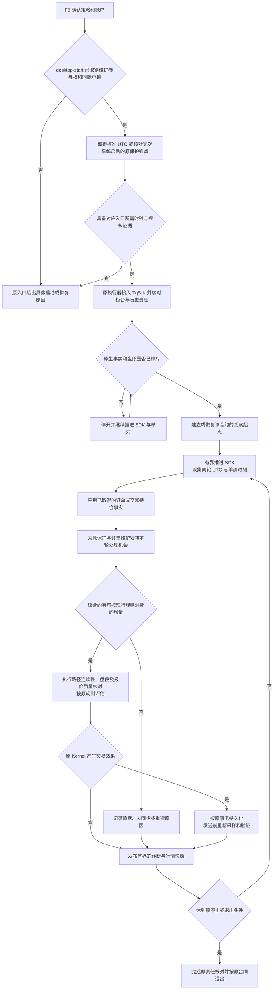
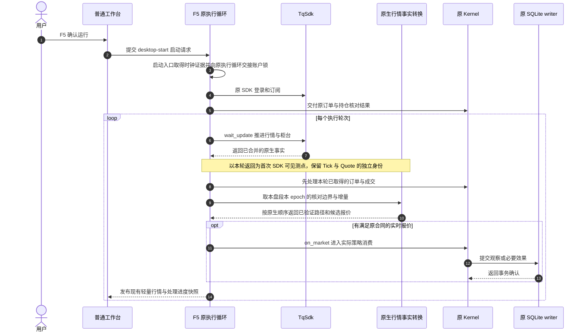
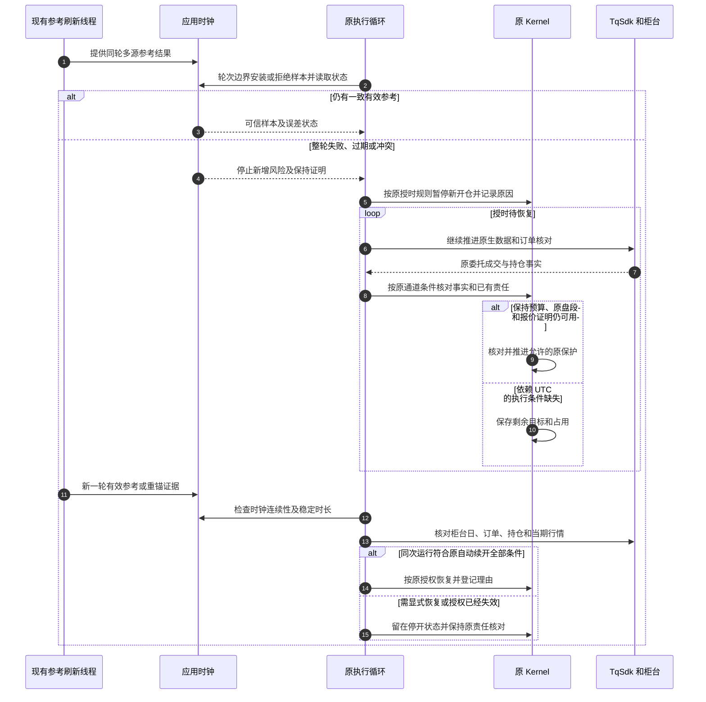
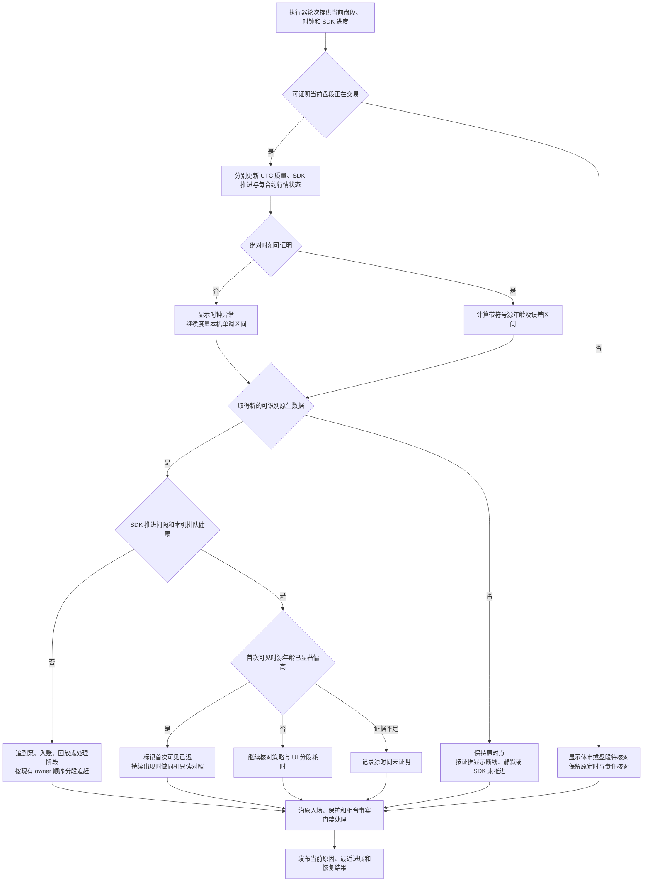
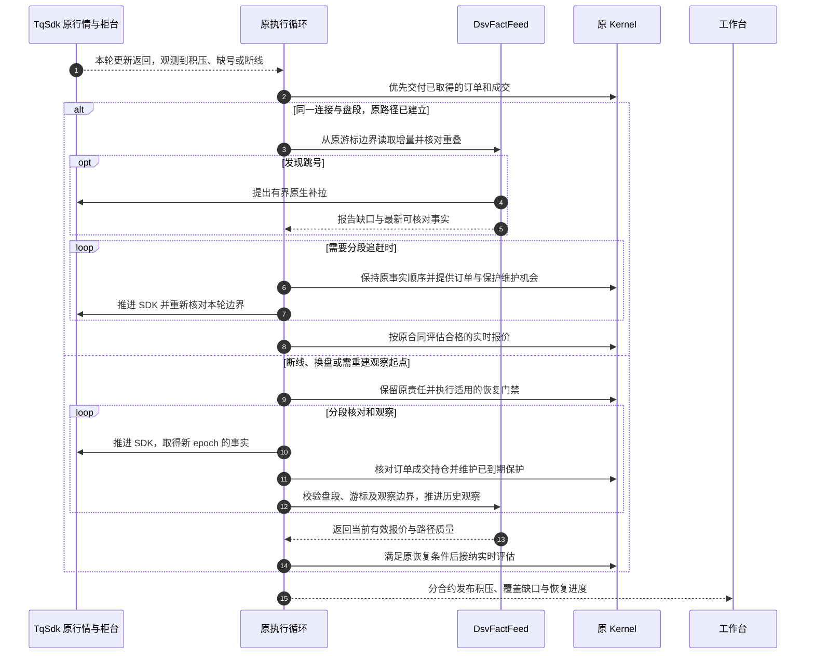
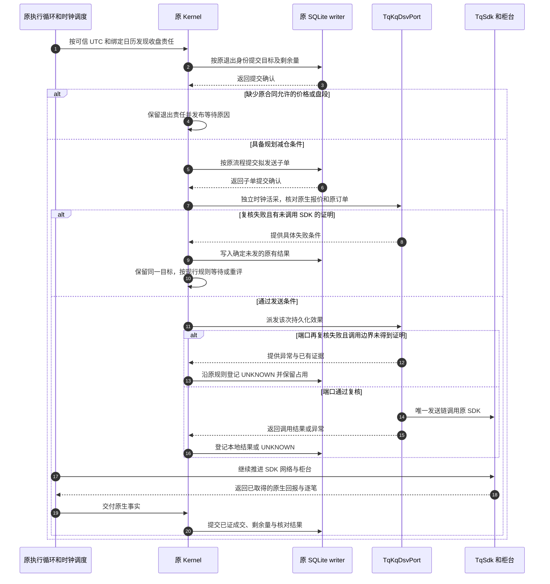
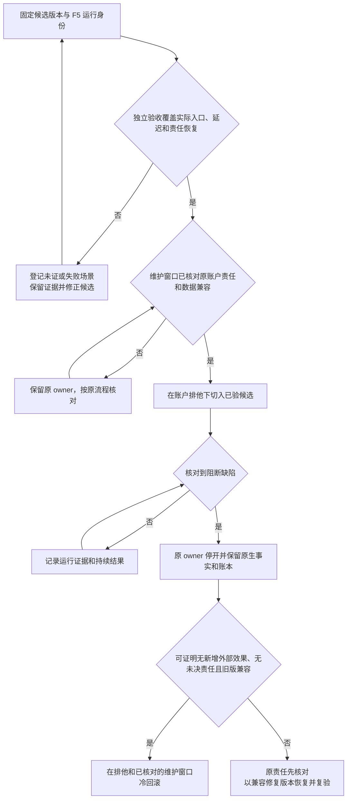

# OnlineTrader 时钟准确性与行情稳定性实施方案

2026-11-18 · 第 1 版评审稿 · 主线基线 `0cfd8270e3a55d00e4d31320e4acb7efcee3f360`

## 1. 用户目标和交付范围

普通工作台 F5 启动后，在正常行情线路和目标 Windows 设备上从开盘持续运行到收盘。应用用误差可解释的 UTC 判断交易时间，按合约识别合法的新鲜行情，策略处理延迟保持在预算内。盘中变慢时，工作台能给出受影响的合约、首次异常时点、原因和恢复进度。行情或时钟异常时，已有委托、持仓和退出责任持续按原入口的核对机制处理。

| 事项 | 实施决定 |
| --- | --- |
| 首发入口 | 普通工作台 F5 → `desktop-start` → `dsv_simulation.run` → `DSV_LEGACY_KERNEL`。以目标 Windows x64、Python 3.13、TqSdk 3.10.4 和当前配置为基线。 |
| 行情与时钟 | TqSdk 继续提供生产行情和柜台事实。复用 `CalibratedClock`、`ClockSample`、可信时间保持、原生 Tick 游标和现有工作台行情通道。 |
| 共用改动的责任 | 改动触及旧链共用代码时，覆盖 `dsv run` 与 `simnow run`。触及共享时钟或底层网关时，核对 `simulation run`、两条 `replacement-run` 和受影响的桌面定时入口。各入口沿各自既有 owner 和恢复契约验收。 |
| CTP 的启动条件 | 同机证据指向上游延迟，或 TqSdk 的源时间证据持续不足时，评估经授权的 CTP 只读对照。数据源切换另案评审，生产放行以 F5 + TqSdk 的证据为准。 |
| 数据与权限 | 使用现有账户锁、原 Kernel、原 SQLite writer、原日历和原保护。诊断输入只有观测权限。保持原 DSV 普通开仓、盘中缺号、保护、收盘及原停开合同。任何拟议交易差异必须列出证据、影响和批准记录。 |

11 月 17 日只读复现中，1,523 个更新有 1,333 个因时间戳领先本机而被拒，以同轮 NTP 时间重算后全部通过。这验证了慢钟造成的误拒机制。早盘缺失轮次缺原始戳。11 月 18 日 dev34 普通工作台在 14:59:40 触发退出，21 个减仓子单全部在发送前中止，现场构建提交未知。开发应分别验证时钟误判、盘中积压与发送前报价拒绝。 [慢钟复测](refactor/dsv-parity-20261114/29-clock-stability-and-four-contract-retest.md#原因与校时结果) · [收盘证据](refactor/dsv-parity-20261114/31-dev34-simnow-handoff-and-closeout.md#三项收盘复核)

主线已接入应用 UTC。旧链已有原生 Tick 增量读取、同会话缺号处理及分段重建，替代链已有单调计时和无报价维护。首批从实际 F5 的采集、策略入口、派发和工作台取证，逐项关闭源码与现场证据之间的缺口。 [时钟实施说明](clock-timer-implementation-20261117.md) · [24 小时修复进度](24h-critical-reliability-repair-plan-20261117.md#14-后续实现进度与现有规则复用) · [V2.1 开发规格](clock-and-timer-development-plan-20261117.md)

## 2. 执行责任和主流程

| 环节 | 现有责任方与接入点 | 方案职责 |
| --- | --- | --- |
| 启动和恢复 | `desktop/startup.py`、`runtime/desktop_bootstrap.py` | 从 F5 绑定授权、配置、日历、原账本和应用时钟。启动及接续仍使用原入口。 |
| SDK 推进与行情事实 | `DsvSimulationSession`、`TqKqDsvPort`、`DsvFactFeed` | 原循环推进 SDK，记录每轮时间和报价身份，检查增量、缺号和运行预算。 |
| 策略、委托与持仓 | 原 Kernel、原调度器和 SQLite writer | 先接纳已经取得的原生订单与成交事实，再评估策略与时间责任。所有效果经原事务、派发和柜台核对。 |
| 授时 | `CalibratedClock` 与原参考刷新线程 | 后台读 NTP，原执行器在轮次边界安装结果。使用同轮应用 UTC，发单前活采复核。 |
| 状态发布 | `MarketMonitor`、工作台行情 IPC | 读不可变快照。诊断采集和展示采用有界聚合，交易权限来自原 Kernel。 |

### 图 1 · 从 F5 启动到持续运行

图中的维护机会用于防止长批次饿死柜台推进。正常策略与收盘、分钟、部分成交的现有优先级由原入口保留。新切片点若改变实质顺序，须以冻结 DSV 和原生事实反例确定可用位置。 [普通工作台启动入口](../src/online_trader/runtime/desktop_bootstrap.py) · [旧链执行循环](../src/online_trader/runtime/dsv_simulation.py) · [替代链调度对照](refactor/dsv-parity-20261114/15-strategy-sdk-schedule.md)

### 图 2 · 正常行情从 SDK 到策略和工作台

## 3. 时钟样本和恢复

| 时间证据 | 采集和用法 |
| --- | --- |
| 决策 UTC | 从 `CalibratedClock` 取得。本轮日历、时段、授权、原生时效判定使用同轮 `ClockSample`。在现有发送边界重新活采。记录应用误差估计、参考年龄、采样夹持跨度、有效状态和 `clock_epoch`。 |
| 已经经过的时间 | 用同一单调域的差计算排队、泵间隔、等待和诊断迟到。进程重启和换机按已有恢复规则，保留原责任，禁止跨域直接相减或重置等待起点。 |
| 源报价时刻 | 同时保留原生字符串或整数纳秒与规范 UTC。策略原比较精度及配置 0 语义按各入口保留，秒级测量使用原始精度。异常未来时间保留带符号差和原因。 |
| Windows 系统时刻 | 记录独立偏移以诊断。TqSdk 3.10.4 的 Unix deadline 兼容换算留在 SDK 边界，单调采集实际等待和返回间隔。 |
| 冷恢复证据 | 沿用 `ProtectionClockAnchor` 的账户、路径与同一系统启动证明。加载后先核对原事实。无可信参考也无可用锚点时，沿原入口报告无法启动或接续的具体原因。 |

UTC 用途依据对应的状态字段判断。已有实现的开仓与保护状态独立，展示同样保留 `entry_ready`、`protection_ready` 和参考状态。诊断写入失败只改变观测可用性。 [应用授时实现](../src/online_trader/scheduling/reference.py) · [保护锚点与保持预算](../src/online_trader/scheduling/holdover.py)

| 事件 | 新开仓 | 已有委托、持仓和退出 | 恢复条件 |
| --- | --- | --- | --- |
| 单台 NTP 请求失败，整轮仍有一致有效参考 | 走原授权和时效检查 | 正常核对和保护 | 记录该源失败，使用通过的整轮参考 |
| 整轮无可用参考、样本过期或参考冲突 | 原授时暂停路径生效 | 守时预算和原账户证据允许时继续保护。原生事实及符合原身份、通道条件的撤单继续核对 | 按原刷新逻辑收敛。冲突重新校准保留独立候选观测 |
| 已超保护保持预算，或长调度间隔/唤醒导致连续性未证 | 保持停开 | 保留目标、已提交效果与 UNKNOWN 占用。需要可信绝对时间的新委托等待核对 | 重新证明 UTC、当前盘段、账本与原生状态。显式故障沿原恢复入口 |
| 短时授时暂停后重新可用 | 同进程原自动策略连续稳定至少 2 秒，再核对原授权、柜台日、订单持仓、会话及报价 | 按核对结果续管原责任 | 人工停止、重启、换日或需人工核对的故障按现有停开合同处理 |

初始核对以当前实现为准。常态刷新约 120 秒，失败后约 10 秒重试，开仓样本年龄上界 300 秒，保护保持上界 900 秒且受现有 1 秒估算误差预算约束。实际策略采用原比较符。性能证据中的 UTC 误差门槛与交易门禁独立评审。服务器独立性、参考合成误差、剩余校正量及休眠恢复都必须以实测和明确的质量来源支撑。可信区间无法计算或覆盖边界时，记录时间证据不足。 [实现及参数](clock-timer-implementation-20261117.md#时间合同) · [NTP 误差和同步距离定义](https://www.rfc-editor.org/rfc/rfc5905.html)

### 图 3 · 授时异常、保持和恢复

### SDK 等待与系统跳钟

应用 UTC 从交易判断中移除了墙钟依赖。TqSdk 3.10.4 仍在内部以当前 `time.time()` 将 Unix deadline 换为事件循环等待时长，回拨若发生在兼容换算间隙，单次等待可能变长。初版沿实际 F5 现用切片采集进入、返回、两轮间隔和当前参考状态，测出首次阻塞位置。若锁定版本的 Windows 注入能重复放大该等待，隔离在 SDK 泵适配点改为经验证的同线程单调截止机制，候选须覆盖无数据、正常推进、报撤单出站、断线回报、提前唤醒和 CPU 占用。仍未找到可保证进度的兼容路径时，该场景按未证明记录。主循环、NTP 与 GUI 都不得以强杀、并发调用同一 SDK 或启动另一发送者作为恢复。 [Windows 探针对照](clock-timer-implementation-20261117.md#诊断参数与证据) · [TqSdk 等待契约](https://doc.shinnytech.com/tqsdk/latest/reference/tqsdk.api.html#tqsdk.TqApi.wait_update)

## 4. 行情接纳、积压与断线恢复

### 行情数据合同

| 数据 | 来源与边界 |
| --- | --- |
| 事实身份 | `run_id + source_epoch + contract_id + trading_day + session_id + native_tick_id`。保留原生纳秒戳和原始字段。Quote 快照保留独立时间戳及收到的盘口。两类对象只有身份、精度与必要价量可核对时才配对。 |
| 首次可见时间 | 在同一 SDK 轮次返回后、行情转换和回放前，记录首次能证明本次新增数据可见的 UTC 与单调时刻。保留 SDK 轮次和游标边界。缓存读取、账户更新、旧快照和历史补回分别记类。身份无法绑定到首次可见轮次时标明证据缺失。 |
| 实际消费时间 | 在真正进入策略行情入口时用单调时间打点，区分实时评估和观察重建。M1 使用活采 UTC，或用同域的有效时钟样本投影到该测点并计入误差。跨时钟状态变化无法投影时保留 M2。用原生同条事件关联处理结束及接纳游标。 |
| 质量 | 同盘、来源连续性、源时刻、盘口和必要交易证明沿原合同评估。独立记录带符号源年龄、资料静默时长、SDK 连接活动和处理等待。诊断延迟本身不生成开仓授权或取消原保护责任。 |
| 游标 | 每合约保留已见边界与已接纳边界。正式观察游标沿既有提交成功的接纳点推进。回退、修订同身份、跨 epoch 和检查点不匹配沿原路径核对。队列深度只在有确切计数时报告，遇原生跳号单列缺口。 |

优先复用 `native_time_ns`、`native_tick_id`、`source_epoch`、`ClockSample` 和现有行情诊断。IPC 中已有纳秒字符串格式继续使用，诊断内部新增字段优先沿原扩展对象承载。 [原生 Tick 转换与接纳](../src/online_trader/gateway/dsv_facts.py) · [行情监控采样](../src/online_trader/runtime/market_monitor.py)

### 图 4 · 盘中迟到如何定位并处理

图 4 的告警可同时成立。最先变差的区间用于定位。TqSdk 的首次可见时刻是 SDK 返回测点，包含上游传输及 SDK 推进等待。只有泵间隔和本机数据转换正常时，才能用该区间将问题缩小到上游或 SDK 数据到达侧。

### 追赶和恢复规则

1. 正常盘中已证明观察路径时，只转换上次核对边界及其后增量。计时覆盖取数、排序验证、策略、提交和诊断发布。处理顺序保留合约内原生顺序与原业务优先级。
2. 同连接同盘段已有路径时，原生跳号按现行规则补拉并继续用经核对的新鲜实时报价判断。诊断保存缺口，禁止把补拉前后的报价当作已证明无缺失。冷启动、切盘、换 epoch 或检查点不能续接时，按原观察起点规则处理，证据未齐期间保持原停开。断线后原柜台事实核对完成且新行情有效时，可沿已有规则重新建立观察起点。 [策略合同](strategy-contract.md)
3. 重建沿用分段进度回调和现有启动追赶上限。首批测量现有 256 条检查粒度。若有可复现的占用过长，实施阶段在条数边界与单调预算中先到者安排维护机会，初测切片建议 20 毫秒。每次切片返回后优先推进原生订单、成交和已到期保护，重新核对来源 epoch、盘段和观察起点。预算属于调度参数，超时需记录具体阻塞调用，已有同步 SDK 或持久化调用的完成由其原契约决定。
4. 追赶完成后再校验真正实时且同盘的 Quote 与 Tick。过时批次按原观察路径更新已获证明的历史状态。队列或历史窗口超限时记录覆盖损失、等待时间和后续恢复点。策略必要事实保留原接纳规则，诊断和界面允许合并显示。
5. 休市、开盘集合竞价、午休复盘、夜盘跨自然日分别走绑定日历。重连时隔离旧 epoch 的观测与价格，保留同账户原责任。柜台日缺少独立事实时使用原日切屏障。 [分段恢复实现](../src/online_trader/runtime/dsv_simulation.py) · [原生增量与补拉](../src/online_trader/gateway/tqkq_dsv.py)

### 图 5 · 高峰追赶、重连与恢复评估

## 5. 收盘退出与临发单校验

收盘路线沿旧 Kernel 调度器。当前 UTC 和绑定日历触发既有收盘责任，使用原周期、授权和收盘事件身份持久化。触发之后继续用原生事实更新剩余量，临发单确认当前盘段、柜台日、订单归属、未决占用、盘口与报价时效。最终关闭以原生成交和原生终态核对为准。 [旧链收盘调度](../src/online_trader/kernel/scheduler.py) · [旧 Kernel 派发](../src/online_trader/kernel/engine.py)

复现 `E_NATIVE_QUOTE_NOT_CURRENT` 时，为原退出身份、决策、子单和发送尝试串起同一条证据。拆解原门禁为源时戳及带符号年龄、报价和当前盘段、盘口及涨跌停、委托价与价格档位、出处和复核时点。按现有语义区分四种进度。

| 进度 | 记录与处理 |
| --- | --- |
| 退出责任已提交，当前缺少可用价格或盘段 | 保留剩余目标准备下一轮核对。UI 给出等待原因，原生事实继续处理。 |
| 有可证据关联的发送前中止 | 仅在能证明没有调用 SDK 下单时使用确定未发的现有结果。重新评估仍走同一退出目标，按原屏障核对剩余量、时段和新的合法报价。 |
| SDK 调用已开始，尚无可核对终态 | 区分本地调用返回、SDK 推进后可观察的出站/回执和未决结果。异常或证据不足进入原 UNKNOWN 核对，保留占用。 |
| 原生事实证实目标完成 | 按原逻辑验逐笔、剩余数量、委托终态和仓位。部分成交继续管理剩余量，撤单请求或暂时未查到订单保留原责任。 |

旧链在 Kernel 的派发检查和端口内部都可能复核。首批只记录发生在哪个位置及具体失败。任何扩大“确定未发”证明范围的改动，须保留可核对的 SDK 调用边界及原订单身份，再单独确认。 [旧网关验证及 SDK 调用](../src/online_trader/gateway/tqkq_dsv.py)

### 图 6 · 收盘触发、报单和失败处置

## 6. 观测、性能预算和用户界面

### 可复核指标

| 指标 | 起点 → 终点 | 初始验收口径 |
| --- | --- | --- |
| UTC 质量 | 应用 UTC 对照可信参考 | 记录绝对偏差、参考可信误差、保持状态和误差预算。建议初测以应用侧可证明误差不超过 100 毫秒作为秒级测量预算，基线不足时调研实际授时能力。它独立于现有交易门禁。 |
| M1 行情到策略 | 已确认语义的原生事件 UTC → 该实时事件实际进入策略 | 正常活跃盘段按合约 P99 ≤ 1,000 毫秒，以误差上界判断。报告上游首见、SDK 推进、处理耗时及最长连续超标。 |
| M2 本机处理等待 | SDK 返回后首次可见 → 同一事件实际进入策略 | 单调计数。初测目标 P99 ≤ 100 毫秒，以实际 Tick 转换、策略入队和执行器负载核实。当前 F5 约 50 毫秒的 SDK 等待切片在首次可见测点之前，单独度量。 |
| M3 工作台 | 行情快照已可用 → 用户可见更新 | 复用现有约 1 秒行情监控定时器，测发布、客户端接收及实际显示。完整业务快照沿原节奏。跨进程耗时只有在已证明同机同单调域时相减。 |
| 持续运行 | 开盘、盘中、尾盘各窗口的进度 | 按合约对照活跃时段固定 15 分钟组和整盘统计。记录最近有效进展、待处理数量/不可计数原因、峰值、连续超标时间和回到预算的时长。运行后段不得出现持续堆积。 |

M1 每样本用 `策略开始 UTC - 源时刻 UTC + 应用 UTC 误差上界 + 源戳误差上界` 作保守值，记录原始带符号差。源戳含义与误差须由目标行情源协议或独立证据给出。小数位提供存储精度。来源语义、精度或误差未能证明时，M1 标为 `NOT_PROVED`，并保留可证明的 M2。只读影子消费者的时间单独记录。 [V2.1 延迟目标](clock-and-timer-development-plan-20261117.md#192-1-秒如何精确定义及验收)

统计同时保存总可见事件、独立实时事件、缓存和重复、补拉、缺口、未消费及无法配对各类数量。把实时分母中缺少合格耗时的样本置于分位排序末尾，P99 取 `ceil(0.99 × N)` 的位置。若该位置落在未知样本范围或分母无法证明，则标 `NOT_PROVED`。正常窗口按日历、授权和连接场景预先定义。每组至少 100 个样本才独立判断 P99。稀疏时合并同盘段相邻窗口并标记覆盖。分组报告 `N / P50 / P95 / P99 / max`，记录连续迟到及恢复时长。

首版把明确可见、仍未消费且单调等待超过 1 秒的实时事件记为本机积压，从首条超标到恢复可接受等待计算持续时间。放行比较各合约的整盘与有效分组，分别核对开盘初段、运行后段和实测高峰。正常分组须达到定稿后的时延预算，跨连续分组仍未解除的积压需要定位和复测。

### 日志与显示

- 执行循环记录泵间隔、Tick 转换、重建、策略和 SQLite 提交的分段时间。复用现有 `MarketMonitor` 诊断，在原生身份无法关联时报告原因。每次运行绑定候选 SHA/制品哈希、入口、引擎、依赖、源/时钟 epoch、日历和配置哈希。
- 关键拒绝、首次异常和恢复保留关联 ID、实测值、适用阈值和进度。重复事件可聚合。分位统计和状态在内存有界聚合。诊断写盘按批轮转，若证据显示同步写阻塞原循环，改由只读记录通道异步排出，报告丢样而保留正式账本写入顺序。磁盘满时区分诊断失败与原账本提交失败。
- 在现有实时行情表中按合约显示最近有效源时间、当前新鲜度和影响交易的具体原因。异常时提供“等待原生报价”“本机处理积压”“授时待核对”等可追查的状态。总览同时提示受影响品种数量，详细分段和 UTC 质量按需展开。刷新旧缓存会保留原源时点。
- 证据只保存所需的脱敏身份、配置哈希、时间质量、症状和关联记录。连接地址、凭据和完整账号不进入 UI 诊断输出或对外报告。 [实时行情控件](../src/online_trader/desktop/workbench.py) · [行情监控实现](../src/online_trader/runtime/market_monitor.py)

## 7. 实施顺序和交付点

| 批次 | 依赖与范围 | 文件级任务 | 实施完成依据 |
| --- | --- | --- | --- |
| S0 固定证据与优先级 | 当前主线、F5、现有历史记录 | 按实际调用顺序列出时间读取、Tick 接纳、原生事实和发送前检查。用 dev34 记录定位首个失败阶段，缺现场输入时列出最小采集字段 | 版本、入口、已有规则、影响场景及首个可验证假设可追溯 |
| S1 观测与诊断 | S0 | `runtime/dsv_simulation.py`、`runtime/market_monitor.py`、`gateway/tqkq_dsv.py`、`kernel/scheduler.py` 和工作台行情通道接入同事件分段计时、时钟质量、收盘复核明细 | 代表性迟到或拒绝可定位到环节和条件，录制与展示保持有界 |
| S2 校准与盘中处理修正 | S1 已定位的差异 | 复用 `scheduling/clock.py`、`scheduling/reference.py` 的采样。按实测处理不一致的取时、SDK 等待、回放、Tick 转换或同步诊断阻塞。保留原提交与柜台事实屏障 | 每个改动对应一次可复核的首个偏差，正常 DSV 规则与原先优先级通过受影响范围检查 |
| S3 收盘派发与恢复 | S1 的实际失败位置和 S2 如需的基础修复 | 在 `kernel/engine.py`、`gateway/tqkq_dsv.py`、原调度器修正已证的临发单差异。复用原退出目标和回执 | 真实入口可追踪触发、提交、复核、发单、收报、成交与终态。无价、休市及 UNKNOWN 时原责任可追溯 |
| S4 Windows 持续观测与放行 | S2、S3 的候选及相应授权 | 普通 F5 使用认可的 Windows 环境独立验收。固定日盘、晚盘、复盘窗口及高峰。触及共用模块时补相应入口 | 时钟、实时/迟到、原生派发及责任恢复各有证据。报告首尾表现、失败/跳过项和未证范围 |
| S5 上游只读对照 | S1 已将问题缩小到首次 SDK 可见前后，且设备、连接、时钟与本机推进已核对 | 同机比较 TqSdk 与具备前置权限、时间字段和许可证明的 CTP。沿 V2.1 SHADOW 方案记录两个来源的独立质量、可比样本及源字段语义 | 出具线路证据和收益/限制。无证源戳或无法对应的快照独立计数。切主源另行走评审 |

S1 和 S3 优先使用实际入口已有的关联数据，先定位已知尾盘故障。源戳语义、Windows 目标设备、误差预算和负载数据在验收基线时确认。无法取得外部证据时，本机时钟及持续处理工作仍可推进，相关线路指标保留未证明状态。涉及交易行为、持久化或 SDK 升级的待定方案在该批编码前完成影响走读。

编制期间原工作区出现尚未提交的 `QuoteTrace` 和 `market-quote-trace.jsonl` 诊断实现，已覆盖部分 SDK、Tick、工作台和临发单测点。选定候选后优先核对并复用该实现及现有 `tick_diag`，补齐同事件的首次可见至策略开始关联、时钟质量、整盘统计和启用诊断后的写盘开销证据。方案基线仍为已提交主线，此处在研代码仅作为接入线索。

## 8. 独立验收计划

以下场景为拟执行计划，当前状态均为 `NOT_RUN`。测试在本次范围另获授权后，由未参与实现的测试 Agent 按独立测试技能执行。基线、候选和必要原版对照都记录完整 SHA、实际入口、依赖、日历、配置、环境、样本与原件哈希。正常行为预期来自已认可的策略合同、冻结 DSV 和真实原生资料。

| 场景 | 入口或证据 | 可复核结果 |
| --- | --- | --- |
| A01 慢钟与轻微未来报价 | F5 全输入链，用已脱敏现场形状和可注入时钟 | Windows 墙钟慢约 0.97 秒时，合格报价按应用 UTC 接纳，原戳保留。时间倒退、跨盘、异常未来以及原有年龄边界各有明确结果。 |
| A02 单台参考失败、整轮失效、冲突和重锚 | 时钟输入夹具与 F5 | 只读诊断故障、单源失败但仍有一致样本、整轮不可用分别验证。原停开、守时、预算到期和续开条件逐项核对。 |
| A03 Windows 墙钟跳变和无行情 | 固定 SDK 版本的 Windows 原入口 | 覆盖换算前与换算后的前后跳。记录绝对时间、SDK 泵时长、业务截止及空行情维护，长等待可定位。 |
| A04 休眠、恢复、进程重启、换机 | Windows 及隔离账本冷副本 | 核对同次启动锚点、过期/不匹配、恢复所需柜台事实、已有保护和授权边界。 |
| A05 从盘前到盘中久跑 | 正常 F5、四个获准合约的日盘和夜盘 | 逐合约报告开盘、盘中和尾盘各窗口的 M1/M2、进度、持续超标、恢复、CPU、RSS 和 SQLite 耗时。无未解释的累积延迟。 |
| A06 历史规模、高峰流量及日志或界面变慢 | 已知基线的代表性高流量和大量既有事实 | 确认首次瓶颈，分段兼顾柜台事实和保护。没有界面或诊断导致的正式事实缺失。正常负载恢复后可追到实时。 |
| A07 短暂缺号与追赶 | 同连接已建路径、冷启动、超出可补窗口 | 已建路径缺号仍按原合同处理合法实时报价。未证明覆盖、补拉及回放原因可见。没有历史新开仓或重复分钟消费。 |
| A08 断网、重连、盘次及自然日切换 | 原入口同步与原生事实对照 | 连接与每个合约静默独立，旧 epoch 无执行权限，核对后可恢复原观察起点。真实柜台日缺证时保留原屏障。 |
| A09 尾盘禁开和持仓实际退出 | 经授权的 SimNow 普通工作台 | 分别验证禁开、收盘触发、最终复核、实际减仓发出、逐笔与原生终态。无报价、过时盘口、休市、部分成交和迟到回复均保留正确责任。 |
| A10 准备成功后拒绝、提交失败或派发异常 | 故障注入与隔离账本 | 能区分确证未发、已调用与 UNKNOWN。提交失败无副作用，撤单请求保留占用，重启核对不重复发单。 |
| A11 行情表可见状态与拒绝溯源 | 普通 Windows 工作台可见流程 | 单个合约迟到、授时待核对、真断流、自然静默和快照过期可辨认。报价和画面超时均可从同一身份追溯。 |
| A12 共用模块与已认可策略行为 | 受影响的旧链、替代链及冻结 DSV 回放 | 记录各入口真实引擎。配置 0、盘中缺号、日停、开收盘及撤单/成交序列保持已有合同。涉及慢部分成交时复用第 7 和 9 轮固定回放。 |
| A13 只读上游对照 | 仅在 S5 条件成立后执行 | 各源时间语义、缓存首帧、断线与质量未知可证明。采集失败或溢出不会改动原交易链授权。 |

整盘验收采用实际 F5，包含开盘活跃期、午休复盘、盘中和尾盘，另覆盖夜盘。历史四合约作为固定回放夹具，现场使用本轮授权的合约和环境。采集方案保留初始故障与复测之前的原件。授权或自然场景缺失时登记 `SKIP` 或 `NOT_RUN`。资料不足以证明性能时登记 `NOT_PROVED`。发布记录逐项给出 `PASS / FAIL / SKIP / NOT_RUN` 以及未证指标。功能验收、模拟账户操作和制品打包各按项目约定单独取得授权。

## 9. 兼容、上线和回滚

兼容以原账本、授权和保护实例为核心。S1 使用可选有界诊断快照与现有记录通道，核对新旧工作台和 IPC 容量。优先沿用可选诊断字段，遇严格协议时用现有版本机制。首批设计无需升级交易账本。实现若确需改动持久结构，应先评审原 writer 兼容性、冷副本迁移、旧版本拒读和交易事实保全。每次发布核对账户锁和未决责任，按项目约定验收最终制品。

### 图 7 · 候选放行与回滚

新增委托、成交和 UNKNOWN 按当前已持久化事实恢复。老快照仅用于取证，不覆盖继续推进的账本。发生诊断资源故障时保留原控制路径。出现交易责任故障时沿原有 STOP、回查及持仓保护链处理。现场报告记录明确的操作、结果与替代方案兼容性。 [V2.1 回滚约定](clock-and-timer-development-plan-20261117.md#173-回滚原则) · [原替代入口与回滚契约](refactor/dsv-parity-20261114/10-sdk-startup-and-same-day-rollback.md)

**评审确认项**　核对 S1 的同事件测点和临发单观测范围，确认目标机及行情源证据，审查切片是否影响现有策略顺序，确认秒级性能分母和误差预算。实现批次按这些结论填写变更及验收记录。
