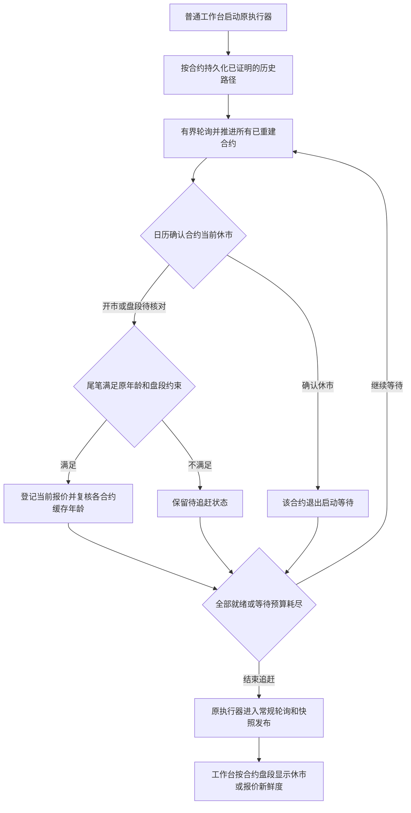
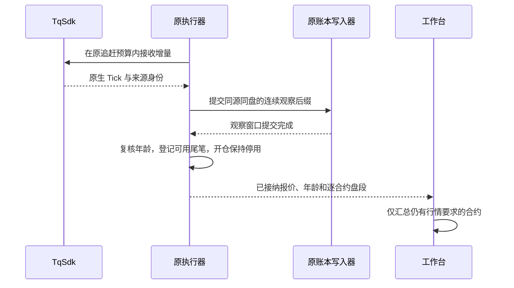

# 时钟、计时器与无行情维护实施说明

[开发规格 V2.1](clock-and-timer-development-plan-20261117.md)已在 2026-11-18 补充独立 NTP 可信 UTC、CTP 行情 SHADOW 接入和「新行情发生→策略开始处理 P99 ≤ 1 秒」的拟验收目标（详见主计划第 19 节）。此前 V2.0 审查基线为 `01ecddaa43e6a1dde27ce9878de2f55e72fb3314`；本说明下方原实施事实保留其发生时的版本语义，**不表示 CTP 已接入或秒级性能已通过**。固定反例使用含该源码的文档提交 `c8f03360a50f74df7e9b74dfeccdb765fed92585`。第一版替代运行链候选为 `1f1ef797426661ad1f55e9d33b888a98755f3ca8`，其后续候选应以独立验收记录的完整 SHA 为准。

## 时间合同

| 事项 | 起算点与判断 |
| --- | --- |
| 当前会话、授权与开盘等待 | 取 SDK 泵返回后的同轮应用内 UTC，与明确归属的日历核对。普通开盘等待包含结束边界，延续开仓的独立开盘等待条件保持严格上限。 |
| 开仓确认与被动等候 | 两者从本地提交的开仓目标起算。确认仅覆盖零成交阶段，严格大于配置秒数。被动等待默认 3 秒且包含等号。已经取得的成交及归属事实优先应用。 |
| 保价和节流 | PASSIVE / CAP 上下文从创建或从 PASSIVE 转 CAP 起算，有效至 90 秒边界。同向开仓节流从上一个目标建立起算。止损冷却从触发该次止损的本地决策起算。 |
| 保护退出同步 | 从登记保护退出起算，5 秒及原生空仓、订单、逐笔共同决定同步。源规则仍触发时，新的报价状态可以再次确认目标。轮询同一份缓存不会反复刷新起算点。 |
| 收盘阶梯 | 持仓第一次满足实际收盘窗口时锁存，阶梯按窗口长度减去首次登记后的单调时间计算。刷新至少间隔 3 秒，保留冻结策略每次更新价位后的最多六次原生仓位检查。检查随现有 SDK 泵推进，实际经过时间由单调计数取得。 |
| 静默与首份快照 | 各合约单独保存源身份、有符号年龄和最近不同报价的单调时点。批次只含账户更新时保持报价锚点。年龄配置 0 保留既有关闭语义。 |

冻结取证中的开仓等待、撤单与成交顺序、PASSIVE / CAP 默认时限见[策略证据](strategy-dsv-evidence.md)。AGGR1 和 MARKET 的有效上限分别是 60 和 120 秒。替代链依据最近一次收盘上下文更新检查该上限，逾期回到 ACTIVE 计价。实时柜台对价格上下文和长时间断线的行为仍须独立验证。

对无法证明现有 UTC 的异常样本停止新增风险。单调时间仍能证明同进程等待，已经取得的成交、订单身份和 UNKNOWN 占用继续保留。时钟回拨不会恢复已经观测到期的同一份授权。行情、系统时间和独立参考的状态分别显示。

应用内 UTC 由至少两个一致的 NTP 响应建立，再按单调时间推进。正常每 120 秒刷新，失败后每 10 秒重试。刷新失败、样本年龄达到 300 秒或新旧参考相差超过 250 毫秒时停止新增。偏差在限幅内时逐步调整。

同一执行器内已获开仓权限的自动策略仅因授时失效暂停时，可信时间连续稳定至少两秒、原授权时窗和柜台日仍匹配、柜台已同步且有可用的当期报价后，才可恢复原权限。未决委托或持仓不符时继续等待核对。人工停止、执行器重启、换日和需要显式时钟恢复的故障均取消自动恢复。恢复动作和原因记入原账本。

原账本仍有未结责任时，可在同一次操作系统启动内使用绑定到账户和账本路径的 UTC 锚点恢复。恢复延用已生效的 UTC 和剩余校正量。保护委托的时间门禁以最近可信参考为起点，最多 900 秒，估算误差预算为 1 秒，按每秒 100 微秒计入保持期间的漂移余量。超出门禁后继续接收、核对原生事实，依赖有效 UTC 的新委托暂停。柜台日及同账户原委托和持仓核对仍按各执行链的既有契约执行。

## CTP 行情集成后续实施边界（V2.1 增补）

- 现有`CalibratedClock` 的可信 UTC 和单调等待仍是策略判断时间；CTP `UpdateTime/UpdateMillisec` 是行情发生时刻，不作为授时来源。
- `CTP_MD_SHADOW` 只读行情观测为先：确认授权行情前置、绑定版本、字段/日历、跨日、订阅回调、重连、队列背压及同机 TqSdk 对照；不得导入第二发送者或修改原 Kernel/替代链的下单来源。
- 「≤1 秒」为有新行情时事件发生至 owner 开始处理的 P99 实测目标，不保证每秒产生一条 Tick；同步报告行情源年龄、接收→owner 延迟及界面 1 秒轻量更新的独立指标。
- `CTP_MD_PRIMARY` 需要另行审批、完成 DSV 全输入链一致性和报单前同源报价校验，尤其不能绕过现有 `E_NATIVE_QUOTE_NOT_CURRENT`；未经验收保持 TqSdk 权威行情。
- 本增补为 **PLAN_ONLY / NOT_RUN**，无代码、SDK、账户、CTP 服务或交易状态变更。

## 操作入口

- `simnow replacement-run` 和 `dsv replacement-run` 使用原替代控制器和 Journal。运行目录的 `runtime-identity.json` 记录入口、引擎、时间合同和当前解释器版本。构建 SHA 缺少证明时，使用该进程的源码清单哈希或冻结可执行文件哈希。
- 桌面 F5 仍从 `desktop-start` 启动原 Kernel。界面可查看执行入口与引擎，原账本继续由原 owner 使用。
- 普通工作台的「连接与行情 → 实时行情」按合约显示 SDK 原始时间、带符号差值和时段核对结果。诊断使用已缓存的 SDK 报价，保留原内核用于交易的行情字段和新鲜度判定。
- 联网偏移计算继续以同盘、完整日线和可核对的当日高低为前提。只读计算入口超过 15 秒的陈旧与领先分别提示，缺失或无效时间、跨盘、日线未齐和振幅未齐也分别提示。开始重算即撤下旧结果，保留数据缓存供主动重算。该领先界限只适用偏移计算，不改变各交易入口的年龄策略。
- 旧替代账本停机并核对后，用 `offline-dsv clock-migrate --source <原替代账本> --target <新账本>` 生成一致性冷副本。旧文件仍可供只读比对。替代入口启动前确认 v3，既有旧 writer 会拒绝打开 v3。未能证明的旧起算点在原生核对后标记 `TIMER_RECOVERY_UNCERTAIN`。
- 替代工作台在同步原生事实、观察到连续时钟后显示恢复操作。恢复成功仍保存停开状态，开仓沿用现有独立授权。退出目标可在缺报价或休市时登记，名义参考没有合法价格时保持未确定。
- 核对系统时间用 `scripts/clock.ps1 -Measure -Output <新文件>`。维护者完成原生账户核对并退出交易程序后，可显式执行 `scripts/clock.ps1 -Sync -ScopeFlatConfirmed -Output <新文件>`。前后独立测量由同一维护锁保护。用 `-WhatIf` 检查停机互斥，用 `sync-clock-once.ps1 -Watch` 持续只读观测系统状态。便携目录的交互入口使用同一维护协议。

## 诊断参数与证据

普通工作台的行情取证使用交易参数里的「逐行情诊断」（`tick_diag`）。保存测试参数并启动执行器后，从本次运行目录读取 `market-quote-trace.jsonl`。文件按 4 MiB 轮换，保留当前和上一份。每批记录带执行器启动身份、Windows UTC 和单调时间。毫秒上限按原配置记录，纳秒计时值以十进制文本保存。

沿同合约、来源 epoch 和原生 Tick 身份核对 `SDK_QUOTE`、`TICK_BATCH`、`ACCEPTED_TICK` 与 `WORKBENCH_QUOTE`。`sdk_wait` 区分 SDK 调用耗时和两次调用之间的间隔。`REPLAY_PATH` 和 `OWNER_LOOP_SLOW` 记录重建及慢轮次。报价显旧时同时看 SDK 源报价年龄和工作台接纳缓存年龄。`NATIVE_QUOTE_REJECTED` 记录实际复核失败的年龄、盘段、价量或行情身份。报单前拦截还带开平标志和子单身份，可与账本中的 `SEND_ABORTED` 对照。

### 普通工作台启动追赶与休市显示

dev35 夜盘事件中，白银已接纳报价停在 22:54:59.500，工作台于 22:55:11 显示滞后，随后执行器才追上已经存在的连续 Tick。普通工作台原来的启动循环把已登记首笔报价的合约从追赶集合移除，其他合约仍在追赶时会跳过这些合约的新 Tick。23:00 后，工作台又把四个有旧报价的休市合约计为滞后，虽然同一快照已标明它们处于休市盘段。

原执行器继续拥有行情、开仓权限、保护和账本。追赶保留最初观测起点，每个后缀核对来源、盘段、逻辑序号及原生身份递增。已有持仓仍由同一执行器按已接纳的有效尾笔及现有发单复核继续保护。追赶期间日历明确证明当前休市的合约退出等待，日历未知的合约继续受原时效和盘段约束。超时后进入常规轮询，未取得新鲜报价的合约继续按原时效规则等待。工作台兼容缺少逐合约盘段字段的旧快照，回退沿用当前账本和 IPC 结构。

可验收场景包括开市合约先就绪后继续来 Tick、另一合约拖到追赶上限或在追赶途中休市、报价确实过时或来源切换、以及部分和全部合约休市。首个场景应接纳等待期间的连续新 Tick，原观测起点可从账本核实。异常场景应继续尊重时效、来源和盘段。已证实休市的合约从启动等待和界面滞后汇总中移除，仍开市的过时合约保留告警。追赶退出日志记录当前报价就绪、休市和仍待追赶的合约。

SDK 驱动切片上界初始为 500 ms，严格截止点使用至少 1 ms 的调度下限。替代链默认应用 UTC 与单调时间的差分阈值为 2 秒，调度间隔提示阈值为 15 秒。运行诊断每 60 秒汇总。生产硬件上的最大迟到、授时、负载及磁盘预算仍需根据实际观察确认。

锁定的 TqSdk 3.10.4 将 Unix deadline 用当时的 `time.time()` 换算成事件循环时长。独立 Windows 注入探针证实，换算前回拨可以拉长单次 SDK 等待，换算后的等待按事件循环的单调时间推进。原执行链和替代链都由各自的单一 owner 驱动 SDK。

收盘参考回放固定了归档中 `StrategyThread._wait_position_closed` 的字节码，并让其实际嵌套 SDK 泵消费同一有序输入。定时点、原生事实和真实出站轮次分别用于判定。使用 [串联回放命令](refactor/dsv-parity-20261114/15-strategy-sdk-schedule.md) 验证固定样本，并增加 `pipeline-final-close` 与 `pipeline-close-late-ack`。

证据按 Windows 源码、实际 Qt/IPC、冻结 DSV、模拟柜台和制品记录。固定候选的计数和未执行项见对应独立测试报告。当前交易日缺少独立柜台证明时，替代链保留获准交易日及已有责任，自动换日范围仍须单独核实。

按 E02 登记的无价收盘退出，在核实原生空仓和订单终态后可以结案。回执保存原日历退出身份及 `SESSION_CLOSE_REFERENCE_UNAVAILABLE`，该笔名义收益和净亏增量为未确定，已知值汇总保留。实际平仓价格、数量和由真实成交推导的点差继续在成交及资金侧记录。
