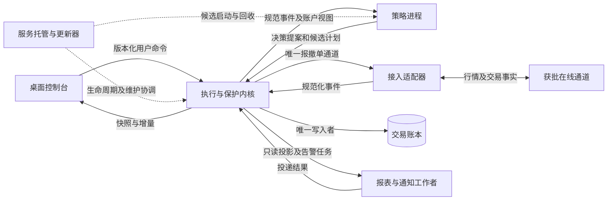

# 在线量化交易软件：架构设计与实施拆解

日期：2026-11-09（Asia/Shanghai）  
产品暂名：OnlineTrader  
状态：架构规划稿；本轮完成材料静态核对与实施拆解，尚未开始新产品编码、通道试验或运行验收。

后续细化见 [G0开发规格入口](../g0/README.md)：状态机、数据模型/SQL、IPC/Schema、保护计划/Schema、96项追踪和业务确认表已形成工程规格，业务规则与通道能力仍待相应批准/验证。

## 1. 本轮结论与文档关系

建议采用**独立 Windows 产品、常驻执行与保护内核、可替换策略进程、独立桌面控制台**的架构。先落实状态所有权、交易身份、持久化、保护和接入完整性，再扩展全部策略及操作功能。最小闭环用于验证底座，最终交付范围仍为全部 96 项能力。

| 材料 | 本计划中的地位 |
| --- | --- |
| [全功能覆盖与实施计划 v0.3](在线量化交易软件_全功能覆盖与实施计划_v0.3.md) | 功能范围与交付标准；A/M/S/P/R/O/D/C/V/N/U/L 共 96 项，不缩减 |
| [开发设计说明书 v0.2](https://github.com/Yoruto/Futures-Trading-Assistant/blob/a6cc369c86ada924e26dce369a9dbfe87ffa55bc/docs/%E5%9C%A8%E7%BA%BF%E9%87%8F%E5%8C%96%E4%BA%A4%E6%98%93%E8%BD%AF%E4%BB%B6_%E5%BC%80%E5%8F%91%E8%AE%BE%E8%AE%A1%E8%AF%B4%E6%98%8E%E4%B9%A6_v0.2.md) | 技术架构基线；本稿细化模块、事务、依赖与开发任务 |
| [规则裁决表 v0.3](在线量化交易软件_规则裁决表_v0.3.md) | B01–B20 的当前候选解释；全部仍为 PROPOSED，未成为生产规则 |
| 用户提供的参考软件目录 | 静态功能线索与设计输入；不等于动态验证、业务授权或可复用源码 |
| [V7 当前状态](https://github.com/Yoruto/Futures-Trading-Assistant/blob/a6cc369c86ada924e26dce369a9dbfe87ffa55bc/docs/V7%E5%BD%93%E5%89%8D%E7%8A%B6%E6%80%81%E4%B8%8E%E5%BC%80%E5%8F%91%E8%AE%A1%E5%88%92.md#版本冻结2026-11-07)及现有源码 | 工程经验与反例来源；rc.41 保持冻结，新产品独立重验 |

本稿不替代 v0.3 的范围归属或规则批准记录。来源材料里的启动、自启、下单、校时、发布等操作说明只作为分析对象，不作为本轮执行指令。

目标工程仍建议为 `E:\online-trader`，本轮不创建代码工程。首版任一时刻只有一个账户/通道拥有本实例交易权，可保存多个账户档案；正式策略一套，切换时可额外运行一个无交易权的 SHADOW 候选。支持多白名单品种；容量至少按 11 合约规模验证，生产名单另定。不增加多账户并发、回测、寻优、AI 自主下单或双机自动接管。

## 2. 参考软件核对对设计的影响

参考目录：`C:\Users\xyc\Desktop\trading`。本次只读目录、配置结构、说明、脚本正文、状态字段和现有日志，没有启动 EXE、执行附带脚本、反编译业务代码或干预正在变化的状态文件。

`trading.exe` SHA-256 为 `aabeafd83d265ab9b1cf5cc3fd0e9b0f21963ddcc95daa70feefc209997269a3`，与 v0.3 的 LOCAL 来源身份一致。可见证据分为以下几类：

| 静态证据与定位 | 能支持的结论 | 新产品承接 |
| --- | --- | --- |
| `config.json:22–110`、`:137` 起：风控、保护、半仓、延续开、参数计算、定时及合约配置 | 有这些配置入口，不能证明各分支实际正确 | 参数用 schema、单位、显式模式和版本管理；所有开关两侧均纳入验收 |
| `logs/trade_2026-11-09.log:153,166`：记录 18.0/20.2 秒主循环耗时，并提示停止需要等待 | 原日志记载存在长等待；本轮未重现，不能据此确诊根因或测算新系统收益 | 历史查询、主力扫描、计算器、报表与通知移出交易关键路径；控制命令有独立队列 |
| 同日志 `:161,165`：分别写只提醒不自动换月、下次启动策略切换新主力 | 换月说明存在口径冲突，不能推断实际行为 | 执行合约、候选主力、已确认下轮合约分列；旧仓保护始终绑定原合约，不自动搬仓 |
| `state/daily_2026-11-09.json:1–23`：日状态及统计字段 | 可见文件是统计线索，不能证明完整交易身份与恢复能力；读取时状态可能继续变化 | 事务账本保存订单、成交、计划、未知发送、权限与预占；统计从事实重建 |
| `钉钉推送使用说明.txt:45–73,108–120`：节流及声音开关耦合说明 | 说明声明的通知机制，未做发送验证 | 事实 ID 去重、持久 outbox、独立风险通道；凭据与可导出配置分离 |
| `成交对照.bat:5–12`、`可选_自启动守护/DSV守护.bat:2–10` | 可见 CSV 成交对照入口，以及按进程名轮询拉起的脚本 | 保留可发现的成交对照工具；守护检查业务推进、维护锁和真实执行身份 |
| `_internal/python314.dll`、`_internal/tqsdk-3.10.2.dist-info/METADATA:2–3` | 发行包文件与元数据指纹，不能证明实际加载或新工程兼容性 | 独立兼容矩阵及锁文件，不复制参考软件运行环境 |

不复制参考软件配置值、账户数据、设备身份、凭据、密钥或闭源实现。原始 PDF 与旧静态核对原件通过现有文档追溯，本轮没有重新执行 PDF 的逐页核验。

## 3. 总体架构与进程边界



图中的适配器、保护、OMS、风控及数据库写入者是内核内部模块，不各自扩成微服务。报表与通知是低权限辅助工作者；可以随规模拆成独立进程，不另持有交易权。四个主要运行主体保持 v0.2 的定义。

| 主体 | 权威职责 | 权限与故障边界 |
| --- | --- | --- |
| execution-kernel | 行情规范化、账户事实、风控、订单、持仓保护、账本与核对 | 唯一交易执行所有者，只有其受控适配器可以调用交易 SDK；GUI/策略退出后继续管理已登记保护 |
| strategy-worker | 高低点入场、首分钟、滞回、延续开、业务原因解释 | 只能提交 DecisionProposal；没有 SDK、凭据、账本写权；影响下次交易的状态由内核验证并持久化 |
| desktop | 账户与参数操作、人工交易命令、状态展示、帮助 | 不自行判定成交或可交易，不直接读写权威账本；断开后显示快照过期 |
| supervisor/updater | 后台生命周期、维护协调、签名验证、A/B 版本管理 | 不提供报单旁路；策略故障先隔离策略，不能顺带杀掉仍在保护持仓的内核 |

### 3.1 内核的执行模型

一个串行业务所有者维护账户、周期、订单、保护和预算状态。SDK 访问在其规定的线程/事件循环中推进；具体集成方式由 W06 兼容试验定版。数据库由内核内的专用单写入者提交，返回 CommitAck。等待存储确认只暂停相关发送流程，不同步卡住 SDK 泵。

提交请求按业务序号有序处理；待提交预占立即计入内存占用，后续命令不能再次使用同一预算或可平数量。待提交状态与已持久化状态分列，只有对应事务成功才推进 durable_seq。CommitAck 绑定事务 ID、业务序号、启动身份及预期 revision；旧身份、冲突或失败确认不能授予发送权、恢复权限或发布持久成功。提交失败时阻断相关派生发送，按可证明的事务/发送状态处理占用，不能简单清空全部预占。

控制命令、交易事实、关键行情和普通展示数据分队列，均设容量与积压诊断。普通 UI 行情可合并；策略和保护需要的路径不能静默只保留最后价。控制队列独立于慢任务，但改变交易状态的命令仍由同一业务所有者排序执行，不能绕开未完成事务。关键队列缺口、存储积压或来源失效触发禁开与明确告警，不能通过丢事实来追求低延迟。

拆队列前记录统一入口序号及来源顺序；本机接收顺序不能冒充交易所逐笔先后。暂停、撤权可以优先收紧权限；平仓数量、接管完成、维护空仓判断等依赖事实的动作，必须追平相关事实屏障后完成。查询快照不能覆盖屏障后的增量，保护所需事件缺口必须可检测，不能任意跨队列重排后仍宣称状态完整。

网络历史查询、合约资料解析、CSV/XLSX、图表、压缩、更新下载和通知均不占用内核关键处理段。若某查询必须使用同一 SDK 会话，由适配器异步调度并限制批量与执行预算，不在业务所有者内同步等待；独立数据工作者不得建立第二条竞争交易连接。

### 3.2 开仓与保护是两条路径

开仓路径：在线行情 → 内核规范化 → 策略提案 → 内核检查当前权限、行情、规则及预算 → 原子登记计划/意图/预占/发送尝试 → CommitAck → 临发复核 → 唯一适配器提交。

保护路径：在线行情/定时事件/成交回报 → 内核保护解释器 → 锁存及剩余退出目标 → 同一 OMS → 必需事务确认 → 适配器提交。此路径不等待策略、GUI、报表或通知。

保护计划在首笔开仓提交前准备完整，首次部分成交即覆盖对应数量。保护触发、开仓残单撤销、晚到成交和退出量共用原周期；退出请求不等于退出成交。

## 4. 模块划分与 96 项功能归属

下表为架构主责，跨模块通过契约协作；每个功能最终仍单独填写实现、入口和证据，不能按整组直接宣告通过。

| 功能编号 | 数量 | 主责模块 | 协作模块及关键入口 | 工作包 |
| --- | ---: | --- | --- | --- |
| A01–A08 | 8 | accounts / gateway | credentials、authority、reconciliation；账户档案、接入与切换 | W01/W03/W06/W09/W10/W11 |
| M01–M08 | 8 | market / contracts / calendar | strategy、quality、desktop；搜索、订阅、时段、换月建议 | W04/W06/W07/W09/W10 |
| S01–S14 | 14 | strategy | kernel 准入与状态登记；逐品种启停、未开仓原因 | W04/W07/W10 |
| P01–P10 | 10 | protection | execution、risk、reconciliation；保护覆盖、半仓及退出进度 | W04/W05/W07/W09 |
| R01–R10 | 10 | risk | strategy 业务计数、ledger、authority；试算、限制与多原因禁开 | W03/W04/W07/W09/W10 |
| O01–O09 | 9 | execution | gateway、authority、desktop；手动开平、撤单、报价与停止命令 | W03/W04/W06/W07/W09/W10 |
| D01–D08 | 8 | ledger / reconciliation | storage、backup；差异核对、接管、备份恢复 | W01/W04/W05/W06/W09/W11/W12 |
| C01–C07 | 7 | configuration / parameter-tools | desktop、reference-data；编辑、模板、CSV、计算器、资料导入 | W02/W06/W07/W08/W10 |
| V01–V06 | 6 | projections / reporting | desktop、fill-comparison；总览、图表、日报、财务及对照导出 | W04/W09/W10/W11 |
| N01–N05 | 5 | operations / notification | ledger outbox、desktop、外部最小健康观察点 | W10/W11 |
| U01–U07 | 7 | supervisor / updater | authority、gateway、operations；后台、诊断、策略切换与核心更新 | W01/W03/W06/W07/W08/W09/W11/W12/W14 |
| L01–L04 | 4 | licensing / desktop / support | authority、发行资料；设备许可、偏好、协议、初装与接管帮助 | W02/W10/W11/W12/W14 |
| 合计 | 96 | 十二组全部承接 | 功能细目仍以 v0.3 原表为准 | W01–W14 |

计算器与历史资料只产生带来源的候选结果，不能直接改活动保护计划；模板应用只填表，保存与生效另分步骤。成交对照是随包可发现的独立入口，输入文件不会改写原交易事实。图表关闭不改变执行，历史图表数据不会流回执行行情。

### 4.1 新工程建议结构

以下目录尚未创建；包结构用于约束依赖，并非实现进度。

```text
E:\online-trader\
  pyproject.toml / 依赖锁文件
  src/online_trader/
    domain/           # 身份、金额/价格/数量单位、状态机与受限计划
    contracts/        # IPC schema、命令、事件、版本及错误码
    kernel/           # 串行业务所有者、权限与调度
    accounts/         # 账户档案与接入配置；不保存明文秘密
    gateway/          # 获批通道适配器；唯一 SDK 调用边界
    market/           # 规范行情、质量、合约与版本化交易日历
    execution/        # OMS、尝试、撤改、预占与退出协调
    risk/             # 最终准入、预算、计数与多原因禁开
    protection/       # 计划解释器、锁存与计划修订
    ledger/           # 事件、事实、事务、迁移与一致性备份
    reconciliation/   # 四类事实完整性、差异与恢复
    strategy/         # 入场规则、状态提案与 SHADOW
    configuration/    # 参数版本、导入迁移、模板及计算器
    projections/      # 不可变视图与解释链
    reporting/        # 日报、费用、图表数据与成交对照
    desktop/          # PySide6 界面与命令适配
    operations/       # outbox、通知、健康与脱敏诊断
    supervisor/       # Windows 托管及维护协调
    updater/          # 签名、组件兼容、A/B 与切换事务
    licensing/        # 新产品设备许可；与交易授权分离
    credentials/      # 服务身份的秘密配置与读取边界
  tests/              # 开发测试，不进入生产包
  qa/                 # 独立故障执行器、证据与实机验证入口
  packaging/          # 构建白名单、签名清单与安装定义
  docs/               # 架构、规格、操作与交付证据入口
```

domain/contracts 不依赖 Qt、SDK、GUI 或运维；策略依赖领域类型与只读输入契约。kernel 通过端口调用 gateway、ledger 和工作者。生产构建明确列白名单，排除测试事件、QA、开发 fixtures、V7 与 DSV 数据。

## 5. 状态、身份与事务设计

### 5.1 身份不随重启或换版重新生成

| 身份 | 用途与边界 |
| --- | --- |
| account_key | 环境 + 柜台/经纪标识 + 账户；本机排他权按此绑定，不因切换配置或 gateway 改名逃逸 |
| gateway_identity / source_epoch | 事实来自哪条线路及连接代次；重连后的查询和旧回报有独立来源校验 |
| boot_id / kernel_epoch / strategy_epoch | 本次进程、执行身份及唯一获权策略；旧消息不能给新进程授权 |
| trading_day / session_id / observation_epoch | 柜台日、合约盘次和路径观察代次；不以自然日或程序启动时间代替 |
| decision_key | 业务机会身份；策略版本变化、重启、重报价不制造新机会 |
| intent_id / cycle_id / child_order_id / attempt_id | 意图、持仓周期、子单与发送尝试，各自独立且持久 |
| broker_order_key / trade_key | 柜台订单与成交去重，组成按通道证明的唯一范围，不猜单号全局唯一 |
| command_id / payload_hash / expected_revision | 用户命令的幂等、冲突与过期控制 |

本机互斥需覆盖 Windows 不同会话，并核对内核启动身份与账本权限。该机制不能排除另一台电脑或外部客户端交易；外部活动必须进入核对，首版不做无仲裁双机接管。

### 5.2 独立状态维度

连接、查询完整性、数据质量、新开仓授权、持仓保护、软件许可及维护状态分别保存。禁止用一个 RUNNING 布尔值代表全部就绪。

| 状态维度 | 建议状态/表示 |
| --- | --- |
| 内核生命周期 | STARTING / RECONCILING / READY / DEGRADED / MAINTENANCE / STOPPED |
| 新仓权限 | DISARMED / ARMED；附全部阻挡原因、批准记录及适用账户/规则/有效边界 |
| 持仓周期 | ENTRY_PENDING / HOLDING / EXIT_PENDING / FLAT_PENDING_CONFIRM / CLOSED |
| 保护模式 | NORMAL / PROTECTED；另记 DATA_GAP、持久化进度与故障原因 |
| 订单与撤单 | 订单发送/接受/部分成交/终态/UNKNOWN，撤单动作为独立子状态 |
| 策略实例 | SHADOW / ACTIVE / DRAINING / REVOKED |

READY 表示基础事实就绪，不自动等于 ARMED；保护模式也不证明订单已送达或已成交。全平但尚有开仓残单或 UNKNOWN 时，周期不能 CLOSED，核心更新窗口不能成立。

### 5.3 最小数据模型与原子边界

SQLite 单写者、WAL + synchronous=FULL 为候选基线；生产存储参数需回读确认，并经过目标磁盘和故障试验，不以配置字符串证明持久性。[SQLite 官方说明](https://sqlite.org/pragma.html#pragma_synchronous)区分了 WAL 下 FULL 与 NORMAL 的断电持久性。

| 表组 | 必须保存的内容 |
| --- | --- |
| event_journal / dedup_keys | 规范事实、幂等身份、来源、事件序号、冲突及观察缺口 |
| intents / orders / attempts / reservations | 意图、子单、尝试、未知结果；预算及可平数量占用 |
| fills / position_allocations | 成交事实、周期分配、外部归属、今昨及剩余量 |
| protection_plans / plan_revisions / protection_state | 理论价、规则/参数哈希、计划原语、最高有利变动、锁存与阶段消费 |
| authority / checkpoints / day_blocks | 执行与策略代次、入场路径状态、机会消费、全部禁开原因与解除证据 |
| config_revisions / rule_approvals | 候选/批准规则、参数单位、版本、生效范围与迁移依据 |
| reconciliation_runs / operator_commands | 查询范围与完成屏障、差异、接管决定、命令回执 |
| update_transactions / alert_outbox | 更新进度、维护身份、事件外发、重试、人工确认与风险解除 |

至少明确五种原子事务：开仓意图 + 完整计划 + 预占 + 可能发送标记；成交去重 + 订单累计 + 周期数量；保护锁存 + 禁开原因 + 退出目标；策略代次 + 屏障 + 状态快照；人工接管 + 撤销自动权 + 原目标处理。

发送事务成功后仍须检查相关权限、价格与风险修订是否有效；临发失效就登记拒绝/释放政策，不能因较早的 CommitAck 强行发送。数据库与柜台不能组成一个事务；可能发送标记后、调用前后崩溃均需分类，不能承诺端到端 exactly-once。UNKNOWN 保留占用并核对，不因本地超时或暂未查询到就换 ID 重发。

不建设全量历史行情仓库，但影响保护、触发路径和下次机会的证据必须持久。记录 durable_seq、关键事件覆盖范围和未提交窗口；崩溃可能丢失尚未提交的观察，恢复须标记缺口，不能声称任意瞬时触及都永不遗漏。

备份采用一致性快照，避免只拷主 DB 丢失 WAL 中已提交事实；可使用 [SQLite Backup API](https://sqlite.org/backup.html)。备份任务限制锁持有和 I/O 负载，恢复必须重新核对当前柜台，禁止用旧备份覆盖正在运行的交易账户。

## 6. 协议、保护与操作命令

### 6.1 IPC 最小契约

候选采用 Windows 命名管道，固定帧头、长度上限、JSON 数据及 schema 版本；拒绝 pickle、任意表达式和可执行配置。Qt 的 [QLocalSocket](https://doc.qt.io/qt-6/qlocalsocket.html)在 Windows 使用命名管道，但服务端 ACL、限制远程连接、客户端身份和跨会话互通仍须专门验证。

每条控制消息包含 protocol_version、message_type、message_id、account_key、boot/epoch、相关 revision、有效期与 payload_hash；传输身份以操作系统权限校验为依据，不能信任请求自报的 role。重复身份同内容返回原结果，同身份不同内容拒绝并记录冲突。控制权变更后拒绝旧会话消息。

| 消息 | 核心内容 |
| --- | --- |
| MarketEvent / AccountFact | source_epoch、event_seq、交易日、源时间、接收单调时间、质量及范围 |
| DecisionProposal | proposal_id、decision_key、based_on_seq、有效期、相关 revision、原因、计划候选及入场状态变化 |
| ProtectionPlan | schema_version、cycle_id、理论基准、单位、原语、规则/参数哈希、报价与退出政策 |
| OperatorCommand / CommandReceipt | command_id、角色验证结果、期望状态、处理阶段、拒绝原因、实际完成证据 |
| Snapshot / Delta / Gap | 快照边界、连续序号、可见性范围、过期时间；缺口先补快照，不拼接不同启动的缓存 |
| SwitchStrategy / CommitAck | 切换屏障、状态哈希、唯一代次；事务 ID、业务/持久序号、启动身份及预期 revision |

### 6.2 保护计划与数量协调

ProtectionPlan 只能使用受限原语：固定阈值、最高有利变动、一次锁存、阶段目标、时间退出及报价政策。计划不包含函数、模块或下载地址。旧计划绑定旧参数与理论价；更换策略不重算已有持仓来改善历史结果。

固定止损、固定止盈、80% 保护、移动止盈、半仓、二阶段、保本、收盘及批准的应急动作均由同一退出协调器处理。各动作记录原因并收紧目标剩余数量，不各发一笔全仓平单；未终态退出单、撤单期间潜在成交和晚到成交均占用数量。具体优先级、半仓取整和阈值仍按 B14/B17/B18 等批准结果实现，架构不替业务定案。

撤单请求不释放原单；平今/平昨、涨跌停、tick 对齐及数量限制由最终闸门检查。人工开仓、自动开仓、延续开及重报价共用该闸门；自动算得 0 手不能解释成自动模式或补成 1 手。候选预算算法不作为已批准生产参数。

### 6.3 命令必须有明确后置状态

| 用户命令 | 内核处理及完成判定 |
| --- | --- |
| 暂停新开仓 | 撤销新增权限，按规则处理自身可证明归属的开仓残单；保护继续；分别显示请求与确认 |
| 恢复自动授权 | 核对账户、规则批准、数据完整性及全部阻挡原因后授予，不能一键清除未知事实 |
| 平仓后停机 | 禁开、合并退出目标；待持仓归零且相关单终态并核对后，才结束托管 |
| 人工接管 | 进入 TAKEOVER_PENDING，撤销新增权并冻结旧目标的自动补量；撤单请求不等于残单终结。完整事实证明相关单终态后移交，或把仍活动/UNKNOWN 单身份及潜在成交量纳入显式确认的接管清单；迟到回报持续入账，旧目标不补回 |
| 仅关闭界面 | 关闭控制台；显示内核仍托管的状态与可用重连入口 |
| 维护停止内核 | 独立命令和维护锁；有仓/未知结果时明确保护终止或接管范围，不能显示安全结案 |
| 批量撤单 | 默认限自身归属；账户级撤单另确认范围，外部订单不被静默包含 |

所有入口包括托盘、快捷键和定时任务均调用同一命令端口。界面收到“已接受”不显示成“已执行/已成交”。

人工接管待确认期间保留既有保护并显示仍可能执行的订单，不能提前宣告托管结束；只有接管范围与风险责任完成确认后，才按同一控制事务撤销对应自动管理权。若保护本身已不可信，明确进入故障接管，不承诺等待期间仍能正确保护。

## 7. 接入验证、核对与异常恢复

### 7.1 通道先做完整性矩阵，再定版

按 v0.2 优先评估 TqSdk 生态；具备许可时试点 TqCtp，同时准备 TqAccount 与原生 CTP 的能力比较。正式部署只选一条获批自动执行通道，不因断线自动切换补单。精确 Python/SDK/Qt 版本均待新工程兼容试验，不指定未经验证的“最新版”。

官方 [TqCtp 文档](https://doc.shinnytech.com/tqsdk/latest/reference/tqsdk.tqctp.html)列出额外包与期货公司程序化外接信息要求，不能假定参考软件目录已提供新产品所需许可。[TqSdk 程序结构](https://doc.shinnytech.com/tqsdk/latest/usage/framework.html)说明默认本地 TqSim、wait_update 推进及跨交易日重启建议；生产入口必须显式账户和环境，SDK 生命周期与服务常驻分别管理。

| W06 验证项 | 必须形成的证据；不足时的处理 |
| --- | --- |
| 环境/账户/权限 | 真实在线模拟与真实资金分别标记；登录/查询/报撤单权限分别证明 |
| 行情与路径 | 合约、时间、订阅、日高低范围、更新粒度及缺口可识别；必须验证是否能满足瞬时保护与首分钟路径需求，只有最新价不能证明完整路径 |
| 四类账户事实 | 资金、持仓、委托、成交的范围、开始/完成屏障、连接身份、增量衔接；动态对象存在不算完整查询完成 |
| 订单身份 | 本地与柜台关联、重启可追溯、重复/迟到/乱序、部分成交与撤单竞争 |
| 价格/数量规则 | 合约元数据、合法价量、今昨及费率来源；未知值不得伪装成 0 或无限额 |
| SDK 推进与维护 | SDK 线程约束、泵调度、断线恢复、日切与安全重建；不能为日切销毁带仓保护链 |

任一强依赖无可靠证据时，限制对应能力或调整适配路线，并明确阻塞。不得用计时器、缓存大小、字典稳定、发送返回或持仓相等伪造“完整核对”。跨日带仓/未知订单时无安全重建能力，是上线阻塞项。

### 7.2 恢复顺序

取得本机账户排他权及新启动身份 → 读取未完更新与维护状态 → 加载账本/计划/禁开 → 建立获批连接 → 完成四类事实核对并接增量 → 解释差异、UNKNOWN 与外部活动 → 校验保护覆盖和路径缺口 → 恢复入场状态 → 根据有效授权决定是否重新开放新仓。

连接恢复、原持仓退出管理恢复和新开仓授权分别记录。外部加减仓、反手或双向仓不能简单按净仓套用策略；只接管有明确归属与批准范围的数量，外部仓不会自动认领。

数据库写失败时立即禁开；已有仓位只可采用预先批准且验证过的减风险降级，否则转人工接管。整机断网/断电时只报告失联或未送达，不能声称已平仓。正常休市、无价格变化、断流和时钟质量分开处理；180 秒、5 秒等来源数值仍待 B15 批准。

## 8. Windows 部署、凭据、运维与更新

建议程序版本目录只读并存，运行数据置于受 ACL 保护的 `ProgramData\OnlineTrader`，界面偏好置于 `LocalAppData\OnlineTrader`；实际产品名与路径在 W01 定版。账户/环境目录独立，SDK flow 按账户及连接身份隔离；不共享 V7/DSV 的配置、数据根和虚拟环境。

服务与用户桌面通过受控 IPC 通信，不能从服务直接弹交互界面，依据 [Microsoft 服务交互说明](https://learn.microsoft.com/en-us/windows/win32/services/interactive-services)。G1 按服务可托管的无界面内核开发，G5 完成开机无用户登录和跨会话实测；开发控制台存活不算服务能力验收。

凭据由获配服务身份保护和读取；初装通过认证本地配置流程交给该身份保存，普通配置只存秘密引用。GUI 的“保存凭据”不意味着桌面用户加密的数据可被服务解密。[DPAPI 官方说明](https://learn.microsoft.com/en-us/windows/win32/api/dpapi/nf-dpapi-cryptprotectdata)要求明确用户/机器作用域；机器范围也不能替代目录 ACL。服务身份更换和新机器迁移默认重新配置凭据，不把凭据混入普通备份、导出或诊断。策略与服务同一用户运行时，进程分离不能宣称秘密隔离；受限身份及 ACL 必须实测。

通知从内核已提交的 outbox 领取任务，异步发送并回报结果；工作者不直接写交易数据库。发送成功、人工确认、风险解除分别记状态。声音静音不关闭独立关键风险通知；外部最小健康观察点只有失联检测能力，无下单权。

守护结合路径、PID、boot_id、业务序号推进、SDK/存储积压及保护覆盖判断健康；有进程或心跳线程存活不等于正常交易。维护停止不会被自动复活，异常拉起有退避和次数上限。许可过期仅约束许可范围内新增能力，既有保护仍在。

| 更新等级 | 实施边界 |
| --- | --- |
| U1 / U2 | GUI、展示与非交易配置独立更新；不重启交易内核 |
| U3 | 策略候选 SHADOW → 快照/增量追平 → 屏障 → 分类旧意图 → 原子切换 strategy_epoch → 拒绝旧消息；已有计划不变 |
| U4 | 已有计划纠错必须能由受限原语表达，带期望旧版本和持仓 revision，按批准迁移，不清零保护锁存 |
| U5 | OMS/账本/SDK/保护解释器/数据库结构在空仓且无活动或 UNKNOWN 后受维护锁保护切换；不能为更新自动强平 |

A/B 更新验证签名、哈希、发行序号、发布者、兼容范围、迁移与回退条件。空仓检查和禁止新请求必须由同一内核控制域确立维护屏障，避免检查后又开仓。代码回退读取当前事实，不恢复旧交易数据库；旧版无法解释新状态时保持禁开，前滚修复或接管。云端 CI/CD 不因本计划自动恢复。

## 9. 技术决策与 V7 复用边界

| 决策 | 本稿建议 | 定版条件 |
| --- | --- | --- |
| 产品边界 | 独立目录、包、数据、账户权限与发行身份 | W01 的依赖与构建清单，无 V7/DSV 运行依赖 |
| 主体技术 | 常规 Python + PySide6 Widgets + SQLite | Windows/Python/Qt/SDK/服务身份兼容矩阵；不继承已有虚拟环境 |
| 进程通信 | 命名管道 + 版本化受限数据协议 | 跨会话、ACL、重连、消息上限、压力与旧消息拒绝验证 |
| 接入实现 | TqSdk 生态先试点，通道完整性优先 | W06 的证据矩阵；缺能力则重新选型 |
| 保护实现 | 内核有限计划解释器，不热加载任意代码 | B项批准、计划 schema 与多空/部分成交/缺口反例 |
| 性能扩展 | 先减少阻塞与无谓计算，再定位热点 | 测量后才决定局部原生扩展，不预设全量 C++/Rust 重写 |

本次参考 V7 源码提交为 `9427c54d1a3dc7affaee28162733a88f99ec5478`；工作树原有文档修改另行保留。V7 当前生产链是 ConditionalExecution → ConditionalEngine 及其受控接入派发，PoolRuntime 是桌面进程内串行运行器，不能直接视作新产品的后台服务或策略热切换底座。

| 可参考内容 | 复用处理 |
| --- | --- |
| `v7_trader/trading/execution_service.py`、`conditions/engine.py` 的身份、预占、未知发送合同 | 优先移植合同与故障反例；新建独立 OMS，不接入原条件单运行态 |
| `services/pool_runtime.py`、`ui/pool_service.py` 的单所有者和不可变投影 | 参考调度与界面边界；跨进程协议、服务生命周期和保护所有权重新实现 |
| `storage/files.py`、`storage/pools.py` 的原子文件/SQLite/备份工具 | 如抽取纯工具，逐项登记许可、来源、依赖和新工程验证；数据库 schema 与事务边界新建 |
| 恢复合同、财务投影、通知、发布及独立 QA 经验 | 复用设计和用例思路，新产品重新绑定账户、规则、制品与证据，不继承旧通过结论 |

不整包复制 `v7_trader`、`vnpy` 或 `qa_pipeline` 作为新产品默认依赖。任何源码提取必须另有可审阅清单：来源提交/路径、许可、依赖、改动、新工程验证及维护责任。

## 10. G0–G6 实施路线

沿用 v0.3 的阶段与 W01–W14 含义。G0 的工程规格与准备交付已在 [G0入口](../g0/README.md)细化；规则批准、精确依赖兼容和通道完整性仍按对应后续门禁落实，G1–G6 尚未开始实现/运行验收。规格检查通过不等于技术选型实测或上线通过。

| 阶段 | 工作包与先后关系 | 可审阅交付物 | 完成门槛 |
| --- | --- | --- | --- |
| G0 规格与可行性准备 | W02 主导；并行准备 W01/W06 | 架构决策、功能映射、状态机、协议/计划草案、规则/参数字典、通道能力与环境矩阵 | 96 项有归属；未决有责任与阻塞点；未将候选规则当生产默认 |
| G1 内核纵向底座 | W01 → W03 → W04 → W05；同步 W08 骨架 | 独立工程、最小状态控制台、IPC、账本、OMS、风险预占、保护解释器及单代次授权 | 开发事件打通意图→持久化→部分成交→保护→退出；强杀/重复/旧消息不重复发送；GUI/策略退出不删保护 |
| G2 首条在线闭环 | W06 在线实现，依赖 G1；可行性准备前置于 G0 | 一条选定在线模拟通道、一个合约完整周期及核对记录 | 明确授权环境取得开平成交、零成交撤单、最终四类完整核对、重启身份证据；本地撮合不替代 |
| G3 策略及全部保护 | W07，补齐 W04/W05 | S01–S14、P01–P10、R01–R10 与参数计算；含延续、半仓、二阶段、移动 | 相关B项定案；开关两侧、多空、边界、路径、部分成交及同事件出口优先级通过 |
| G4 操作及财务闭环 | W09/W10 | 账户切换、人工交易、接管恢复、配置/模板/CSV、图表、日报、费用、成交对照及支持入口 | 外部操作不补回；未知可见；对照独立核验；每项有完整用户流程 |
| G5 常驻及受控更新 | W08/W11/W12 | Windows 托管、守护、outbox、许可、签名、U1–U5 与备份恢复工具 | 无用户登录/跨会话、有仓策略切换、维护停止、更新中断、回退和断电场景通过 |
| G6 全功能候选与发布 | W13/W14，复核 W01–W12 | 同源包、干净 Windows 安装、容量/性能/耐久、操作手册和 96 项验收表 | 规则及生产输入齐备；同制品证据逐项结案；生产账户权限另行取得 |

### 10.1 W01–W14 交付责任

| 工作包 | 主要交付 | 依赖与关键检查 |
| --- | --- | --- |
| W01 工程与依赖 | 独立包结构、锁文件、身份/目录约定、构建白名单 | 架构边界；干净机与依赖许可验证 |
| W02 规则与参数 | B01–B20 批准结构、单位字典、黄金正反例、96 项追踪表 | 贯穿各包；未批准不能取得对应生产权限 |
| W03 进程与权限 | 无界面内核、IPC、控制台、排他实例、命令与 epoch | W01/W02 契约；策略/GUI退出与旧命令拒绝 |
| W04 账本/OMS/风险 | 五类原子事务、预占、唯一发送、撤改与 UNKNOWN | W03；强杀窗口、重复成交、并发预算和晚到回报 |
| W05 保护 | 计划解释器、锁存、阶段目标、统一退出与受限修订 | W04；首次部分成交、保护切换、多出口竞争 |
| W06 接入 | 候选能力矩阵、一个正式实现、在线完整性与日切 | G0 先准备；G1 后在线闭环，不推迟到全界面完成 |
| W07 策略与参数工具 | 全部 S/P/R 业务分支、计算器及参考资料语义 | W02/W04/W05/W06；所有启用分支按批准规则验收 |
| W08 策略/计划切换 | G1 代次与屏障骨架，G5 SHADOW/迁移/恢复完整实现 | W03/W04/W05；切换前后断电与旧消息拒绝 |
| W09 核对恢复 | 四事实屏障、差异、外部活动、接管、跨日与备份恢复 | W04/W05/W06；旧备份、人工平仓、归属不明保留限制 |
| W10 完整交互 | 账户、手动交易、参数工具、图表、财务、导出、对照、偏好及帮助 | G1只做诊断所需最小界面；依赖内核契约完成产品流程 |
| W11 运维告警 | 服务/守护/定时、凭据流程、outbox、诊断及外部失联观察 | 心跳与错误遥测从G1具备，G5完成实机；不堵交易线程 |
| W12 发行许可 | 设备许可、签名 manifest、安装/便携、A/B及兼容回退 | W01/W08/W09/W11；许可不撤保护、账本不倒退 |
| W13 性能耐久 | 入口计时、压力、队列、资源与168小时综合试验 | 测量入口从G1预留，G6以稳定同源候选结案 |
| W14 联调发布 | 同源证据、上线输入、手册、发布和接管演练 | 96 项、规则、接入、运维与具体制品共同满足门槛 |

### 10.2 第一批可直接拆单的任务

任务使用原 W 包的子编号，不新增另一套里程碑。下列为待执行清单，本轮没有将任何编码任务标为完成。

| 顺序/任务 | 输入与具体产物 | 可完成的判断 | 阻塞项 |
| --- | --- | --- | --- |
| 1，W02.1 范围与架构基线 | 本稿 + v0.3 → 架构决策记录、96 行需求追踪、变更归属 | 每功能有主责模块、页面/命令、B项及验收入口 | 不依赖生产账户 |
| 2，W02.2 领域与状态规格 | 身份、单位、周期/订单/权限/保护状态、原子边界 → schema 草案与事件例 | 重启/换版/部分成交/未知的唯一结果可人工核对 | 交易参数未批可保留候选标签 |
| 3，并行 W01.1 环境矩阵、W06.1 通道矩阵 | Windows/解释器/Qt/SDK候选、安装权限与API资料 → 兼容验证方案及证据要求 | 能指出版本/许可/完整性阻塞；不能只列 SDK 类名 | 实际通道、程序化许可和环境范围待落实 |
| 4，W03.1 IPC 与命令合同 | schemas → 帧、鉴权、幂等、快照/增量/缺口协议 | 重复、冲突、过期、旧代次和跨会话案例可执行设计 | W02.2；服务身份需选定 |
| 5，W04.1 账本与发送规格 | 事件/订单/预占/计划表与五类事务 → 迁移及崩溃点清单 | 每个发送前后崩溃点均有 UNKNOWN/确证未发的处理 | W02.2/W03.1 |
| 6，W05.1 保护计划规格 | 受限原语、状态和剩余目标 → Plan schema、能力表、黄金事件 | 首次成交、瞬时触及、半仓竞争、晚到成交不超平 | B14/B17/B18 的生产解释尚未批准 |
| 7，W08.1 切换骨架规格 | 权限/快照/账本 → epoch、屏障及切换提交/恢复表 | 切换提交前后仅一个代次有效，旧计划不被替换 | W03.1/W04.1/W05.1 |
| 8，G0 架构收敛 | 上述规格 → 首批开发任务、依赖与故障用例基线 | 关键未决明确，方案无相互矛盾；再进入G1工程实现 | 不把文档通过当成运行验收 |

可并行准备 UI 信息架构和报告样例，但应使用契约数据，不能以界面完成倒推内核可交易。G1 完成后优先进入 G2 验证接入，不先铺满全部菜单。排期在依赖矩阵、接入条件和首条闭环成本明确后估算；本稿不预填缺少依据的工期。

## 11. 规则未决与需落实的输入

不重复确认已经定稿的功能范围；业务规则按以下分组在裁决表中成版，批准人、适用版本和反例必须留档。

| 决策组 | B项及关联输入 | 架构可先做什么 |
| --- | --- | --- |
| 仓位与零值 | B03/B05/B16：自动/固定/兜底、预算、单位及资金基准 | 模式与结果分类型、统一闸门、预占和候选反例 |
| 入场路径 | B02/B04/B08–B11/B20：80%/90%、延续/禁开、K线机会、双价、滞回/首分钟 | 路径事件和观察代次，缺口NOT_READY，提案契约 |
| 保护与退出 | B06/B14/B17/B18：理论价、半仓/二阶段/保本、移动、收盘/应急 | 受限计划、阶段消费与目标剩余量协调 |
| 财务与计数 | B07/B12/B13/B16/B19：交易日、名义点数、真实人民币损益、报单及滑点 | 原始事实与派生账分列，独立计数和方向字段 |
| 异常与解除 | B07/B15/B20：断流、期限、日切、缺路径及自动恢复 | 多原因禁开、核对证据、恢复权限及健康分层 |
| 来源与版本 | B01及全部B项：批准人、规则集、材料哈希与迁移 | 候选/批准/撤销记录结构，不赋予隐式授权 |

规则表 v0.3 的 B18 已补二阶段与保本候选，B20 明确首分钟和滞回路径；不能用 v0.2 的旧关闭建议删去必交付功能。PDF 的现价到线也不自动等于 V7 的真实穿越，源码复用不能带入额外交易条件。

G2 前落实目标通道、测试账户/环境、接入许可、允许操作范围及测试额度；G3 业务验收前冻结所依赖 B 项与价格/数量/费用/计数口径；生产前落实白名单、预算、恢复政策、告警接收与接管责任、设备许可及发布签名权限。上述条件是后续阶段输入，本轮无需因此停止架构规划，也没有将任何历史授权自动继承到新产品。

## 12. 验收、性能与本轮交付状态

后续沿用 v0.2 T01–T24 和 v0.3 X01–X12，不重新给它们改含义。首批重点是 T01/T02/T04/T05/T06/T10/T11/T14/T24：保护锁存、部分成交、发送强杀窗口、旧代次、切换断电、GUI退出及空仓仍有残单。后续补齐全部业务开关、输入边界、外部操作、存储、告警、更新和现场故障。

每个功能一行追踪：`feature_id → 模块/入口 → B项/规则版本 → 参数版本 → 用例 → 源码/依赖身份 → 制品哈希 → 同包实机证据 → 剩余限制`。状态沿用“待裁决/待开发/开发通过/同包待验/交付通过”。四类查询、可见桌面、真实在线模拟、真实资金接入及耐久结果分别记账，不互相替代。默认关闭、代码存在、SDK提供API或V7旧结果均不能替代新产品验收。

性能沿用 v0.2 的待测目标：保护入口至 API 提交 P99≤10ms、经策略进程开仓 P99≤20ms、IPC 往返 P99≤2ms；均须包含适用排队、风控及关键持久化。提交、SDK实际调度、柜台确认与成交分别计时；不作成交时限承诺。至少按11合约、开盘突发、SHADOW、UI与通知故障组合测量；168小时耐久同时检查错误、仓位、资源增长、日切和维护，不能只累计运行时间。

本轮交付为本架构规划稿及文档导航，核对范围为本地静态材料、现有源码边界和官方技术资料。未修改 V7 产品代码，未创建新工程、安装服务、连接账户、报撤单、发布制品或恢复云端 CI/CD。运行正确性、通道完整性、版本兼容、性能及耐久均保持待验证。
