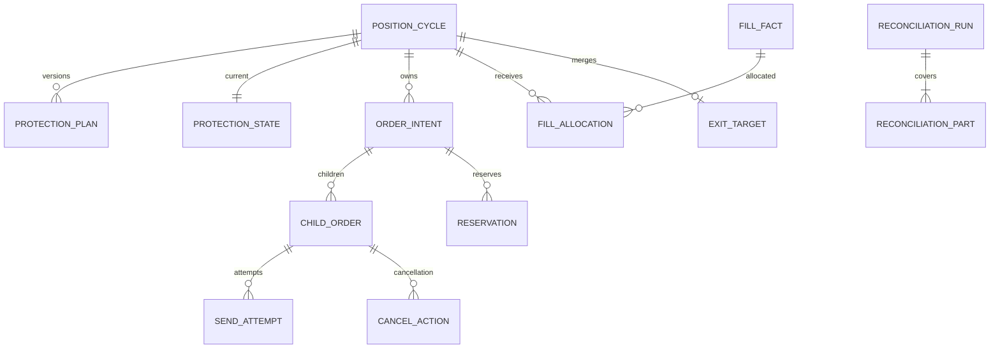

# G0 数据模型与事务规格 v1

日期：2026-11-09（Asia/Shanghai）。状态：工程开发规格；交易规则与生产参数未批准。本文与 [schema.sql](schema.sql)、[状态机](state-machines.md)、[IPC](ipc-protocol.md)及[保护计划](protection-plan.md)共同使用。

## 1. 作用域、类型与数据所有权

每个账本文件只容纳一个 `account_key`，其环境、柜台和账户身份一经创建不可改。`ledger_scope.singleton=1` 及 UNIQUE 限制第二个作用域；切换账户必须切换账本，不 UPDATE 作用域伪装迁移。文件根由产品独立管理，持久权限绑定规范化账户身份，与可变线路名称、配置路径和 GUI 会话无关。`ONLINE_SIM` 是获批外部在线模拟；生产数据库不提供本地撮合环境。

| 类型 | SQL / IPC 表示 | 约束 |
| --- | --- | --- |
| ID、合约、来源、哈希 | TEXT / string | ID不透明、不可复用；合约包含交易所及真实月份；SHA-256小写64位十六进制，协议哈希算法见IPC |
| seq / epoch / revision | INTEGER / 十进制整数字符串 | SQL有符号64位；event/epoch/revision从1开始，允许0的游标明确区分；超过上限拒绝，禁止绕回 |
| 数量 | INTEGER / JSON整数 | 以手为单位、非负；真实子单/成交数量必须>0；关闭功能不用0手暗示；零可平量不生成子单 |
| 价、距离、金额、比例 | TEXT / 十进制字符串 | 最多18位整数/12位小数，不留小数尾零或负零；领域层用Decimal运算，禁止NaN/Infinity/指数、binary float及SQL REAL/CAST比较；价格点与tick分类型 |
| 未知金额/均价/证据 | NULL及独立quality | 不使用0代替未知；首次成交前实际均价NULL，费用未知单独保留 |
| 业务时间 | UTC字符串与交易日/盘次 | 格式按IPC；交易日为YYYY-MM-DD，Asia/Shanghai日历单独解释；不由文件名推导 |
| 超时 | 当前进程的单调截止 | 不跨boot恢复绝对单调值；重启作废context并重新核对，不用旧剩余秒数自动恢复权限 |
| JSON | TEXT / object | 先严格解析及schema校验，再按IPC约定哈希；SQL json_valid不代替schema和跨字段约束 |

写入者仅内核专用存储线程。业务所有者产生版本化提交请求；策略/GUI/通知/报表不得自行修改表。报表通过只读一致性快照或内核投影读取，不将其读连接提升为交易事实写入者。账户档案索引及秘密引用在产品配置域；口令、Webhook、设备私钥不进入本账本或配置导出。

## 2. SQL 制品与实体关系

[schema.sql](schema.sql)是可执行的空库 v1 定义，使用 STRICT 表、CHECK、FK、部分唯一索引及关键不可变触发器。采用 STRICT 的最低 SQLite 能力要求和可用类型以 [SQLite 官方 STRICT 说明](https://sqlite.org/stricttables.html)为依据。实际版本由新工程兼容矩阵锁定，本机建表成功不代表目标Windows已兼容。

| 表组 | 主键/唯一性及解释 |
| --- | --- |
| ledger_scope / kernel_boots | 一个账户环境；每boot新ID、kernel_epoch持久递增。启动取得OS排他权后才登记，不能靠存在一行替代活进程排他 |
| event_journal | event_seq主键、tx_id唯一；一笔业务提交一个journal包络，包内可含多个事实；原始事实和冲突只追加 |
| rule_sets / rule_decisions / config_revisions | 规则集、B项决定revision、配置revision；批准与撤销追加新决定，不覆盖历史；已有计划引用旧版本 |
| approval_manifests / approval_manifest_items / policy_revisions | 批准集合及具体B项revision，版本化行情/日历/执行/应急/恢复政策；opaque引用必须解析，不靠字符串存在授予权限 |
| authority / strategy_instances | 当前执行/策略权、风险revision；部分索引限制最多一个ACTIVE，ARMED还须满足批准/完整性/多原因门禁；manual-only grant可无策略，自动提案额外验证ACTIVE epoch |
| position_cycles | 每周期的方向/归属/今后管理身份；`remaining_qty=open-close+allocation_adjustment`；外部活动不擅自写成策略开仓 |
| protection_plans / protection_state | 同plan_id的不可变revision；当前状态以周期+plan_id+revision复合FK绑定，不能错接其他周期 |
| order_intents / child_orders / send_attempts / broker_order_links | 机会→意图→子单→发送尝试→可证明的柜台身份；开仓decision_key唯一，未知不换key重开 |
| cancel_actions | 独立撤单动作；CONFIRMED需要原单终态与累计成交一致，不代表发过撤单就完成 |
| fill_facts / fill_allocations / fee_observations | 成交事实按trade_key去重；来源回报与周期分配分离；手续费补证另追加，原成交不被重写 |
| reservations / exit_targets | 风险/保证金/品种/报单/可平预占；每周期一个当前退出目标，并保留全部原因 |
| reconciliation_runs / parts / differences | 同连接范围内的四事实查询、完成证据、快照/增量屏障与差异决定；COMPLETE不等于差异全解决 |
| day_blocks / business_counters | 多原因禁开和独立计数；解除一项不能删除其他原因；名义点数、真实金额、手续费分别记录 |
| checkpoints / observation_windows | 入场状态、首分钟/滞回覆盖与缺口；不可把当前日高低冒充完整路径 |
| operator_commands / takeover_records | 幂等回执与接管清单；残单/UNKNOWN的风险身份必须留存；接管不回补旧目标 |
| strategy_proposals | proposal_id幂等与hash冲突检测；DECISION关联decision_key/intent，STATE_UPDATE只登记入场状态且不能伪造0手开仓 |
| update_transactions / maintenance_locks | 策略屏障、更新等级、维护身份与安全窗口；更新失败不回滚真实成交 |
| alert_outbox | `(fact_identity,channel)`唯一；投递、人工确认和风险解除三条状态分别更新 |

`fill_facts.broker_order_key`允许尚未关联/外部单，因此不强制FK到本产品子单。回报暂时无法归属也必须落事实与差异，不能丢弃；后续通过证明建立关联。`source_epoch`说明收到来源，不参与稳定trade_key来制造第二笔成交。trade_key必须按通道证明的范围组成，例如交易日/交易所/柜台成交标识及必要账户范围，不假设交易ID全局唯一。

所有来源去重键必须区分事实种类及实际版本。订单每次状态更新不能只以order_id当作同一事实；同键不同内容先存冲突事件，不覆盖旧事实，也不静默当重复。SQLite完整性检查之外，应用必须校验哈希、规范类型、当前revision、关联归属、Decimal约束、跨表数量及B项批准。

计划的approval_record_id解析到approval_manifests及items中的精确`(rule_set_id,b_code,decision_revision)`集合，同时核验manifest/hash、规则/config范围、环境和批准人证据。每次新增权限/意图还须核对各B项当前适用的最新决定，旧APPROVED之后若有REVOKED不得靠旧manifest继续增仓。撤销批准不删除原有计划和持仓保护。DEVELOPMENT夹具引用只在独立开发执行器解释，不预置进在线账本。

authority_policy_id解析policy_revisions中AUTHORITY类型的不可变版本，至少包含allowed_origins、账户环境/命令范围、有效边界、所需批准集合及解除条件。allowed_origins只能为MANUAL/STRATEGY的非空去重集合；仅MANUAL不要求ACTIVE策略，含STRATEGY则必须额外关联当前有效策略。原始JSON内容可存表，但注册和启用前必须校验这些字段，不接受任意JSON直接授权。

配置/计划和strategy实例的rule_set_id与config_revision由复合FK绑定；authority的boot/epoch、reservation的child/intent也由复合FK绑定。JSON字段内的周期、计划、参数哈希和policy_id仍需在同一事务前逐项解析核对，SQL JSON语法检查不自动比较其含义。

`exit_targets.desired_remaining_qty`是唯一权威退出目标，`exit_targets.state_revision`就是保护规格的exit_target_revision。protection_state.target_remaining_qty只是同事务镜像，不独立演算或放宽目标；尚无退出目标时为NULL。

## 3. 修订和提交合同

`ingress_seq`在规范入口分配，记录本机先后；`event_seq`由串行业务所有者按提交顺序分配，一次提交对应一个journal包络；`durable_seq`是已确认连续提交的最大event_seq。序号不能由客户端或其他进程分配。来源顺序、订阅流stream_seq与上述序号各有语义，不混用。

业务所有者在内存登记pending delta和reservation，然后请求存储线程执行：`BEGIN IMMEDIATE → 插入event_journal → 更新关联事实/投影/回执/outbox → COMMIT → CommitAck`。已提交行才代表持久事实；不得先发成功回执再异步补数据库。数据库写入请求不重排，失败后停止发布依赖该事务的结果；不能越过一个失败序号继续宣称durable连续。凡分配新event_seq的规范化关键观察必须进入有序journal，不能丢弃后跳过该序号；不参与策略/保护的可合并UI行情只用入口/订阅游标，不凭空分配业务提交序号。

CommitAck为内核内部合同，包含tx_id、event_seq、durable_seq、kernel_boot_id、state_revision及结果；外部IPC不得伪造。待确认占用立即阻挡后续预算和可平量使用。失败/迟到Ack要核对原事务与当前身份，不盲目释放全部占用或重新调用SDK。

相关revision采用乐观并发：更新语义为`WHERE id=? AND state_revision=?`，同一业务提交中每受影响实体revision递增一次；影响风险的提交推进risk_revision，授权变更推进authority_revision，命令可见阶段变化推进receipt_revision。0行更新是冲突，不能当成功。无关合约行情不自动失效所有提案；依赖的position/risk/config、context与市场质量变化才由内核逐项判断。

## 4. 原子事务清单

| 合同 | 必须同事务提交的写入 | 提交后的外部动作与失败行为 |
| --- | --- | --- |
| TX_BOOT | 新boot/epoch、启动事实、撤销旧自动权、恢复阻挡 | 连接和核对；旧context作废，禁止继承ARMED快照直接开仓 |
| TX_AUTH | 批准范围/新仓权、相关revision、命令回执、阻挡变更 | 仅可按当前批准范围接受新提案；失败不授予权限 |
| TX_INTENT | 周期/计划、入场状态与机会消费、意图/子单、预占、SEND_POSSIBLE尝试、计数及journal | Ack后临发复核再调用SDK；任何发送窗口不确定则保留未知占用，不重发 |
| TX_ORDER / TX_CANCEL | 原回报/撤单动作、累计量/终态证据、预占变化及命令阶段 | 可继续撤改/报价需新事务；单纯SDK返回不能释放原单 |
| TX_FILL | 新trade_key事实、证明后的分配、子单累计、周期数量/均价、实际财务、保护覆盖、预占与outbox | 首笔部分成交即由计划管理；重复同内容无重复记账，同键冲突另记核对阻挡 |
| TX_PROTECT | 最高有利变动/锁存、日禁开、阶段消费/目标、退出意图/预占及outbox | 首次触及先持久留证；退出子单仍遵循发送门禁，策略不参与等待 |
| TX_SWITCH | 新唯一strategy_epoch、入场checkpoint、屏障、旧意图分类、更新状态及授权记录 | 提交成功才接受新代次；旧保护及机会不变，失败不启用候选 |
| TX_TAKEOVER | 接管范围/残余风险清单、权限变化、旧目标处理、回执与核对依据 | PENDING不等于接管完成；已确认清单覆盖活动/UNKNOWN潜在成交后才交接 |
| TX_MAINTENANCE | 禁开/维护token、事实屏障、安全窗口或交接依据、更新进度 | 维护锁确认前不切核心；有仓或未知不自动强平换版 |
| TX_RECONCILE | 四事实范围/完成证据、差异、归属/预占修订及恢复决定 | 只有满足当前用途的证据才恢复；完整查询有差异仍可保持禁开 |
| TX_CONFIG / TX_COUNTER / TX_OBSERVATION / TX_OUTBOX | 对应修订、事件和必要派生状态 | 不改写活动计划；通知失败不反压SDK；关键观察失持久能力禁开并告警 |

数据库无法与柜台原子提交：SEND_POSSIBLE持久后可能尚未调用、已经调用或调用结果未保存。重启一律按可证明事实分类；只有确证未调用且未排入SDK发送队列才标DEFINITELY_NOT_SENT。SDK同步返回异常也不能自动证明未发送。

## 5. 数量、费用和单调约束

1. `remaining_qty`只来源于已归属成交及带证明的分配调整；不能用净仓差值默认为某周期成交。多空和今昨在核对证据/分配中保留，平仓预占区分今昨。
2. 待发退出量为`max(0, confirmed_remaining - desired_remaining - potential_pending_exit_qty)`，还须受可平量/今昨和柜台规则约束；UNKNOWN退出按最大潜在成交量占用。多出口收紧同一目标，不累计全平数量。
3. 成交回报早于订单关联时先记fill_facts与核对阻挡，待证据齐后分配；总分配量不超过该成交量，确认退出不能超过可证明持仓。约束异常记录原始事件和差异，不能裁剪真实回报凑平衡。
4. 费用未知为NULL/UNKNOWN；估算和已确认分列。同一费用若已进入柜台权益，不再从日亏公式重复扣除。补充结算单只追加fee_observation，不改原成交价/量/时间。
5. PROTECTED不可回NORMAL；最高有利变动、已消费阶段和锁存事件不能被计划迁移降低。SQL触发器覆盖模式回退；Decimal高水位和阶段单调性由所有者校验并以不变量测试覆盖。
6. CLOSED后新的有效迟到事实先失效原完整性证据，追加纠正事件并重启原周期管理/接管；保留原封存事件。不得删除旧CLOSED审计，也不得因此恢复新开仓。

## 6. 存储错误、迁移和备份

每连接在事务外启用并回读foreign_keys；[SQLite官方外键说明](https://sqlite.org/foreignkeys.html)要求应用显式确保外键开启。文件写连接回读WAL/FULL，读写失败、磁盘满、busy超预算或提交顺序不明，均冻结新增风险并显示持久化错误。现有持仓的应急处理只按单独批准/验收的降级方案，不能在失败循环里无限补单。

schema.sql仅新建空库v1；后续迁移用新migration_id、前后schema版本和制品哈希，先一致性备份/副本验证，在U5安全窗口执行。迁移不能UPDATE历史event/fill或回退交易数据库。未来添加全局维护元数据时也不能绕过持仓安全屏障。

备份包含当前已提交WAL事实、规则/config/plan版本、账本scope及哈希清单；通过一致性Backup API生成并核对完整性，不在运行中单拷主文件。新机恢复先核验scope与schema，再接柜台核对当前事实；秘密重新配置，旧备份不具有自动恢复交易权。

## 7. 可直接写成开发检查的用例

| 编号 | 输入/故障 | 必须断言 |
| --- | --- | --- |
| G0-DM-001 | 执行schema.sql、回读外键并检查全部FK | 空库建表、唯一索引与外键定义成立；不证明磁盘持久性 |
| G0-DM-002 | 插入第二scope/重复开仓decision_key/重复trade_key | 拒绝；不同payload另记冲突，不覆盖原事实 |
| G0-DM-003 | 两品种在首事务Ack前争用同预算 | pending占用已生效，第二笔不能重复使用额度 |
| G0-DM-004 | TX_INTENT提交后、SDK调用前后分别强杀 | 不能凭超时/重启重发；按完整核对和可能发送状态恢复 |
| G0-DM-005 | 撤单途中新增成交，原单尚无完整终态 | 预占不提前释放，退出只补可靠剩余量 |
| G0-DM-006 | 成交重复、同键不同价、先成交后订单关联 | 一次入账；冲突留原件；未知先归档再核对 |
| G0-DM-007 | 原有PROTECTED尝试写NORMAL/改历史成交 | 模式回退及原成交改写拒绝，迁移不降锁存 |
| G0-DM-008 | 一笔业务事务中途rollback/写失败/旧boot Ack | 无部分持久成功，相关发送及授权不推进 |
| G0-DM-009 | 切换账户/旧备份/外部持仓 | 不串scope、机会或计划，恢复先核对，外部仓不自动归属 |
| G0-DM-010 | UNKNOWN费用与结算单重复导入 | 未知不变0，不重复扣费，不修改原成交事实 |

本轮仅静态检查SQL结构及有限约束反例；以上涉及真实调度、强杀、SDK与故障的开发用例仍待G1/G2执行。
