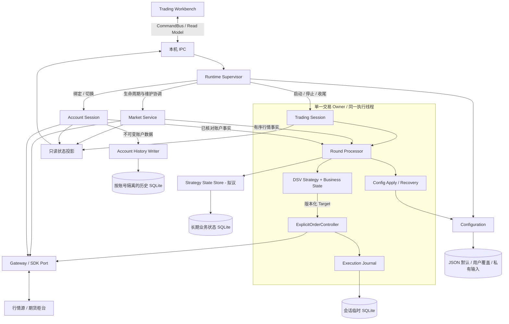
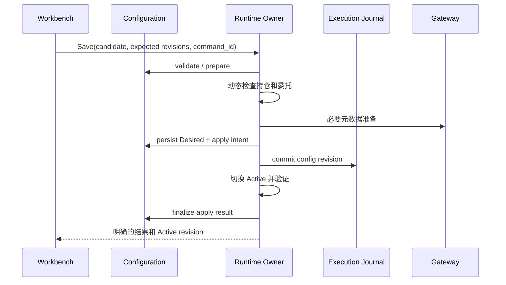
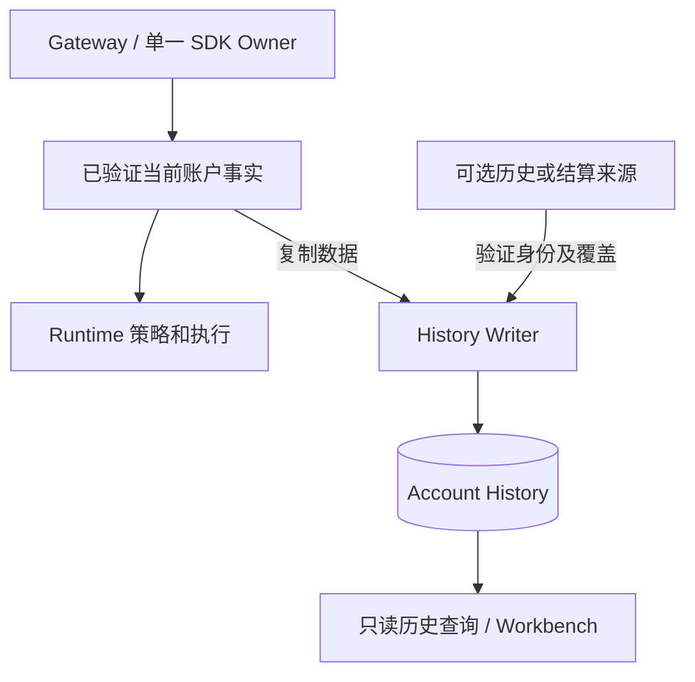
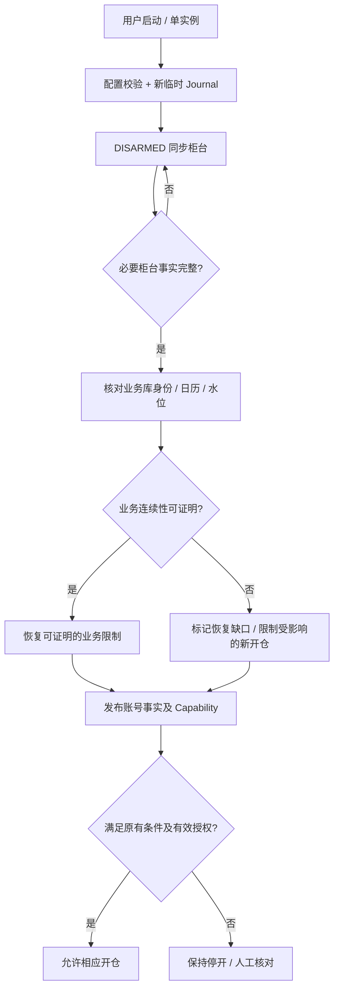
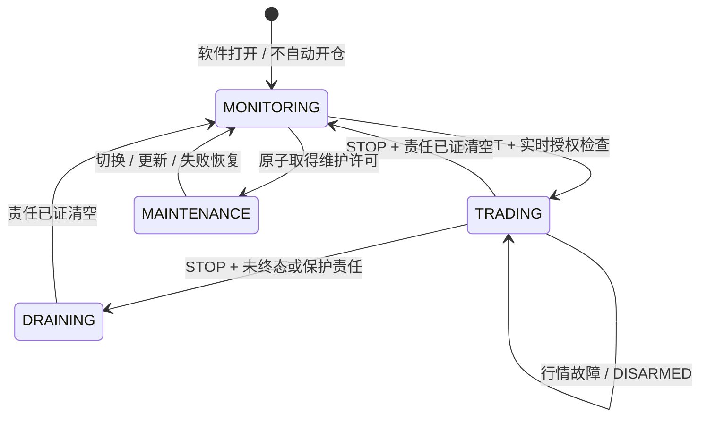
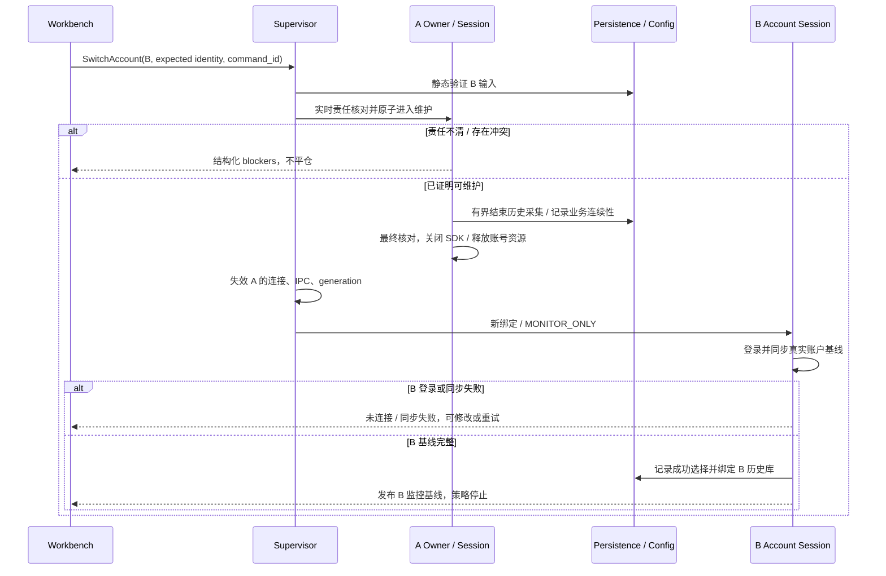
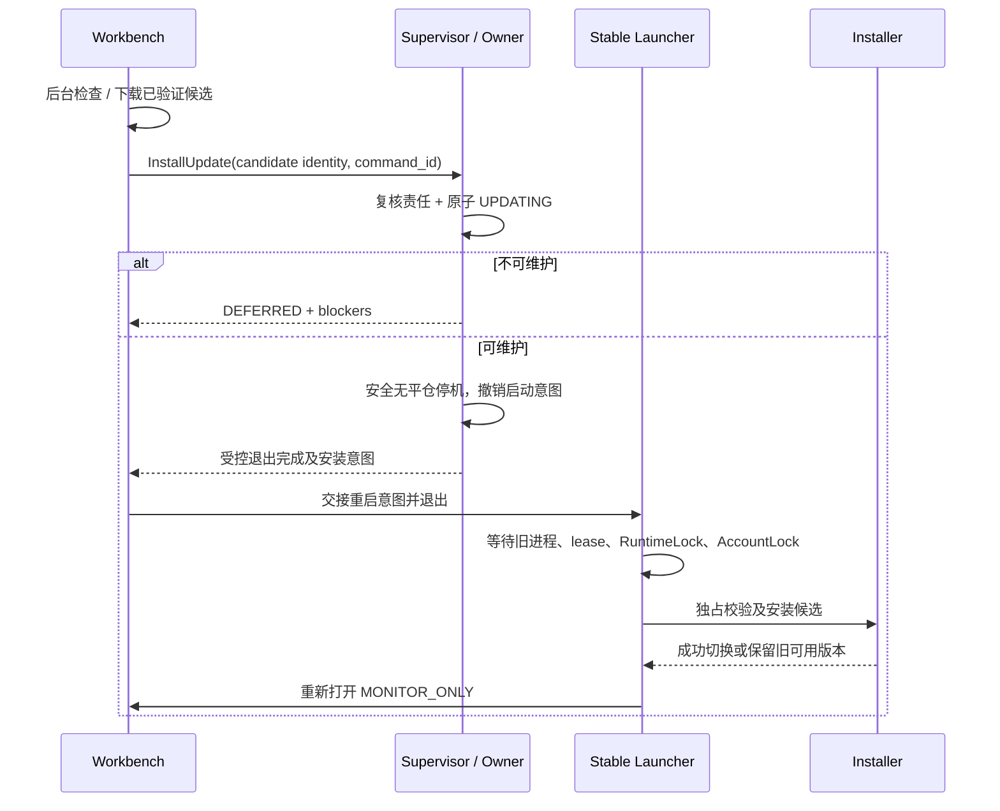

# Configuration、Persistence 与 Runtime 基础架构与生命周期解耦设计（V1.1）

> 日期：2026-11-24  
> 状态：`CANDIDATE / DESIGN_ONLY / NEEDS_REVIEW`  
> 基线：`deadb3bb4c8617d96752935ef86cabdffa7935d9`（main，本次生命周期复核）；V1.0 基线 `e43e9d9cbaeb5b929c92877a761e690c55a6de78`。  
> 范围：OnlineTrader 默认 Standalone Trading Runtime + DSV Target Owner；人工监督的 Windows 桌面自动交易终端。  
> 本文是后续开发设计和分批验收合同，不代表新增功能已经实现或通过测试；不授权连接账户、下单、运行测试、打包或发布。

## 0. 摘要与核心决策

**V1.1 核心修订：Runtime 进程、行情、账户连接与交易会话具有不同生命周期。软件运行不等于策略运行，账户连接不等于交易授权，策略停止不等于交易责任结束。** 普通打开软件进入监控模式；仅在有效授权后进入交易模式。策略停止且交易责任已证明清空时，不应再要求用户先退出 Runtime 才能发起账号切换或更新。首版允许 Supervisor 自动受控重启 Runtime 实现切换，不要求新增独立行情进程或两套 SDK。

当前架构已经解决了 Workbench 与 Runtime 的进程隔离、单一交易发送者和基于 Target 的数量核算。下一阶段不需要再次拆分交易进程，而应收敛三个基础系统的边界：

- **Configuration**：描述软件应该如何运行，管理参数、账户连接输入、默认值、用户覆盖、版本及静态验证。
- **Persistence**：描述软件必须记住哪些事实、怎样保存以及怎样证明数据的有效性；不自行决定交易行为。
- **Runtime**：Supervisor 协调进程、行情服务、账户会话和交易会话；当前 Trading Session 的 Owner 仍是唯一交易裁决和发送者，负责有序事实、策略、执行、动态配置生效及业务状态恢复。Supervisor 无报撤单权。
- **Gateway**：期货柜台与行情源的适配边界。真实资金、持仓、委托、成交由柜台权威决定，不由本地配置或数据库决定。

建议继续使用 Python、JSON、SQLite、现有 IPC 和单 Owner 模型。只增加确有用途的类型、接口与持久化记录，不引入 Redis、消息中间件、ORM、微服务、第二 OMS 或独立交易 Reconciler。

本文拟议的业务合同变化包括：运行模式及责任判定、受控账号切换/更新/无平仓维护停机、生命周期逻辑拆分、Desired/Active Config、账户历史覆盖和补录、跨重启业务事实。优先解决可维护性阻塞，不改变 DSV 策略语义。涉及普通启动默认停开（含旧 auto_start_on_launch 语义）、新维护命令和长期业务库的合同，在实施前须明确批准并更新拥有合同；本文仍为设计候选。

## 1. 适用合同与当前实现

| 依据 | 当前适用边界 |
| --- | --- |
| [Target 执行与 Standalone 接管](target-execution-and-standalone-cutover-20261121.md) | 当前默认唯一 Target Owner；UNKNOWN 占量、先记账后发送、退出责任及归属 |
| [柜台权威与单实例](runtime-broker-authority-single-instance-20261120.md) | 每机一个 Runtime；跨机可同账号；临时执行库不跨 boot 继承 |
| [Workbench 当前合同](runtime-workbench-current-20261120.md) | 当前 IPC、命令权限、热保存、投影及退出 |
| [跨重启业务连续性 ADR](runtime-business-state-restart-continuity-adr-20261124.md) | 草案；本文提出扩展建议，不静默将其转为 CURRENT |
| [ConfigSnapshot 旧合同](runtime-config-snapshot-contract-20261120.md) | 可参考版本与投影设计；原 Ledger 配置权威、原周期回读及重启恢复语义不得直接用于当前 Standalone |
| [账户数据同步](../account-data-sync-design-20261119.md) | 必须先应用 2026-11-20 覆盖说明；旧 handoff、长期执行账本等不是现行默认设计 |
| [诊断系统](runtime-workbench-diagnostics-reporting-20261124.md) | 统一诊断机制与收盘/退出上报，非交易权威 |
| [桌面退出合同](desktop-lifecycle-user-flow-20261120.md) / [Windows 更新](../windows-gitlab-updates.md) | 既有明确退出与安装锁仍保留；新增无平仓维护路径及协调顺序是 V1.1 提案，不改变当前实现 |
| [架构状态](../ai/architecture-status.yaml) / [模块边界](../ai/module-boundaries.yaml) | 当前合同导航；实现与合同冲突需明确标记 CONFLICT_NEEDS_REVIEW |

### 1.1 现状审视

| 源码 | 已有能力 | 待处理问题 |
| --- | --- | --- |
| [configuration/dsv.py](../../src/online_trader/configuration/dsv.py) | 严格、不可变的 DsvProfile，规范化数据及内容哈希 | 保留，不重造参数类型系统 |
| [runtime/portable_config.py](../../src/online_trader/runtime/portable_config.py) | PortableAccountStore 管账号、凭据、默认/覆盖合并、原子保存与回滚 | 同时管理历史路径、Ledger 初始化等非配置职责；覆盖语义与生效状态需区分 |
| [dsv_runtime/standalone_owner.py](../../src/online_trader/dsv_runtime/standalone_owner.py) | 保存前动态校验、文件保存回滚、SDK 合约准备、当前配置 revision | JSON 与临时 SQL 不存在跨存储原子事务；崩溃窗口需要可解释 |
| [dsv_runtime/runner.py](../../src/online_trader/dsv_runtime/runner.py) | 策略轮次、事实校验、事务、命令、保护及风险状态 | 多职责集中；策略状态与发送状态共享字典，接口边界不够稳定 |
| [dsv_storage/journal.py](../../src/online_trader/dsv_storage/journal.py) | 单 writer，SQLite WAL + synchronous=FULL，事务和 effects 证据 | 关键事务保持不变；不允许为了减负取消发送前提交 |
| [runtime/session_storage.py](../../src/online_trader/runtime/session_storage.py) | 每 boot 创建独立临时库，退出后清理 | 保留，不作为跨重启执行恢复来源 |
| [runtime/account_cache.py](../../src/online_trader/runtime/account_cache.py) | 有界异步 latest-wins 快照写入及历史查询 | 缺少按类别保证历史增量和覆盖的完整合同；仅快照不能证明整日完整历史 |
| [runtime/target_owner_startup.py](../../src/online_trader/runtime/target_owner_startup.py) | 唯一 Owner、历史 writer、命令服务、生命周期协调 | BrokerHistoryWriter 初始化失败可能传播到启动失败，与历史缓存非交易前置的目标不一致 |
| [dsv_runtime/sdk_adapter.py](../../src/online_trader/dsv_runtime/sdk_adapter.py) | 验证已准备 effect、SDK 事实和发单结果 | 私有 session 成员访问和 SDK 内部版本耦合；应封装但不放宽权限 |
| [runtime/standalone.py](../../src/online_trader/runtime/standalone.py) | RuntimeLock、RuntimeSessionStorage 与账号启动流程绑定 | 单一进程锁不可用来判断是否存在交易责任 |
| [desktop/update_ui.py](../../src/online_trader/desktop/update_ui.py) / [update_install.py](../../src/online_trader/update_install.py) | UI restart_now 在 request_restart 前取得 quiescent_installation；安装端仍有独占锁 | 在监控模式下先协调退出，再由稳定 Launcher 独占安装；不能把安装锁当请求前置门禁 |
| [dsv_runtime/runner.py:prepare_shutdown](../../src/online_trader/dsv_runtime/runner.py#L351-L366) | 只读汇总未终态 child、自有/分离持仓及 native conflicts | 可复用，但 ready 不足以证明当前同步、归属冲突、未处理命令、授权与维护状态均安全 |

上述是源码审视和设计建议，不是新的功能验收结论。当前支持的账户范围以已验收的模拟账户为准；不能据此声明实盘、任意历史接口或多物理机交易已经验证。


## 2. 目标架构与依赖规则



图表示逻辑模块而非新增进程或 SDK 连接。第一批仍复用现有同一 Owner 和连接，Supervisor 可通过受控进程重启完成账号切换；后续才把行情/账户读侧从交易会话的生命周期中逐渐提取。共享 TqApi 时由同一个执行线程驱动，禁止并发操作 SDK 或产生第二 sender。

四个逻辑生命周期：Supervisor 与应用进程同寿命；Market Service 在可认证时独立于策略；Account Session 对应一个明确的账户连接上下文；Trading Session 对应该账户的执行权威和临时 Journal，可以在停止且无责任后保持休眠以保留同日状态，但不得继续获得开仓授权。

### 2.1 数据权威矩阵

| 对象 | 唯一事实来源或写入者 | 生命周期 | 是否参与交易裁决 |
| --- | --- | --- | --- |
| 当前资金、持仓、原生订单、成交 | 柜台 / 当前连接的已验证事实 | 当前连接和柜台日 | 是 |
| 实际生效配置 | 当前绑定会话经 Owner 应用的 Active Config | boot/account generation/trading context 内 revision | 是 |
| 用户选择 / 已连接账户 | Configuration 持久化期望选择；Supervisor 发布实际绑定身份 | 跨重启 / 当前会话 | 仅真实绑定并核对后可交易 |
| 维护权限 | Supervisor 串行协调、当前 Owner 根据实时事实裁决 | 当前维护 generation | 是；不能由进程锁或 UI 推断 |
| 版本默认、用户期望配置 | Configuration 管理的文件 | 跨版本/重启 | 仅在验证和生效后 |
| Target、child、UNKNOWN、执行回执 | 当前 Owner 的 Execution Store | 当前 boot 下的单一账户交易上下文；普通停止/再启动保留 | 是 |
| 日停、月停、已消费信号等 | 当前 Owner 产生的业务事实；拟议长期业务库 | 按业务规则 | 可约束开仓，不独立授权发送 |
| 账户历史及收益 | 带来源、覆盖和版本的柜台观察/历史接口 | 长期 | 不作为当前仓位或订单权威 |
| UI 草稿、布局、筛选、pending command | Workbench | UI 进程或本地偏好 | 否 |
| 行情缓存、日志、诊断包 | 对应辅助模块 | 短期或按保留政策 | 否，除非原生实时事实另行验证 |

### 2.2 必须保持的不变量

1. 每台 Windows 机器一个 Runtime；默认入口只启动单一 Target Owner。跨设备不使用本地锁冒充全局协调。
2. SDK 对象只由交易 Owner 线程驱动，后台线程只接收复制出的不可变值。
3. 策略不得读写 SQLite、JSON 文件或直接发送 SDK 订单。
4. 配置模块不依赖 Runtime 内部类、Execution Controller 或交易数据库。
5. 存储模块不依赖 Qt、SDK 或交易算法，不从历史数据推导发送权限。
6. 发送必须经过原 Controller 的数量核算、权限、柜台事实、Journal 事务和 SDK 发送前校验；UNKNOWN/Cancel Pending 继续占量。
7. 历史查询、投影、诊断可以背压和降级；不能成为交易决策输入，也不能堵塞交易主循环。
8. 任何恢复都不得继承旧 boot 或旧账户上下文的发送权、旧 Target、旧 command_id 待发送责任或自动认领外部仓。普通同账户停开/再启动不是新 boot，不销毁仍有责任的会话。
9a. 维护入口只能由实时、可信的责任门禁授予。停止策略或 DISARMED 不代表可维护；账号切换/更新本身无平仓或撤销外部订单的权力。
9. 新配置或新业务状态只能在当前 Owner 的确定性边界被应用；禁止多个模块自行读文件后采用不同版本。
10. DSV 原有算法、交易时段、价格和保护语义保持不变；行为改变须有独立依据和验收。

## 3. Configuration：统一规则输入及生效边界

### 3.1 逻辑分层与职责

- Schema / Value Model：字段类型、范围、完整性、规范化、版本。复用 DsvProfile。
- Config Repository：读取版本默认、用户覆盖、账户输入；原子文件写入；无业务状态判断。
- Config Manager：合并、静态校验、预览差异、保存 Desired、验证 expected revision。
- Runtime Config Apply：动态校验、SDK 准备、事务、Active 切换、发布结果。唯一生效者仍为 Owner。
- Config Projection：给 Workbench 发布当前配置身份、状态及可变更范围，永远不包含密码、令牌。

保留现有交付文件：

| 文件 | 所有权和用途 |
| --- | --- |
| runtime.json | 账号目录、provider、线路及默认选择 |
| private/OnlineTrader-defaults.json | 私有账户连接输入，单独授权、脱敏 |
| OnlineTrader-parameters.json | 版本默认策略参数 |
| OnlineTrader-overrides.json | 用户显式覆盖，独立于版本默认 |
| private/diagnostics-upload.json | 诊断上报独立配置，不能影响交易授权 |
| 本机 UI preferences | 布局、主题、声音等展示偏好 |

现有 runtime.json 为严格 schema，不向其中随意塞新字段。新的配置格式或元数据必须单独版本化并提供迁移；没有明确批准前保持现有文件与入口兼容。

### 3.2 Desired、Effective 与 Active

- Desired：最后成功保存的用户期望配置，可能尚未生效。
- Effective：版本默认与用户覆盖合并、静态验证后的完整不可变 Profile。
- Active：当前 boot 经 Owner 动态校验并真正应用的 Effective Profile，策略与执行使用同一引用或身份。
- Draft：UI 尚未提交的草稿，不属于上述任何运行权威。

建议的规范身份（示意，不是现有协议的字段承诺）：

```text
ConfigIdentity
  schema_version
  desired_revision          # 持久化期望修订
  defaults_hash
  overrides_hash
  profile_hash
  account_key / provider    # 脱敏身份
  active_boot_id
  active_revision           # 当前 boot 内执行修订
  apply_id / apply_status
  effective_boundary
```

稳定内容哈希用于同内容比较和审计；revision 用于乐观并发，不能互相替代。默认值、覆盖和实际 Profile 分别具有身份。Active revision 可以在新 boot 重新编号，比较时必须携带 boot ID。

默认值更新应合并用户明确覆盖，而不是把旧 Effective 全量复制到新版本。现有 diff 格式对列表按整体替换，不能假定 symbols 是逐合约字段覆盖；不得在本轮重构中静默改变列表语义。等于默认值是否表示用户主动锁定该字段，需另行确认；迁移不可从旧数据猜测用户未表达的覆盖意图。

### 3.3 账户选择与配置生效策略

账户配置与账户实际连接分别建模：

- Config 管账户目录（稳定 account_key/provider、别名、凭据引用）与期望选择；Supervisor 管 active_account 和连接/会话 generation。不能直接改 PortableAccountStore 的 active identity 或替换 Pipe 来完成切换。
- 允许添加/编辑不影响当前活动账户的配置；影响活动连接的凭据、删除当前账户、线路/provider 等变更不得绕过维护门禁。持仓期间可显式保存合法 NEXT_BOOT 参数；不能因此修改当前保护规则。
- 账户切换经 Supervisor 获取维护许可，目标账号静态验证后记录期望；只有 B 的真实完整基线确认后才标记 active B 并持久化 last_successful_account。B 登录失败时明确展示 UNBOUND/失败和 desired B，保留上次成功选择，不把 A 的数据冒充 B；用户可重试 B 或重新选择 A。旧文件 selected_account 字段与新增选择元数据须有唯一权威和原子/可恢复迁移设计，不能两处各自写入。
- 配置热保存绑定 boot/account generation/active revision，旧 A 的草稿、回执和异步结果不得应用到 B。升级/切换重启使用明确的 MONITOR_ONLY 启动意图，不能消费旧 auto-start 或旧启动请求。


| 配置或操作 | 处理原则 |
| --- | --- |
| UI 偏好 | 客户端直接生效 |
| 通知、诊断参数 | 对应辅助模块独立处理 |
| 账号/provider/线路/凭据 | MONITORING 且维护门禁通过后由 Supervisor 受控切换/重启；不在交易责任未清时热换连接 |
| 交易日历、schedule、夜盘结束规则 | 延用当前限制，下次启动 |
| 新增合约 | 保留当前动态检查，先验证范围、行情/日历元数据，再原子应用 |
| 删除合约 | 当前运行不允许；下次启动前明确核对外部/自有责任 |
| 既有策略、风控及保护参数 | 保留当前持仓、未决、归属冲突限制；仅满足 flat/idle 等现有条件才可热应用 |
| 仅保存下次启动配置 | 明确标注 NEXT_BOOT，不影响 Active |
| 非法或 schema 不兼容 | 拒绝变更；当前已有效配置继续运行；新 boot 没有有效配置则明确失败 |

不新增“所有策略参数立即生效”的开关，不自动重置日停或保护阶段。期望配置保存和热应用可为不同命令，不能把热应用动态拒绝默认为保存成功。

### 3.4 热保存与断电一致性

当前 _save_parameters 先保存覆盖文件，再通过 SDK/Session 应用；异常时尝试恢复旧文件。它已具有补偿机制，但无法使 JSON 与 SQLite 原子提交。

建议实施最小可恢复协议，不引入 2PC：

1. UI 提交 candidate + expected boot/account/account_generation/active_revision + expected desired revision + command_id；维护已受理时拒绝冲突热应用。
2. Config Manager 生成静态合法 candidate 和 hash；Owner 重新检查当前状态、范围及生效条件。
3. 必要时准备新增合约的元数据；准备失败不允许宣称参数生效。
4. 原子持久化 Desired 和应用意图（apply_id、old/new hash、boundary、PENDING），使用单一逻辑文件权威。可采用版本化配置封装；如保持原文件，附加 marker 必须有明确的顺序、完整 hash 和恢复判定，不把两个可任意独立编辑的文件都当权威。
5. 在同一 Owner 轮次内通过现有 Journal 提交配置 revision、应用身份及关联状态，切换内存 Profile/SDK 适配器并复核一致性。
6. 成功后持久化应用结果（ACTIVE/APPLIED 等），然后发布 Active Config 和命令回执。结果记录失败不能把尚未确认的应用标为成功；不一致时撤销新开仓权限并进入现有安全故障路径。
7. 正常拒绝仍按当前行为回滚（除非用户明确选择仅保存 NEXT_BOOT）。回滚失败或部分生效按 FAIL_STOP/持久 DISARMED 合同处理；不继续在混合参数下交易。



崩溃窗口：

| 崩溃时点 | 新 boot 应做什么 |
| --- | --- |
| 保存 Desired 前 | 继续使用原合法配置 |
| 文件已写、未提交 Journal | 识别未完成变更；验证 Desired，保持 DISARMED，不冒充曾生效 |
| Journal 已提交、内存未完成切换 | 旧 boot 不恢复执行；新 boot 检查配置和应用标记，要求核对 |
| 内存已切换、结果未落盘 | UI 不推断成功；下次启动仍按待核状态处理 |
| 文件回滚失败或内容损坏 | 保留证据，拒绝猜测有效配置；不自动重发原命令 |
| 用户明确保存 NEXT_BOOT | 按新 boot 校验，不能恢复旧 ARM |

不要为实现上述合同引入全局配置数据库，也不要承诺两个独立存储的跨文件原子性。配置迁移采用版本化、可恢复备份与原子替换；启动时不得 silently reset。

## 4. Persistence：数据分类、所有权与保留策略

### 4.1 物理布局和逻辑仓储

建议维持两个长期 SQLite + 一个临时 SQLite；这是建议的故障域，而非新增数据库数量的硬要求。

| Store | 物理实现建议 | writer / 一致性 | 生命周期 |
| --- | --- | --- | --- |
| ExecutionStore | 现有临时 Journal，沿用 RuntimeSessionStorage | 当前 Owner；关键事务同步，WAL/FULL | 单 boot 单账户上下文；普通停/启策略不销毁 |
| AccountHistoryStore | 现有 account-history.db | 独立后台单 writer；有界批量/幂等 | 长期 |
| StrategyStateStore | 拟议 strategy-state.db | 当前 Owner 的受控关键写入；无第二交易 writer | 跨 boot，按业务期限定 |
| MarketStore | 可选短期独立文件或 SQLite | 后台批量、按容量和交易日清理 | 未来阶段 |
| Diagnostics | 现有 JSONL / Reporter | 有界异步、允许不连续 | 现有保留政策 |

StrategyStateStore 不存旧订单发送任务或可重放 SDK effect。与历史库分开，避免历史大量导入、清理或损坏影响业务限制的可用性。历史和策略库迁移、备份、重建分别进行。

### 4.2 ExecutionStore：不改变现有发送边界

复用 Journal 的 checkpoint、native_orders、native_trades、effects、receipts 和 events 等机制。核心顺序：

```text
已验证事实 -> 策略 Target -> Controller 核算
  -> Journal 提交必要 state / native facts / prepared effects
  -> SDK 校验同一 owner / scope / effect 未重放及已提交
  -> SDK 调用 -> 记录发送结果 -> 柜台回报 -> 下一轮核算
```

- 明确未发送的 child 才能释放占量；UNKNOWN、SEND_POSSIBLE、Cancel Pending 继续保留最大可能剩余数量。
- 不改变既有部分成交、晚到成交、平今平昨、退出目标持续推进、错误分类。
- Journal 失败必须阻止相应新发送；严格沿用当前 fail-closed / fail-stop。不得为追求保护继续发送无记录订单。
- 新 boot 或切换账号后不读取旧临时 Journal 作为执行权威，旧临时文件残留只能用于诊断且有保留政策。只有证明旧会话无未结责任且维护屏障生效后才可正常关闭；不能通过销毁 Journal 让 UNKNOWN 消失。
- 关键事务提交不可异步化。非关键空转、序列化、展示应按已有 Owner 减负方案优化并测量。

### 4.3 AccountHistoryStore：记录来源而非伪造完整性

当前 Writer 容量为 1 的 latest-wins 队列适合最新状态观察；但历史事件与最新快照不是同一语义。若柜台快照确实包含完整累积集合，跳过中间快照不必然丢成交；跨日或来源仅提供部分记录时则可能丢失。应根据 provider 的可证明能力确定数据通道。

| 类别 | 推荐写入 / 查询语义 |
| --- | --- |
| 最新资金与持仓观察 | 可 latest-wins；按确认柜台日和 source epoch 保存 |
| 历史资金/结算 | 按柜台日与观察或结算身份；区别盘中权益、日终结算，不用缺失余额算收益 |
| 委托 | 原生业务键幂等更新；保留晚到终态、必要的版本历史 |
| 成交 | 稳定原生业务键幂等追加；重复不增加成交量，冲突保留证据 |
| 覆盖 | 按账号、provider、数据类别、柜台日、来源和观察水位记录 |
| 历史补录 | 仅使用账号明确授权并可验证的 provider/结算接口；独立后台任务，绝不写执行权威 |

建议逻辑模型（列名为提案，不是强制 DDL）：

```text
account_scope(account_key, environment, provider, schema_version)
broker_snapshots(snapshot_id, trading_day, source_epoch, observed_at, payload_hash, payload)
order_history(native_business_key, revision, source, observed_at, payload)
trade_history(native_business_key, source, observed_at, payload)
daily_funds(trading_day, observation_or_settlement_id, source, coverage, values)
history_coverage(category, trading_day, source, completeness, watermark, gap_reason)
history_conflicts(business_key, source, previous_digest, incoming_digest, observed_at)
```

原生业务键必须依据 provider 正式身份：账号、环境、provider/必要的交易所、已证明的柜台日和订单/成交身份；重连 epoch 只用于新鲜度或水位，不作为同一成交的新身份。没有稳定身份时保留带来源的观察证据，不凭价格/手数/时间近似去重或认领自有仓。

覆盖建议区分 COMPLETE（该来源及类别有协议级完整性证明）、PARTIAL、NOT_OBSERVED、UNSUPPORTED、CONFLICT。收到完整“当前快照”不代表历史整日完整。断线、队列满、换日尾部缺口要明确记录；历史写入失败保留最后有效数据并标注过期/缺失。

### 4.4 账户能力和同步



建议每种 provider 声明 capabilities，并分别维护当前连接数据完整性与历史数据覆盖：

| 数据能力 | 缺失影响 |
| --- | --- |
| 当前资金、可用资金、风险计算必要字段 | 阻断依赖该事实的新开仓 |
| 当前持仓、方向及今昨仓路由证据 | 阻断无法正确核算或路由的操作 |
| 活动委托及发送结果核对 | 阻断可能重复或冲突的发送 |
| 当前成交及事实完整性 | 按现有归属、占量和核对合同限制动作 |
| 历史成交/委托/结算 | 历史查询标记缺失；如与当前策略限制有直接关系，则仅限制受影响的策略 |
| 报表或非交易必要字段 | 可降级，不阻断交易 |

不得把 UNSUPPORTED 当作空集合，也不得仅凭 API 能登录就声明事实完整。模拟账号可缺少非必要历史能力，只要交易所需数据、权限和策略限制均得到证明即可按现有规则运行。实时交易所需字段不得因模拟账号而放宽正确性。

本机 A/B 账号切换：AccountHistoryStore 按稳定 account_key/provider/environment 选择；旧 writer 捕获固定作用域，停止接收新样本并有界 flush，未写入范围标记缺口。旧查询游标、回调、快照及 UI worker 绑定 boot/account generation/query generation；迟到数据只可按原 A 作用域处理或丢弃，严禁进入 B。B 的历史库不影响 B 当前事实同步；损坏仅降级历史功能。

A/B 换机：每台电脑从柜台同步当前事实，分别保存自己的历史库和策略状态，不复制活动 SQLite/WAL，不交接旧执行库。只要来源支持历史补录，新机按缺失柜台日获取并幂等写入。若 A 运行两日、B 再运行两日，而柜台无法返回旧日历史，则无法仅凭重新登录保证双机 SQL 的全部历史一致；必须如实显示缺口。

若用户后续要求所有已观察历史跨机器汇聚，单独设计授权的增量历史同步：只同步带来源、稳定业务键、版本/覆盖的历史记录，不传递 Active 配置、保护责任、旧 Target 或交易凭据。当前不引入中心同步服务；不宣称换机完整历史已实现。多电脑同账户并行交易仍无法以单机锁提供全局原子风险额度。

## 5. 跨重启业务连续性（待批准的新增合同）

### 5.1 解决的问题

柜台能够提供账户事实，但不能完整提供 DSV 内部的日停原因、某个分钟信号是否已经消费、开仓目标次数、保护阶段和浮盈峰值。仅通过历史成交重算这些状态会把“是否有成交”与“是否产生过目标/执行过规则”混为一谈。

建议采用 **本地业务事实持久化 + 柜台事实核对 + 保守恢复** 的组合方案，而非完全依赖历史成交推算，也非恢复旧执行账本。本节扩展现行长期存储约定，需要用户确认后更新原 ADR 和拥有合同。

### 5.2 分级保存与恢复

| 字段/状态 | 保存与失效条件 | 新 boot 恢复条件 |
| --- | --- | --- |
| day_stop、day_stop_reason、net_loss | 关键变化时保存；按实际柜台日和规则处理换日 | 同一有效作用域且事实可验证；未知不静默清零 |
| month_stop、stop_days | 按策略定义的月停周期，保留止损日期证据 | 月界和交易日历核对；不能用自然日/启动次数替代 |
| target_count | 按 DSV 已定义的目标计数事件保存，不以成交笔数代替 | 同柜台日及策略作用域，缺口标记并限制新开 |
| last_signal_bar | 按合约、交易日、会话及已证明分钟身份保存 | 防重复消费；不能由最新成交时间任意推断 |
| STOP/PAUSE 意图 | 用户触发时可靠保存负向限制和作用域 | 不自动恢复 ARM；显式重新授权不能清除独立日停/月停 |
| half_stage、peak、theory、保本线 | 仅保存有明确仓位身份、参数与来源水位的保护业务记录 | 先证明仍对应同一仓位/责任、配置及连续性；不足时要求人工核对 |
| 旧 Target、child、UNKNOWN、待发命令 | 仍仅在旧 boot 执行库 | 永不作为新 boot 可发送责任恢复 |

优先实现不涉及仓位认领的日停/月停、信号去重、目标次数和负向操作限制；保护峰值、半仓阶段的恢复作为下一批设计，不在第一批直接自动接管外部仓。不能证明的峰值不虚构；已有外部仓位不因存在本地记录就自动获得保护发送权。

### 5.3 状态身份与记录

建议 scope 包含：

```text
environment, provider, account_key, strategy_id, strategy_scope_id,
rule_set_id, contract_id, trading_day / business_period,
source_boot_id, business_event_id, business_revision,
config_hash, broker_fact_watermark, observed_at, payload, digest
```

strategy_scope_id 是稳定的本机策略作用域，不用随机 boot_id 或配置 hash 当作永久主键，避免改参数就绕过旧停开限制；规则版本及配置 hash 用于验证兼容性。跨机采用不同策略是允许的；不能把 A 的策略限制无条件归给 B。当前仅保证同一受控本机作用域的业务连续性，不自动承诺跨设备策略同步。

采用最小业务记录及 checkpoint（可选择单表事件 + 当前投影）；不需要完整 Event Sourcing，不保存所有 Tick。事件身份幂等，revision 单调，旧记录晚到不得覆盖新限制。月停/日停依据业务规则解除，禁止通过重启、改账号别名或更新版本来清除。

### 5.4 写入顺序与崩溃处理

临时 Journal 和长期业务库不是同一数据库，不能假定存在跨库事务。必须明确以下规则：

1. 每个可能增加开仓许可的动作需要业务限制的有效证明；关键限制或目标计数变化需在依赖它的新开仓发送之前持久化。
2. 采用保守顺序：先可靠保存该轮业务事实（包含作用域、因果身份、水位和待核标识），再允许依赖它的执行事务与发送。若业务库成功而执行事务失败，可能产生保守的限制或占用记录；下次按证据核对，不自动删除或减计数。
3. 对“确认消费信号/计数”区分目标产生、发送可能、成交确认等阶段，按现行 DSV 语义选定记录点；不因存储优化改变次数计算。故障窗口若无法确定事件是否消费，标记待核，禁止重复使用。
4. 已发生且不可回滚的限制变化，如果长期保存失败，立即阻止受影响的新开仓，并保留内存限制、临时 Journal 及诊断；不得继续开仓后假定下次能恢复。
5. 业务库故障不应删除现有 Owner 的退出责任；降风险动作仍遵守原执行 Journal 和柜台事实条件。若连核心 Journal 也失败，沿用原 FAIL_STOP，不能旁路发单。
6. 保护峰值只在确实改变有效保护条件时更新（需先确认 DSV 语义和性能），不每 Tick 同步写盘；若存在未可靠保存的保护变化，则记录连续性不完整，恢复时不能把较旧峰值当成当前可靠值。
7. 在 boot 初始化和正常安全退出记录业务存储覆盖/完成水位。异常退出后的未完成标志用于证明需要核对，不是恢复交易授权；丢失数据库或身份不匹配不得解释为首次交易日无记录。

具体事务协议需独立评审并进行故障注入；禁止将 StrategyStateStore 作为独立交易执行者。

### 5.5 停止、重新启动和重启状态恢复策略

普通同账户 STOP -> MONITORING -> START 保留同一账户执行上下文、Journal 和策略业务状态。行情/K 线、历史、当日盈亏、计数、日停/月停及必要的信号去重继续保存；STOP 仅撤销自动开仓授权并按 cancel_on_stop 处理既有开仓委托，不重置规则。若还有持仓、UNKNOWN 或未终态责任，则保持 DRAINING 并继续 Owner 保护及核对。再 START 必须重新检查当前事实、配置和规则，不能消费旧自动 ARM。

账号切换、更新、配置重启或异常退出若产生新 boot，则按照以下流程。Phase 2 在长期业务库完成前，必须有保守桥接策略：无法证明同日/月业务限制连续性时，新 boot 仍允许监控、账号查询和维护，但限制受影响的自动开仓直至按获批 ADR 核对；不得通过切换、更新、重启绕过停开或计数。若无法实现可靠证明，先实现安全监控和维护，不能声称完整交易连续性验收通过。



V1.1 建议普通桌面打开、账号切换和版本更新后默认 MONITORING（账户基线未齐时显示同步/待核），DISARMED 且无自动启动意图。普通桌面启动是否废止旧 auto_start_on_launch 行为属于明确合同变更，需获批后实施；维护重启必须强制 MONITOR_ONLY，不受旧配置 auto_start_on_launch 影响。用户之后显式 START 仍须核对业务连续性、柜台、行情、配置和 authority_generation；恢复故障不能绕过 STOP/PAUSE。ADR 定稿前不得实施新的自动恢复。


## 6. Runtime：生命周期、交易会话与维护协议

### 6.1 四个逻辑职责及生命周期

| 模块 | 所有职责 | 不得承担 |
| --- | --- | --- |
| Runtime Supervisor | 进程单实例、模式判定、维护屏障、账号切换、退出/更新协调、服务组装和状态投影 | 策略计算、SDK 发单、修改订单/持仓事实 |
| Market Service | 行情 Tick/K 线、合约元数据、行情健康；复用交易日历与时钟服务 | 交易授权、账户持仓认领 |
| Account Session | 绑定稳定账号及 provider、登录/重连、同步资金/持仓/委托/成交、只读账户发布及历史采集 | 自主下单、从历史缓存生成实时事实 |
| Trading Session | DsvSession、ExplicitOrderController、策略和执行状态、保护、订单占量、临时 Journal | 控制整个应用进程生死、修改账号身份、旁路发送 |

Market Service 的逻辑职责不依赖策略运行。在行情认证允许时可在无交易账户的情况下接收行情；当前 TqSdk 可能需要同一 TqApi 承载认证与交易连接，因此第一版允许账号切换期间行情短暂中断和重建。不得因解耦同时驱动一个 SDK 对象或引入第二 sender。无行情认证时 UI 明确显示不可用，不伪造行情。

Trading Session 可以休眠：同一账号、同一 boot 的 STOP 后保留业务状态和 Journal。只有在责任已证明清空、维护屏障成立且旧连接完成关闭后才释放相应上下文。第一、二批不必实际重建 Market Service 类；允许复用现有运行路径，用自动冷重启实现用户无感切换。Runtime 不可用期间 Workbench 仍能编辑配置、选择账号、查询已验证本地历史；不能展示旧账号为当前实时数据。

### 6.2 正交状态与用户运行模式

| 维度 | 建议状态 |
| --- | --- |
| Runtime 生命周期 | STARTING / RUNNING / STOPPING / STOPPED / FAIL_STOP |
| 行情 | CONNECTING / READY / DEGRADED / DISCONNECTED（保留 feed/symbol/clock health） |
| Account Session | UNBOUND / SYNCING / READY / DISCONNECTED / RECOVERY_REQUIRED |
| 用户策略意图 | STOPPED / STARTING / RUNNING；仅显式合法操作或获批启动合同改变 |
| 实际开仓权限 | DISARMED / ARMED + authority_generation；与策略意图区分 |
| Execution responsibility | NONE / ACTIVE / DRAINING / UNKNOWN |
| 维护状态 | IDLE / SWITCHING_ACCOUNT / UPDATING / RESTARTING / CLOSING |
| 配置 | Desired/Active identity、apply status |
| 业务连续性 | VERIFIED / PARTIAL / NEEDS_REVIEW / UNAVAILABLE（按作用域） |
| 存储健康 | execution、history、strategy 独立 |

用户只需理解监控和交易两种主要模式，DRAINING 是交易收尾过渡态。内部同步或故障阶段保留阻断原因：

| 模式 | 判定 |
| --- | --- |
| MONITORING | 策略意图 STOPPED，当前无交易责任且该结论已证明；UNBOUND 的无旧会话场景也可监控，不代表已登录或可启动策略 |
| TRADING | 策略意图 STARTING/RUNNING，或明确人工交易会话承担责任；即使时钟、行情或柜台异常使 DISARMED，也不是自动停止 |
| DRAINING | 已请求停止且仍有待终结、保护、未知或归属核对责任；阻止维护，继续已有责任 |
| 同步/故障提示 | 作为正交状态显示；无法证明 NONE 时不得宣称可维护，即便界面显示“监控/同步中” |

不要从当前 DsvSession.running、DISARMED、Qt 是否存活、RuntimeLock/AccountLock 是否占用推导业务模式。维护状态不是第四种策略模式；进入维护后冻结新的交易启动/变更，并以明确错误告知用户。已有风控和退出责任如出现新事实仍须处理。



MAINTENANCE 在图中仅表示独占维护过渡，不是 operation_mode 新枚举。同步与故障不画成可自动 ARM 的边。FAIL_STOP 不自动发单、接管或释放未知责任。

### 6.3 责任判定与统一 Capability（优先实施）

Runtime 的维护门禁必须是实时 Owner 判定，而不是客户端状态推断。复用 prepare_shutdown() 的只读责任汇总，补齐现有缺失的条件。不能只检查 owned_lots==0 或未决委托列表为空：

- 已明确停止策略；无启动/自动 ARM 意图，authority_generation 已撤销旧授权。
- 当前账户、柜台日、source epoch 和事实覆盖匹配；最后一份可信同步不能在断线后冒充当前证明。
- 无自有持仓保护、分离/待核持仓、未终态 child（含 SEND_POSSIBLE/UNKNOWN/Cancel Pending）、可能晚到成交、发送/撤单不确定结果、归属/分配冲突、尚需执行的退出 Target。
- 无可能改变责任的已接收未处理命令、待执行 effect 或未确认控制结果；只读请求或已证明终态但 UI 尚未收到 ACK 的命令不应无限期阻塞。
- 无已受理的互斥维护、配置应用或其他会改变账户上下文的操作。
- 执行存储与 Owner 状态足以证明责任边界；异常后不得通过清库、强制结束进程或失联推断 NONE。
- 对从未创建交易会话且能够证明不存在本机遗留未决责任的 UNBOUND 场景，不要求取得一个不存在的账号基线；登录失败或无凭据应允许改配置、选择账号和更新。若此前已有会话但断线/崩溃后责任不明，则进入待核，不能将 UNBOUND 当作安全。

仅有已核实的外部持仓/委托且没有本机归属冲突、冲突活动订单或未结责任，不构成必须全平的理由。外部订单可能继续成交，UI 明确说明切换后不管理它们。不得按价格、时间、数量猜测归属。

Capability 表（✓ 仍需各操作具体前置条件）：

| 操作 | MONITORING | TRADING | DRAINING |
| --- | --- | --- | --- |
| 行情、账户、历史查看 | ✓ | ✓ | ✓ |
| 添加/编辑非活动账户配置 | ✓ | ✓* | ✓* |
| 保存下次启动参数 | ✓ | ✓* | ✓* |
| 热应用参数 | 按现行动态校验 | 按现行动态校验 | 拒绝会改变当前责任的变更 |
| 切换活动账户 | ✓* | — | — |
| 发起安装更新 / 维护重启 | ✓* | — | — |
| 检查/下载更新 | ✓ | ✓ | ✓ |
| 启动策略 | ✓* | — | — |
| 停止策略 | 幂等无操作 | ✓ | 幂等继续收尾 |
| 撤单/平仓 | 仅在现有明确授权的人工交易路径中允许；否则禁止 | ✓* | ✓* |
| 明确平仓后停止 | 按命令范围和授权 | ✓* | ✓* |

* 添加非活动账户不能影响当前连接；下次启动参数不能改变 Active；START 需账户及行情、时钟、配置、风险、业务连续性等证据；维护需责任门禁；降风险命令仍以 Owner 最新实态校验。监控模式不得暗中发单；如果保留现有独立人工交易入口，应先建立明确交易授权和 Trading Session，存在责任即退出 MONITORING。不能以此次改造暗中退役用户已有合法人工操作。

建议投影（仅为 V1.1 协议示意，复用当前版本化 Workbench schema/Capability/CommandBus，不另建权限中心）：

```json
{
  "runtime_state": "RUNNING",
  "operation_mode": "MONITORING",
  "market_state": "READY",
  "account_state": "READY",
  "strategy_state": "STOPPED",
  "entry_authority": "DISARMED",
  "execution_responsibility": "NONE",
  "maintenance_state": "IDLE",
  "account_generation": "3",
  "maintenance_generation": "8",
  "capabilities": {
    "switch_account": true,
    "install_update": true,
    "restart_runtime": true,
    "start_strategy": true
  },
  "maintenance_blockers": []
}
```

真实请求绑定 boot、account_key、account_generation、config revision、command_id 和适用的 target/maintenance revision。Workbench 消费 Capability 及原因码，仅用于展示；Owner 在执行前再次检查，原子进入维护屏障并撤销旧启动意图。已受理命令需有幂等回执；超时查询原 ID，不自动重发。新维护操作需要显式版本化 allowlist、同 Windows 用户控制通道和身份校验；不得开放公共只读 CLI 的交易权限。

### 6.4 STOP、收尾与无平仓维护停机

| 场景 | 行为 |
| --- | --- |
| 停止策略且无自有仓/单/未知/冲突 | 撤销开仓授权；可信核对后直接 MONITORING；保留行情、账户、同日业务状态及 Journal |
| 有未完成开仓委托 | 按现有 cancel_on_stop 行为；等待终态及完整成交核对，不因撤单请求而释放占量 |
| 仍有自有仓或晚到成交 | 停止新增开仓，保留原有保护和退出责任；DRAINING |
| UNKNOWN 或断线 | 继续核对；不能宣布无责任 |
| 用户明确要求平仓后停止 | 使用现有 FLATTEN_THEN_STOP 的授权及退出目标，不新增平仓旁路 |
| 用户只要求切换、更新或维护重启 | 不自动执行平仓、外部撤单或改变既有目标；条件不足时显示阻断并允许等待或明确选择原平仓操作 |

新增概念操作 SAFE_STOP_FOR_MAINTENANCE（名称待协议评审）：只在 Owner 证明无责任并取得维护屏障后关闭账户/行情连接和进程，不生成平仓目标。它与既有明确退出 FLATTEN_THEN_STOP 不同，不应复用会自动平仓的关闭回调作为维护路径。

状态转换后的最后一个 SDK 轮次/连接关闭边界必须重新检查责任。如果出现晚到自有成交、未知或归属冲突，则中止维护并恢复原 Owner 收尾；不能因为已批准维护就忽略新事实。若退出后才得知原责任不明，新 boot 保持 DISARMED，核对并提示，不能恢复旧订单发送。

### 6.5 账号切换

首版采用受控冷切换：Workbench 保持可用，旧 Runtime 安全退出后启动 B 的 Runtime；目标阶段可在同一 Supervisor 内销毁 A Account Session / Trading Session 后建立 B，但不能原地改 account_key。



- 启动前验证 B 的稳定身份及必需输入；先释放 A 的交易权和资源，再申请 B 的锁/连接，不并存两名交易 Owner。冷切换时由本机 Supervisor/Workbench 协调，等待旧 Owner 与 runtime-view 的 PID/身份真正退出并取得新 RuntimeLock；若失败不得启动第二个 Runtime。若未来同进程切换，RuntimeLock 可继续持有，account generation、临时 Journal 和执行身份必须更新。
- 旧账户历史 writer 的 flush 设限，失败标记缺口，不因历史查询或上传失败无限阻塞。旧交易事实不得丢弃。
- 冷切换期间 Workbench 使用明确的 account switch 状态；旧 IPC、命令回执、视图、查询结果、配置草稿及 SDK 回调均以 boot/account generation 拒绝串入 B；新账户无完整基线时不得展示空仓/零资金。
- B 失败后保持 Workbench 可编辑、可选择账号、可查询相应账号已验证历史；允许明确重试或回选 A，不自动回滚到 A 的交易授权。
- 切换或更新重启一律 MONITOR_ONLY；账号当前选择与 last_successful_account 分离。返回 A 时应保留/核对 A 的同日策略限制（见第 5 章），不能因为切换再切回绕过规则。
- 外部仓存在且已核实无本软件责任时可以切换；不因“账号非空仓”擅自平仓。跨设备事实仍由柜台提供，无中央全局锁。

### 6.6 软件更新和重启：请求门禁与安装锁分离

现状 restart_now() 先取得 quiescent_installation(root) 再调用 request_restart()，Runtime 正在接收行情时锁自然存在，造成用户无法发起协调。修订后：

| 锁/权限 | 作用 |
| --- | --- |
| RuntimeLock | 防本机出现多个 Runtime；监控也可持有 |
| AccountLock | 防本机重复使用同一受控账号资源 |
| 安装 lease / launcher lock | 保证旧程序进程退出后才能替换程序版本 |
| 维护屏障 / 交易权限 | 由实时责任状态裁决；不以进程锁存在推断业务状态 |



UI 不再在请求维护前获取 RuntimeLock/AccountLock；不删除安装端独占校验。维护许可不是安装许可：Launcher 独立验证目标版本、摘要、安装目录、原进程身份和真实退出，持有现有安装 lease / quiescent_installation 才能切换。不得持有等待退出进程所需的锁造成死锁。退出/交接超时、锁获取失败、候选损坏或新版本启动失败均停止切换或使用既有可用版本；不得覆盖私有配置和长期数据、不得自动启动策略。

必须防止维护与 START、切账号、热应用同时获得权限；维护请求受理后设置互斥 generation，直到明确完成或安全取消，旧 generation 不可重放。跨进程退出到 Launcher 安装期间也需受控交接，竞争启动不得绕过更新锁；若另一实例已占用则安装失败而非强制覆盖。更新过程中不释放锁来提前宣布安装成功。

### 6.7 Runtime 内部职责与窄接口

| 职责 | 当前入口 | 收敛目标 |
| --- | --- | --- |
| Lifecycle / Supervisor | standalone、desktop_bootstrap、target_owner_startup | 统一状态、维护、账户切换、更新协调 |
| Market / Account | DsvSdkAdapter、AccountPublication | 事实采集、认证与生命周期独立于策略 |
| Round Processor | DsvSession.apply_round / _commit | 同一 Owner 有序事务 |
| Strategy / Execution | dsv_core、DsvSession、ExplicitOrderController | 保留现有决策、目标、占量、归属与保护 |
| Config Apply / Recovery | StandaloneDsvOwner._save_parameters、Session、Adapter | 动态生效及持久化核对 |
| Publication / Control | standalone_projection、ControlServer、CommandBus | 只读投影、唯一维护/交易命令入口 |

```python
# 逻辑接口示意；不新增第二交易线程，不替代已验证业务核心。
class RuntimeSupervisor:
    def request_maintenance(self, request): ...
    def switch_account(self, request): ...
    def request_update(self, request): ...
    def publish_capabilities(self): ...

class TradingSession:
    def responsibility_snapshot(self): ...
    def check_maintenance(self, request): ...   # Owner 实态裁决
    def stop_strategy(self, command): ...
    def apply_round(self, ordered_facts): ...
    def apply_config(self, command): ...

class Configuration:
    def load_desired(self, scope): ...
    def validate(self, candidate): ...
    def save_desired(self, candidate, expected_revision, apply_id): ...
    def finalize_apply(self, apply_id, result): ...

class ExecutionStore:
    def transaction(self): ...
    def effect_is_prepared(self, effect): ...
    def record_dispatch_result(self, effect, result): ...

class AccountHistoryStore:
    def offer_snapshot(self, immutable_snapshot): ...
    def offer_history_batch(self, immutable_batch): ...
    def query(self, scope, coverage, cursor): ...

class StrategyStateStore:
    def read_scope(self, scope): ...
    def commit_business_facts(self, facts, expected_revision): ...
```

不要为每个名词机械创建 Manager。现有 Adapter 需通过 Owner 控制的窄接口验证 effect 已提交、Owner 存活、account/provider/boot/context、调用线程及未重放身份；不可将 session._journal/_controller/_closed 等私有访问替换为可由调用者任意声明的 prepared=True。TqSdk 固定版本及私有发送边界判定保留在 adapter。Market/Broker Port 可以逻辑拆分，但现阶段允许共享同一个 TqApi 和线程。

## 7. 故障隔离、性能及数据安全

| 故障 | 目标处理 |
| --- | --- |
| 启动缺失或非法必要配置 | 明确失败，不回落旧内核或空配置 |
| 热保存静态/动态校验失败 | 拒绝变更；保持原 Active |
| 配置部分应用、文件与 Active 不一致 | 停止新开仓并按当前安全故障合同处置；不自动重发 |
| 执行 Journal 失败 | fail-closed / FAIL_STOP；禁止绕过事务报撤单 |
| 历史库初始化/读写失败 | 交易核心可启动或继续（必要事实均独立满足）；明确历史不可用，保留原库证据 |
| 历史队列满、换日尾部缺口 | 记录类别和日期覆盖，安排可证补录，不阻塞交易 |
| 业务库损坏/不可用 | 限制依赖该状态的新开仓；已有退出责任按当前执行合同处理 |
| UI/IPC/日志/上报失败 | 不改变交易权威；接口恢复后取得当前基线 |
| SDK 连接中断 | 使用现有重连、事实核对与权限代际；不盲目重新 ARM |
| Runtime 退出或断电 | 柜台订单和仓位可能仍存活；下次从柜台重建，默认停开并检查业务覆盖 |
| STOP 之后仍有保护或 UNKNOWN | DRAINING，继续核对与保护，拒绝维护，不强制平仓 |
| 维护期间发现晚到成交或归属冲突 | 中止维护、维持已有 Owner 责任；不能销毁旧 Journal |
| 账号 B 登录失败 / 旧进程退出超时 | Workbench 保持可用；明确失败，不启动第二 Owner，不自动恢复 A 授权 |
| 更新交接或安装失败 | 维持独占校验，保留已知可用版本，重启 MONITOR_ONLY |

特别说明：第一批即可修复 BrokerHistoryWriter 构造失败导致启动失败的问题；需按故障类别处理，不能吞掉账户身份冲突后继续使用错误历史库。停用历史功能时须明确显示原因，重建需要保留/隔离原文件，不自动清库掩盖错误。

### 7.1 性能原则

- Owner 线程只执行 SDK、交易必要事实、策略/控制器计算、必要事务、轻量发布。
- 历史 IO、序列化、查询、报表和诊断采用有限队列；latest-wins 只用于允许覆盖的状态。
- 不在 Owner 主循环同步做历史全表扫描、数据库迁移、网络历史补录、日志上传。
- 业务关键写入按语义变化而非 Tick 次数触发；独立测量其 fsync、事务及对 SDK pump 的影响。
- 复用现有行情连续性诊断，记录 SDK pump gap、round transaction、dispatch、projection、queue depth/drops 的 P50/P95/P99 和最大值；门限以真实基线、授权验收确定，不虚构 SLA。
- 不以吞错、跳过计时器、取消保护或放宽行情门禁作为性能优化方式。

### 7.2 数据安全和可运维性

- 私有凭据仅提供给指定 Gateway，UI/SQL/诊断不得记录密码、token 或未脱敏连接秘密。
- SQLite 运行中读取遵守 WAL 一致性；禁止复制活动库主文件作为完整备份、手删 WAL/SHM、用 immutable 绕过有效 WAL。需要备份时使用一致性 SQLite backup 或停机后受控复制。
- 每种长期库独立 schema version、scope 验证、migration 和备份；执行 Journal schema 不因历史迁移而改变。
- 版本升级保留 runtime/ 用户数据和配置。版本默认文件的更换遵守既有交付策略和覆盖验证；不可默认为升级载荷可以覆盖私有配置或业务库。
- schema 不兼容时只读旧数据或拒绝受影响功能；回退已知完整版本，不能自动降级写新格式。
- 日志用现有统一诊断系统，关联 boot_id、apply_id、desired/active revision、profile hash、业务水位、账户摘要、历史覆盖、store kind 和 error code。不得把诊断记录提升为交易恢复事实。
- 建议错误分类沿用现有 E_RUNTIME_CONFIG、E_STORAGE、E_ACCOUNT_SYNC 等；新增业务连续性错误码先注册并明确 UI 文案和故障等级，不在各模块自行创造同义错误。

## 8. 运行目录与代码目录

### 8.1 运行目录（保持现行便携交付）

```text
OnlineTrader/
  OnlineTrader.exe
  versions/<version>/
  runtime/
    runtime.json
    OnlineTrader-parameters.json
    OnlineTrader-overrides.json
    private/
      OnlineTrader-defaults.json
      diagnostics-upload.json
    data/<现有 provider/account 映射>/
      account-history.db
      strategy-state.db              # 拟议
    logs/
    diagnostics/
    market/                         # 未来可选
系统临时目录/
  online-trader-runtime-session-*/ledger.db
```

沿用当前 provider/account path mapping，不为统一目录命名移动或覆盖已存在账户数据。旧执行 ledger 保留历史只读，不用于新 Runtime 恢复。

### 8.2 代码组织（逐步收敛，不做机械全量搬迁）

```text
src/online_trader/
  configuration/
    dsv.py                # 复用已验证模型
    files.py              # 复用原子文件机制
    account_config.py     # 拟议：账号输入
    manager.py            # 拟议：合并/期望修订/预览
  persistence/
    execution/            # 优先通过现有 dsv_storage/journal 接口复用
    account/              # 逐步收敛 runtime/account_cache 与只读查询
    strategy/             # 拟议业务状态仓储
  runtime/
    session_storage.py
    target_owner_startup.py
    supervisor.py         # 拟议：生命周期与互斥维护
    market_service.py     # 拟议：逻辑行情服务
    account_session.py    # 拟议：账户会话
    config_apply.py       # 拟议：从现有热保存提取
    recovery.py          # 拟议：恢复策略
  dsv_core/
  dsv_runtime/            # 保留当前核心与 Controller
  gateway/
  desktop/
  transport/
  diagnostics/
```

此树为目标职责地图。第一阶段只修改边界和接口，保留现有 import/打包入口；目录迁移仅在消除实际依赖后进行。维护 Legacy 时遵守旧合同，不让 Legacy 成为新 Runtime 的第二发送者。


## 9. 分批开发计划（V1.1 调整优先级）

各批次单独提交、单独评审，结构调整不混入策略语义变更。先解决用户已经遇到的账号切换/更新阻塞，再做内部模块收敛。现有测试、打包仍需明确授权。

| 阶段 | 内容 | 退出条件 |
| --- | --- | --- |
| Phase 0 / 合同冻结 | 更新状态所有权、维护操作、安全停机、默认监控、同账户 STOP 连续性合同；确认 ADR 的保守桥接规则 | 明确旧文档适用边界；命令/schema 兼容及失败合同；不改交易算法 |
| Phase 1 / 模式和责任门禁 | 新增 MONITORING/TRADING/DRAINING 投影、独立策略意图与授权、统一 Capability；复用 prepare_shutdown 并补齐可信同步和未决核对 | 停止无责任能监控，有责任仍收尾，DISARMED 不误判安全；维护和 START 串行裁决 |
| Phase 2A / 无平仓维护停机 | SAFE_STOP_FOR_MAINTENANCE、维护屏障及最终事实重查；区分显式平仓退出 | 无责任可安全退出；有责任拒绝且不隐式平仓；迟到成交中止 |
| Phase 2B / 账户切换 | 首版自动冷重启、WorkBench 可恢复、账号选择持久化最小接口、作用域隔离 | A/B 登录和历史隔离；B 失败仍可操作；新 boot MONITOR_ONLY；同日状态未知时保守限制 |
| Phase 2C / 安装更新 | UI 先申请维护，Launcher 后取得独占锁；交接、失败/回退与监控重启 | 用户不手动退出 Runtime 即可发起更新；安装端锁不变，竞争启动安全 |
| Phase 3 / 逻辑生命周期解耦 | 提取 Supervisor、Market Service、Account Session、Trading Session；无账号 UI 仍工作；复用同一 SDK | 无第二 sender、不必双连接、同账号普通 STOP/START 不重建 Journal；必要时行情暂时重建 |
| Phase 4A / Configuration | 从 PortableAccountStore 收敛账户/参数/数据路径；Desired/Active、revision、回滚、NEXT_BOOT | 配置断电/失败边界可证、作用域正确 |
| Phase 4B / Persistence 账户历史 | 优先隔离 BrokerHistoryWriter 初始化失败；分类写入、能力/覆盖、补录、稳定分页、迁移 | 历史故障不阻塞独立交易能力；不造假完整、不跨账号写入 |
| Phase 4C / 策略业务连续性 | 审批 ADR；先日停/月停、次数、信号去重、负向意图，保护连续性另批 | 同日重启、切回原账号与更新不绕过限制；不恢复旧发送权/自动认领 |
| Phase 4D / Runtime 内聚 | 提取 Config Apply、Recovery、Round Processor，封装 SDK 私有依赖，渐进退役 Legacy 依赖 | 交易顺序和行为不漂移，单 Owner |
| Phase 5 / 完整场景验收 | FakeBroker 多合约、Desktop E2E、ReleaseGate、真实模拟柜台及最终制品分开验收 | 按场景、候选和制品提供可核证据 |

Phase 1/2 是当前产品阻塞优先级。Phase 2 前须先解决最小账号选择、旧新作用域、维护意图及业务连续性保守桥接（第 5.5 节），不能把必要的正确性推迟到 Phase 4。若不能证明跨 boot 业务连续性，允许账号切换与更新后监控，但禁止受影响策略盲目重新开仓。历史库初始化故障隔离等低风险缺陷可提前单独修复。MarketStore、跨设备历史增量同步、新实盘 provider 不在本轮强制范围内。

## 10. 验收计划（规划，尚未执行）

沿用现有测试清单、Fake Broker、OfflineTargetOwnerProcess、SimAll、ReleaseGate 等设施；测试与打包仍需按项目 AGENTS.md 获得授权。不得因文档或组件测试通过宣称真实柜台、Windows 实包已验收。

| 编号 | 场景 | 必须观察的结果 |
| --- | --- | --- |
| L01 | 刚打开软件、未启动策略；停止无仓无单 | Runtime 与行情保持运行，模式 MONITORING，允许请求维护 |
| L02 | 策略运行 / 仅因故障 DISARMED 时请求切换、更新 | 拒绝并给具体 blocker，不误判已停止 |
| L03 | STOP 后 Cancel Pending、UNKNOWN、自有仓、归属冲突 | DRAINING；保留核对/保护，不隐式平仓 |
| L04 | 仅有已证明外部仓/委托、无本软件责任 | 允许维护，不认领、不自动平仓/撤单 |
| L05 | 账号未绑定、首次登录失败与旧会话断线分别请求维护 | 无遗留责任可改配置/换账号；旧责任不明不得按 UNBOUND 放行 |
| L06 | 已取得维护许可但最后一轮出现晚到成交 | 取消停机并继续当前责任，不销毁 Journal |
| L07 | 维护、START、切换、热应用并发或旧 command 重放 | 一个互斥操作获得许可；过期 generation 拒绝，回执幂等 |
| L08 | A 切 B、B 登录失败、旧 A 迟到快照/回调/查询 | 无第二 Owner；Workbench 保持可用；不串账号，不继承旧授权 |
| L09 | B 切回 A 或更新后启动、同账户 STOP/START | 同 boot 保留业务限制；新 boot 无法证明连续性则限制开仓 |
| L10 | 监控模式发起安装，旧 Runtime 尚持锁 | 请求可受理；实际安装必须等待独占锁与进程退出 |
| L11 | 安装失败、交接超时、竞争启动或候选不一致 | 保留可用版本，禁止强制替换或自动 ARM |
| L12 | 切换时历史写入失败或队列堵塞 | 有界结束，标记 A 历史缺口，不写 B 或阻塞无责任维护 |
| L13 | 用户明确平仓退出与普通维护退出分别操作 | 前者沿用原授权，后者不创建平仓目标 |
| L14 | 已启用旧 auto_start_on_launch 后账号切换、更新及普通启动 | 维护重启强制 MONITOR_ONLY；普通启动按已批准的新默认合同，旧自动启动意图不复活 |
| C01 | 相同默认+覆盖反复加载 | Effective hash 和实际 Profile 一致，不丢用户覆盖 |
| C02 | 新版默认新增字段、删除/改类型字段 | 合法未覆盖项采用新默认，非法覆盖明确拒绝；用户数据不静默重置 |
| C03 | 重复命令 / 旧 revision / 两次编辑 | 幂等或明确冲突，不能覆盖新修订 |
| C04 | 运行中改已有持仓保护参数、增/删合约 | 延用原动态限制；新增合约准备不完整不能生效 |
| C05 | 写文件失败、Journal 提交失败、SDK 应用失败 | Active 与回执明确；不存在混合参数继续交易 |
| C06 | 在每个配置保存步骤强制结束进程 | 下次启动识别待核状态、重新同步、不得自动发送 |
| P01 | 历史库权限/损坏/身份不符/磁盘满 | 历史降级，账户身份正确，实时交易门槛不被错误历史改变 |
| P02 | 重复委托、重复成交、晚到终态及冲突身份 | 去重、版本及覆盖正确；不增加虚假成交 |
| P03 | 两个交易日、夜盘换日、历史队列过载 | 日归属正确；缺口和水位可见；无虚假 COMPLETE |
| P04 | A/B 同账号顺序换机、不同历史能力 | 当前资金持仓一致；可证历史补录，不能补录的日期如实显示 |
| P05 | 历史分页、并发写、旧游标、超限 | 分页稳定、查询不阻塞 Owner，不引入 SQL 共享状态 |
| R01 | 同日重启且已有日停/月停 | 保存限制按原语义延续，不能因 boot/config 改变清零 |
| R02 | 同一分钟信号重复启动、目标计数未完成窗口 | 不盲目重复消费；未知进入待核 |
| R03 | STOP/PAUSE 后断网重连及重启 | 不自动恢复旧授权 |
| R04 | 带仓重启、外部仓、仓位发生变化 | 不自动认领、不虚构峰值，按批准的恢复/人工路径处理 |
| R05 | 业务库写入后 Journal 失败、关键状态未落盘 | 识别部分完成；保守限制；不产生重复订单 |
| R06 | 临时 Journal 写入失败、SDK 发送结果 UNKNOWN、撤单晚到成交 | 维持原执行安全不变量，禁止无事务发送 |
| R07 | Qt/接口/历史/诊断进程故障 | 不影响当前 Owner 责任；恢复后新基线 |
| R08 | 受控退出与异常终止 | 当前责任按合同处理；旧 Journal 不用于新 boot 发送 |
| U01 | 升级、回退、配置/历史 schema 迁移 | 备份、兼容、数据保留与明确错误；不覆盖用户配置 |
| PERF01 | 多合约行情、历史查询与关键业务写入并发 | 对比 SDK pump、事务、dispatch、发布尾延迟；无无界队列 |
| LIVE01 | 真实 SimNow/TqKq 当前支持范围内自然开平仓、完整交易时段 | 与柜台核对订单、成交、持仓及保护；分别记录实际结果 |
| ART01 | 最终 Windows 制品启动、配置保存、更新、重启、历史查询 | 从实际用户入口验收，绑定制品 SHA-256 |

测试证据须记录完整候选 SHA、配置摘要（不含秘密）、fixture/实际环境、命令、报告水位、PASS/FAIL/SKIP/NOT_RUN、必要的原始日志摘要。任何真实交易、正式发布或跨机操作需要另行授权。设计阶段全部新增验证场景为 NOT_RUN。

## 11. 待评审决策及非目标

建议优先确认以下事项，再实施有业务行为影响的 PR：

- 认可 V1.1 普通打开默认监控、维护冷重启强制 MONITOR_ONLY，以及如何兼容旧 auto_start_on_launch；明确普通 STOP 与显式平仓退出的区别。
- 认可第一版账号切换允许自动冷重启和短暂行情中断；B 失败仍保留工作台可用，绝不自动恢复 A 的授权。
- 认可监控状态下人工交易操作的现有授权兼容边界、新维护命令与 Capability 版本、待核时的保守策略。

1. 是否批准独立长期策略业务库作为柜台之外的本地业务事实来源（不包括发送权）。
2. 同日、同月策略状态的作用域及配置版本兼容规则；未知状态默认保守限制，不自动清零。
3. 保护阶段和峰值是否只提供人工核对辅助，还是允许在可证明仓位归属后恢复；第一批建议仅保存/展示与核对，不自动认领。
4. 用户覆盖是否需要支持显式锁定等于默认值的字段；symbols 是否保持当前列表整体覆盖。
5. 历史不可补录时，是否需要未来建设跨设备增量历史同步；不同电脑的策略状态不默认同步。
6. 历史保留周期和可用空间预算；未来 Tick 存储另行确认，不能用诊断日志替代行情历史。

非目标：恢复旧长期执行 Ledger 或 handoff；云端全局交易锁；7x24 无人值守集群；跨机器自动接管交易责任；新 ORM 或消息队列；立即支持所有实盘 API；以全量目录重命名代替边界治理。

## 12. 完成定义

本轮架构收敛的最终标准不是新增了多少文件，而是：

- 软件打开、账号连接、策略运行、交易责任和维护状态分别表达；停止无责任后即可请求切换、更新，无需手动关闭 Runtime。
- 维护许可由实时 Owner 原子裁决，无未决责任才允许无平仓退出；安装锁仍由 Launcher 独占验证。
- 账号切换后旧上下文失效，SQL、配置、回调按稳定账号/代际隔离，默认监控且不自动交易。
- 任何策略决策都能追溯到唯一有效的配置、事实水位和当前 Owner。
- 配置改动在允许的边界生效，未完成或失败不冒充成功。
- 历史数据可独立查询、补录、降级，交易事实与历史观察不混淆。
- 同日重启不会静默解除已知业务限制，也不会恢复旧发送责任。
- 账户当前数据由柜台核对，无法取得的历史保持明确缺口。
- 交易安全事务和 UNKNOWN 占量不因解耦、性能优化或 UI 故障被破坏。
- Configuration、Persistence 和 Runtime 通过稳定接口协作，仍然只有一个实际交易发送者。

本文的实现状态为 DESIGN_ONLY；后续批准与实施记录应分别更新相关拥有合同和架构状态索引，不能以本设计覆盖当前运行证据。
