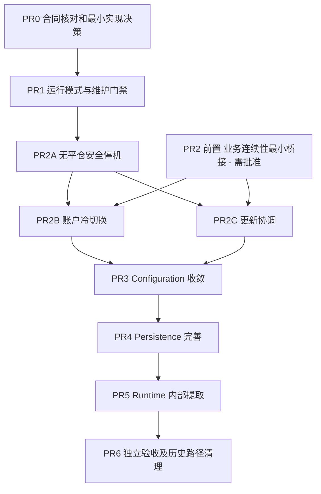
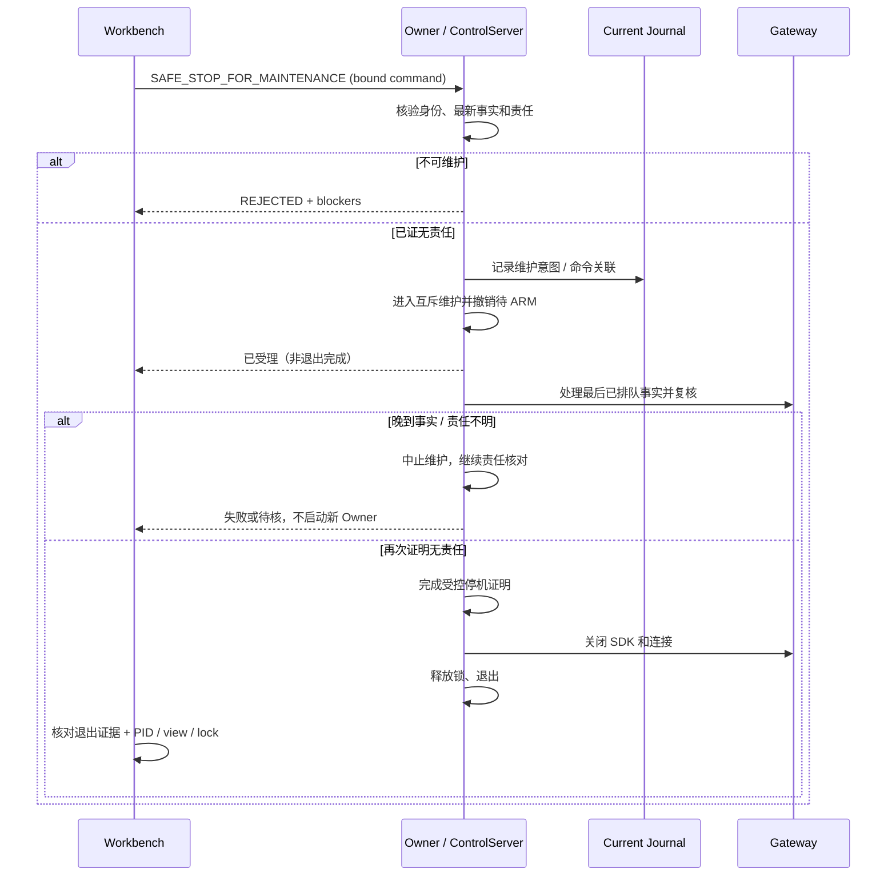

# OnlineTrader 基础架构与生命周期解耦实施规格（V1.0）

> 2026-11-24 · `CANDIDATE / DESIGN_ONLY / NEEDS_REVIEW`  
> 源码基线：`7a9df4dbe612642544a0fb0048a768301573e271`（main）  
> 上位设计：[Configuration、Persistence、Runtime V1.1](configuration-persistence-runtime-architecture-20261124.md)  
> 本文是面向编码者的最小实现规格，包含开发顺序、接口、状态判定、故障处理与验收条件；不代表已修改源码、执行测试或批准任何账号连接、交易、打包及发布。  
> 仅适用于默认 Standalone Target Owner；Legacy、Replacement candidate 的维护合同不随本案改变。

## 0. 实施结论和范围

保留 V1.1 的完整逻辑架构，但以纵向功能批次交付，不机械建设四个服务框架。第一阶段实现用户能够在监控状态下直接切换账户、更新软件，而无需手动退出 Runtime；后续才提取真正有收益的内部接口。

明确采用以下最小方案：

- 账户切换采用**自动冷切换作为长期默认方案**，无需实现同进程 SDK 热切换。Workbench 保持打开，后台 A Runtime 安全退出后建立 B Runtime；短暂行情中断允许。
- 保留现有 Python / JSON / SQLite / Windows Named Pipe / 单 SDK Owner。Supervisor 首先是一组协调函数及少量状态，而不是新进程。
- 运行模式、责任摘要、Capability 由同一权威事实派生；只保存不可派生的策略意图、维护意图及代际，不并行维护多个业务状态机。
- Configuration 复用 DsvProfile、现有默认/覆盖文件和 Active revision；仅增加必要的账户选择持久化、应用状态和原子恢复标记。
- Persistence 复用临时 Journal 与账户历史缓存；仅在确有不可重建业务事实时增加小型持久化方案，先审 ADR；不保存整个引擎内存。
- 不新增 ORM、RBAC、配置中心、消息中间件、第二 Reconciler/OMS、双行情连接、通用迁移框架或中心跨设备同步。

## 1. 最新基线复核与合同优先级（编码前必读）

### 1.1 已有合同与新差异

依次核对 [AGENTS.md](../../AGENTS.md)、[架构状态](../ai/architecture-status.yaml)、[模块边界](../ai/module-boundaries.yaml)、[全账户目标持仓收敛与启动推算](runtime-account-target-convergence-20261124.md)、[Target Owner](target-execution-and-standalone-cutover-20261121.md)、[本机单实例](runtime-broker-authority-single-instance-20261120.md)、[Workbench](runtime-workbench-current-20261120.md)、[业务连续性 ADR](runtime-business-state-restart-continuity-adr-20261124.md)、[桌面退出](desktop-lifecycle-user-flow-20261120.md)、[更新](../windows-gitlab-updates.md)。每批开工重新确认 HEAD；发现源码和合同冲突标记 CONFLICT_NEEDS_REVIEW，不凭旧文档覆盖新规则。

V1.1 成文后，Standalone 已采用**全账户 Actual vs Target 收敛和方案 B 启动推算**，并新增统一市场交易权限、集合竞价门禁。这是 CURRENT 合同，旧文档的“永不处理外部仓”不再是默认 Standalone 规则。

必须落实以下兼容边界：

1. 未启动的 MONITORING 仅同步、计算并展示 Actual/Target 差异；不得自动发单或撤单。非配置合约的 Target=0 和外部订单的预览不能成为维护时自动清仓/撤单理由。
2. 用户显式启动后，按照现行全账户收敛规则执行，包括非配置合约清仓、非策略挂单撤单、先平反向再开目标、保护和市场权限，不重新设计这些算法。
3. STOP 后，不再生成新的自动开仓/全账户收敛任务；已经提交的收敛子单、非策略撤单请求、可能发送及 UNKNOWN 仍须核对。现有保护责任继续由原 Owner 处理，但不得借维护退出创建新平仓目标。
4. 当前收敛合同对 DISARMED 的禁止发送与 V1.1 的 STOP 后保护之间，需要明确区分“从未授权的监控”与“已授权会话收尾”。应先确认这一限定，并按原 STOP/保护行为、市场权限和发送前事务实现；不能简单以 running=False 禁掉所有保护，也不能借 DRAINING 恢复全账户收敛。
5. 当前 runner._infer_startup_targets 会构建 awaiting_start_arm 的推算仓位，prepare_shutdown 又把它们计入 owned_lots。必须区分**未授权、仅推算预览**和**曾生效的真实保护责任**，不能以推算仓位导致监控账号永远不可切换，也不能把真实责任假装成预览。只读推算不授予任何交易权。
6. 当前方案 B 能从当日成交和行情推算部分 day_stop、net_loss、target_count、last_signal_bar 与保护基线，不能据此宣称任意业务限制已完整恢复；特别是未成交目标计数、人工 STOP、月停历史缺口、分钟信号消费等需单独证明。
7. AGENTS.md 现行规则仅允许长期配置和可重建账户历史，独立长期业务状态或新的跨 boot 安全标记需要明确批准并同步修订拥有合同。本文不自行修改该规则。若批准未取得，可先完成只读模式和不跨 boot 的功能；跨 boot 开仓连续性不能假定通过。

### 1.2 实际源码定位

以下路径相对于 src/online_trader/；行号随 HEAD 变化，以符号定位。

| 文件 / 符号 | 已确认现状 | 第一处改动 |
| --- | --- | --- |
| dsv_runtime/runner.py:DsvSession.prepare_shutdown | 汇总未终态 child、owned lots、native_conflicts；未完整计入新 convergence_cancels 与同步/意图 | 提取责任证据，不改订单算法 |
| dsv_runtime/runner.py:_evaluate / _infer_startup_targets / _operate | 方案 B 推算、awaiting_start_arm、running 门禁及收敛计划 | 区分预览与已授权责任；STOP 不重置业务状态 |
| dsv_runtime/controller.py:plan_convergence / terminal / dispatch | 收敛、撤单及发送占量 | 复用原事实/终态与发送证据，禁止额外 sender |
| dsv_runtime/standalone_owner.py:command / start_confirmed / step / _update_stop_ready / execute_command | authority_generation、平仓退出标记、命令回执 | 统一维护门禁、显式策略意图、无平仓退出分支 |
| dsv_runtime/standalone_commands.py:translate_workbench_command | ARM->START；PAUSE/STOP 当前都映射 STOP | 保留原执行语义；明确用户意图；新增窄维护命令 |
| dsv_runtime/standalone_projection.py:workbench_view | workbench/1、capabilities.operations、current_responsibility、Actual/Target | 使用 Owner 捕获的统一责任摘要；不从被裁剪 UI 列表推断 |
| runtime/owner_tick.py:execute_owner_tick | initial_start_pending 与 authority_generation 触发 start_confirmed | MONITOR_ONLY 禁止初始 ARM；维护互斥覆盖自动启动入口 |
| runtime/target_owner_startup.py:run_target_owner | 同线程 Owner/SDK、历史 writer、ControlServer | 传入启动意图、受控关闭证据；隔离历史初始化故障 |
| runtime/shutdown.py:shutdown_runtime_and_wait | 明确提交 FLATTEN_THEN_STOP 并等待进程退出 | 新增无平仓维护停机入口，复用等待 helper，绝不调用旧平仓请求 |
| desktop/runtime_bootstrap.py:BootstrapWorker.run | 优先附着任何本机 Runtime | 普通打开维持附着；显式切换要求目标 account_key/预期 boot，不能附着错误账号 |
| desktop/entrypoint.py:runtime_ready/runtime_failed | 当前成功后建 Workbench，失败 app.exit(2) | 单一 Workbench 允许未连接/启动失败状态 |
| desktop/workbench.py:use_account / _attach_account / _restart_runtime_with_profile / closeEvent / prepare_update_restart | 账户选择经旧 store.change；旧退出/配置重启与更新路径 | Standalone 使用新协调入口；复用界面清理，隔离 Legacy |
| desktop/update_ui.py:restart_now | 请求重启前取得 quiescent_installation | 改成请求维护，等待退出后交 Launcher |
| update_install.py:apply_pending / launch_managed / runtime_lease / quiescent_installation | 真正安装时的独占锁和候选校验 | 保留，不删除安装端安全条件 |
| runtime/portable_config.py:PortableAccountStore | 只读账号目录及 Profile 保存；历史路径和 Ledger helper | 仅增加必要选择/保存接口；渐进职责分离 |
| runtime/account_cache.py:BrokerHistoryWriter | 构造同步初始化、容量 1、后台快照写入 | 初始化故障隔离、关闭语义与按账号覆盖 |
| desktop/runtime_client/client.py / state.py | CommandBus、独立 IO、状态和 pending 关联 | 扩展现有协议，不建立新命令系统 |

另核对 contracts/ 中 OperatorCommand 和 Workbench schema、runtime/operator_api.py、kernel/server.py / control.py 的操作 allowlist 与 context 校验、transport/runtime_view.py、transport/workbench_snapshot.py 的投影校验、现有 release 启动及包入口。新字段必须由实际协议消费者验证通过，不能只在 UI 增加按钮。

## 2. 批次划分与交付门槛



PR1–2 优先解决用户问题；PR4 的历史初始化隔离可提前作为独立小修复。PR2B/2C 可并行，但共享同一个停机门禁，不复制判定。每批次需更新 owning contract 和状态索引（批准后），明确源码、测试和真实制品证据；本文只规划，不授权新增/修改/运行测试。

不以“文件数量”或“类数量”作为完成标准；初始阶段不要移动大量现有 import 路径。结构重构与交易语义修改分开提交。

## 3. PR1：运行模式和维护权限

### 3.1 最少的权威状态

在 StandaloneDsvOwner（或其现有协作者）新增少量不可派生状态：

```python
# 规格示意，沿用项目实际类型和 codec；不是直接复制运行的代码。
strategy_intent = "STOPPED"  # STOPPED / RUNNING；启动过程可用现有 pending 标识
maintenance = None          # 或唯一已受理请求：kind / command_id / generation
authority_generation = ...  # 复用现有字段，不另起第二代际系统
```

策略意图不是 entry_authority：
- 只有成功的显式 ARM/START 或经批准的启动合同改变意图为 RUNNING。自动 ARM 尚等待同步时必须可被 STOP 或维护作废。
- 用户显式 STOP 后意图为 STOPPED；PAUSE_NEW_ENTRIES 当前映射 STOP，需要明确兼容：建议保持原执行语义，但不把所有自动 DISARMED 事件视为用户 STOP。若区分 PAUSE 与 STOP 的 UX 需要行为改变，另行确认。
- 故障、行情阶段、时钟和 SDK 失联可撤销开仓权限，不自动改变用户意图或遗忘已授权的责任。
- 普通同账户 STOP/START 不重建 DsvSession、Journal 或业务状态，不通过重启实现按钮操作。

### 3.2 单一责任检查函数

建议扩展 prepare_shutdown() 的只读结果或建立一个纯函数（例如 runtime/maintenance_policy.py）。不要引入 MaintenanceManager + CapabilityManager 两套独立系统。

最小输入由当前 Owner 在同一线程采集：

| 输入 | 来源 / 检查 |
| --- | --- |
| 当前 boot、account_key、config_revision、柜台日、连接 source epoch | Owner binding 与最新已确认事实 |
| strategy_intent、pending auto-arm、实际授权 | Owner 和 owner_tick 现有 authority_generation |
| 非终态 child、发送/撤单不确定 | terminal()、Journal effects/receipts；不得仅检查 GUI 当前订单列表 |
| 已激活保护仓位、detached_positions、分配或归属冲突、尚需兑现退出目标 | DsvSession 原有状态 |
| convergence_cancels / convergence children / 待确认非策略撤单 | 新全账户收敛路径；以实际已准备/已调用及终态证明为准，不用 dict 长度代替状态机 |
| 方案 B 的 awaiting_start_arm 推算对象 | 未 ARM 且无 child/实际责任的预览单列；ARM 后按当前已激活责任处理 |
| 未处理的状态变更命令/待执行 effect、配置应用 | Owner 队列、已受理事务、ControlServer 实际顺序 |
| synchronized、connection.complete、事实完整性、执行存储健康 | 当前连接和 Owner；断线/缺口不等于空仓 |
| 维护/退出状态 | 当前唯一已受理 maintenance |

责任函数返回可序列化证据（示例）：

```text
ResponsibilitySummary:
  state: NONE | ACTIVE | DRAINING | UNKNOWN
  protected_lots: ...
  unresolved_child_ids: ...
  unresolved_convergence_cancel_ids: ...
  conflict_contracts: ...
  preview_only_contracts: ...
  fact_boundary: (boot, account, day, source_epoch, sequence)
  blockers: [reason_code, ...]
```

需要区分 ACTIVE/UNKNOWN 的展示，但 NONE 必须是已证明无本机执行责任；不能把“暂无数据”映射为 NONE。整个责任计算是只读且无 SDK 调用、无磁盘扫描。

### 3.3 模式与 Capability 派生

```python
def derive_mode(intent, responsibility, has_start_pending):
    if intent == "RUNNING" or has_start_pending:
        return "TRADING"
    if responsibility in ("ACTIVE", "DRAINING", "UNKNOWN"):
        return "DRAINING"
    return "MONITORING"

def maintenance_blockers(facts):
    # 每一项来源于上节当前 Owner 证据。
    return stable_ordered_codes_for_failed_conditions(facts)
```

未绑定、从未启用交易且无已知未决旧会话时，可显示监控/连接失败；不能假定账号空仓或允许 ARM。重启后旧责任无法确定时显示待核，不得通过 UNBOUND 逃避。

维护允许的必要条件：已显式停止、无待启动授权、责任已证 NONE、当前作用域和柜台事实可信、无冲突状态变更请求、执行存储健康、无维护 in-flight。纯行情过期不等于账户未核对：维护不依赖新鲜可交易盘口，只需能够证明责任边界；不能因已休市且无责任永久禁止更新。无权限的行情状态不得被放宽为交易权限。

复用 workbench/1 的 capabilities.operations，发布 mode、intent、responsibility、maintenance 及 blockers（实际字段名按 schema 评审）。现有 ClientStateStore.capability 消费；旧版本缺字段时禁用新操作，明确不兼容而非假设可维护。后台 projection 只接收 Owner 捕获的摘要；不得访问可变 Session 私有成员或从截断列表推导权限。所有实际请求仍在 Owner 线程复核。

建议复用现有错误码，确需新增时注册三类：维护有责任、维护待核、维护忙；UI 显示人话与受影响合约/数量，不堆叠多个通用弹窗。诊断记录稳定原因码和 scope，不打印密码。

### 3.4 门禁场景矩阵

| 场景 | 模式 / 能力 |
| --- | --- |
| 初次连接，有实际仓和预览差异，从未 ARM | MONITORING；无本机责任且基线可信可维护；0 insert / 0 cancel |
| 曾 ARM，STOP，保护仓或收敛 child 未终态 | DRAINING；不可维护；继续已授权保护及核对 |
| STOP 后非策略撤单 SEND_POSSIBLE/UNKNOWN | DRAINING；不得重复发送或销毁 Journal |
| RUNNING 时因时钟/行情/断线 DISARMED | TRADING（异常提示）；不能误判用户已停止 |
| STOP 后可信已清空，无待命令 | MONITORING；允许申请维护 |
| 从未绑定/登录失败，且无旧未决责任 | 监控/未连接；可改配置、选账号、请求更新 |
| 旧 Owner 异常消失，存在不明事实 | 待核；不能以 PID 消失代替责任清空 |
| 仅有未被当前会话激活管理的真实持仓或外部挂单 | 可在证明本机无责任后维护；不得自动清仓/撤单 |

## 4. PR2A：无平仓停机协议

### 4.1 新命令的最小接口

建议在当前 OperatorCommand 通道增加 SAFE_STOP_FOR_MAINTENANCE（最终名称在 PR0 确认）。现有 Legacy ENTER_MAINTENANCE 不自动成为 Standalone 的实现。新命令走同一 Windows 用户、可信 peer、context、allowlist、payload hash、expected revisions 和回执路径。

```json
{
  "command_id": "maint-unique-id",
  "operation": "SAFE_STOP_FOR_MAINTENANCE",
  "scope": {"scope_type": "ACCOUNT", "scope_ids": []},
  "parameters": {"reason": "SWITCH_ACCOUNT"},
  "binding": {
    "account_key": "current-account",
    "kernel_boot_id": "current-boot",
    "config_revision": "7"
  }
}
```

reason 仅允许 SWITCH_ACCOUNT / UPDATE / RESTART_CONFIG 等明确用途。不传密码、目标 SDK 对象、任意文件路径或可执行命令。B 的登录输入留在本地 Configuration/Bootstrap，不通过交易命令传递。冷切换后 boot_id 变化，现有身份足以隔离交易；不强制新增独立 account_generation。只有未来同进程热切换才需要更复杂的账户代际。

### 4.2 Owner 执行时序



实现约束：

- Owner 在同一命令执行边界完成“检查 + 设置 maintenance”。先复核、再设置，持久化/内存变化的失败需进入现有 fail-closed；不能发出成功回执后才锁定。
- 维护受理时拒绝 ARM、自动 ARM、影响当前上下文的热应用、第二维护；只读查询继续。STOP 可以幂等确认，已有保护/核对路径不因屏障被误拦。
- 不调用 FLATTEN_THEN_STOP，不把 target 改成零，不自动取消未激活外部挂单，不用 kill 强行获取锁。
- ControlServer 的 owner_tick 仍运行到最终责任核对。先处理所有可能改变责任的已接收请求/事实；最后的 SDK 读数必须证明相应请求的终态及同步范围。任意固定 sleep 或“连续两帧都为空”不能替代因果水位证明。
- 复用现有 runtime_command_receipt 及关闭状态记录（status/run-identity），扩展最小的维护 completion evidence：原 boot/account/command_id、reason、最终责任摘要和终态（READY_TO_CLOSE / COMPLETED / ABORTED / UNKNOWN）。具体使用现有文件还是回执扩展由 PR0 确认；不增加通用任务数据库。
- 区分“受理维护请求”和“旧进程完成安全退出”。若现有 receipt schema 的 SUCCEEDED 仅表示命令提交成功，UI 必须明确显示等待退出，不将其当安装许可。超时查原 command_id；旧 boot 不可达时核对受控关闭证据，不能重新提交新的交易命令。
- 在正常受控结束路径记录证据后关闭 SDK/Owner/view；若异常退出、缺证据或发现晚到成交，停止后续切换/安装。已经退出但责任不明时，新 boot 仅以监控/待核方式恢复，不继承旧发送权。
- 分离旧 shutdown_runtime_and_wait() 的平仓请求和纯等待 helper。新增无平仓入口或显式 mode 参数，默认调用不能含糊；明确平仓退出路径继续使用原行为和授权。

### 4.3 退出验证

Workbench 记录原 Runtime 与 runtime-view 的身份、PID（必要时包含进程启动身份避免 PID 复用）、boot/pipe。复用 matching_runtime_instance、wait_pid_exit、runtime_owner_exists 和安装端锁证明；验证受控完成记录、旧进程退出、没有活跃 Owner。仅看 IPC 断开或旧 PID 消失不足以授权下一步。等待有界，复用现有超时配置和后台 worker；超时提示原因并保留可恢复界面，不反复创建进程。

## 5. PR2B：账户自动冷切换

### 5.1 唯一用户流程

1. Workbench 选中目标账号 B，不立即改 Active、Pipe 或界面真实账户标签。
2. 在 Configuration 校验 B 的 provider、身份、必填字段，目标不能是无效或已删除账号。
3. 向 A 发送第 4 章无平仓维护命令。若拒绝，保持 A 原状态，提示持仓/订单/同步原因；不能擅自平仓。
4. A 正常退出后，关闭/失效旧 subscription、query、CommandBus worker；清空旧实时状态和旧账户报表窗口；旧 pending 只保留原 A 的诊断关联，不迁移到 B。
5. BootstrapController 以明确 B、MONITOR_ONLY 和预期 account_key 启动；仅在不存在旧 Runtime 后才尝试获得 RuntimeLock/AccountLock。发现竞争启动了不同账号则失败并提示，不连接第二 Owner。
6. B 完整基线匹配后才切换 Active、绑定 B 历史库和当前 view；持久化最后成功账号；展示 Actual/Target 预览且不发单撤单。
7. B 登录失败、启动超时或取消等待，Workbench 仍可操作配置和账号选择；不自动启动 A，不自动 kill 正在启动的 Owner。下一次操作先发现并核对真实活跃实例。

普通启动 attach-any 与显式切换 attach-exact 分开。可以在 BootstrapWorker 增加一个明确 expected_account_key / attach policy 参数，默认行为保持；不要复制第二套 Bootstrap。Worker.ready 信号可以携带或随后核验绑定身份，不能只凭 pipe 名断言连接 B。

### 5.2 配置选择持久化

优先复用 runtime.json 的 selected_account（现有别名到稳定 account_id 映射）。只有 B 成功建立可信基线后才原子更新该字段，保留其余未知/原有合法字段和严格 schema；切换中的目标选择暂存于当前 Workbench worker，不需要永久 DesiredAccount/ActiveAccount 多表。

PortableAccountStore 增加窄 select_saved_account(expected_catalogue_hash, alias) 或等效接口。读取当前文件、验证 hash 和目标存在，复用 catalogue lock 及 publish_replace_bytes；不调用旧通用 change('select') 或绕过账户身份校验。实际 Active 始终来自当前真实连接，而非 selected_account 文件。

若 B 已成功但保存选择失败：仍如实显示 B，标记下次启动选择未保存，允许重试保存；不得把 A 的选择文件当作实际 B 未连接的证明。若 B 失败，保留上次成功选择，显示本次尝试 B 失败和当前无绑定状态；不静默恢复 A 的交易授权。

### 5.3 Workbench 未连接状态

当前 desktop/entrypoint.runtime_failed 会退出应用，需重构为使用**同一个 WorkbenchWindow** 的未连接状态（可复用已有 view=None、配置页面、账户选择和诊断显示）。普通启动失败、切换失败、重连失败均能编辑非交易配置、重新连接和读取合法账号历史。禁止另建一套交易 UI。

对未连接状态的资金、仓位、委托显示“未知/未同步”，不是 0；行情认证不可用时显示未连接。后续可以独立行情认证，但本批不必建立无交易账号的额外 SDK。

隔离所有迟到数据：
- 控制：boot_id + account_key + config_revision + command_id（现有绑定）。
- 状态：ViewReplica cursor/boot/account + 当前 attach token。
- 查询：account_key、boot、query generation；无 Owner 的纯历史查询绑定明确账户及历史来源。
- Worker：取消旧请求，迟到结果按旧身份丢弃或留原账户诊断，不交给新视图。
- SQL：writer 构造固定 scope/path；禁止读当前下拉框动态决定写入账号。

## 6. PR2C：更新与配置重启

### 6.1 替换更新前置顺序

ManagedUpdateController.restart_now() 不再在 UI 请求阶段获取 quiescent_installation；保留现有候选确认和下载。调用统一 Workbench 维护协调入口，确认 candidate version + 已验证摘要后发起 UPDATE。用户可以在监控 Runtime 持有锁时请求；真正安装仍必须等锁释放。

```text
下载 / 校验候选
  -> 用户确认安装
  -> 请求 Owner 维护并冻结 START
  -> 无平仓安全停机 / 真实进程退出证据
  -> Workbench 交接已有 RESTART_FOR_UPDATE 启动协议并退出
  -> Stable Launcher 独占校验 runtime_lease + quiescent_installation
  -> 应用候选 / 保留或回退可用版本
  -> 恢复最后成功账号，MONITOR_ONLY
```

当前有 desktop/entrypoint.py 和 desktop/workbench.py 两个 request_restart 闭包；核对默认和兼容入口实际调用，统一协调，不漏掉另一个启动路径。更新重启必须跳过会提交 FLATTEN_THEN_STOP 的普通 closeEvent 分支（只在已证明受控退出后允许），保留托盘关闭、通知、诊断 cutoff 等收尾。

### 6.2 最小交接与锁

- 原有 RuntimeLock、AccountLock、launcher_lock、runtime_lease、quiescent_installation 保持；业务许可和物理安装独占是两件事。
- 维护请求不持有等待 Owner 退出所需的锁；由 Launcher 在原流程最后取得独占锁并再次检查候选。
- 优先复用现有 pending candidate / restart exit code / managed launcher 交接。若无法绑定本次候选摘要和 MONITOR_ONLY 意图，才增加单个受控、原子、一次性 restart marker；不新增更新任务系统。
- 交接标记无交易授权，仅允许同一根目录、候选版本和摘要；消费后失效。竞争启动或锁失败时不强制安装。
- 下载、校验、停机、安装、首次启动失败分别显示原因。安装失败保留旧 active version；首次启动失败按现有受控回退能力处理，不虚构已有自动回滚；无法自动恢复时明确提示可用版本和人工恢复入口。
- 不修改长期账户数据、私有配置、用户覆盖；禁止版本载荷携带旧执行库或无授权的自动启动意图。

### 6.3 配置重启共用路径

Workbench._restart_runtime_with_profile 不能默认走平仓退出。仅保存 NEXT_BOOT 时不需要退出；立即重启应用参数时需用户明确请求且通过同一维护门禁；存在未结责任则继续当前版本，不改变 Active 或自动平仓。新 boot 必须 MONITOR_ONLY。

### 6.4 最小跨 boot 连续性桥接（PR2 前置审批）

不能为了让账号切换立即可用而重新引入长期执行账本。也不能只在切换前保存一个“安全”布尔值，就声称同日策略规则已完整恢复。

建议分两部分：
- **当前安全退出证明**：用于本次 A->B/更新的受控交接，不授予新 boot 交易权限。
- **跨 boot 业务连续性证明**：使用当前方案 B 和第 9 章待批准的小型策略记录；无法证明限制时只允许监控。维护后新 boot 禁止自动 ARM，显式 START 仍需核对。

PR0 应批准最小本地记录与初始化策略。建议在首次可能发单之前持久化该本机策略作用域的“本交易日可能发生业务活动”标记（或等效覆盖证据），在关键限制变化时记录；异常退出、旧版本升级缺失标记、数据库丢失或换机历史不足均不能当作从未交易。已知有活动但无完整证据时不得用单纯点击 START 清除限制。若业务状态无法完整恢复，按已批准的 DSV 规则和可证明事实解除限制；月停不能简单等到明日重置。首次使用也必须有明确初始化条件（可证柜台事实及获批策略口径），不可用缺失文件证明全新账号。

若长期记录审批尚未完成，先提供监控与维护能力，对受影响的自动开仓明确进入待核；不得标记 PR2 的跨 boot 自动交易完整验收已完成。已有保护/平仓责任遵守当前拥有合同，不以业务库缺口阻塞所有风险降低动作；若全账户收敛会主动平掉不可证仓位，必须按现行用户授权及方案 B 合同核对，不能把新限制或维护请求变成自动清仓的授权。

## 7. PR3：Configuration 最小实现

### 7.1 代码组织

继续使用 configuration/dsv.py:DsvProfile、configuration/files.py 和 PortableAccountStore.profile / profile_with_defaults / save_profile / replace_profile / restore_overrides。

建议只提取一个 ParameterConfigRepository 或等效函数模块，负责默认值+覆盖合并、差异计算、文件原子读写；PortableAccountStore 保留兼容委托方法。账号配置单独由既有 store 管理；路径 helper 只有在多个调用者实际需要时再移动。

| 概念 | 最小实现 |
| --- | --- |
| Desired | 原 JSON 文件和内容 hash |
| Effective | load + merge + DsvProfile 校验的返回值，不另持久化 |
| Active | 当前 Owner 的不可变 Profile、config_revision、profile_hash |
| Draft | UI 内存 |
| 生效类型 | IMMEDIATE / SAFE_APPLY / NEXT_BOOT 三种固定规则，非通用策略引擎 |

保留现有 symbols 列表整体覆盖语义，禁止迁移时自动改变用户覆盖。配置文件 schema 变化必须独立评审；不将诊断或私人字段塞进 strict runtime.json。

### 7.2 热保存最小协议

现有 StandaloneDsvOwner._save_parameters 已实现“动态验证 -> SDK 准备 -> 保存覆盖 -> Session 应用 -> 失败恢复”。在此基础上增强，不重造事务协调器。

```text
静态校验 + expected boot/account/revision + desired hash
  -> 原有持仓/订单/配置动态检查
  -> 必要 SDK 元数据准备
  -> 写最小 pending 标记（old hash / new hash / apply id / boundary）
  -> 原子替换用户覆盖文件
  -> 原 Journal 提交 + 内存 Profile 切换
  -> 一致性复核
  -> 清除 pending 标记并返回回执
```

推荐单个固定路径的待应用 marker（schema_version、apply_id、old/new hash、作用域、boundary），标记必须先于覆盖文件替换原子持久化；同一时刻最多一个待应用，完成后删除或标记完成。沿用现有文件写入机制并确认其持久化边界；若清除标记失败，则下次进入待核，不假装成功。marker 只证明变更阶段，不成为另一配置源，也不保存账号密码。

| 启动观察 | 行为 |
| --- | --- |
| 无 marker + 合法文件 | 正常加载并同步，按启动意图门禁 |
| marker + old hash | 变更可能未保存或已回滚；显示待核，确认有效文件后按原规则处理 |
| marker + new hash | 文件已保存但无法证明旧 boot 生效；重新验证当前 Desired，保持 DISARMED，提示确认 |
| marker + 其他 hash / 损坏 | 明确冲突，不猜测生效版本或自动清零 |
| 正常热保存失败 | 按原补偿恢复；若部分应用/回滚失败，fail-closed，不继续混用 Profile |

不引入跨 SQLite/JSON 的 2PC，不建立永久 ConfigRevision 表。命令重复按现有 command_id/hash 回执处理；配置变化使旧 expected_revision 失效。配置快照必须取自 Active 而非 Desired 文件。NEXT_BOOT 单独显式保存，不将正常热保存拒绝变成偷偷延后生效。

## 8. PR4A：账户历史与故障隔离

### 8.1 先修复非关键缓存影响启动

run_target_owner 中 BrokerHistoryWriter 构造会调用 initialize_cache。将历史初始化错误限制在历史功能边界：

```python
# 示意：捕获历史仓储可预期错误，非无条件吞掉所有异常。
try:
    history_writer = BrokerHistoryWriter(path, account_key, provider, on_error=...)
except EXPECTED_HISTORY_ERRORS as error:
    history_writer = None
    report_history_unavailable(error, scope)
```

history_writer=None 已是 owner_tick 可处理的方向，核对读取端与 finally。scope 不匹配、坏库、磁盘满等按具体诊断标记；不能继续使用错误账号库、静默删除原库或把“不支持历史”当无成交。Owner 仍需独立完成交易必要事实核验。

### 8.2 快照与历史事件分流（渐进）

当前容量 1 latest-wins 队列和每 10 秒采集适合最新资金/持仓观察；若 source 提供累积全量成交，跳过中间快照不一定丢数据，但换日、断线或部分数据源可能形成缺口。

第一版保留 broker_snapshots、account_scope 及现有查询，先补充按类别、交易日的覆盖记录（可用一张小表）；仅当现有快照查询确实不能提供稳定委托/成交身份或效率时再增加 order_history、trade_history 表。不要一次创建七张空表或通用 Repository Factory。

原生键由 provider 的可证明订单/成交身份、账号、柜台日、交易所等组成；重连 epoch 不用于重复创建成交。成交幂等追加，委托按可靠水位更新；冲突保留证据。没有稳定身份的数据标为观察/待核，不按价量时间猜测。当前完整集合不是整日历史完整。

覆盖状态：COMPLETE（该类别/范围确有来源证明）、PARTIAL、NOT_OBSERVED、UNSUPPORTED、CONFLICT；最新实时事实是否完整与历史覆盖独立。只在 provider 确有历史接口时补录；后台操作不使用第二交易 sender，不扫描历史阻塞 Owner。

### 8.3 关闭和账号隔离

Writer 一旦构造固定 account_key/provider/path；关闭先停止 offer，再有界结束队列，返回已提交/未确认范围。当前 close() 若 queue 满可能无法放入 sentinel，且 join 有界；修复结束协议时使用 stop flag/有限队列等简单机制，不能把“已请求停止”称为“已完成写入”。历史落盘失败仅影响覆盖，允许有责任已清空的维护继续，不能无限等待历史 flush。若进程退出强制丢弃未完成历史，日志明确标记 PARTIAL。

同账号换机优先由柜台补回可得事实。A/B 不同步活动 SQLite/WAL、策略配置、旧执行责任。柜台不支持的跨日历史如需完整双机汇聚，应另立增量同步需求；当前仅承诺能证明的覆盖，不把它列为已实现功能。

## 9. PR4B：策略业务连续性（审批后实现）

### 9.1 最小保存集和范围

保留方案 B startup_inference，优先从完整柜台成交、行情和历史可证事实恢复。只保存无法可靠重算且丢失会改变策略行为的必要事实：

| 状态 | 最小记录 | 处理 |
| --- | --- | --- |
| 日停/月停 | 生效限制、原因、交易日/月业务周期、stop_days 等必要统计 | 按原 DSV 规则解除，不随 boot 或参数 hash 重置 |
| net_loss / stop_streak | 依赖原规则的必要统计及水位 | 与柜台可证已实现盈亏核对，不双计 |
| target_count | 原 DSV 定义的目标计数与事件身份 | 不以成交笔数代替 |
| last_signal_bar | 已消费分钟身份，合约/交易日/会话 | 防重，不把最近成交分钟直接当已消费信号 |
| STOP/PAUSE | 必要负向限制和启动意图 | 新 boot 不恢复 ARM |
| half_stage / peak / theory | 第一批不建设完整自动恢复 | 沿用已批准方案 B 可证推算，缺证据显示预览/待核；后续单独评审 |
| 旧 Target、child、effect、UNKNOWN | 不作为长期恢复对象 | 新 boot 从柜台核对，不继承执行责任 |

scope 建议为 environment/provider/account_key + 稳定本机策略作用域 + contract + business period；配置 hash、规则版本、来源 boot、业务 revision 和柜台水位作为验证信息，不作任意改参数即可清空日停的主键。跨设备使用不同策略允许，不默认同步业务限制。

### 9.2 最小物理实现

优先一个小型独立 strategy-state.db（需批准，避免历史缓存清理损伤业务限制），而非把原临时 Journal 变成长期库。建议两张逻辑表即可：

```sql
-- 概念 DDL，正式字段与类型由 ADR 冻结。
CREATE TABLE business_state (
    scope_key TEXT NOT NULL,
    period_key TEXT NOT NULL,
    revision INTEGER NOT NULL,
    payload TEXT NOT NULL,
    digest TEXT NOT NULL,
    PRIMARY KEY (scope_key, period_key)
);
CREATE TABLE business_coverage (
    scope_key TEXT PRIMARY KEY,
    payload TEXT NOT NULL,
    digest TEXT NOT NULL
);
```

payload 包含上述必要字段和因果身份/水位；严格版本校验，禁止反序列化任意对象。若当前 checkpoint + event identity 足够实现幂等，不增加完整 event sourcing；确有冲突或补证需求再增加小型事件证据表。不可只保留一个布尔“已恢复”标志。

### 9.3 写入与恢复边界

在 DsvSession 有序轮次中计算必要业务变化，以当前唯一 Owner 按变更写入。不是每 Tick 同步写整个状态。对于可能增加开仓许可的事件，先可靠保存业务限制/计数/消费证明，再允许依赖它的执行事务及发送；两个 SQLite 没有原子事务，业务记录先成功但执行未完成时保留保守待核，不能在新 boot 任意减计数。关键写失败冻结受影响的新开仓；已有保护仍遵守原临时 Journal 与市场权限。核心 Journal 失败继续现有 fail-stop，不绕开事务。

实际计数事件的产生时点必须先核对现有 DSV 语义；不能为存储方便在成交时计数代替目标生成。幂等以业务事件身份和 expected revision 防重。持久化的限制与方案 B 推算合并时逐字段按原业务语义验证，不能简单把所有数值 max/min 或把历史事实当执行授权。

新 boot：加载合法配置 -> fresh Journal / DISARMED -> 当前柜台完整基线 -> 方案 B + 本地业务覆盖核对 -> 明确可恢复/待核范围 -> 展示监控 -> 用户明确 ARM 后按当前规则交易。若本地缺失/损坏/跨设备记录不一致，不虚构完整恢复；对依赖缺失证据的开仓继续限制。正常同 boot STOP/START 不走重新初始化；换日、月界按既有交易日历和策略规则执行。

保护状态自动恢复不在 PR4B 强制范围；任何新增的可证恢复条件必须兼容现行全账户收敛、冻结预览以及已授权保护。不能借旧“外部仓隔离”设计否定当前用户已批准的 ARM 后全账户收敛。

## 10. PR5：按实际需要收敛 Runtime 内部职责

只有完成纵向功能并观察重复逻辑后再提取：

| 逻辑模块 | 最小实现建议 |
| --- | --- |
| Supervisor | 复用 desktop/runtime_bootstrap、runtime/standalone、target_owner_startup 和统一维护协调函数 |
| Market Service | 先从 DsvSdkAdapter 提取无 I/O 的行情解析、状态/日历调用接口 |
| Account Session | 固定账户事实读取、验证、发布及历史采集；同一 SDK/thread |
| Trading Session | 保留 DsvSession、ExplicitOrderController、Journal 和 Owner |
| Configuration | 现有 DsvProfile + 窄文件仓储与应用函数 |
| Persistence | 现有 Journal/HistoryWriter + 批准后的小型业务库 |

Adapter 对 session._journal / _controller / _closed 等访问可封装为受 Owner 控制的验证接口，必须继续检查已提交 effect、当前调用线程、scope/boot/account、未重放身份及原发送边界。不能用 prepared=True 代替验证，也不能因重构弱化 TqSdk 固定版本的 UNKNOWN 判定。

现行统一市场权限（can_open/can_close/can_cancel、阶段和证据）保持；维护门禁不改集合竞价、开盘首分钟风险降低动作、条件恢复和合约阻塞隔离。Legacy Kernel/ControlServer 迁移按独立依赖证据渐进实施；不要求本轮彻底移除所有旧文件。

## 11. 验收规格（全部新增场景 NOT_RUN）

复用现有 FakeBroker、离线 Owner process、Oracle、Desktop E2E、SimAll、ReleaseGate；项目 AGENTS.md 明确禁止未经用户授权新增/调整/执行测试。这里仅给未来获准实施的测试规格。源代码改动按现行编译要求处理；真实连接、下单和打包另行授权。

| ID | 输入/故障注入 | 独立可观察断言 |
| --- | --- | --- |
| M01 | 初始 DISARMED，配置合约推算多仓，非配置实际仓，外部活动单 | 0 insert/cancel；预览不算已激活保护；可信无责任可维护 |
| M02 | ARM 后收敛撤外部单、非配置平仓未确认，随后 STOP | 不产生新收敛/开仓；保留 UNKNOWN 和未终态责任，维护拒绝 |
| M03 | 已授权保护仓，STOP 或行情故障 | 继续原获准保护；意图与 entry authority 独立；不得进入可维护 NONE |
| M04 | 部分成交、撤单延迟、晚到成交、归属冲突 | 同一 Owner 保持占量和责任；无重复发送 |
| M05 | 可维护但休市/行情过期，柜台事实完整 | 可申请维护；市场交易权限不被放宽 |
| M06 | 账户事实不完整、断线、执行库失败 | 不假定空仓、禁止维护放行；核心失败按合同 |
| M07 | SAFE_STOP 请求后 START/配置保存/第二维护竞争 | 只有一个获准；无自动 ARM；回执原 ID 幂等 |
| M08 | 维护最后一轮出现新责任 | ABORTED/待核，不销毁 Journal、不启动 B |
| M09 | 显式 FLATTEN_THEN_STOP 对照 SAFE_STOP | 前者原授权，后者 0 新平仓/撤单目标 |
| A01 | A->B，已有旧 history/query/view 回调 | B 只显示 B 的数据；原 A 不写入 B SQL |
| A02 | B 登录失败/超时、A 退出失败/竞争启动 C | Workbench 可用；不附着错误账号；不启动第二 Owner |
| A03 | B 完整同步，选择持久化失败 | 显示真实 B、提示选择未保存；重试不改变交易授权 |
| A04 | A STOP->START 同 boot | 原 Journal/计数/日停/信号状态保留 |
| A05 | A->B->A 当日、缺业务连续性证据 | 新 boot MONITOR_ONLY；相关开仓受限，不静默清零 |
| U01 | 监控 Runtime 持锁时安装更新 | 可受理维护；真正安装在进程退出和独占锁之后 |
| U02 | 更新退出交接超时、候选摘要错误、锁竞争、新版本启动失败 | 不强制替换；保留可用版本或明确人工恢复；不自动 ARM |
| U03 | 老 auto_start_on_launch=true、旧启动请求存在 | 维护重启仍 MONITOR_ONLY；普通打开按批准合同 |
| C01 | 相同默认/覆盖反复加载、版本默认更新 | DsvProfile/hash 一致、保留合法用户覆盖 |
| C02 | 运行中热改保护参数、新增或删除合约 | 现有动态约束保持；失败不混用 Profile |
| C03 | marker 前后、覆盖替换、Journal 提交、内存应用、标记清除各点异常终止 | 新 boot 能识别待核，未完成不冒充成功，不自动 ARM |
| H01 | 历史库损坏、权限错、磁盘满、scope 不符 | 历史不可用诊断；实时必要事实独立核验；不使用错误库 |
| H02 | 重复成交、迟到委托终态、跨日和队列溢出 | 稳定身份幂等；覆盖缺口明确，不产生假 COMPLETE |
| H03 | 历史 writer 退出队列满 | 有界结束/标注 PARTIAL，维护不无限阻塞 |
| B01 | 日停、月停、未成交目标计数、信号消费后重启 | 可证限制延续；不可证不静默解除 |
| B02 | 业务状态写成功/Journal 失败、反向故障、旧版本无标记 | 待核或保守限制；不恢复旧发送权 |
| P01 | 多合约开盘、集合竞价、历史查询/关键写入并发 | 对比 pump gap、事务/dispatch 尾延迟、丢弃计数；不破坏当前统一市场门禁 |
| L01 | 获授权真实 SimNow/TqKq 开盘/交易/收盘、受控切换 | 真实柜台委托成交仓位及状态对照，分离历史覆盖与执行 |
| Z01 | 获授权实际 Windows 制品双击、切换、更新、失败回退 | 使用同一 Workbench/默认入口；报告完整制品 hash 与实际验证 |

额外独立核验：保留用户批准的 DSV 5 手目标、3+2 成交行为及 fixed round 7/9；现有全账户收敛、统一市场权限、集合竞价撤单限制和非配置合约休市隔离不能回归。测试断言看 FakeBroker 实际 insert/cancel 调用、Journal 提交与事实水位，不仅看 UI 按钮或字符串。故障注入通道仅 QA，不能流入生产 API。

性能验收基于同 fixture 的前后对比，记录 P50/P95/P99/max、队列深度、等待时间、SDK 调用数及 CPU/磁盘开销；不在本设计编造毫秒阈值。交易必要事务必须保持，历史和诊断应异步。验收记录包括候选完整 SHA、配置摘要（脱敏）、fixture、环境、命令、PASS/FAIL/SKIP/NOT_RUN 和报告路径。旧测试报告不能作为本次结果。

## 12. 回退与上线策略

- PR1 投影/门禁先兼容旧界面；能力缺失时新操作禁用，不绕回旧未经授权路径。
- PR2 新维护路径失败则保留现有 Runtime/交易责任，不降级为 FLATTEN_THEN_STOP；不通过强制杀进程完成切换或安装。
- 版本部署仍使用现有 Launcher 冷切换，保留 runtime/ 和私有文件。新版本失败允许受控回退；未知长期业务库 schema 只读/待核，不让旧版本静默清除新限制。无法保证安全回退的行为变更不得直接发布。
- PR3 保存失败保持原 Active；marker 冲突不自动删除。备份/迁移仅针对用户配置及对应长期库。
- PR4 历史迁移失败独立降级，保留原库；活库用 SQLite 一致性备份，禁止手删 WAL/SHM。长期业务状态 schema 不兼容时限制相关开仓，不将旧库直接导入执行 Journal。
- 每批提交说明新旧合同、影响路径、兼容和 rollback 边界；不将 DEFAULT Standalone 切换回 Legacy 作为故障回退。

## 13. 编码前需要拍板的事项

本规格的最小实现选择是推荐方案，而非已授权源码变更。PR0 确认：

1. 默认普通桌面打开是否完全取消旧 auto_start_on_launch 的自动 ARM；维护重启始终 MONITOR_ONLY。
2. STOP 后保护/已授权收尾与当前收敛合同 DISARMED 禁止发送的精确界限，PAUSE/STOP 的既有产品语义；不改市场门禁及已批准全账户收敛。
3. 是否批准新增本机最小业务连续性标记/小型库，更新 AGENTS.md 及现有 ADR 的长期数据限制；明确首次使用、旧版本迁移、日/月限制和不可证状态解除条件。
4. 仅推算 awaiting_start_arm 仓位与已激活保护责任的识别证据；不可把实仓是否存在直接等同责任。
5. SAFE_STOP_FOR_MAINTENANCE 操作与完成证明载体、schema 兼容和失败文案。优先现有协议，不创建新服务。
6. 是否需要独立人工交易入口在 MONITORING 下使用；默认当前全账户策略监控只预览、不发单。任何人工命令须延用已批准授权并明确进入交易责任。

**实施完成定义**：打开软件可监控；普通 STOP 不丢业务限制；无已证未结责任即可受理维护（有责任或未知必须拒绝）；账号/更新无需用户手动退出，不擅自平仓；新 boot 不自动交易；当前全账户收敛与市场权限、单 Owner、commit-before-send、UNKNOWN 占量保持；配置与 SQL 独立、数据来源可证，历史缺失不伪造。以实际产品行为和独立验收为准，而不是新增多少架构类。

本文为 DESIGN_ONLY，所有新场景测试及产品验收均 NOT_RUN。
