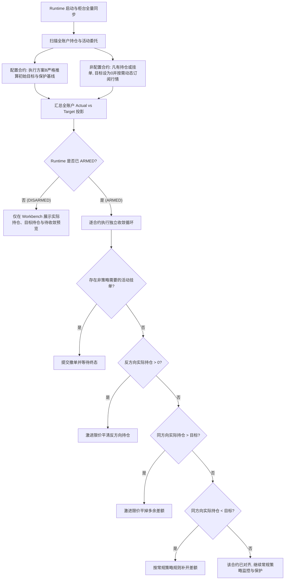

# Standalone Runtime 全账户目标持仓收敛与启动状态推算设计

> 状态：`CURRENT / IMPLEMENTED_OFFLINE_VERIFIED`  
> 日期：2026-11-24（2026-11-25 按 Issue #28 修订）  
> 适用范围：Standalone Trading Runtime 执行层（`DsvSession` / `ExplicitOrderController` / `DsvSdkAdapter`）、启动业务状态推算及 Workbench 持仓展示  
> 验证状态：已完成 Issue #28 核心项（任务 A/B/C）源码修复与离线回归（基于 `930bb1c` 工作区：`compileall` 通过，`test_startup_inference` + `test_account_convergence` 19/19 PASS，受影响 convergence/market_permissions/target 测试 36/36 PASS，全量离线 `unittest discover -s tests` 2058/2059 PASS，唯一失败为既有的 `test_dsv_workbench_parity.py:149` 中文文案差异）；实盘/仿真柜台连接（`LivePreflight`）与产品打包验收仍为 `NOT_RUN`

---

## 1. 背景与产品规则变更

在既有 Standalone 设计中，系统将期货账户持仓拆分为 `RuntimeProvedPosition`（本 boot 自有持仓）与 `ExternalOrUnattributedPosition`（外部/未归属持仓），并通过 `EXTERNAL_POSITION_PRESENT` 禁止同合约开仓、禁止平仓外部持仓，在 Workbench 首页弹出外部持仓提示条。

经用户明确确认，Standalone Trading Runtime 的产品执行模型调整为 **全账户目标持仓收敛模型（Account-Level Desired Position Convergence）**：

1. **统一账户视角**：不再区分“策略持仓”和“外部持仓”，统一以 **账号实际持仓（Actual）** 与 **策略目标持仓（Desired/Target）** 进行核算与展示。
2. **全账户收敛（含非配置合约）**：
   - 配置内监控合约：目标持仓由 DSV 策略规则决定；
   - **非配置合约**：只要柜台返回存在持仓，其目标持仓恒为 `0`，启动策略后自动清仓。
3. **仅在启动策略（`ARMED`）后收敛**：
   - 软件启动后默认 `DISARMED`：同步柜台事实、运行启动推算，在界面预览“账号实际持仓 vs 策略目标持仓”及待收敛动作，**严禁发单或撤单**；
   - 用户点击 **启动策略（`ARMED`）** 后，立即开始收敛。
4. **启动状态推算（方案 B — 严格按策略规则推算）**：
   - 启动同步完成后，结合柜台当日成交事实与当日行情/K 线，严格按策略规则推算每个配置合约此刻应持有的方向、手数与保护基线；
   - 无法被策略规则证明应持有的持仓（如人工随意开仓、非策略信号点位、已过强平边界的隔夜昨仓、已触发日停/止损）推算目标为 `0`，点击启动后自动平仓。
5. **自动撤销非策略活动挂单**：点击启动策略后，自动撤掉所有非当前策略需要的活动挂单（含外部挂单、旧 boot 遗留挂单及非配置合约挂单），待撤单终态释放可平仓位后再收敛。
6. **反手先平后开**：当某合约账号存在空单而策略目标为多单（或反之）时，先撤冲突挂单并平清反方向持仓，确认归零后再开目标方向。
7. **收敛平仓采用激进限价**：收敛平仓（多余同向、反向先平、非配置合约清仓）直接采用激进限价（涨跌停保护限价或对手价加激进滑点并截断至涨跌停、对齐 `tick_size`）尽快清仓。
8. **单合约阻塞隔离**：若某个非配置合约当前处于休市（例如无夜盘品种）、集合竞价、停牌或涨跌停封板无法成交，该合约排队等待下一个可交易时段/盘口再平，**不阻塞其他配置合约正常运行策略**。
9. **统一市场交易权限门禁与目标分离（2026-11-24 修订）**：
   - **市场交易权限与策略开仓限制分离**：Runtime 按合约统一计算市场阶段与权限（`market_phase`、`can_open`、`can_close`、`can_cancel`、`continuous_matching`、`evidence_state`、`status_source`）。`participate_auction=False` 与 `no_open_after_open` 属于策略普通开仓限制，仅约束普通策略开仓；开盘进入连续交易后（含开盘首分钟 `09:00–09:01` / `21:00–21:01`）立即允许收敛平仓、保护平仓与手动平仓等风险降低操作。
   - **集合竞价与非连续阶段默认规则**：开盘前、集合竞价撮合（开盘前最后 1 分钟）、盘中休市、临时停牌及收盘后禁止主动开/平仓；集合竞价申报阶段（开盘前 5 分钟至前 1 分钟）禁止主动开/平仓及撤单追价，仅在权限明确允许时执行必要的非策略/多余开仓撤单；撮合期禁止撤单。市场暂不可交易时保留目标持仓差额，市场恢复连续交易后自动继续执行，无需人工重启。
   - **分层交易状态来源**：保持 `TRADING_CALENDAR/1` 持久化结构不变，在其上派生只读阶段查询。优先采用可选实时交易状态（`TqApi.get_trading_status`，按连接生命周期订阅，无商业权限或超时时自动无错降级，不阻塞 Runtime 主循环，并识别 `CONTINOUS` / `AUCTIONORDERING` / `NOTRADING`）；无实时状态权限时以完整日历 + 可信时钟 + 当前时段有效行情作为 `INFERRED` 基础路径，并结合柜台拒单回报进行阶段修正；非配置合约按需在内存中构建临时运行期时段覆盖，不得直接以“存在报价时间”视为处于连续交易。
   - **失败分类与条件恢复重试**：市场阶段限制、行情暂不可用、本地因市场权限拒绝发送/撤单（`E_DSV_MARKET_PHASE`）不计入失败次数；`TRANSIENT` 拒单采用退避重试而非永久锁死；撤单 `effect_id` 唯一序列号与真实失败次数分离计数；结构性拒单基于失败原因与执行条件指纹（可用今昨仓、挂单占用、目标手数、合法价位、市场阶段）判断是否可重新计算并恢复重试，对无交易权限等明确权限故障保持阻断报警。
10. **Issue #28 核心可靠性修订（2026-11-25）**：
   - **统一 `Actual / Desired / Pending` 语义**：在 `target_execution.py` 提供 `effective_position_target` 与 `contract_pending_summary`，`plan_convergence`、`_compute_convergence_preview` 与 `standalone_projection` 共用同一目标口径（区分正常开仓 `quantity`、部分成交后停止补开 `owned`、减仓/退出 `exit_target`），输出 `deficit_*` 与 `pending_*`，不再将部分成交缺口或活动委托在途状态误标为 `ALIGNED`。
   - **统一委托占量与差额归零撤单**：`plan_convergence` 每轮先检查所有活动收敛平仓单；即使某侧 `conv_excess == 0`，多余在途收敛平仓单亦立即提交撤单（`CANCELLING_EXCESS_CLOSE`）。策略正常平仓路由（`_reduction_routes_with_reason`）与收敛平仓路由（`plan_convergence`）共同按合约、方向、今昨仓桶核算全部非终态平仓单（含 `SEND_POSSIBLE` / `UNKNOWN` / `CancelPending`）。
   - **启动状态推算与事实完整性**：`_collect_startup_facts` 与 `infer_startup_symbol_state` 按交易日历/窗口过滤当前交易日 K 线与成交（正确保留跨自然日夜盘、剔除上一交易日日盘）；将同一开仓目标的多次撤改子单归并为 1 次策略目标；区分 `DAILY_TARGET_LIMIT`/`NET_LOSS_STOP`（禁止继续开新仓）与已实现止盈日停，不因达到每日次数上限而强平当前合法在手仓位；`DISARMED` 等待期间对 Plan B 推算持仓只读增量复核保护状态（零发单/撤单）；`position_known=False` 时单合约隔离为 `DEFERRED_FACTS_INCOMPLETE`，不依据伪造零持仓执行。

---

## 2. 第一处源码差异定位

当前 `61c0dc0` 基线中，与新模型直接冲突的第一处入口分布如下：

| 层级 | 当前源码位置 | 现状行为 | 新模型变更方向 |
| --- | --- | --- | --- |
| 策略开仓门槛 | `src/online_trader/dsv_runtime/runner.py` (`L1120-L1126`) | `standalone_external_model` 下只要 `long_qty` 或 `short_qty` 非零即返回 `EXTERNAL_POSITION_PRESENT` 禁开；存在外部挂单返回 `E_FOREIGN_ACTIVE_ORDER` | 移除 `EXTERNAL_POSITION_PRESENT` 禁开；改为按 `(actual_long, actual_short)` 与 `(target_long, target_short)` 进入收敛状态机 |
| 持仓归属校验 | `src/online_trader/dsv_runtime/controller.py` (`L476-L510`, `L537-L572`) | `_position_proof_reason` 强制要求 `market[own] == position['owned']` 且 `market[other] == 0`，否则阻断或进入归属故障；`_reduction_routes_with_reason` 按本地 `fills` 推算今昨仓 | Standalone 收敛模式下直接以柜台真实 `long_today/long_historical/short_today/short_historical` 与全量活动委托为依据规划撤单与平仓路由 |
| SDK 订阅范围 | `src/online_trader/dsv_runtime/sdk_adapter.py` (`L1030-L1100` 及初始化订阅) | 仅订阅配置列表合约的 `quote`、`periods` 与 `calendar`；非配置合约无法获取盘口、`tick_size` 和涨跌停价 | 扫描账户全量柜台持仓与活动委托，对非配置合约按需动态订阅行情与合约属性，生成独立收敛条目 |
| 状态投影 | `src/online_trader/dsv_runtime/standalone_projection.py` (`L291-L340`) | 计算 `ext_long/ext_short` 并输出 `external_positions` 与 `EXTERNAL_POSITION_PRESENT` | 输出统一的账户持仓与策略目标持仓字段（含非配置合约待清仓项），不再将外部持仓标记为阻挡故障 |
| Workbench 首页 | `src/online_trader/desktop/workbench_layout.py` (`L1110-L1181`) | 首页对 `external_positions` 弹出黄色告警条；且存在 `view is None` 吞掉 `home_issue`、`recovery_required` 无匹配错误码缺兜底提示两处缺陷 | 移除外部持仓告警条，统一展示“账号持仓 vs 策略目标”；同时修复首页上述两处异常提示缺陷 |

---

## 3. 状态归属与不变红线

### 3.1 状态归属表

| 状态/数据 | 唯一权威与写入者 | 生命周期 | 说明 |
| --- | --- | --- | --- |
| 账号实际持仓、今昨仓桶、活动委托、成交、资金 | 期货柜台（Runtime 单向同步） | 每次 boot 与重连全量刷新 | 覆盖账号内**全部合约**（配置内 + 非配置） |
| 策略目标持仓 `(target_long, target_short)` 与保护上下文 | 当前 boot 的 Target Owner（内存 + 临时 Journal） | 仅当前 boot 存活，退出删除 | 启动时由方案 B 推算初值，盘中由策略信号/保护/强平更新 |
| 非配置合约清仓目标 | 当前 boot 的 Target Owner | 仅当前 boot 存活 | 凡柜台有持仓的非配置合约，目标恒为 `(0, 0)` |
| 订单意图、子单状态、`UNKNOWN` / `CancelPending` 占量 | 当前 boot 临时 Journal（单写者） | 仅当前 boot 存活，不交接 | 严格保持 `commit-before-send` |
| 账户历史缓存 `account-history.db` | History Cache Writer（可重建） | 跨 boot 持久化（仅辅助查询） | 辅助方案 B 核对当日成交/月停统计，不作为下单权威 |
| Workbench 界面展示状态 | Workbench 进程 | 进程内可丢弃 | 只读投影，不反向推导持仓归属 |

### 3.2 不可违背的工程红线

即使放开了平仓外部持仓与非配置合约，以下安全机制**全部保留，不得削弱**：

1. **单 Owner、单 Sender、单 SQLite 写者**：所有撤单、平仓、开仓仍只由当前 Runtime Owner 经 `ExplicitOrderController` 提交。
2. **`DISARMED` 严禁发单与撤单**：未点击启动策略前，只能同步事实、计算目标并在 UI 预览差异，不发出任何交易或撤单请求。
3. **`commit-before-send` 与 `UNKNOWN` 占量**：每次发单/撤单前必须先写入临时 Journal；调用结果未知（`SEND_POSSIBLE` / `UNKNOWN`）时按最大剩余量占量，未获完整柜台水位证据前不得重复发单。
4. **撤单未终态不叠加发单**：对同一合约同一方向的冲突挂单发出撤单后，必须等待柜台返回明确终态，再发新的平仓或开仓单，防止超平或反向错单。
5. **柜台事实不完整 / 时钟异常 / 存储异常时暂停动作**：不完整快照不得触发任何收敛平仓或开仓。

---

## 4. 整体流程与时序设计

### 4.1 账户目标持仓收敛主流程



### 4.2 典型场景时序（点击启动 → 撤外部挂单 → 平反手/非配置 → 开目标仓）

```mermaid
sequenceDiagram
    participant U as 用户 (Workbench)
    participant O as Target Owner (DsvSession)
    participant C as ExplicitOrderController
    participant S as DsvSdkAdapter / 柜台

    S->>O: 完整柜台帧 (实际持仓 + 全部活动委托 + 当日成交)
    O->>O: 方案B推算配置合约目标; 非配置合约目标=0
    O-->>U: 投影 Actual vs Target (DISARMED 仅预览)
    U->>O: START_STRATEGY (ARMED)
    O->>C: 提交全账户合约收敛计划
    alt 存在非策略活动挂单
        C->>S: 撤销非策略活动挂单 (commit-before-send)
        S-->>C: 撤单终态回报 (释放可平仓位)
    end
    alt 存在反向持仓或多余持仓/非配置持仓
        C->>S: 激进限价平仓 (按柜台今昨仓路由)
        S-->>C: 成交回报与最新柜台持仓
    end
    alt 目标方向仍存在缺口 (配置合约)
        C->>S: 常规策略限价开仓
        S-->>C: 成交回报, 建立保护基线
    end
    O-->>U: 投影更新为已对齐状态
```

---

## 5. 方案 B：启动状态推算规则（严格可证推算）

本节与草案 [runtime-business-state-restart-continuity-adr-20261124.md](file:///e:/online-trader/docs/refactor/runtime-business-state-restart-continuity-adr-20261124.md) 合流，明确 Standalone 启动后在无旧本地执行账本的前提下，如何确定每个配置合约的初始目标持仓与策略状态。

### 5.1 输入事实

推算过程为纯确定性函数，仅接受以下只读输入：
1. 当前已确认配置（`DsvProfile`：监控合约列表、交易参数、止损/半仓/保护线/日停/月停规则）；
2. 当前交易日完整柜台快照：各合约实际持仓（含今昨仓）、当前交易日已确认逐笔成交、当前交易日分钟 K 线/行情；
3. 可选历史缓存 `account-history.db`：仅用于核对跨日 `month_stop` / `stop_days` 统计（缺失时按保守口径记录诊断提示，不虚构历史止损天数）。

### 5.2 严格可证判定规则（逐合约独立判定）

对每个**配置内合约**：

| 条件检查 | 判定结论 | 目标持仓与保护状态 |
| --- | --- | --- |
| 柜台该合约实际持仓为 0 | 无需保留持仓 | `target = (0, 0)`；按当日已实现平仓盈亏重建 `day_stop`、`net_loss`、`target_count` 与 `last_signal_bar` |
| 存在隔夜昨仓，且按当前日历该合约上一交易日收盘已过强制平仓边界 | 隔夜仓不符合日内强平策略 | `target = (0, 0)`（点击启动后全平） |
| 存在双边锁仓（同时有多单和空单） | DSV 策略不允许单合约双边持仓 | 无法证明哪一侧应保留时按严格规则判定：若仅一侧满足下方可证开仓条件则保留该侧、另一侧目标 0；否则双边目标均为 `0` |
| 存在单边今仓，但**无当日柜台开仓成交记录**，或开仓时间不在策略允许开仓时段内，或开仓时刻对应当日行情/K 线**未触发策略入场条件** | 无法按策略规则证明（如人工随意开仓） | `target = (0, 0)`（点击启动后全平） |
| 存在单边今仓，且当日开仓成交时间、方向与当日 K 线信号**匹配策略规则**，且从开仓后至今的行情**尚未触发策略全平/止损/强平** | **可证应持仓** | 推算 `target` 为策略当前阶段应持手数（若按行情已触发半仓止盈，目标为剩余半仓手数；若实际手数大于目标手数，多余部分启动后自动平掉）；以实际成交均价建立开仓价基线，以开仓后至今可观测 K 线极值建立 `peak` 与 `half_stage` |
| 当日成交已证明该合约当日亏损达到 `day_stop` 或连续止损超限 | 策略当日已停开 | `day_stop = True`，`target = (0, 0)`（若有残余仓位，启动后全平且当日不再新开） |

> **关键原则**：方案 B 宁可因“缺少足够行情/成交证据”将无法证明的持仓归零（保守收敛），也**绝不虚构**开仓价、保护峰值或强行认领明显不符合策略逻辑的仓位。每次启动推算必须产出结构化诊断事件（`STARTUP_TARGET_INFERENCE`），记录每个合约的判定依据与结果。

---

## 6. 非配置合约动态平仓与激进限价机制

### 6.1 非配置合约动态订阅与生命周期

1. **发现**：柜台全量同步（及后续每一轮更新）扫描 `api.get_position()` 与 `api.get_order()`，凡 `contract_id not in configured_symbols` 且 `(long_qty > 0 or short_qty > 0 or has_active_order)`，即纳入 `unconfigured_targets` 集合，目标恒为 `(0, 0)`。
2. **按需动态订阅**：`DsvSdkAdapter` 对新进入 `unconfigured_targets` 的合约动态调用行情订阅，获取 `quote`（`last`、`bid1`、`ask1`、`upper_limit`、`lower_limit`、`price_tick`、`trading_time` 等）。
3. **休市与异常隔离**：
   - 若该非配置合约当前无有效盘口、未处于可交易时段、或涨跌停封板导致无法成交：状态标记为 `WAITING_SESSION` / `WAITING_LIQUIDITY`，继续轮询等待，**绝不阻塞其他配置合约的开仓、平仓与保护**；
   - 若该合约持仓归零且无活动委托，标记为已收敛并从活跃收敛队列移除。

### 6.2 非策略活动挂单自动撤单

在 `ARMED` 状态下，对任意合约（配置内或非配置）：
- 凡柜台活动委托的 `native_order_id` 不属于当前 boot 临时 Journal 中仍在有效期的策略子单（包括外部终端挂单、旧 boot 遗留挂单、非配置合约挂单），均归类为 `NON_STRATEGY_ACTIVE_ORDER`；
- 收敛器优先对其提交撤单（记录 `CANCEL_NON_STRATEGY_ORDER` 意图到临时 Journal），在该合约的冲突挂单全部到达终态前，不叠加发新的平仓或开仓单；
- 若单笔撤单失败或超时未终态，标记该合约为 `CANCEL_PENDING` 并等待下一轮柜台完整快照复核，不跨合约连坐阻塞。

### 6.3 激进限价平仓价格规则与今昨仓路由

1. **价格计算（仅用于收敛平仓：多余同向、反向先平、非配置合约清仓）**：
   - 卖平（平多）：优先取 `lower_limit`（跌停价保护限价）或 `max(lower_limit, bid1 - N * tick_size)`（对齐 `tick_size` 并校验 `lower_limit <= price <= upper_limit`）；
   - 买平（平空）：优先取 `upper_limit`（涨停价保护限价）或 `min(upper_limit, ask1 + N * tick_size)`（对齐 `tick_size` 并校验区间）；
   - 默认参数配置化（默认直接采用对手价加激进滑点截断至涨跌停，或在配置开启时直接使用涨跌停价），若委托未立即完全成交，沿用有限次撤改重试，直至持仓归零或封板挂起；
   - **常规策略开仓与常规盘中止盈/保护平仓**继续沿用原 DSV 价格规则，不改变原策略回测与实盘信号语义。
2. **今昨仓路由**：
   - 统一直接以柜台返回的 `long_today / long_historical / short_today / short_historical` 计算平仓指令（SHFE/INE 严格拆分为 `CLOSE_TODAY` 与 `CLOSE_YESTERDAY`，其余交易所按 `CLOSE`），不再依赖本地历史 `fills` 反推今昨仓桶，彻底避免外部持仓导致的 `E_OWNERSHIP` 或 `MISSING_TODAY_HIS_BUCKETS` 报错。

---

## 7. Workbench 界面统一展示与首页修复

1. **统一持仓视图**：
   - 取消“策略持仓 vs 外部持仓”的分裂展示，移除首页“账号存在非本机策略持仓（无需本机处理）...”黄色告警条；
   - 首页及持仓表统一以**账号合约**为行，核心列展示：
     - `合约`（标注是否配置内，非配置合约标示“非配置·待清仓”）
     - `账号实际持仓`（多/空手数）
     - `策略目标持仓`（多/空手数）
     - `收敛状态`（`已对齐` / `待启动收敛` / `撤单中` / `平仓收敛中` / `补开中` / `等待开盘`）
   - 在 `DISARMED` 状态下，若存在实际持仓与目标持仓不一致（包括非配置合约），在首页清晰提示“点击启动策略后将自动收敛以下持仓差异”，让用户启动前一眼看清会发生什么。
2. **同步纳入审核报告的两处首页异常修复**：
   - 修复 `home_attention_summary()` 在 `view is None` 时直接返回 `None` 导致吞掉 `self.window.home_issue`（命令异常）的缺陷；
   - 修复 `connection.get('recovery_required') == True` 但 `blocks` 未命中已知错误码时缺少通用故障提示与详情入口的缺陷（“重新核对”按钮仍严格遵守 `connected and synced and self.buttons['reconcile'].isEnabled()` 准入条件）。

---

## 8. 合同修订、兼容与回退

### 8.1 修订受影响的既有合同

本设计经确认并落地实现后，将修订以下两份文档的对应条款：
- [target-execution-and-standalone-cutover-20261121.md](file:///e:/online-trader/docs/refactor/target-execution-and-standalone-cutover-20261121.md) 第 3 节（Target 所有权边界）：Standalone 模式由“仅约束 `RuntimeProvedPosition`、不平外部持仓”修订为“全账户目标持仓收敛，允许撤外部挂单及平仓多余/反向/非配置持仓”。
- [runtime-workbench-reconciliation-guidance-20261124.md](file:///e:/online-trader/docs/refactor/runtime-workbench-reconciliation-guidance-20261124.md)：移除“外部/未归属持仓”告警流程；保留“自动同步中”“时钟/持久 Owner 故障重新核对”“UNKNOWN 委托核对中”的简洁分类。
- **不改变** Legacy 路径与 Replacement Candidate 路径的既有合同，仅作用于 Standalone Trading Runtime。

### 8.2 与 V1.1 生命周期解耦的兼容性

本设计与 [configuration-persistence-runtime-architecture-20261124.md](file:///e:/online-trader/docs/refactor/configuration-persistence-runtime-architecture-20261124.md) 完全正交且天然契合：
- V1.1 的 `MONITORING` 模式对应本设计的 `DISARMED`（只同步与方案 B 推算、不收敛）；
- V1.1 的 `TRADING` 模式对应本设计的 `ARMED`（执行全账户收敛与策略运行）；
- V1.1 的 `DRAINING` / 切账号 / 更新维护屏障只需先停新收敛并等待活动子单终态，不引入额外状态机冲突。

### 8.3 诊断证据要求

为保证实盘问题可回溯，关键节点必须写入结构化诊断事件（复用到现有 `DiagnosticSink` 并纳入关键事件保留优先级）：
- `STARTUP_TARGET_INFERENCE`：记录合约、实际持仓、推算目标、判定原因（如 `PROVED_OPEN_MATCH` / `UNPROVED_NO_TODAY_FILL` / `UNCONFIGURED_CONTRACT` / `DAY_STOP_ACTIVE`）；
- `CONVERGENCE_ACTION`：记录触发动作（`CANCEL_NON_STRATEGY` / `FLATTEN_OPPOSITE` / `REDUCE_EXCESS` / `FLATTEN_UNCONFIGURED` / `OPEN_GAP`）、目标与实际差额、激进限价与参考盘口/涨跌停价、今昨仓路由；
- `CONVERGENCE_DEFERRED`：记录非配置合约或配置合约因休市、无盘口、封板、撤单待终态而暂缓收敛的具体原因。

### 8.4 回退策略

- 若在代码落地阶段需要回退，仅需按提交回退 Standalone 收敛与 UI 展示改动，不涉及持久化数据库结构迁移（临时 Journal 每 boot 重建，`account-history.db` 保持只读兼容）。

---

## 9. 可执行异常验收条件（独立测试规格）

以下场景已纳入自动化测试与离线 FakeBroker E2E + Oracle 回归验证（工作区基线 `61c0dc09906aceba3ee9ec1915b0e17385590a26` 下 `FullOffline` 1998/1998 PASS、`SimAll` 17/17 PASS、`DesktopE2E` 3/3 PASS；实盘柜台与打包验收 `NOT_RUN`）：

1. **初始化存在多余/不可证持仓（塑料多单 30 手）**：
   - `DISARMED` 期间：界面展示实际多 30 手、目标 0 手，**发出 0 笔委托**；
   - 点击 `ARMED` 后：立即按激进限价全平 30 手（SHFE/INE 场景正确拆分今昨仓），平仓完成后实际持仓与目标持仓均归零。
2. **反手收敛（实际空单 5 手，策略目标多单 8 手）**：
   - 点击 `ARMED`（或盘中触发多头信号）后，先平清 5 手空单；确认空单归零后，再开 8 手多单；期间不出现双边同时发开仓单或超平。
3. **非配置合约全平与休市隔离**：
   - 账号持有非配置合约 A（交易时段内）与非配置合约 B（休市/无盘口），同时持有配置合约 C；
   - `ARMED` 后自动动态订阅 A、B，立即激进限价平清 A；B 标记为等待开盘不报错；C 正常按策略开平仓不受 B 阻塞；待 B 进入交易时段后自动平清 B。
4. **外部活动挂单自动撤单**：
   - 账号存在占用可平仓位的外部平仓挂单或反向开仓挂单；
   - `ARMED` 后先自动撤掉外部挂单，等待撤单终态回报后再执行平仓收敛，不因可平不足报错死循环。
5. **方案 B 严格可证保留与部分收敛**：
   - 当日成交与 K 线可证明策略应持多 5 手、账号实际持多 8 手 → `ARMED` 后仅平掉多余 3 手，保留 5 手并正确恢复保护基线；
   - 当日有人工随意开仓（不匹配策略信号）或已过强平边界的昨仓 → 推算目标为 0，`ARMED` 后全平。
6. **异常保护红线**：
   - 撤单或平仓返回 `UNKNOWN` 时按最大剩余量占量，不重复平仓导致反手开新仓；
   - 柜台快照不完整或时钟异常时暂停收敛，不发单。

---

## 10. 整合审核报告后的建议开发批次

1. **第一批：测试体系强化（优先）**
   - 完善 `qa/e2e/oracle.py` 必需字段与阶段性字段检查（含委托价、剩余量、柜台订单 ID、boot ID、配置 revision）；
   - 增加委托价格、开平属性、方向、字段缺失的负向故障注入测试。
2. **第二批：诊断系统与 Workbench 首页小范围修复**
   - 修复超限日志文件读取方向（超单文件上限走 `TAIL`）；
   - 简化历史 Workbench 日志预算处理（避免未按 boot 过滤提前挤占 Runtime 预算）；
   - 限制收盘上报的交易日范围至当前关联交易日；
   - 提高关键交易/行情/保护事件在日志裁剪时的保留优先级；
   - 修复 Workbench 首页无投影时吞掉 `home_issue` 及 `recovery_required` 缺通用提示两处缺陷。
3. **第三批：落地全账户目标持仓收敛与方案 B**
   - 实现 `DsvSdkAdapter` 非配置合约动态订阅与全账户挂单/持仓投影；
   - 实现方案 B 严格可证启动推算器与 `STARTUP_TARGET_INFERENCE` 诊断；
   - 改造 `runner.py` / `controller.py` 收敛执行（撤非策略挂单 → 激进限价平反手/多余/非配置 → 开差额）；
   - 改造 Workbench 统一持仓展示并补齐第 9 节全部 E2E 自动化测试。
