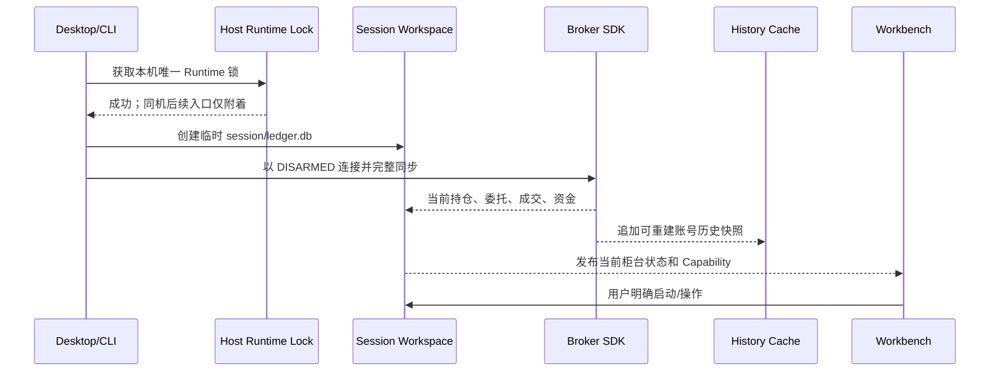

# Runtime 本机单实例与柜台权威改造

> 日期：2026-11-20  
> 状态：用户确认需求后的实施设计。本文定义目标合同、迁移和回退；不代表功能测试、柜台验收或发布完成。

## 1. 用户确认的目标

1. 一台 Windows 电脑只运行一个 OnlineTrader Standalone Runtime。
2. 不同电脑可以同时运行各自的 Runtime，并允许同时登录同一个期货账号和下单。
3. 期货柜台是持仓、活动委托、成交、资金和账户收益的唯一业务权威。
4. 不做 Runtime 账本交接、源设备退役或跨设备本地执行责任转移。
5. 本地长期业务存储仅保留可从柜台重新下载、可删除并重建的历史成交、委托、资金和收益缓存。
6. 新版本可以改变默认配置；用户显式覆盖与版本默认值分层保存。

这些决定替代旧 Standalone Runtime 的“每账号原执行账本随配置交接”合同。Legacy 和 Replacement 的历史文件保持只读兼容，不自动导入新 Runtime。

## 2. 状态与所有权

| 状态 | 权威与生命周期 |
| --- | --- |
| 当前持仓、活动委托、成交、资金 | 柜台/SDK；每次启动、重连和换日完整同步 |
| 当前会话命令、策略周期、发送前提交和保护计算 | 当前 Runtime 会话临时 SQLite；只在本进程生命周期内有效 |
| 历史成交、委托、资金、收益 | 本机 `account-history.db` 缓存；由柜台快照追加，可删除重建 |
| 默认策略配置 | 当前版本 `OnlineTrader-parameters.json` |
| 用户显式配置 | `OnlineTrader-overrides.json`；只保存相对当前默认值的覆盖 |
| 界面布局、筛选、短期诊断 | 本机展示状态；不参与交易裁决 |

本地历史缓存不能证明订单归属、恢复发送责任或阻止另一台电脑登录同一账号。

## 3. 正常启动流程

- 临时会话库由进程拥有，正常退出自动清理；异常残留不在下次启动恢复为交易权威。
- Runtime 启动不读取旧执行账本恢复周期、保护或开仓权限。
- 柜台完整同步之前保持 `DISARMED`，不得把缓存中的空集合解释为柜台空仓。
- 柜台已有仓位和订单以账号级外部事实展示；未经当前会话明确操作，不从旧本地记录自动认领。

## 4. 多电脑同账号

每台机器有独立的本机 Runtime 锁、临时会话和历史缓存。Windows 命名互斥量不会跨机器，因此不限制多电脑登录。

柜台持仓是账号汇总事实。若 SDK 提供稳定的客户端订单引用，可用于展示来源；缺少来源证明时保持账号级事实，不根据价格、时间或手数猜测设备归属。账号级全部撤单/全部平仓必须在界面明确说明会影响其他电脑。

纯本地 Runtime 无法原子协调多电脑共享的总风险额度；各机在发送前使用最新柜台资金、持仓和活动委托，并应用本机风险上限。未来若需要严格的跨机总额度，另行增加中心协调能力，但它不是允许多机交易的前置条件。

## 5. 历史缓存

`account-history.db` 只保存完整柜台快照：账号/provider、柜台日、gateway/source epoch、资金、持仓、委托、成交、观察时间和内容摘要。

- 写入使用独立后台 latest-wins 队列，不阻塞 Owner 交易轮次。
- 同一 snapshot ID 幂等；原生身份冲突保留诊断，不改造成本地订单所有权。
- 历史查询、收益和报告只读取该缓存。
- 缓存缺失时返回未同步/覆盖不完整，不创建交易状态。
- 可从柜台重新下载的范围取决于 SDK/结算接口；无法下载的日期如实标为未覆盖。

## 6. 配置版本

`OnlineTrader-parameters.json` 是当前版本默认配置，升级可以替换。`OnlineTrader-overrides.json` 保存用户相对默认配置的字段级覆盖：

1. 启动时先读取并验证版本默认配置；
2. 递归应用用户覆盖；
3. 新默认字段在用户未覆盖时自动生效；
4. 用户保存参数时原子更新覆盖文件，不写历史缓存或会话库作为下一次启动来源；
5. 删除、类型变化或不再合法的覆盖明确报 `E_RUNTIME_CONFIG`，不猜测迁移。

## 7. 兼容迁移与回退

- 旧 `data/.../ledger.db` 不删除、不覆盖、不合并，保留为只读历史证据。
- 新 Runtime 不再执行 `E_RUNTIME_HANDOFF` 碰撞检查，也不把 `initialized.json` 作为启动权威。
- 旧 `runtime export-handoff` 从默认 Runtime CLI 退役；历史命令不自动修改已有文件。
- 若新启动在连接柜台前失败，删除临时会话目录即可回退，默认配置、用户覆盖和历史缓存保持不变。
- 若历史缓存写入失败，只降低历史覆盖并记录诊断；不得改变 Owner 当前柜台状态或发送结果。

## 8. 诊断

启动和运行日志至少记录：本机 Runtime 锁结果、session ID、柜台同步阶段、账号/provider 摘要、历史缓存水位、配置默认哈希/覆盖哈希、同步失败条件和后续 `DISARMED` 状态。日志脱敏，不记录账号口令。

## 9. 验收条件

本次仅授权实现和编译检查；下列行为测试保持 `NOT_RUN`，待另行授权后由独立测试 Agent 执行：

1. 同机重复启动只附着一个 Runtime；不同账号也不能启动第二个 Runtime。Standalone 桌面同时只允许一个 Workbench 附着该 Runtime；再次运行 `OnlineTrader.exe` 只唤醒/前置现有 Workbench，不创建第二个面板。若 Runtime 已存在而 Workbench 不存在，EXE 验证本机发现记录与 Runtime baseline 后打开唯一 Workbench；若 Runtime 不存在，才走正常的 `DISARMED` 启动流程。
2. 两台电脑同账号可以同时连接、分别下单，并看到一致的账号级柜台状态。
3. 删除本机历史缓存后可重新同步，不影响柜台持仓和订单。
4. Runtime 异常退出后不恢复旧本地周期；重启从柜台完整同步且保持 `DISARMED`。
5. 新版本默认配置新增/变化时，未覆盖字段采用新默认，用户覆盖字段保留。
6. 旧执行账本仍存在时不触发 handoff 拒绝，也不被新 Runtime 写入。
7. 历史缓存、配置和临时会话故障的日志可定位到具体阶段和后续状态。

## 10. 当前修正候选状态

2026-11-20 最新独立全量复测对旧候选记录 `PASS 22 / FAIL 4 / BLOCKED 6 / NOT_RUN 6`。当前源码已针对第一失败修正 Workbench schema、历史缓存与执行库路由、Qt 脱敏账号展示，并将旧测试从跨重启 pending/ledger handoff 迁移到本文合同。已执行的新检查仅为 `compileall`，功能、GUI、回放、柜台和打包复测均为 `NOT_RUN`。根因、变更边界和下一次独立复测清单见[全量复测缺陷修正记录](runtime-full-retest-remediation-20261120.md)。

