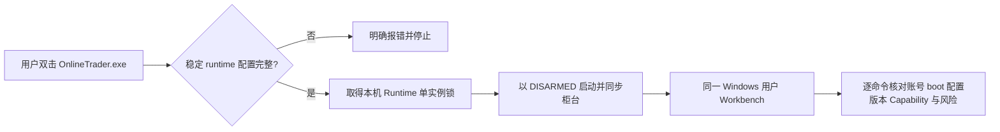

# Standalone Runtime 手动启动收口

2026-11-20 · 当前产品决定

## 目标与入口

Standalone Runtime 只由当前 Windows 用户通过配置完整的 `OnlineTrader.exe` 主动启动。Workbench 是唯一人工交易控制入口；CLI 只保留只读查询和运维诊断。缺少相邻稳定 `runtime/` 配置时，默认桌面入口明确失败，不静默回落 Legacy。

## 删除的旧产品合同

- 删除委托操作员 ID、令牌、有效期、`private/operators.json` 和外部交易命令管道。
- 删除 `runtime schedule`、`runtime-control.json`、自动策略启动和随包自启动守护。
- 删除 Standalone 执行账本 handoff 实现；旧账本和旧 handoff 文件只作为未被新版本读取或修改的历史文件保留。
- 删除旧 `qt-*` 操作员回执身份兼容。回执只属于当前 Runtime boot 和当前 Workbench 身份。
- 本机交互管道只接受启动用户 SID，不把 `LocalSystem` 当作交互用户。

## 状态与数据合同

期货账户继续作为资金、持仓、委托、成交、历史和收益的权威来源。每次 Runtime boot 创建进程所有的临时执行库，退出后删除；持久状态只包括版本默认配置、用户覆盖配置和可由柜台重建的历史/收益缓存。

更新器取得安装锁、Runtime 单实例锁及当前已配置账号的本机进程锁后切换版本。它不扫描、不解释、不结算旧 `ledger.db`，也不删除旧文件。任何锁冲突都保持当前版本并提示用户先关闭程序。

## 兼容、迁移与回退

- 已交付目录中的 `operators.json`、`runtime-control.json`、handoff 文件和守护脚本可继续留在用户磁盘；新版本忽略它们，自动更新无需删除客户配置。
- 新版配置交付只要求 `runtime.json`、`OnlineTrader-parameters.json`、可选用户覆盖和 `private/OnlineTrader-defaults.json`。
- 显式 Legacy 维护参数仍可进入旧路径；无参数默认入口不得进入 Legacy。
- 回退旧版时，旧版可继续使用原遗留文件；新版不迁移或改写这些文件，因而回退不需要数据反向转换。

## 诊断与验收条件

启动失败应明确区分配置缺失、单实例冲突、柜台同步失败和 Workbench 通道身份失败。命令审计继续记录脱敏账号、boot、配置版本、操作、命令 ID、对端 PID/SID 和拒绝原因。

后续获得测试授权时至少验证：手动双击启动、缺配置不回落、不同 SID 拒绝、LocalSystem 拒绝、CLI 无交易命令、遗留授权/控制/handoff 文件被忽略、旧账本不阻止更新、Workbench 全部封闭操作以及更新后配置保留。本次按仓库规则只执行编译检查。
