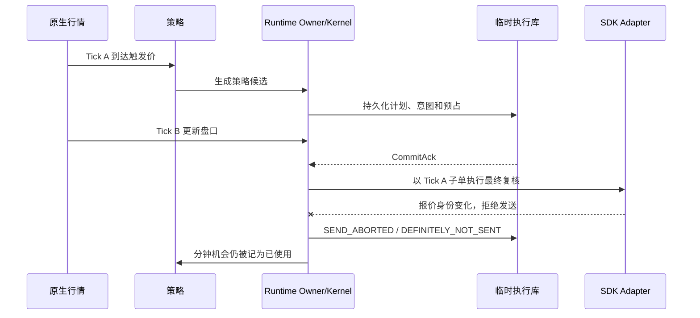
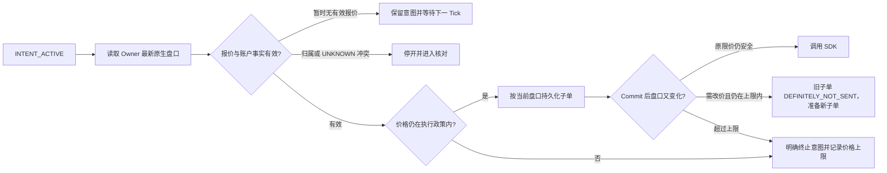
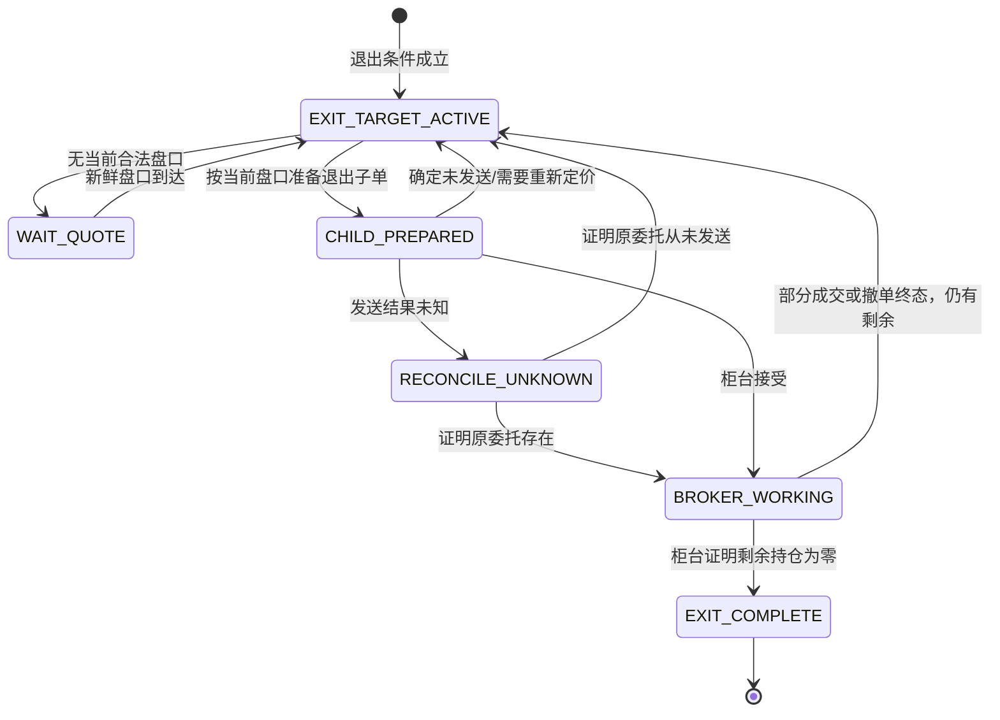

# Standalone Runtime 行情竞态、开仓漏单与退出可靠性修正设计

2026-11-20 · 问题分析与实现前评审稿

## 1. 结论

当前 Standalone Trading Runtime 的策略链路存在严重的行情竞态风险：策略在一笔行情上产生开仓候选后，持久化与最终发送复核期间如果行情更新，最终校验可能把正常的报价变化归类为 `E_OWNERSHIP`，确定不调用 SDK；与此同时，策略状态仍可能把该分钟机会记为已使用。结果是满足策略条件但没有报单，且同一分钟的后续有效报价不能继续完成原机会。

这不是单纯的提示文案问题，而是会真实漏单的 P0 缺陷。平仓路径虽然保留共同退出目标，通常能在新报价到来后重新定价和重试，不与开仓完全相同，但仍存在反复 `SEND_ABORTED`、错误分类、重试推进不透明以及旧执行策略可能耗尽尝试次数的风险。任何退出目标都不得因为行情正常更新而消失或静默停止推进。

修正方向不是删除发送前复核，也不是无限放宽报价年龄，而是分离以下四类事实：

1. **策略信号事实**：为什么建立开仓或退出意图；
2. **执行定价事实**：本次子单按哪一笔最新合法盘口定价；
3. **账户与订单归属事实**：持仓、委托和数量是否由当前 Runtime 管理；
4. **发送结果事实**：确定未发送、可能已发送、已调用 SDK 或已被柜台确认。

在完成修正并取得独立 SimNow 自然开仓、成交保护和自然退出证据前，不应把当前自动开平仓能力视为已验收。

### 1.1 2026-11-20 实施状态

本设计已经按评审修订为工作区实现候选，但仍是 `P0 / IMPLEMENTED_CANDIDATE / NOT_TESTED`，不构成发布或自动交易验收通过：

- 复用现有 `intent_id / child_order_id / attempt_id`，一个逻辑开仓目标只计一次授权；明确未发送后的本地重新定价继续使用原 Intent；
- 普通开仓信号冻结方向、触发价、分钟身份、策略版本、有效时段和追价上限，发送限价按最新合法盘口重新判断，不再要求旧候选的 `limit_price` 完全复现；
- Gateway 使用类型化的 SDK 前拒绝。能够证明尚未进入 `insert_order()` 的失败提交为 `DEFINITELY_NOT_SENT`；越过边界后的异常仍为 `UNKNOWN`；
- 报价、持仓、外部活动委托、开仓信号失效、追价上限和平仓路由使用不同错误码及结构化证据；
- `target_remaining_qty` 继续表示退出完成后的目标剩余持仓。柜台已证拒单不再删除或永久阻断自动退出目标，而是重新计算价格与平今平昨路由；
- 1.2 新计划把连续三次柜台拒单作为版本默认人工接管门槛；目标及潜在数量仍保留，人工接管提示不等于删除退出责任；
- Runtime/Workbench 投影包含开仓 Intent 的下一责任动作与退出责任状态；持续缺合法退出价格的数据断流场景进入人工接管提示；
- 旧 boot 的执行记录没有迁移为当前交易权威，未增加第二个 sender、跨设备锁或持久账本交接。

当前仅执行源码编译检查。故障注入、独立回归、SDK 边界崩溃恢复及真实 SimNow 自然开平仓均须在本次另行授权的独立测试中完成。

## 2. 范围与约束

本设计适用于默认的 Standalone Trading Runtime，实际交易 Owner 仍是单一 Runtime 进程。Workbench、runtime-view 和 Qt 只负责读取与人工控制，不能成为第二个 SDK 发送者或执行库写入者。

必须保留：

- 订单调用前的持久化；
- 单一 Owner、单一 SQLite writer 和单一 SDK 发送链；
- `UNKNOWN` 对潜在成交量的占用与柜台核对责任；
- 柜台持仓、委托、成交和资金的权威地位；
- 当前 boot、账户、柜台日、盘段、配置版本和授权范围绑定；
- 平仓请求、撤单请求和实际终态之间的区别；
- 所有退出动作共享一个剩余退出目标。

本设计不授权连接账户、发送订单、运行测试或打包。

## 3. 现场问题与证据

2026-11-20 夜盘，塑料 `DCE.l2701` 的用户可见记录显示：

1. 21:29:22 策略启动成功，自动开仓权限为 `ARMED`；
2. 塑料当日高 7972、低 7903，开仓偏移 55，多开触发价为 7958；
3. 21:38:02 出现 `开仓条件受阻 · E_OWNERSHIP`；
4. 同一时刻随后出现 `当前分钟机会已使用`，并立即解除 `E_OWNERSHIP`；
5. 21:38:27 现价显示为 7958，但没有订单发送、委托回报或成交记录。

第一处差异发生在策略候选已经形成之后、SDK 订单调用之前。现有源码在开仓最终校验中把以下不同情况合并为 `E_OWNERSHIP`：

- 当前原生报价与策略接受报价不再满足完全一致或新鲜性要求；
- 所选合约不再是空仓；
- 所选合约存在活动委托。

现场错误瞬时出现又解除，账户摘要没有持续的持仓或活动委托屏障，因此最可能的触发条件是策略候选产生后行情再次更新，导致最终报价身份或盘口复核失败。由于现有日志没有保存该次 `E_OWNERSHIP` 的具体谓词和新旧报价字段，该细分原因仍需在修正后的诊断中明确证明。

## 4. 为什么既有测试没有证明该能力可用

既有覆盖证明了若干局部性质：

- 受控离线行情可以生成 `ENTRY_COMMITTED` 并调用替身发送接口；
- 旧报价不能直接授权最终发送；
- 报价超时和重连等待在部分用例中不会消耗当前信号；
- 风控、价格限制和部分业务拒绝会消费分钟机会；
- 产品通过显式限价操作曾在 SimNow 实际发送并成交。

但这些证据没有覆盖完整用户流程：

> 真实连续行情自然触发策略 → 提交期间行情变化 → 确定未发送 → 同一逻辑机会使用新鲜盘口继续推进 → 柜台收到自动委托 → 成交 → 自动保护 → 自然退出。

已有真实 SimNow 成交属于显式限价测试，不是自然策略入场的通过证据。历史记录也持续把自然开仓、成交后保护和在线自动退出列为待验范围。因此，不能用离线替身的 `ENTRY_COMMITTED` 或一次人工/显式限价成交替代自然自动交易验收。

## 5. 当前失效机制

### 5.1 开仓时序

行情变化本身并不是持仓或订单归属变化。把它归类为 `E_OWNERSHIP` 会隐藏真正失败条件，也使上层无法选择正确的后续动作。

### 5.2 平仓风险

当前平仓路径具有一项重要的正确基础：止损、止盈、收盘等动作写入共同的 `target_remaining_qty`，目标通常会跨后续报价保留；`DEFINITELY_NOT_SENT` 的退出子单可在新行情到来后重新准备，`UNKNOWN` 继续占用数量。

仍需解决的风险包括：

- 最终复核要求旧子单价格与当前执行价格完全一致，活跃行情下可能反复中止；
- 普通报价变化与真实持仓/活动委托冲突仍可能共用模糊错误码；
- `SEND_ABORTED` 后是否等待、何时重试、使用什么新价格没有完整用户可见证据；
- 旧计划中的 `max_child_order_attempts=1` 可能让退出目标存在但不再产生新子单；
- 持续无法发送时缺少明确的分级升级、告警和人工接管状态。

因此，平仓目标未必立即丢失，但不能据此声称目标点位一定能够及时报单或成交。

## 6. 设计原则

### 6.1 信号与执行价格分离

策略 Tick 决定是否建立逻辑意图；发送前最新合法盘口决定实际子单价格。策略候选不得要求原始 Tick 在整个异步提交期间保持不变。

### 6.2 安全条件不因放宽精确相等而降低

发送时仍必须检查：

- 当前报价新鲜、同一 source epoch、同一柜台日和盘段；
- 当前权限、配置、风险和控制代次仍有效；
- 当前持仓数量与 Runtime 已证归属一致；
- 不存在非本 Runtime 的活动委托或未知发送；
- 价格满足 tick、涨跌停、追价上限和交易所规则；
- 子单已在 SDK 调用前持久化。

### 6.3 逻辑意图和发送尝试分层

一个策略机会只建立一个 `entry_intent_id`。该意图可以生成多个顺序子单尝试，但每个尝试必须有独立 `child_order_id/attempt_id` 和明确终态。确定未发送可安全地产生下一尝试；可能已发送则必须核对原尝试，禁止换 ID 盲目重发。

### 6.4 退出目标高于报价尝试

退出目标在持仓归零并取得柜台证明之前持续有效。单次报价失效、单次提交失败、撤单请求或进程内重定价不能取消退出目标。

## 7. 新开仓状态合同

建议把当前隐式的“分钟已使用”改为显式意图状态：

| 状态 | 含义 | 后续动作 |
| --- | --- | --- |
| `SIGNAL_OBSERVED` | 已发现策略信号，但尚未建立可执行意图 | 完成业务规则、风险和授权检查 |
| `INTENT_ACTIVE` | 唯一逻辑意图已持久化 | 等待当前有效盘口，准备子单 |
| `CHILD_PREPARED` | 子单及价格已在调用前持久化 | 执行最终账户、价格和权限复核 |
| `DEFINITELY_NOT_SENT` | 可证明未调用 SDK | 保留意图；按当前盘口准备下一尝试或明确终止 |
| `SEND_POSSIBLE/UNKNOWN` | 可能已调用或结果未知 | 冻结数量；只核对原 ID，不重发 |
| `BROKER_WORKING` | 柜台已确认委托 | 按订单状态管理撤改与成交 |
| `INTENT_TERMINAL` | 已成交、柜台终态或明确业务终止 | 记录最终消费原因 |

分钟信号状态和逻辑意图状态必须分离。以下情况不得把机会终结为“已使用”：

- 持久化期间行情更新；
- 当前原生报价暂时未同步；
- 报价年龄瞬时越界但下一笔报价可恢复；
- SDK 可证明没有被调用；
- 可重试的本地提交或定价竞态。

以下情况可以终结逻辑机会：

- 进入 `SEND_POSSIBLE/UNKNOWN` 或已经调用 SDK；
- 柜台接受、拒绝、撤销或成交；
- 当前价格超过批准的追价上限；
- 原盘段或开仓窗口结束；
- 权限、配置或风险发生不可继续的变化；
- 用户停止策略。

明确终止必须记录具体业务原因，不能只写 `CANDLE_OPPORTUNITY_CONSUMED`。

## 8. 发送前重新定价合同

“原限价仍安全”按方向判断，而不是要求盘口完全相等：

- 买入：最新可成交价不高于已承诺的最大买入限价；
- 卖出：最新可成交价不低于已承诺的最小卖出限价；
- 行情向有利方向变化不应阻止发送；
- 行情向不利方向变化但仍在追价上限内，应准备新子单；
- 超过追价上限则终止本次开仓意图。

最终子单价格仍须遵守现有被动/主动、追价窗口、滑点比例、涨跌停和最小跳动政策。修正不等于使用市价单或无上限追价。

## 9. 新平仓状态合同

平仓不得复用“分钟机会消费”。止损、止盈、保护、收盘和人工减仓统一收敛到持久退出目标：

强制要求：

- `target_remaining_qty` 只有在更严格的新退出目标或已证成交下收紧，不能回升或因报价失败清空；
- `DEFINITELY_NOT_SENT` 不占用退出数量，可在下一笔有效行情重新准备；
- `SEND_POSSIBLE/UNKNOWN` 占用潜在成交量，直到柜台核对结束；
- 撤单请求不释放原单潜在成交量；
- 部分成交只减少共同剩余目标，晚到成交继续入账；
- 普通报价竞态不计入会耗尽的业务尝试上限；
- Standalone 当前计划的自动退出不得使用 `max_child_order_attempts=1`；
- 持续无法取得报价或持续遭柜台拒绝时，保持退出目标，显示明确告警并要求人工接管，不能静默停止。

## 10. 错误分类与诊断

必须拆分现有笼统的 `E_OWNERSHIP`：

| 建议错误码 | 含义 | 默认责任动作 |
| --- | --- | --- |
| `E_NATIVE_QUOTE_NOT_CURRENT` | 没有当前有效原生报价 | 保留意图/退出目标，等待新报价 |
| `E_QUOTE_REVISION_CHANGED` | 提交期间盘口更新 | 重新判定原限价是否仍安全，必要时准备新子单 |
| `E_ENTRY_PRICE_CAP` | 最新价格超过开仓追价上限 | 终止本次开仓意图 |
| `E_POSITION_MISMATCH` | 柜台持仓与已证归属不一致 | 停开并核对；已有退出责任不得删除 |
| `E_FOREIGN_ACTIVE_ORDER` | 存在非本 Runtime 活动委托 | 停止冲突发送并核对 |
| `E_EXIT_ROUTE_CHANGED` | 平今/平昨或可用桶变化 | 重新计算关闭路由，不删除退出目标 |
| `E_UNKNOWN_SEND` | 可能已经调用 SDK | 冻结数量，查询原订单身份 |

每次拒绝至少记录：

- `entry_intent_id/exit_target_id`；
- `child_order_id/attempt_id`；
- 原候选行情和发送前行情的 native tick ID、source time、source epoch；
- 原/新最新价、买一、卖一、报价年龄和盘段；
- 原限价、最新可执行价、追价上限及比较结果；
- 柜台持仓、已证归属量、活动委托摘要；
- SDK 是否被调用；
- 本次终态及下一责任动作。

现有用户界面把报价变化显示为“柜台归属待核对”，不能还原实际失败谓词，与仓库的可诊断性要求冲突，应标记为 `CONFLICT / NEEDS_REVIEW`。

## 11. 兼容、迁移与回退

### 11.1 当前 boot

本修正只影响新建立的逻辑意图和子单尝试。实施切换时，当前 Runtime 必须保持 `DISARMED`；已有 `UNKNOWN`、活动委托、持仓和退出目标先从柜台核对，不得重解释为新状态后自动重发。

### 11.2 旧执行记录

旧临时执行库只作为历史证据，不迁移为新 boot 的交易权威。历史 `CANDLE_OPPORTUNITY_CONSUMED` 不在新 boot 自动恢复成活动意图。

### 11.3 配置

新增执行政策字段必须进入版本默认配置，并与用户覆盖分层。旧配置缺少字段时使用经过评审的版本默认值；非法覆盖明确报配置错误，不能猜测迁移。

### 11.4 回退

若新逻辑在发送前失败，可回退旧版本，但必须保持停开并先核对柜台事实。回退不能重新发送新版本留下的 `UNKNOWN` 子单，也不能删除已有退出责任。

## 12. 实施拆分

建议按以下顺序实施，避免把 P0 修正扩大成无边界重构：

1. **诊断先行**：为报价、持仓和活动委托的每个最终谓词记录结构化证据，拆分错误码；
2. **开仓意图与分钟消费分离**：确定未发送的报价竞态保留原逻辑意图；
3. **最新盘口定价**：子单使用发送前最新合法盘口，允许有利变化和批准范围内的重新定价；
4. **平仓持续推进审计**：保证退出目标不受报价竞态、旧尝试上限或单次发送中止影响；
5. **Workbench 投影**：显示活动意图、退出目标、最后中止原因和下一责任动作；
6. **独立验收**：先离线故障场景，再真实 SimNow 自然开仓、保护和退出；
7. **完成门槛**：只有最终柜台事实、订单身份、成交和持仓归零均独立验证后，才能恢复自动交易可用声明。

## 13. 后续独立验收条件

测试必须由未参与实现的独立测试 Agent 使用 `$independent-testing` 执行，并从用户实际 Runtime/Workbench 入口操作。至少覆盖：

### 13.1 开仓

1. 触发后以 10–50 ms 间隔连续更新报价，仍能在允许范围内发送；
2. 提交期间行情向有利方向变化，原限价仍安全并发送；
3. 向不利方向变化但仍在追价上限内，旧子单确定未发送，新子单按最新盘口发送；
4. 超出追价上限，明确终止且不误发；
5. 确定未发送后同一分钟的新鲜报价继续推进；
6. SDK 调用边界断线，进入 UNKNOWN 并且不重复发送；
7. 当前持仓或外部活动委托真实冲突时，明确报告归属原因而不是报价错误。

### 13.2 平仓

1. 止损、止盈、保护和收盘目标触发后连续变价，退出目标始终保留；
2. 单次最终复核失败后，下一笔报价重新定价并发送；
3. 部分成交、撤单、撤单失败、晚到成交和重新定价共享同一剩余目标；
4. 平今/平昨桶变化后重新路由，退出数量不丢失也不重复；
5. UNKNOWN 子单核对前不补发；
6. 持续无行情、持续柜台拒绝和时钟故障时，目标保留且产生可操作告警；
7. 实际 SimNow 完成自然开仓、柜台成交、成交后保护、自然退出和独立重新登录归零核对。

### 13.3 报告要求

报告必须记录完整候选 SHA、Runtime boot、隔离配置、账户环境、柜台日、用例预期与实际、订单和成交身份、脱敏日志证据，以及 `PASS/FAIL/BLOCKED/NOT_RUN` 数量。离线替身结果不得替代真实 SimNow 结论。

## 14. 交付判断

在以下条件全部满足前，本问题保持 P0 未关闭：

- 报价变化不再被错误归类为持仓/委托归属冲突；
- 开仓确定未发送后不会错误消费可继续执行的逻辑机会；
- 退出目标在所有报价、撤单、部分成交和 UNKNOWN 分支中持续可追踪；
- 日志能还原每次发送或未发送的精确谓词；
- 独立测试完成真实 SimNow 自然开仓与自然退出闭环；
- 最终账户持仓、活动委托和未知责任均有柜台证据闭合。

