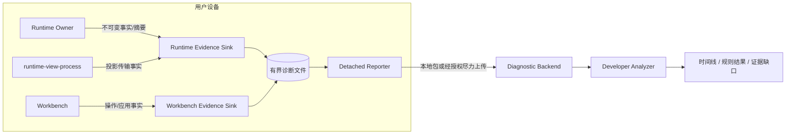
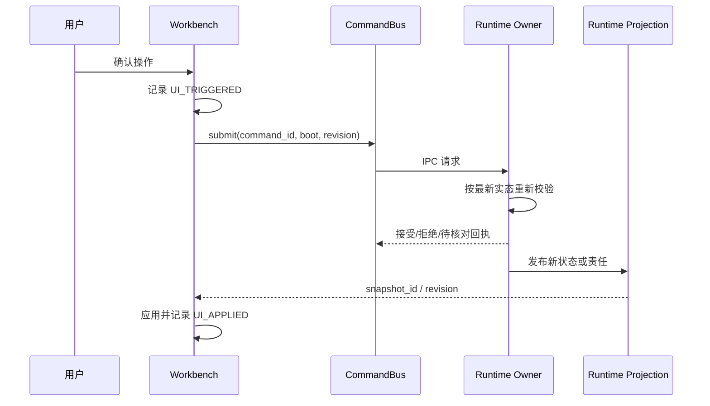
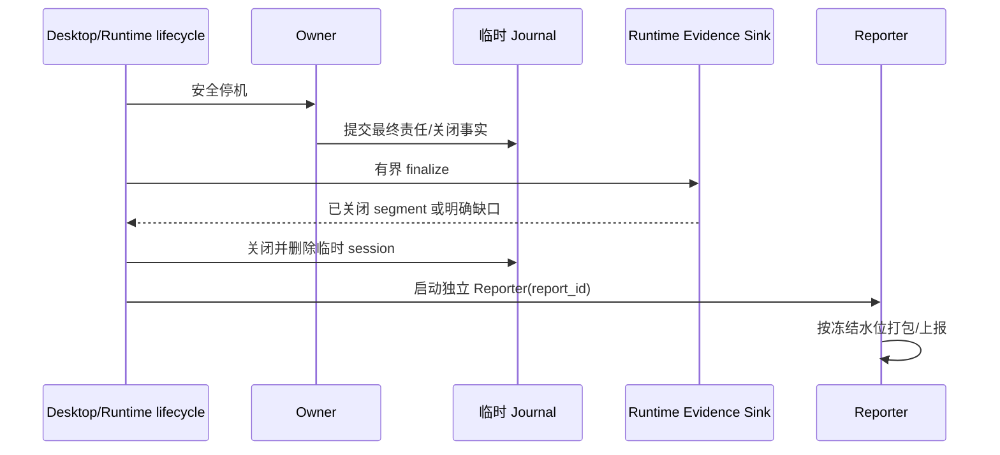

# Runtime & Workbench Diagnostics 诊断上报与运行证据系统实施设计

2026-11-24 · `CANDIDATE / IMPLEMENTED_REVISED_CANDIDATE`

> 适用路径：Standalone Trading Runtime、runtime-view-process、Runtime Workbench 与开发端诊断工具。  
> 本文定义架构、数据合同、生命周期、迁移、回退、诊断点和验收条件；对应源码候选已实现，但功能、实机、在线上报和制品验收仍为 `NOT_RUN`，本次实现不授权账户连接、交易、测试、构建或打包。
> 当前权威仍是期货账户、当前 boot 的单一 Owner 与临时执行 Journal。诊断记录不是交易事实、恢复源、第二套状态机或跨设备交接介质。

### 2026-11-24 简化评审覆盖

用户复审后确认本节覆盖本文中更严格的冻结、水位和上传凭据草案：

- 诊断允许丢失、重叠和单次上报失败；不建设跨进程屏障、可靠补传、遥测服务或新的诊断控制协议。
- 收盘切片只在当前 boot 内按完整交易日历观察到“曾进入盘段，随后所有绑定合约结束最终适用盘段”时触发一次。日历不完整、冲突或 Runtime 在盘后才启动时不猜测、不补报。
- Reporter 对活跃文件固定读取打开时观察到的字节长度，舍弃末尾不完整 JSON 行；不等待业务队列清空。任何必需活跃流都使包成为 `PARTIAL`。
- Workbench 允许跨越多个 Runtime boot。Reporter 按事件 `runtime_boot_id` 选取目标 boot，只把同一进程的启动、连接和异常等 bootless 记录作为 `UNATTRIBUTED_PROCESS_CONTEXT`，且不以它们证明完整。
- 统一桌面 bootstrap 显式声明本次预期 Workbench；若目标 boot 没有对应 Workbench 事件则包为 `PARTIAL`。运维 `runtime run` 不强行要求 Workbench，runtime-view 订阅日志只提供辅助发现。
- runtime-view 复用现有有界日志，仅采集白名单解析后的启动、退出、重启、客户端连接和命令结果；无法归属的行只作上下文。
- Reporter 只删除已经 finalize 的进程目录。每个 Sink 只淘汰自己最旧的已关闭分片；磁盘或诊断失败不传播到交易业务。
- 不新增或修改行情、开仓、订单或保护门禁。诊断只观察现有裁决。
- 新交付配置优先使用项目级 Deploy Token 的 `write_package_registry` 权限；旧 `/1` 私人 Token 配置只作兼容读取，不再作为配置工具默认输出。

## 1. 定位与目标

系统正式命名为：

**Runtime & Workbench Diagnostics（软件运行诊断与观测行为核对系统）**

它只解决四类问题：

1. 软件出错或表现异常时，能够还原足够的运行现场。
2. 能够核对本次真实运行中已经观察到的行为是否符合公开合同。
3. 能够区分问题首先发生在行情源、Runtime Owner、SDK/柜台接口、临时执行存储、IPC/runtime-view，还是 Workbench。
4. 能够在明确的诊断截止点和正常退出时生成有覆盖说明的诊断包，并在授权配置下尽力上报。

本文有意不建设：

- 7×24 小时实时遥测平台；
- 新的交易状态管理器、订单所有者或恢复账本；
- 强可靠补传、开机自动补报、断点续传或系统服务；
- 全量 Tick、完整数据库或账户秘密上传；
- 在 Runtime 内执行复杂根因分析；
- 以一次实机轨迹替代单元测试、回放、模拟交易或独立产品验收。

## 2. 结论语义：诊断能证明什么

诊断系统不能笼统报告“功能正常”。Analyzer 的结论必须绑定：软件版本、Runtime boot、配置 revision、账号匿名标识、时间窗口、证据覆盖和规则版本。

统一结果状态：

| 状态 | 含义 |
| --- | --- |
| `OBSERVED_OK` | 在本次有完整适用证据的观测窗口内，没有违反该规则 |
| `VIOLATION` | 已观察到满足失败谓词的事实 |
| `DEGRADED` | 行为继续运行，但质量、时序或覆盖低于目标 |
| `INCONCLUSIVE` | 证据缺失、时钟不可信、身份不一致或顺序无法证明，不能下结论 |
| `NOT_EXERCISED` | 本次运行没有发生该功能所需场景 |
| `NOT_APPLICABLE` | 该版本、配置或入口不适用此规则 |

禁止把以下情况判为 `OBSERVED_OK`：

- 没有错误日志；
- Recorder 没有记录到事件但存在已知丢弃；
- 只看到 Workbench 显示，没有 Runtime 或柜台侧证据；
- 只看到 Runtime 请求，没有 SDK 调用结果或柜台事实；
- 规则需要成交、撤单、断线恢复等场景，但本次没有发生；
- 两个版本的运行环境、负载或证据范围不可比。

## 3. 不可妥协的权威边界

| 状态/事实 | 权威与写入者 | 生命周期 | 诊断系统的权限 |
| --- | --- | --- | --- |
| 持仓、委托、成交、资金、收益 | 期货账户；Runtime 同步并裁决 | 柜台事实 | 只记录脱敏观察和身份关联 |
| SDK、下单、撤单、保护、交易决策 | 当前 Runtime Owner | 当前 Runtime boot | 只接收事件，不调用 SDK、不发命令 |
| 发送前提交、UNKNOWN 责任、当前周期 | 当前 boot 临时 Journal | boot 结束即删除，不交接 | 可按提交水位导出只读证据，不成为恢复源 |
| 历史与收益 | `account-history.db` 可重建缓存 | 本机持久，可删除重建 | 记录缓存水位和写入结果，不把缓存当交易权威 |
| Workbench 页面状态和 pending 关联 | 当前 Workbench / CommandBus | 当前 Workbench 进程 | 记录本进程看到和应用的事实，不跨进程恢复 |
| 诊断事件、指标和包 | 每进程诊断写入器 / Reporter | 有界保留 | 仅用于排障与观测核对 |
| 上报任务状态 | Reporter 独占任务文件 | 最多一次短生命周期尝试 | 不改变 Runtime 或 Workbench 生命周期决定 |

因此，“账户到数据库链路”必须拆分为：

```text
交易责任链：
柜台事实 -> Owner 处理 -> 临时 Journal 提交 -> SDK 调用 -> 柜台回报

历史展示链：
完整柜台快照 -> BrokerHistoryWriter -> account-history.db -> Workbench 历史读取
```

二者分别使用 `execution_journal_event_seq` 和 `history_snapshot_seq`，不得使用含混的 `database_commit_id`。

## 4. 总体架构



只有三个产品角色：

| 角色 | 位置 | 职责 |
| --- | --- | --- |
| Evidence Sink（Recorder 适配层） | Runtime、runtime-view、Workbench 内 | 接收业务代码在原始决策点产生的事实，异步有界写入 |
| Diagnostic Reporter | 用户设备短生命周期独立进程 | 按已冻结水位读取、脱敏、压缩、生成 Manifest，并尽力上报 |
| Diagnostic Analyzer | 开发仓库工具 | 校验包、重建时间线、执行规则、比较可比运行 |

Evidence Sink 不是新的业务组件树。它应复用并逐步统一现有：

- `RuntimeDiagnostics` 的有界异常、恢复和轮转；
- `OrderDiagnosticTracker` 的订单阻断去重；
- `QuoteTrace` / `MarketLatency` 的行情身份、覆盖和丢弃计数；
- Workbench 已有的渲染延迟记录；
- Runtime client 的稳定诊断目录和通知去重；
- 临时 Journal 已提交的业务事件及水位。

每个进程最多一个诊断写入器。业务模块只提交小型不可变记录，不各自管理文件、线程或上传。

## 5. 统一事件合同

### 5.1 基础信封

建议建立 `ONLINE_TRADER_DIAGNOSTIC_EVENT/1`：

```json
{
  "schema_version": "ONLINE_TRADER_DIAGNOSTIC_EVENT/1",
  "stream_id": "runtime:boot-...:events",
  "event_seq": "1052",
  "observed_at_utc": "2026-11-24T10:03:00.123456Z",
  "monotonic_ns": "1234567890",
  "process_role": "RUNTIME_OWNER",
  "process_instance_id": "process-...",
  "runtime_boot_id": "runtime-...",
  "account_pseudonym": "acct-...",
  "configuration_revision": "42",
  "component": "execution",
  "event_type": "EXECUTION_DECISION",
  "reason_code": "OPENING_PAUSED",
  "error_code": null,
  "severity": "INFO",
  "correlation": {
    "decision_id": "decision-...",
    "snapshot_id": "13821"
  },
  "payload": {},
  "diagnostic_protocol": "1"
}
```

约束：

- `event_type`：发生了什么稳定事实；
- `reason_code`：正常允许、拒绝、等待或降级的业务原因；
- `error_code`：非预期异常或合同失败；
- `severity`：影响，不参与交易裁决；
- `correlation`：只放稳定身份，不塞入整份业务对象；
- `payload`：按事件 schema 白名单输出，禁止任意对象序列化；
- 同一事件 schema 的字段含义跨补丁版本保持兼容；新增字段默认可忽略。

### 5.2 顺序、丢失与覆盖

- 每个进程、每个记录流独立维护 `event_seq`。
- 序号在进入有界队列前分配；队列丢弃会形成可检测缺口。
- 写入器维护 `enqueued`、`persisted`、`dropped_by_priority`、`write_failures` 和最后成功水位。
- 指标、状态和事件若分文件，分别拥有自己的 `stream_id` 和序号，禁止假装存在跨文件全序。
- 文件轮转、容量淘汰和包截取必须写入 Manifest 的覆盖区间；正常轮转不是“完整保留”。
- 若队列已满，交易线程不得等待写盘。低优先级记录先丢弃；关键事实仍可能因磁盘或进程崩溃缺失，因此 Analyzer 必须保持 `INCONCLUSIVE`，不能宣称绝不丢失。

## 6. 六层数据及其证明目标

| 层 | 数据 | 能回答的问题 | 不能单独证明 |
| --- | --- | --- | --- |
| L0 环境与身份 | 版本、构建清单哈希、实际加载组件、有效配置哈希、功能开关、SDK/日历/诊断协议版本 | 到底运行了什么 | 功能行为正确 |
| L1 业务状态摘要 | Owner、连接、授权、订单/持仓摘要、投影 revision、Workbench 应用状态 | 某个水位看到的状态 | 中间每个事件都发生过 |
| L2 业务事件 | 启动、同步、决策、提交、SDK 调用、回报、命令、投影、退出 | 软件实际做了什么 | 未记录路径没有发生 |
| L3 决策依据 | 输入 revision、命中谓词、结果、reason code | 为什么执行/拒绝/等待 | 算法对所有输入正确 |
| L4 性能与时序 | SDK pump、Owner loop、Journal、投影、IPC、UI 应用延迟 | 延迟首先出现在哪一段 | 不可信时钟下的绝对端到端延迟 |
| L5 异常与恢复 | incident 打开、更新、恢复、错误分类、责任状态 | 异常持续多久、是否观察到恢复 | 未见恢复等于永久未恢复 |

L0 的构建指纹来自发行清单，不在运行时递归扫描安装目录。有效配置只上传 canonical hash、revision 和允许的功能摘要，不上传口令或完整参数正文。

L1 不复制完整业务状态。Runtime 记录已有权威快照的 bounded summary；Workbench 记录实际应用的同一 `snapshot_id` / `revision` 及规范化显示结果。

## 7. 关联模型：使用有类型的图，不是假定直线

建议保留以下身份：

```text
market_fact_id
strategy_decision_id
execution_intent_id
position_cycle_id
child_order_id / attempt_id
broker_order_id
trade_id
position_revision
execution_journal_event_seq
broker_snapshot_id / history_snapshot_seq
command_id
runtime_snapshot_id
workbench_apply_id
```

关系采用带类型的边：

```text
market fact --evaluated_by--> decision
decision --produced--> intent
intent --prepared--> child order
child order --attempted_as--> SDK call
child order --mapped_to--> broker order
broker order --filled_by--> trade
trade --observed_in--> broker snapshot
command --accepted/rejected_by--> authority revision
runtime snapshot --transported_as--> view frame
view frame --applied_by--> workbench apply
```

订单与成交可能一对多、多对一。另一台电脑产生的柜台事实必须标为 `EXTERNAL` 或 `UNATTRIBUTED`；不得仅凭价格、时间和手数强行关联到本机 intent。

## 8. 六条优先端到端链路

### 8.1 行情源到 Workbench

记录：

- SDK/source epoch、原生 Tick 身份和源时间；
- SDK poll/update/timeout、全局回调间隔和单合约更新时间；
- 时钟健康、UTC 误差范围、实际 quote age；
- Owner 消费、策略开始、投影准备、编码和发布水位；
- runtime-view 接收/转发及 Workbench 接收、应用、渲染时间；
- 重复发布旧快照次数和 UI 丢弃快照的明确原因。

必须区分：行情源无更新、Owner 未消费、投影未发布、IPC 未送达、Workbench 未应用。重新发布快照不等于底层行情更新。

当前 [行情诊断、Owner 减负与快照连续性方案](runtime-market-continuity-and-owner-offload-20261124.md) 作为本链路的专项子设计；不得另建平行行情 Recorder。

### 8.2 策略决策到柜台结果

记录：策略输入 revision、决策和 reason、执行目标、发送前检查、Journal 提交水位、SDK 调用阶段、明确未发送/UNKNOWN/已受理、柜台委托、成交及保护责任。

关键约束：

- 诊断异常不得改变 commit-before-send。
- SDK 调用异常不能被诊断工具解释成“未发送”。
- Analyzer 只能根据 Owner 已提交分类判断 `DEFINITELY_NOT_SENT` 或 `UNKNOWN`。
- 不把历史缓存写入结果混入发单成功证明。

### 8.3 目标仓位与柜台仓位核对

记录执行器当轮看到的：目标、柜台已证持仓、有效活动委托、UNKNOWN 预留、撤单未确认、平今/平昨路由、计算结果和最终动作。

诊断只复述 Owner 已使用的输入和输出，不重新计算第二份交易目标。Analyzer 可以离线复核公开公式，但复核结果不反馈 Runtime。

### 8.4 用户操作到 Runtime 生效



暂停开仓等规则的核对还要观察后续 Owner 决策是否遵守新的 authority revision。只看到按钮、请求和显示变化，不能证明后续交易遵守。

### 8.5 Runtime 与 Workbench 一致性

Runtime 和 Workbench 针对同一个 `runtime_boot_id + snapshot_id + schema_version` 分别记录规范化业务摘要。开发端比较：授权、连接、策略状态、持仓/活动委托计数、行情业务状态和关键 capability。

格式化价格、排序、筛选和页面草稿不是 Runtime/Workbench 原始字段一致性目标；这些 UI 逻辑需要独立规则。

### 8.6 柜台事实、执行 Journal 与历史缓存

分别记录：

- SDK 是否返回完整柜台截面；
- Owner 是否吸收并提交当前 boot 责任；
- 临时 Journal 是否提交、提交到哪个 event seq；
- `BrokerHistoryWriter` 是否接受/覆盖 latest-wins 项；
- `account-history.db` 是否提交 snapshot seq；
- Workbench 历史读取使用哪个 cache checkpoint。

缓存失败只降低历史覆盖，不得改变交易授权、持仓或订单结论。

## 9. 采集策略与性能隔离

### 9.1 三类采集

| 类型 | 内容 | 实现 |
| --- | --- | --- |
| `ALWAYS` | 命令、发送责任、SDK 调用阶段、回报、成交、authority 变化、重要错误与恢复 | 结构化事件；仍为 best-effort，权威事实保留在原 Owner/Journal |
| `SAMPLE` | SDK/Owner/投影/IPC/UI 延迟、CPU、内存、队列、数据年龄 | 1–60 秒聚合摘要，不记录每次调用 |
| `INCIDENT_BUFFER` | 异常前后高精度轮次 | 平时只保留内存环形缓冲；触发时异步切片落盘 |

不建议第一版通过异常时无限提高采样频率。优先使用固定容量环形缓冲保存异常前窗口，触发后在有界时长内保留后窗口；同类 incident 有冷却和总容量预算。

### 9.2 线程与 I/O

- Owner 热路径只构造有界标量/小字典并执行非阻塞入队。
- 文件编码、轮转、压缩、脱敏和上传均不在 Owner 线程。
- 不把 TqApi、Qt 对象、DataFrame、SQLite connection 或可变业务对象传给诊断线程。
- 写入器异常被吞并并转为自身健康计数，不传播到业务模块。
- 诊断队列不能持有交易责任；丢弃事件不释放订单数量或命令责任。

### 9.3 初始工程预算（待实测）

| 指标 | 候选目标 |
| --- | --- |
| 行情/Owner 热路径 P99 增量 | 不超过 5%，且同时满足绝对耗时预算 |
| 报单发送前关键路径 P99 增量 | 不超过 5%，且不增加同步文件 I/O |
| 诊断平均 CPU 增量 | 不超过 2 个百分点 |
| 稳态内存增量 | 不超过 30 MiB |
| 诊断文件写入或上传阻塞 Owner | 0 次 |
| 本地总容量 | 默认上限 500 MiB，按完整 segment 淘汰 |
| 单个诊断包 | 目标 10 MiB，超过时写明裁剪项 |
| Reporter 生命周期 | 最多 30 秒 |

百分比目标必须配合样本量、绝对耗时和同机器同负载 A/B；低基线下不能只看百分比。

## 10. Incident 与错误目录

### 10.1 Incident 生命周期

同一稳定错误签名采用：

```text
INCIDENT_OPENED
INCIDENT_UPDATED（有界周期摘要）
INCIDENT_RECOVERED
```

未观察到恢复时使用 `OPEN_AT_CUTOFF` 或 `RECOVERY_UNKNOWN`，不能写成永久故障。

大部分 incident 聚合可在 Analyzer 完成。客户端只在现有业务状态确实发生转换，或高频重复错误需要保护磁盘时维护轻量 episode。

### 10.2 错误注册表

不一次性重命名仓库中全部现有 `E_*`。第一阶段只建立对外诊断目录，并映射现有错误：

```yaml
code: OT-MKT-1004
name: SNAPSHOT_EXPIRED
component: market
default_severity: WARNING
required_context:
  - runtime_boot_id
  - snapshot_id
  - snapshot_age_ms
  - source_last_receive_time
  - clock_status
```

新目录必须明确 required context、影响范围、恢复条件和相关 Analyzer 规则。正常业务拒绝继续使用 `reason_code`；不得因为历史代码中个别 reason 以 `E_` 开头，就把所有正常拒绝升级成错误。

## 11. 本地目录与保留

建议位于稳定 Runtime root 下的非配置目录：

```text
diagnostics/
├── runtime/
│   └── <runtime_boot_id>/
│       ├── metadata.json
│       ├── events-0001.ndjson
│       ├── metrics-0001.ndjson
│       ├── state-0001.ndjson
│       └── health.json
├── workbench/
│   └── <workbench_process_id>/
│       ├── metadata.json
│       ├── events-0001.ndjson
│       ├── metrics-0001.ndjson
│       └── health.json
├── report-requests/
├── bundles/
└── upload-results.ndjson
```

规则：

- 不存入 `runtime/` 配置目录，不随配置快照复制，不进入交易账本。
- 轮转只关闭完整 segment；Reporter 可按打开文件时的固定长度复制活跃前缀，舍弃末尾不完整行并把包标记为 `PARTIAL`。
- 每个 segment 记录首尾 seq、字节数和 SHA-256。
- Reporter 只淘汰已 finalize 的 bundle/进程目录；活跃 Sink 只淘汰自己的最旧闭合 segment，不截断单条 JSON。
- 旧 Runtime boot 的诊断文件可删除，不影响下次启动或交易恢复。

## 12. 截止水位、退出与 Reporter

### 12.1 诊断截止不是“最终业务结算”

Runtime 可以产生 `REPORT_CUT_REQUEST`，内容包括目标 boot、交易日、日历 hash 和触发原因。它只表示“尽力收集请求时已经持久化的前缀”，不表示队列已经刷新、交易日后续没有迟到回报或所有进程处于同一精确时刻。

多合约存在不同收盘时间。第一版不新增交易日历：复用当前绑定日历；当前 boot 必须先观察到该交易日的活动盘段，随后所有 scope 合约均越过该交易日最后一个 `force_close_at_end`，才以 `runtime_boot_id + trading_day + calendar_hash` 在进程内触发一次。无法证明时不触发，等待正常退出或人工导出。

### 12.2 临时 Journal 删除前的顺序

正常受控退出仍先结束 Owner 责任并 finalize Runtime Sink；不再要求跨进程同步冻结或等待所有诊断队列：



finalize 有严格时间预算，失败时记录 gap 后继续退出。Reporter 可读取闭合 segment 或活跃文件的固定前缀，不能接管、恢复或延长 Journal 生命周期。

### 12.3 唯一上报责任

- 正常完整退出：Desktop/Runtime 生命周期协调器创建一个 `report_id`，不由 Runtime 和 Workbench 各自压缩。
- 收盘切片：Runtime 只创建 request 和水位；Reporter 原子认领。
- 点窗口 X 隐藏到托盘：不是退出，不触发退出包。
- Workbench 崩溃：Owner 继续运行；不保证立即上报，Runtime 包标记 Workbench source 中断。
- Runtime 异常退出、进程被杀或断电：不保证打包和上传；下次只可报告发现的残留 segment，不能宣称完整。
- 收盘与退出重叠：不同 `report_id` 可产生重叠覆盖，但同一 request 只能有一个 Reporter；Manifest 明确覆盖区间供服务端去重。

### 12.4 时间预算

| 阶段 | 初始预算 |
| --- | --- |
| 各进程刷新并冻结水位 | 0.5–1 秒 |
| Reporter 脱敏和压缩 | 最多 10 秒 |
| 网络上传 | 最多 20 秒 |
| Reporter 总生命周期 | 最多 30 秒 |

Runtime 和 Workbench 不等待上传成功。Windows Job Object、便携版目录、更新切换和父进程退出后 Reporter 是否能存活，必须在最终打包环境单独验证。

## 13. 诊断包合同

```text
diagnostic-<report_id>.zip
├── manifest.json
├── summary.json
├── environment.json
├── runtime/
│   ├── events.ndjson
│   ├── metrics.ndjson
│   └── state.ndjson
├── workbench/
│   ├── events.ndjson
│   ├── metrics.ndjson
│   └── state.ndjson
└── logs/
    ├── runtime.log（允许列表、范围限制后）
    └── workbench.log（允许列表、范围限制后）
```

Manifest 至少包括：

| 字段 | 含义 |
| --- | --- |
| `report_id` / `report_reason` | 包身份与触发原因 |
| `diagnostic_protocol` | 诊断协议版本 |
| `application_version` / `build_manifest_hash` | 实际运行构建身份 |
| `coverage_start` / `coverage_end` | 包的时间边界 |
| `streams[]` | 每流 boot/process、首尾 seq、cutoff、segment hash |
| `dropped_events` / `write_failures` | 已知缺失 |
| `missing_sources` | 未取得的 Runtime、runtime-view 或 Workbench 来源 |
| `snapshot_available` | 截止前是否取得状态摘要 |
| `clean_shutdown` | 是否观察到正常退出完成 |
| `capture_status` | `COMPLETE_WITHIN_SCOPE` / `PARTIAL` / `FAILED` |
| `redaction_version` | 脱敏规则版本 |
| `bundle_sha256` | Manifest 中为除 Manifest 外包内成员的确定性聚合哈希；ZIP 字节级 SHA-256 另写入同名 `.sha256` 和上报结果，避免文件内自指哈希的循环定义 |

不使用单一 `complete=true` 声称整个交易日绝对完整。

## 14. 脱敏与上传安全

- 账户使用安装级随机密钥 HMAC 后的稳定 pseudonym；不上传账号、用户名、口令或凭据引用正文。
- 默认不上传完整配置，只上传 canonical hash、revision 和白名单功能摘要。
- 异常记录允许异常类型、产品错误码和裁剪后的仓库内文件名/行号；不上传 locals、绝对路径或任意异常文本。
- 原始柜台拒绝文本先分类，只有明确通过允许列表的安全字段才进入包。
- 合约代码和数量可作为单对单诊断所需的业务事实保留；仍不得把账户口令、柜台登录凭据或上传 Token 写入诊断包。
- 用户已于 2026-11-24 明确授权：该单对单软件的极狐上传 Token 直接写入客户 Runtime 的私有交付配置并随包交付，不再以“凭据不能随包”为启用门槛。
- 固定配置文件为 `private/diagnostics-upload.json`。它属于 Runtime 配置，不属于诊断目录、诊断包、配置摘要或日志采集范围；更新保留该文件，Reporter 只读取，不回显。
- 固定 Backend 为极狐 Generic Package Registry：`jihulab.com`、Project ID `390001`、项目 `Yoruto/online-trader-diagnostics`。生产包名使用 `online-trader-diagnostics`，版本使用稳定 `report_id`，文件名使用诊断包文件名。
- 旧 `/1` 配置中的 `owner`/私人 Token 只为已有部署兼容读取。新配置必须显式声明认证类型，客户交付优先使用项目级 Deploy Token 和 `write_package_registry`；若暂时保留高权限 Token，必须记录为有时限的安全例外。
- 第一阶段仍支持 Local Backend，便于人工导出和上传失败时保留证据；启用极狐 Backend 不依赖系统凭据库或额外安全存储方案。
- 上传失败写入脱敏结果，不自动无限补传；是否保留本地包由容量策略决定。

交付配置合同：

```json
{
  "schema_version": "ONLINE_TRADER_DIAGNOSTIC_UPLOAD/2",
  "enabled": true,
  "backend": "JIHULAB_GENERIC_PACKAGE",
  "host": "jihulab.com",
  "project_id": 390001,
  "project_path": "Yoruto/online-trader-diagnostics",
  "package_name": "online-trader-diagnostics",
  "auth_kind": "DEPLOY_TOKEN",
  "token": "<项目级 write_package_registry Token>",
  "request_timeout_seconds": 20
}
```

配置校验失败时仅禁用远端上传并记录安全错误码，不能阻止 Runtime 启动、交易、退出或本地诊断包生成。日志、异常和 `upload-results.ndjson` 只能记录 host、project ID、report ID、HTTP 状态、阶段和裁剪后的错误分类，禁止记录请求头、Token、完整响应正文或带凭据 URL。

Backend 最小协议：

```python
class DiagnosticBackend(Protocol):
    def upload(self, bundle: DiagnosticBundle) -> UploadResult: ...
```

第一版只需要 Local Backend 和一个经授权的 GitLab/JiHuLab Backend，不创建 Issue、不实时告警、不远程控制客户端。

## 15. Analyzer 与规则注册表

建议放在开发工具而非生产 wheel：

```text
tools/diagnostics/
├── validate_bundle.py
├── analyze.py
├── compare.py
├── timeline.py
├── trace_order.py
├── trace_command.py
├── check_market.py
├── schemas/
└── checks/
```

执行顺序：

```text
校验 ZIP/Manifest/hash
-> 校验协议和每流序号/水位
-> 标出缺失与不可比范围
-> 重建跨进程时间线
-> 执行适用规则
-> 输出结论、直接证据、反证、缺口和置信度
```

每条规则声明：

```yaml
id: CHECK-IPC-001
title: 暂停开仓命令在当前 Runtime 生效
applies_when:
  operation: PAUSE_NEW_ENTRIES
requires:
  - UI_TRIGGERED
  - IPC_SENT
  - RUNTIME_COMMAND_RECEIVED
  - COMMAND_RECEIPT
  - AUTHORITY_REVISION_PUBLISHED
time_tolerance_ms: 5000
violation:
  - NEW_ENTRY_PREPARED_AFTER_EFFECTIVE_REVISION
missing_evidence_result: INCONCLUSIVE
```

诊断规则可与自动化测试共享公开合同、schema 和纯判定函数，但测试用例输入和预期仍从用户需求及公开合同独立设计，不能照着实现内部事件顺序生成。

### 15.1 跨版本比较

只有环境、配置、活跃合约数、观测时长、时钟状态和负载可比时，才输出性能差异。否则只并列展示，不下“新版本更好/更差”的结论。

标准化指标包括每小时 incident、每万次行情候选的覆盖损失、相同阶段 P50/P95/P99、CPU/内存和 UI 应用延迟。自然实盘之间的差异主要用于发现异常，不替代同输入回放或 A/B。

## 16. 正常与故障场景走读

| 场景 | 必须保持的业务行为 | 诊断结果 |
| --- | --- | --- |
| 正常启动 | 唯一 Runtime、DISARMED 同步、唯一 Workbench | 记录构建/配置/boot、同步阶段和首个完整基线 |
| 重复启动 | 唤醒现有 Workbench，不建第二 Owner | 记录 attach/wake，不产生第二诊断 owner |
| SDK 断线并恢复 | Owner 按现有分类保持/撤销权限 | incident 关联 source epoch、同步丢失和恢复 |
| SDK 调用结果未知 | 原责任保留，不自动重发 | 明确记录调用边界和 UNKNOWN，Analyzer 不猜未发送 |
| Workbench 投影过期 | Owner 独立运行；降风险命令按当前合同重核 | 区分 UI stale 与 Owner quote stale |
| runtime-view 崩溃 | 有界重启，不重启 Owner | 记录中断、基线重取和缺失窗口 |
| Workbench 崩溃 | Owner 继续保护 | Runtime 流继续，Workbench source 标记缺失 |
| Owner 正常退出 | 最终责任提交、诊断补齐、临时库删除 | 记录 cutoff 和补齐水位，再由 Reporter 打包 |
| Owner 崩溃/断电 | 不承诺诊断完整或上传 | 下次只报告残留 segment 与 clean_shutdown=false |
| 另一台电脑同账号 | 两个 boot 独立，不共享本地诊断状态 | 柜台事实可相同，本机 owned 关联不可互相推断 |
| 磁盘满/权限失败 | 不影响 Owner 决策和发送 | write_failures 增长，包为 PARTIAL/INCONCLUSIVE |
| Reporter 超时/上传失败 | 不阻塞关闭或下一次启动 | 本地记录失败阶段，不触发交易恢复动作 |
| 更新切换 | 只在安全退出后切换版本 | 旧 boot 包绑定旧 build，新 boot 绑定新 build |

## 17. 源码落点与模块边界

建议新增最小公共层：

```text
src/online_trader/diagnostics/
├── contract.py       # 信封、字段白名单、schema version
├── sink.py           # 每进程有界队列、segment、健康计数
├── redaction.py      # 生产端确定性脱敏
├── manifest.py       # cutoff/coverage/segment manifest
├── reporter.py       # 短生命周期打包与 backend
└── backend.py        # Local/GitLab 最小协议
```

集成点：

| 范围 | 主要源码入口 |
| --- | --- |
| Runtime 生命周期/临时库删除前 finalization | `runtime/standalone.py`、`runtime/desktop_bootstrap.py`、`runtime/session_storage.py`、`runtime/shutdown.py` |
| Target Owner 与 SDK | `runtime/target_owner_startup.py`、`runtime/owner_tick.py`、`dsv_runtime/sdk_adapter.py`、`dsv_runtime/runner.py`、`controller.py` |
| 投影与 runtime-view | `dsv_runtime/standalone_projection.py`、`runtime/account_publication.py`、`runtime/view_process.py`、`transport/runtime_view.py` |
| Workbench/CommandBus | `desktop/workbench.py`、`desktop/runtime_client/client.py`、`state.py`、`diagnostics.py` |
| 现有诊断复用 | `dsv_runtime/runtime_diagnostics.py`、`order_diagnostics.py`、`runtime/quote_trace.py`、`market_latency.py`、`market_monitor.py` |
| 开发端 Analyzer | `tools/diagnostics/`，不进入生产 wheel |

禁止事项：

- Qt、Reporter 或 Analyzer 直接打开 SDK 或临时执行库写入；
- 为诊断增加在线输入注入端口；
- 把诊断进度加入开仓门禁；
- Reporter 通过 CLI/API 提交交易控制；
- 将诊断目录作为跨 boot 恢复依据。

## 18. 分阶段实施

当前源码候选的实现映射如下；这些是源码状态，不是功能验收结论：

| 范围 | 源码状态 | 未验证/未实现 |
| --- | --- | --- |
| 事件合同与 Sink | 已实现 schema、有界队列、2 MiB segment、健康与丢弃计数、安装级 HMAC 账号匿名 | 队列/磁盘/权限故障测试 `NOT_RUN` |
| 产品诊断点 | 已接入 Runtime 生命周期、Owner、订单、行情、命令、历史缓存和 Workbench | 实际 Runtime/Workbench/柜台事件覆盖 `NOT_RUN` |
| 截点与 Reporter | 已实现进程内收盘一次触发、退出触发、request 认领、目标 boot 逐事件筛选、活跃前缀安全读取、诚实完整性、活动目录保护、Manifest、ZIP 与 SHA-256 | 功能、crash/cutoff 及冻结 EXE 独立存活 `NOT_RUN` |
| 远程上报 | 已实现固定极狐 Project 390001 Generic Package 单次尽力上报；新 `/2` 配置支持 Deploy/Project/Personal Token，旧 `/1` 私人 Token 兼容读取 | Deploy Token 实际上传、产品路径和封装配置验收 `NOT_RUN` |
| 开发端工具 | 已实现包校验、通用时间线和行情规则检查 | `compare`、订单/命令专项 trace 仍待后续实现；现有 Analyzer 不对未实现规则给出 `OBSERVED_OK` |

### PR1：证据合同与首个行情纵向切片

- 审计并映射现有诊断能力，避免重复 Recorder。
- 建立事件信封、stream/seq、丢弃和 segment 合同。
- 把专项行情诊断方案接入 Target Owner、runtime-view 和 Workbench。
- 同时交付 `validate-bundle`、`check-market` 的最小 Analyzer；不能把 Analyzer 延到最后。
- 仅写本地诊断文件，不自动上传。

验收目标：对“所有合约同时延后”的样本，能够区分行情源、SDK pump、Owner loop、投影、IPC 与 UI 应用阶段；证据不足时输出 `INCONCLUSIVE`。

### PR2：CommandBus 与 Workbench 一致性

- 记录 UI、CommandBus、IPC、Owner 重核、回执、投影和 UI 应用链路。
- 建立 `trace-command` 和规范化 snapshot compare。
- 覆盖超时查询原 command、过期快照下 OWNER_RECHECK 操作和 boot/revision 冲突。

### PR3：订单、目标仓位与存储边界

- 复用临时 Journal 水位和订单阻断诊断。
- 建立 typed correlation edge、UNKNOWN、broker order/trade、position revision。
- 分离临时执行提交与历史缓存写入。
- 建立 `trace-order`、目标仓位复核和缓存覆盖规则。

### PR4：Reporter、诊断包和本地导出

- 实现 cutoff、正常退出 finalization、原子 request 认领、Manifest、脱敏和压缩。
- 先交付 Local Backend 和人工导出入口。
- 验证临时 Journal 删除前的补齐顺序，以及 Workbench/Runtime 重叠退出只启动一个 Reporter。

### PR5：经授权的 GitLab/JiHuLab 上报与版本比较

- 按 `private/diagnostics-upload.json` 接入极狐 Generic Package Backend；新交付显式选择认证类型并优先写入项目级 `write_package_registry` Deploy Token。
- 加入上传超时、去重身份和失败记录；不做可靠补传。
- 完成 `analyze`、`compare`、incident/order/command timeline 和 AI 使用说明。

每个 PR 都必须形成一个能回答真实问题的纵向闭环，禁止先采集全部数据、最后才定义这些数据能证明什么。

## 19. 兼容、迁移与回退

- 新诊断目录和 schema 是旁路能力；关闭后产品行为应与当前 Runtime 相同。
- 旧文本日志、`runtime-diagnostics.jsonl`、`order-blocking-log.jsonl` 和 Workbench latency 文件先保留；通过适配器逐步纳入，不在首个 PR 同时删除。
- Analyzer 按 `diagnostic_protocol` 选择 schema；未知字段忽略，未知必需版本明确拒绝。
- 升级不迁移旧临时执行库，也不把旧日志转成交易事实。
- 回退旧版时，新诊断目录可原样保留或删除；旧版不得读取它作业务裁决。
- 若新 Sink 引起性能或稳定性问题，可通过显式配置回退到现有有界日志实现；交易合同和数据文件无需反向迁移。
- Reporter/Backend 可独立关闭，Recorder 本地证据仍可用于人工导出。

## 20. 测试与验收计划（需另行授权）

本设计本身不授权测试。获得明确测试授权后，主 Agent 必须把用户级行为测试交给未参与实现的独立测试 Agent，并使用 `$independent-testing`。

### 20.1 定向测试

- schema、顺序、轮转、完整行、hash 和 Manifest 覆盖；
- 队列满、磁盘满、权限失败、Reporter 超时；
- Runtime/Workbench crash 与缺失 source；
- 行情源、Owner、投影、IPC、UI 各阶段故障区分；
- command timeout 查询原 ID、不自动重发；
- UNKNOWN 责任不被诊断误分类；
- history cache 失败不改变交易状态；
- 脱敏中无账号、口令、绝对路径和任意 broker 文本；
- Analyzer 对缺失证据输出 `INCONCLUSIVE`，对未发生场景输出 `NOT_EXERCISED`。

### 20.2 性能测试

使用同机器、同配置、同输入回放分别关闭/开启诊断，比较 Owner loop、SDK pump、Journal、发送前路径、投影、CPU、内存和磁盘写入。记录样本量、P50/P95/P99、绝对值及差值。

### 20.3 用户入口验收

从实际 `OnlineTrader.exe` / `online-trader-desktop --runtime-root` 入口覆盖：正常启动、重复启动、收盘切片、托盘隐藏、显式安全退出、runtime-view 重启、Workbench 崩溃、Owner 新 boot、Reporter 独立存活和本地导出。

连接柜台、真实行情、订单、打包和最终制品验收分别需要本次明确授权。模拟或源码测试不能替代相应在线/制品证据。

## 21. 完成条件

只有以下条件全部满足，才能报告系统在相应范围内完成：

1. 每条 Analyzer 规则先定义证明目标、适用条件、必需证据、失败谓词和缺失处理。
2. Runtime、runtime-view 与 Workbench 的状态权威和生命周期没有改变。
3. 关键事件可按 boot、revision、command、decision、child/attempt、broker order/trade 和 snapshot 关联。
4. 行情、命令、订单、状态一致性和历史缓存链路能定位第一处差异。
5. 已知丢弃、轮转、缺失 source、时钟不可信和异常退出都进入覆盖结论。
6. 诊断 I/O、压缩和上传均不阻塞 Owner；诊断失败不传播到业务模块。
7. 临时 Journal 删除前的诊断补齐有明确水位、预算和失败结果，且不形成跨 boot 交易恢复。
8. 诊断包经过版本化 schema、脱敏、segment hash、Manifest 和总包 hash 校验。
9. Analyzer 不把未观察、不可比或缺失证据写成 PASS。
10. 经授权的独立测试完成相应范围，并如实记录 PASS/FAIL/SKIP/NOT_RUN；未授权部分保持 `NOT_RUN`。
11. 若要求自动上报，已交付并读取 `private/diagnostics-upload.json`，能够使用已授权 Token 上传到 Project ID `390001`，且诊断包、日志和错误结果中均不包含 Token。
12. 若要求打包交付，从最终 ZIP/安装器在隔离环境完成独立验收并记录制品 SHA-256。

## 22. 当前决定与待定项

已在本文定稿：

- 客户端记录事实，开发端解释事实；
- 诊断旁路、非权威、best-effort；
- Analyzer 前置并按纵向链路交付；
- 收盘使用诊断 cutoff，不声称最终结算完整；
- 正常退出由单一协调器创建 Reporter request；
- 保留 Local Backend，同时使用极狐 Generic Package Registry 作为远端 Backend；
- 极狐目标固定为 `Yoruto/online-trader-diagnostics` / Project ID `390001`；
- 旧 `/1` owner/private Token 配置仅兼容读取；新 `/2` 配置显式声明认证类型，优先使用项目级最小权限 Deploy Token；
- 不用一次实机轨迹替代完整功能测试。

当前已实现但仍需在后续验收中确认：

- `private/diagnostics-hmac.key` 的 Windows 权限、更新保留和卸载行为；
- 500 MiB 上限下以诊断包/进程目录为单位的旧优先淘汰是否符合实际使用；
- 诊断协议升级时 Analyzer 的最低支持窗口；
- Windows 冻结制品中 detached Reporter 与更新切换的进程关系。
