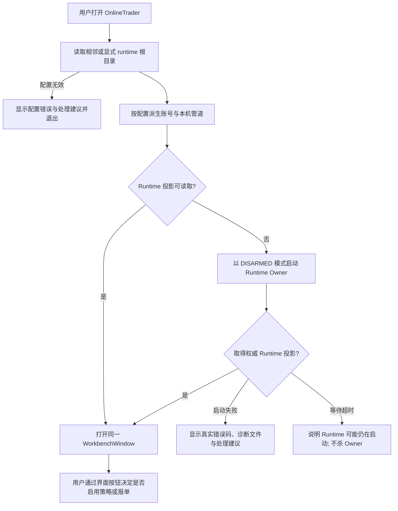
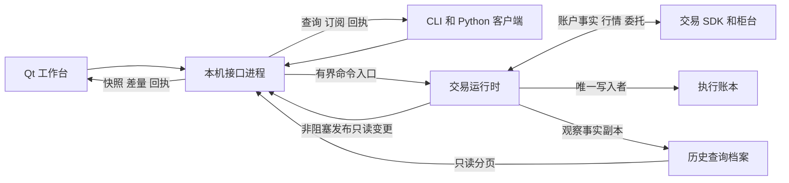
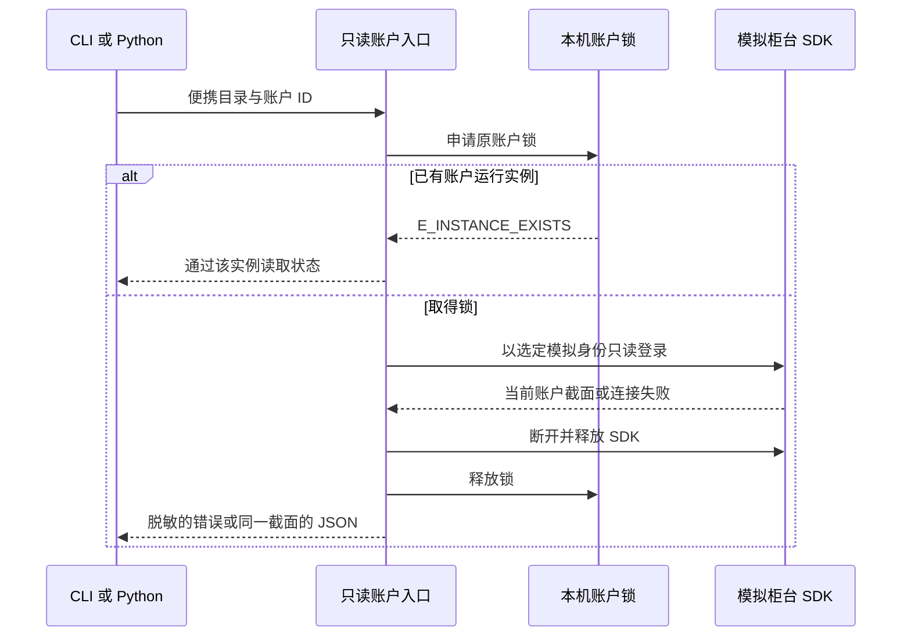
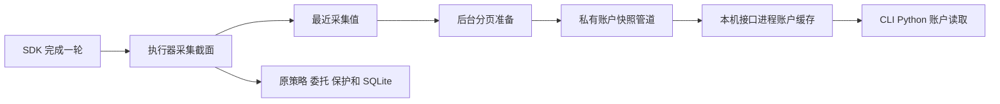
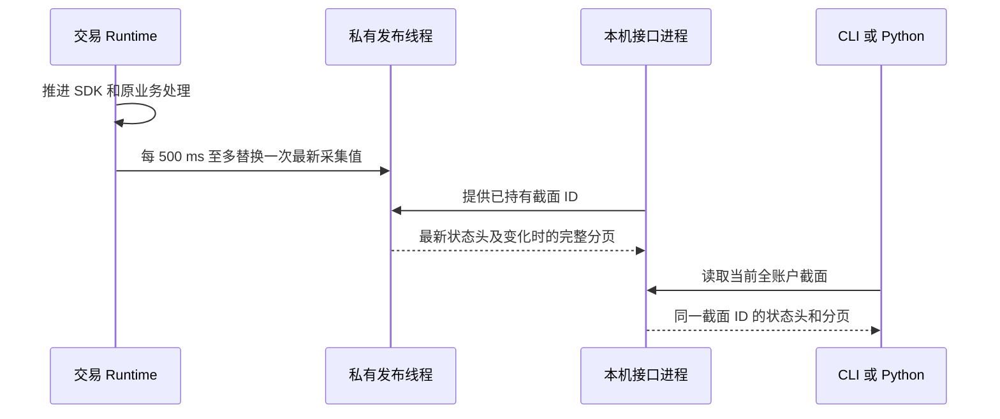
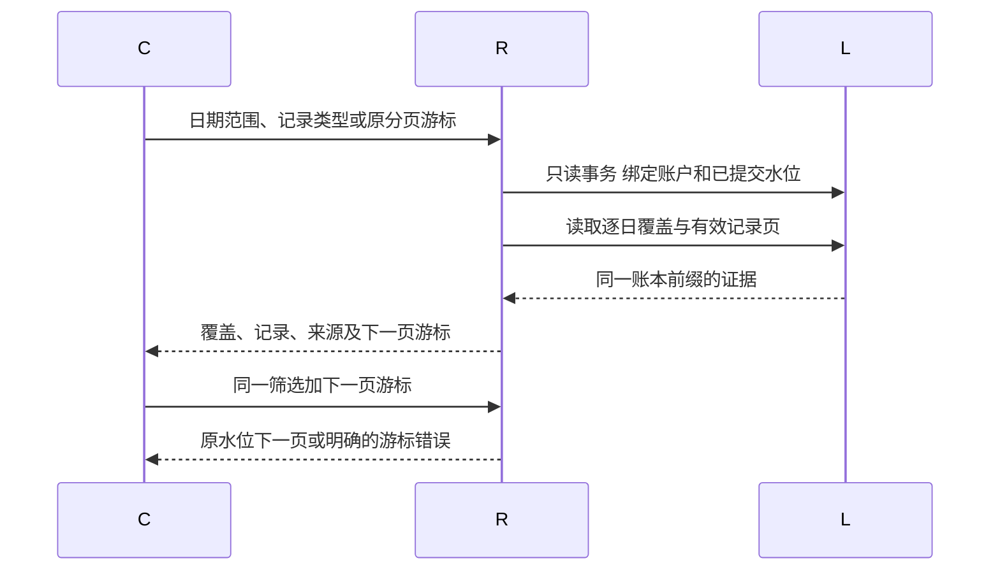
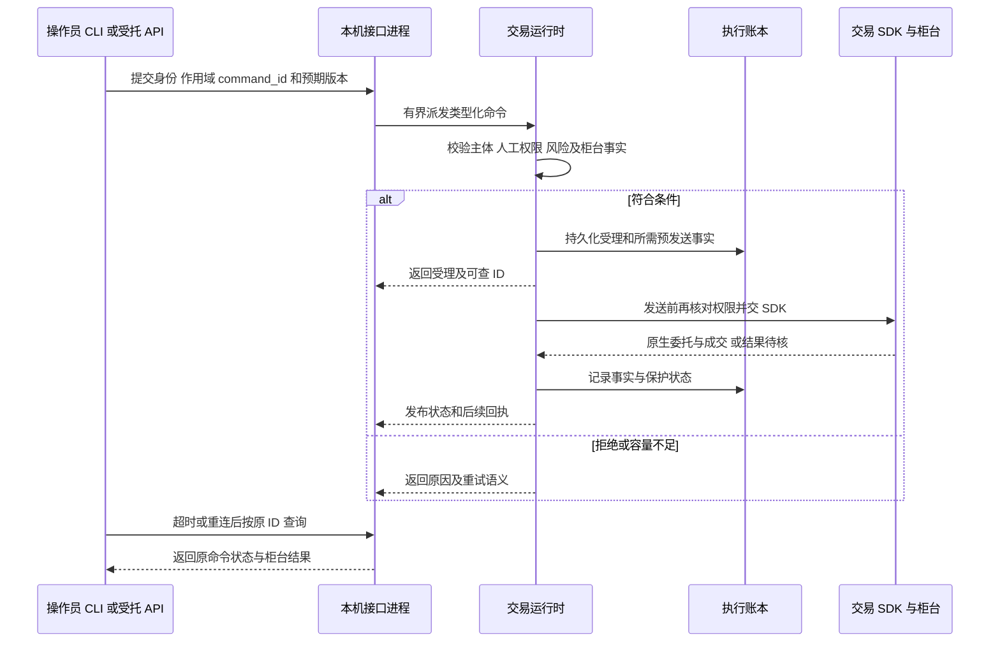
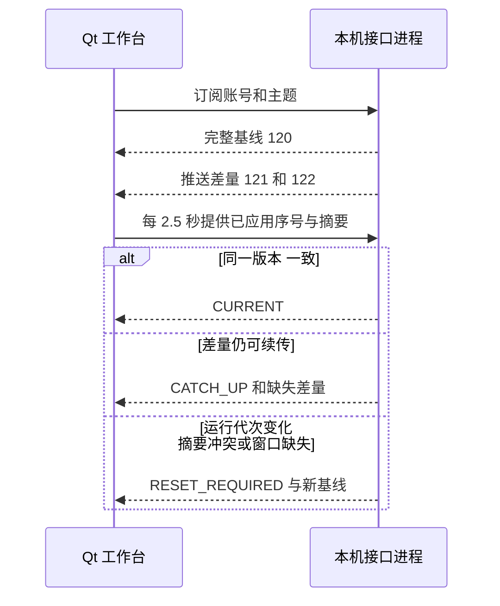

# OnlineTrader 独立交易运行时与交易工作台设计

2026-11-19 · 实施设计 · 源码基线 `10b915fa23f33860712ec491a7aa74d015c46203`（dev36）

当前实现状态：Trading Runtime、便携配置、原账本、操作员接口、只读接口进程、差量视图、附着账户读取、跨日历史、交接导出及 Workbench 本机身份通道均已进入源码。实际 SimNow 模拟账号的历史证据覆盖无 Qt 策略成交、人工开平、持仓中强杀 Qt、附着账户读取和最终结清；跨日历史完成过 Windows 独立离线复测。2026-11-20 源码候选已完成封闭 Workbench allowlist、Capability 补齐、CommandBus pending 加固和生产接管、异步 Bootstrap 及 ConfigSnapshot 投影；当前身份检查仍不能证明真实按钮点击，本次候选也尚未独立测试，不能沿用此前候选结果。真实资金账户和最终发行制品同样不在完成口径。

实现提交、候选源码树、独立测试计数、脱敏报告摘要及未完成范围见[实现与验收记录](standalone-trading-runtime-acceptance-20261119.md)。

本轮实现和验收范围为快期模拟与 SimNow。实盘接入设计留作后续阶段。

策略继续用现有信号、原有开仓条件及保护规则自动执行。保留原有人工和策略启动模式。新增操作员接口提交人工指令和开仓限制，授权范围内的自动策略动作由运行时自行处理。

当前阶段的用户级产品测试以 Trading Runtime 的 CLI、Python 和 Qt 公共入口为准。旧工作台直连 Kernel/ControlServer 的回放只保留为 Legacy 或组件覆盖，不再作为 Runtime 产品验收。

## 1. 目标和最终交付

**交易运行时（Trading Runtime）**是可以单独启动的本机程序。它负责账户登录、行情订阅、策略运行、人工委托、撤单、持仓保护、对账与恢复。启动与接管都可通过命令行完成。Qt 卡死、强退或重启时，运行时按当时有效的交易权限和参数继续处理行情、策略、成交和保护。Qt 恢复后可看到期间发生的业务事实。

**交易工作台（Trading Workbench）**是 Qt 应用。它用公开接口订阅、查询和回放状态，以本地模型渲染界面，并提交人工操作。**本机控制接口（Local Control API）**是工作台、CLI 和 Python 客户端共用的版本化合同。首版采用 Windows 本机命名管道，沿用现有分帧与身份校验基础。对接方可以用 JSON 命令、Python 客户端或公开的协议及 Schema 实现自己的工具。

本轮交付包括快期模拟和 SimNow 的独立运行入口、CLI 与 JSON 输出、Python 客户端、协议 Schema 与操作文档、无需 Qt 的启动和排障手册、隔离回放工具及可复查的验收记录。全新便携版随包带配置，首次启动自动建立账户执行账本。换机交接版随包带配置和原 SQLite 执行账本的一致性副本，目标机用同一启动命令接续。工作台界面验收和指定真实期货公司的接入属于后续阶段。

## 2. 当前入口和拆分位置

| 现状 | 设计处理 |
| --- | --- |
| 普通工作台 F5 通过桌面启动请求拉起独立进程，由 `DsvSimulationSession`、`Kernel` 和原账本执行。公开 `serve` 入口使用无交易适配器的内核。 | 将 F5 的账户登录、作用域准备、策略启动及恢复逻辑提取为独立运行入口。首轮封装现行 `Kernel`，沿用当前业务规则和账本。 [桌面启动](../../src/online_trader/runtime/desktop_bootstrap.py#L302) · [在线执行](../../src/online_trader/runtime/dsv_simulation.py#L1120) · [当前 CLI](../../src/online_trader/cli.py#L17) |
| 普通入口的 `ControlServer` 在执行循环里处理请求、投影和快照。候选 `replacement-run` 会在 SDK 循环中等待管道读写。 | 将公开通信、序列化、快照查询和订阅补齐移出执行进程。通用的是接口合同，各执行路径继续按自己的恢复规则运作。 [原循环](../../src/online_trader/kernel/server.py#L291) · [候选循环](../../src/online_trader/dsv_runtime/sdk_startup.py#L231) · [候选管道读写](../../src/online_trader/dsv_runtime/control_endpoint.py#L72) |
| 现有订阅协议支持分片、顺序和续传，投影范围以账户、保护周期、订单、阻断为主。账户同步另有全账户采集及原账本历史查询设计。 | 复用分帧、校验和续传机制。新增含盘口行情、账户事实及操作权限的版本化业务投影，对接同一个原生事实采集点和原账本查询合同。工作台的周期对齐固定为 2.5 秒。 [现有订阅](../../src/online_trader/transport/subscription.py#L168) · [投影](../../src/online_trader/kernel/projection.py#L4) · [账户数据同步设计](../account-data-sync-design-20261119.md) |
| 现有账户档案与交易授权限定快期模拟和 SimNow。SimNow 虽使用 `TqAccount`，适配器绑定的是 `simnow`。 | 增加独立实盘账户类型和适配能力，以指定真实期货公司接口、权限和柜台事实为验收依据。 [账户档案](../../src/online_trader/accounts.py#L171) · [SimNow 适配](../../src/online_trader/gateway/simnow.py#L71) |

### 2.1 2026-11-20 统一桌面启动入口评审

#### 问题、证据与约束

当前 `online-trader-desktop --runtime-pipe` 会持续附着 Runtime，但不会启动 Runtime。便携目录另外提供 `start-trading-runtime.cmd` 和 `open-runtime-workbench.ps1`，导致普通用户必须理解并依次运行 Owner 与 Qt。Runtime 启动失败时，附着型工作台只能看到管道超时，并回退显示“未选择”，无法区分“未配置账号”“Runtime 未运行”和“Runtime 启动被账本交接门禁拒绝”。

统一入口必须同时保留以下约束：

- Runtime 仍是唯一 SDK owner 和账本 writer；桌面引导层只编排进程，不取得交易权限。
- 打开工作台可以启动已配置的 Runtime，但 Runtime 必须以 `DISARMED` 建立；启动本身不等于启用策略或允许新增开仓。
- 已有 Runtime 优先附着；并发桌面启动不能产生第二个 sender，最终仍由原账户锁裁决。
- 不自动复制、重建、删除或迁移账本。`E_RUNTIME_HANDOFF`、账本缺失、身份不符和未知发送责任必须原样阻止启动。
- Qt 关闭、崩溃或引导等待超时不得终止已经取得责任的 Runtime。

#### 用户流程



#### 时序与所有权

```mermaid
sequenceDiagram
    participant U as 用户
    participant L as Desktop Bootstrap
    participant V as runtime-view-process
    participant R as Trading Runtime
    participant W as WorkbenchWindow
    U->>L: 打开 OnlineTrader
    L->>V: 读取当前权威投影
    alt 已有 Runtime
        V-->>L: BASELINE
    else Runtime 不存在
        V--xL: E_TIMEOUT / E_PIPE
        L->>R: runtime run --root ... --mode strategy
        Note over L,R: 子进程独立; entry_authority=DISARMED
        R->>R: 账户锁、账本身份、恢复与连接门禁
        R->>V: 发布版本化投影
        V-->>L: BASELINE
    end
    L->>W: 仅传入已核实的 pipe
    W->>V: 订阅、查询、命令回执
    U->>W: 明确解锁或交易操作
    W->>V: 带账号/boot/配置版本的命令
    V->>R: 原 Runtime 最终鉴权与裁决
```

桌面引导层不读取 SDK、不打开账本、不生成交易命令。它可以读取便携配置中的脱敏账号展示字段，并只把它用于启动进度；WorkBench 的账户、连接、资金、持仓、订单和权限仍只接受 Runtime 投影。引导层探测成功的条件是取得合法的非 `UNAVAILABLE` Runtime 基线，而不是仅发现进程或管道名。

#### 接口、状态与失败合同

| 项目 | 合同 |
| --- | --- |
| 普通桌面入口 | `online-trader-desktop --runtime-root <目录> [--runtime-account <ID>]`；Runtime 配置版的冻结 `OnlineTrader.exe` 在没有其他入口参数时自动选择相邻 `runtime/`。 |
| 高级附着入口 | `--runtime-pipe <pipe>` 保持只附着，不隐式寻找配置或启动 Owner。 |
| 运维入口 | `runtime run`、`runtime schedule`、`runtime status` 保持兼容；无人值守调度不依赖 Qt。 |
| 启动模式 | 统一桌面入口启动策略作用域，但 `entry_authority` 固定为 `DISARMED`；F5/操作员命令仍是独立授权步骤。 |
| 并发与重试 | 先附着后启动；启动后轮询权威投影。竞争启动由账户锁拒绝，若另一 Owner 已就绪则附着该 Owner。不得因超时自动重复创建第二个启动请求。 |
| 失败 | 读取本次启动进程的结构化首行与 `startup-failure.json`。界面显示具体错误码、影响和诊断路径；不得把 `E_RUNTIME_HANDOFF` 降级成网络错误。 |
| 生命周期 | 引导子进程不绑定 Qt 生命周期。Qt 退出不发送停止 Runtime 的命令，也不删除锁、WAL 或运行目录。 |

#### 兼容、回退与诊断

- 未携带 `runtime/` 的普通/Legacy 配置包保持原入口；只有显式 `--runtime-root` 或冻结目录存在有效相邻 `runtime/runtime.json` 时进入统一 Runtime 引导。
- 若统一入口有回归，运维可直接使用原 `runtime run` + `--runtime-pipe` 两步入口；不需要改变账本或配置格式。
- 每次桌面引导在 `runtime/logs/desktop-bootstrap/` 写独立 stdout/stderr 文件，文件名包含启动关联 ID。日志不得包含密码或操作员令牌。
- `E_RUNTIME_HANDOFF` 明确提示“同账号已有另一份桌面账本，需要受控一致性交接”，不自动创建 handoff；`E_INSTANCE_LOCK` 先继续观察既有 Runtime，只有最终仍无权威投影才作为失败显示。

#### 可执行验收条件

1. 已运行 Runtime：双击统一入口只附着，不创建第二个 Owner；账号身份来自 Runtime 投影。
2. 未运行且配置/账本合法：统一入口启动 DISARMED Runtime，取得基线后打开原 `WorkbenchWindow/WorkbenchLayout`。
3. `E_RUNTIME_HANDOFF`、账本缺失或身份不符：不打开伪连接工作台，不改账本，显示具体错误码、处理建议和诊断文件。
4. 两个统一入口并发启动：最多一个 Owner；两个界面如允许存在均附着同一 boot，默认桌面单实例仍生效。
5. 关闭或强杀 Qt 后，已经启动的 Runtime、持仓责任与保护继续；重新打开统一入口可再次附着。
6. Runtime 配置便携目录从 `OnlineTrader.exe` 单一入口完成上述流程；直接 `--runtime-pipe`、`runtime run` 和 `runtime schedule` 保持兼容。
7. 启动等待超时不杀 Owner、不重发交易命令；后续状态可从关联日志、Runtime 启动目录和公开 `runtime status` 反查。

## 3. 进程、状态归属和故障边界



| 状态 | 权威拥有者及生命周期 |
| --- | --- |
| SDK 连接、柜台日、行情与账户同步证据 | 交易运行时负责归一和判定，唯一 SDK 驱动者按其连接线程处理。柜台提供原生委托、成交、资金和持仓事实。 |
| 账户档案、登录资料、默认策略参数和应用内操作员身份 | 由交易运行时从运行目录的配置加载。私有配置仅由可信运行侧读取。 |
| 策略实例、实际生效参数、人工权限、委托占量、保护、回执、启停计划 | 交易运行时持有。恢复所需事实写入所选路径的账本。一个环境下同一规范账户只允许一个发送者和一个账本 writer。 |
| 对外业务投影、订阅和增量窗口 | 本机接口进程管理可重建副本。按账户、权限和查询范围导出必要字段，使用有界缓存和历史分页。 |
| 账号历史 | 按账号同步设计由后台归档。通过独立已确认水位标明覆盖、缺口和来源。执行账本以自己的原生关联认定所有权和恢复责任。 |
| 选中项、筛选、滚动、页面布局、未提交操作及非秘密待核命令身份 | Qt 自己管理，重连和页面切换使用本地模型。Workbench 不持有操作员令牌。 |

- **执行隔离。** 接口进程和 Qt 都是可重启进程。运行时先取得账户锁，独立持有 SDK、计时和账本。运行时从现有 SDK 读数和账本提交点送出有界、不可变的变化，队列满时以常量开销标记读侧断档。接口进程基于稳定检查点异步重建。未落入账本的行情或连接状态使用独立最新值，必要的重建批次分段交接。连接、编码、分块、历史查询、逐连接队列和发送都在执行进程外。停止慢订阅即可释放资源。
- **控制隔离。** 公开消息在接口进程完成分帧、大小检查和初步校验。耗时的配置准备、预览和查询在读侧完成，带相关版本提交最终操作。运行时只接收类型明确且有界的命令，在既有 owner 顺序中完成最终授权、状态变化及原路径所需的 SDK 和账本操作。限制单调用方并发、总队列和每轮命令派发预算，预算耗尽后继续 SDK 与保护轮次。增量、快照重建和客户端等待都无权在执行循环中请求全账本扫描。成交、保护、SDK 推进和紧急人工控制有保留的处理机会。
- **退出与恢复。** Qt、CLI 及接口进程退出只释放相应连接。已持久化受理的命令由 owner 继续推进。运行时重启保留禁开、待核委托和保护责任，按原执行路径完成柜台核对后恢复已有保护。新增开仓按原授权和恢复合同重新确认。运行时主动退出前检查策略停止、已负责仓位、活动委托和未知发送，返回未完成的责任及其身份。账号切换由工作台重新附着，多个真实账号使用各自的账户运行实例与配置。
- **定时独立。** 定时启动、定时停开等计划由运行时或其独立启动入口执行。计划绑定账户、时间规则、事件标识和生效版本，触发去重，进程恢复时按现行交易日及授权规则决定是否可执行。Qt 关闭时保留已确认计划。部署验收以无 Qt 的 Windows 入口为准。

## 4. 账户和交易状态

连接、策略、开仓权限分别对外展示。查询结果带当前账户、运行身份、柜台日、数据覆盖及上次成功观察的时间。

| 维度 | 状态与转换 |
| --- | --- |
| 连接 | `DISCONNECTED → CONNECTING → SYNCHRONIZING → READY`。拒绝或掉线带具体原因。重连先核实身份、柜台日、同步代次和原生事实覆盖，再进入 `READY`。 |
| 策略 | 可空闲、预热、运行、暂停新增、停止中、停止。连接就绪后可以单独运行手工操作，策略启动和账户登录各有回执。暂停新增和停止策略继续保留需要处理的已有保护。 |
| 新开权限 | 初次连接、恢复和无法确认柜台事实时按现有路径保持停开或待核。人工范围、运行授权、风险及市场条件共同决定某次开仓是否可执行。 |
| 原生结果 | 已受理、待发送、已交 SDK、柜台确认、部分成交、终态和结果待核可追踪。超时保留原命令和委托身份，保留可能占量，通过柜台、账本和完整同步核对结果。 |

真实资金账户以 `LIVE` 单独标识，按环境、真实 broker 与资金账号绑定规范身份、账户锁、配置、账本和登录资料，使用独立的实盘运行目录。CLI 和 API 传账户 ID。运行时从配置解析账户档案和配套的私有登录资料，以账户身份匹配执行账本及券商连接。接入候选是仓库已固定的 TqSdk `3.10.4` 加指定期货公司的 `TqAccount`，需核对该期货公司、席位、认证、可用权限、柜台日、查询完整性、报单和今昨仓平仓映射。先验收真实登录及只读同步，再分别验收已授权的人工交易与策略交易。TqSdk 文档区分 `insert_order` 本地提交与下一次 `wait_update()` 发出，运行时据实际证据记录各阶段。 [SDK 固定版本](../../pyproject.toml#L14) · [TqSdk 实盘账户](https://doc.shinnytech.com/tqsdk/latest/reference/tqsdk.account.html) · [TqSdk 账户与交易](https://doc.shinnytech.com/tqsdk/latest/usage/trade.html)

### 4.1 模拟账户只读登录

`runtime account` 与 Python 调用可独立核对快期模拟或 SimNow 的账户登录。它从便携配置选择规范账户，先取得与执行器相同的本机账户锁，再创建只读 SDK。资金可读且 SDK 账户截面同步完成后，在同一轮中复制原生资金、持仓、委托和成交，再断开连接并释放锁。已有 owner 时返回 `E_INSTANCE_EXISTS`，调用方可用 `runtime account --attached` 查询该 owner 接收的最近完整截面。



返回规范账户、环境、提供方、观察时间、资金及原生记录，并用 `CURRENT_BROKER_SNAPSHOT` 标明覆盖。只读登录只需要 `runtime.json` 和 `private/OnlineTrader-defaults.json`，交易日由原运行时根据核实的日历和账户事实判定。只读阶段的 SDK 禁止下单与撤单。配置和 SQLite 均无写入，已有启动、恢复与备份合同保持兼容，旧版本可以单独回退此查询入口。验收覆盖首次无账本、截面未同步、登录失败、已有执行器、完整账户数据及退出释放锁。标准错误提供脱敏的配置、依赖、登录、同步或关闭错误码。

### 4.2 运行中的全账户读取

原执行器的 `port.snapshot()` 已能从同一轮 SDK 更新复制全账户资金、持仓、委托和逐笔成交。现有工作台状态据此构造有限的持仓和执行视图。历史查询从原 SQLite 读取周期观察。运行中需要单独的全账户读取入口，以取得最近同步截面和策略范围之外的记录。





`runtime account --attached --root <目录>` 和 `RuntimeAccountClient` 读取接口进程的 `.account` 管道。公共请求只等待读侧缓存。消息使用 `ONLINE_TRADER_RUNTIME_ACCOUNT/1`。一条连接上的第一帧带账户、环境、网关、owner 启动身份、观察 UTC、确认交易日、SDK 连接代次、账本水位、截面 ID、资金和各表行数，随后按持仓、委托、成交传输多帧。行数和各页起始位置齐全后，客户端一次应用。请求带相同截面 ID 时可复用持有的记录，仅返回新的状态头。私有发布端只接受现有接口子进程，缓存只保留最后完整截面、当前状态和最新待发布值。

| 状态 | 可见结果 |
| --- | --- |
| `READY` | 已取得当前连接同步、账户身份及交易日证据。空列表代表同一完整截面的真实空集合。 |
| `WAITING` | 尚无完整截面，各记录集合为空值，附原因。 |
| `STALE` | 有过完整截面而 SDK 待同步、读取通道中断、发布超容量或运行时停顿。保留原观察时间、日和数据，明确标记原因。再次收到完整截面后整体替换。 |

每帧复用原传输上限，每页最多 256 行。单个截面最多包含 32,768 行或 16 MiB 记录，超限或编码失败记录脱敏错误，保留最后可验证数据。后台线程准备分页和失败状态，私有管道应答独立读取最新发布结果。正常返回 `READY` 时 CLI 返回 0，`WAITING` 和 `STALE` 带状态数据且返回 2。接口进程重启可从同一执行 owner 重建。新入口无写入，升级或回退保持现有 `runtime account`、账本、交易权限及工作台协议可用。验收核对跨合约原生记录、正常持仓到平仓、分页连续、连接中断的旧截面、接口停顿时执行及原回执推进、错误账号和容量诊断。

### 4.3 原账本的跨日历史查询

跨日查询读取便携目录原有的每账户 SQLite。原始柜台截面取自已提交的登录基线、盘中刷新与可证最终观察，自有逐笔成交取自不可变的 `fill_facts`。独立运行时的正常停机事件保留通过原核对的最终账户截面，继续使用原有停机证据、事务和 writer。旧账本可以直接查询，旧停机事件仍可证明停机时核清仓位和活动单。




用户指定起止日期，查询 `coverage`、`funds`、`positions`、`orders`、`trades` 或 `owned-trades`，可按合约筛持仓、委托与成交。资金及持仓取每天最后一个完整截面并带观察时间。委托和成交按观察柜台日、网关与原生 ID 去重，委托保留最后所见状态，逐笔成交出现冲突时给出冲突状态及账本事件位置。柜台观察归在截面明确的 `trading_day`，每条有独立 `trading_day_basis`。自有成交用执行账本已核证的成交日。逐日覆盖以全账户为准，给出有完整截面的部分覆盖、仅见不完整截面、仅有账本事实或无观察，也列出已证自有成交数与停机证据。同一原生 ID 在不同观察日可出现多次，反映不同柜台截面的保留范围。

每页按原账本前缀读取。游标绑定账户、筛选条件、原水位和不可变水位指纹。追加新事实不会移动之前的分页，已复制的同一账本可以继续。运行中的账本继续用 SQLite 正常的 WAL 锁和一致性快照；确认没有账户 owner、且不存在 WAL/SHM 的冷账本在持有账户启动锁期间用不可变只读连接，查询不会在交接目录生成协调侧文件。只读查询有并发、执行时间和帧大小限制，错误明确返回原因。启用和回退只涉及只读查询入口，没有 schema 迁移，也可继续使用旧 `runtime history --before`。已提交数据随原账本交接。完整日结与柜台历史缺口要用可验证的结算或逐笔来源补齐。独立验收覆盖跨日、未完整观察及未观察、重复成交和冲突、短运行停机截面、持仓变化、追加后的分页和错账户。

## 5. 人工操作与策略动作

命令合同分别记录 `source`、`actor`、`operation` 和 `scope`。`source` 是 Qt、CLI、自动化工具、内部策略或保护模块等入口。`actor` 由执行器根据经验证的操作员身份、受托自动化权限或已绑定的策略实例认定。来源是 CLI 的请求仍需操作员授权，来自工作台的请求也按实际授权分类。外部接口允许启动已登记的策略，策略产生的每次交易动作由运行时关联到自己的策略实例。

| 角色 | 对应权限 |
| --- | --- |
| 人工操作员 | 按授权管理账户或合约的开仓开关、决定是否人工交易、启停和恢复策略、核对或处理指定订单与持仓。可实施按账号、合约或策略划定的限制。 |
| 受托自动化 | 在明确授予的账户、范围、指令和有效期内调用同一业务接口。操作记录携带授权引用和真实调用方。 |
| 策略实例 | 在人工设定的有效范围和原业务规则内提出开仓、撤单、减仓、平仓和保护动作。人工禁开状态对该范围内的策略开仓具有否决权，策略启停、参数刷新、行情恢复和重新附着均保留该限制。 |
| 保护与核对 | 依据已确认持仓、委托和保护计划推进已有责任。每次动作按已有权限、数量约束及原生盘次核对。 |

**人工禁开接口**采用 `authority.get`、`authority.set` 和 `authority.history`。`authority.set` 包含账户、合约或策略范围、目标 `STRATEGY_OPEN` 或 `MANUAL_OPEN`、允许或禁止、该范围的期望权限版本、原因和命令 ID。默认操作「禁开某合约」关闭该合约的 `STRATEGY_OPEN`，人工开仓仍由其单独授权和风控决定。账户级全部禁开可覆盖两类开仓。上级禁开优先，恢复单合约策略开仓仍要检查账号级禁开和原业务交易条件。

- 权限由交易运行时持久化，并写入操作者、范围、旧值、新值、版本和生效序号。账号级和细粒度限制各有版本。策略决策入口和每次实际交 SDK 前都检查最新有效权限，覆盖第一次报单及追价重报。禁开经 owner 顺序处理并持久化后才回「已生效」。旧版本下已经触发但尚未交给 SDK 的开仓被阻断或按预发送记录结案，重新允许时按新行情重新评估。回执和日志指明生效版本与命中的限制。
- 禁开回执分别给出「已停止新提交」和「此前委托的柜台核对状态」。此前已进入 SDK 队列的订单仍可能出现在下一轮发送及成交中，回执列出仍在途的开仓委托。原生撤单、迟到成交和保护仍经 owner 继续处理。接口可选择组合执行「禁开并撤存量开仓单」，继承同一路径已经确认的余单处理规则。人工平仓、策略退出和持仓保护共用同一剩余目标与占量，避免多条来源为同一仓位重复平仓。
- 现有 Qt 的品种停用会同时限制人工和策略开仓，并请求撤自有开仓余单。兼容入口保留这个组合行为。新增的「仅禁策略开仓」走细化后的权限合同。迁移将旧禁开映射为原合约的两类禁开，保留已认领的撤单和保护责任。 [现有品种开关](../../src/online_trader/kernel/control.py#L283) · [Qt 停用操作](../../src/online_trader/desktop/workbench.py#L971) · [现有发送前校验](../../src/online_trader/kernel/engine.py#L701)
- 最终工作台不展示或询问操作员 ID/令牌，命令走独立的本机身份通道。命名管道验证连接进程的 Windows 身份；当前服务端允许 Owner SID 与 `LocalSystem`，但这不能证明命令来自真实用户按钮，也不能自动批准新增 Kernel 操作。Workbench 来源需按 `LOCAL_USER` 合同审计，使用显式、版本化、默认拒绝的操作白名单；接口和原 Runtime Owner继续校验账号、owner boot、配置版本、Capability、风险前置条件和幂等身份。确认界面展示准确的账户、合约、动作、价量和范围，超时保留原命令 ID并只查回执，不自动重发。CLI、定时任务和受托工具继续使用 `DELEGATED_OPERATOR` 授权协议。 [管道访问控制基础](../../src/online_trader/transport/named_pipe.py#L276) · [安全改造门禁](runtime-architecture-hardening-plan-20261120.md)

### Workbench 交互用户通道评审结论（2026-11-20）

用户流程固定为：取得完整 Runtime 基线 → 用户在工作台选择动作并完成现有确认 → Qt 生成唯一 `command_id` 及账号/boot/配置绑定 → `*.workbench-control` 接口校验同一 Windows 登录用户和允许的界面操作 → 原 Runtime Owner 按原命令合同执行并写入原账本 → Qt 展示回执并重新对齐权威视图。策略自动判断、保护和自动交易仍由 Runtime Owner 内部执行，不经过 Workbench 通道。

故障流程保持 fail-closed：状态陈旧、账号/boot/配置变更或不支持的操作在发送前或接口端拒绝；连接超时保留原命令 ID并只允许查询原回执；Runtime 或接口重启后工作台无需重新输入身份，但必须重新取得完整基线；不同 Windows 用户和远程客户端由命名管道 ACL/对端 SID 校验拒绝。旧 Runtime 没有交互通道时，工作台报告接口版本不兼容，不回退到操作员提示或直连 Owner。

状态与数据归属不变：Qt 只保存非秘密的待核命令身份，接口不建立交易状态，账本仍由唯一 Runtime Owner 写入。已受理命令的账本 `actor.id` 固定为 `workbench-user`；CLI/调度/受托工具仍记录各自经认证的操作员身份。历史 Qt 命令的原回执允许在同账号下按原 `qt-*` 命令 ID只读查询，避免升级后丢失未知结果；不得借此重放命令。

兼容和回退：保留原 `*.control` 操作员协议、`private/operators.json`、CLI 和调度入口；只把 Qt 工作台切到新协议。回退旧版前无需迁移账本，但旧版 Qt 仍需要其原操作员配置。诊断记录通道、请求动作、命令 ID和接受/拒绝错误码，不记录账号口令、操作员令牌或完整敏感载荷。

本次可执行验收条件为：界面不出现操作员/令牌控件或提示；每个既有按钮仍生成一次绑定命令；同用户本机通道可达，其他 SID 拒绝；错误、超时和重启保留原命令 ID；CLI/调度操作员协议不变；策略内部执行不依赖 Workbench。未经单独测试授权，本次只执行源码编译检查，以上行为验收留待独立测试。

## 6. 开放接口

接口首版使用版本化 JSON 消息与 Schema。`ONLINE_TRADER_RUNTIME_COMMAND/1` 支持 `authenticate`、`submit` 和 `receipt`；鉴权只返回操作员、账号、能力和有效期，不回显令牌，也不建立可绕过逐命令校验的服务端会话。每个操作有请求、响应和错误码。旧调用方可以按能力发现降级。CLI 业务结果走标准输出，诊断走标准错误。长任务返回可查询的 ID，Python 客户端提供对应调用、订阅和等待接口。

| 接口组 | 操作及返回结果 |
| --- | --- |
| 运行 `runtime` | 独立运行、发现实例、健康和就绪查询、诊断、受控退出、交接导出和换机预检。返回进程启动身份、活动账号、柜台同步和原执行责任。 |
| 账户 `accounts` / `session` | 查账户档案、登记或编辑非秘密资料、检查私有配置的账户引用、连接、重连、当前状态、合规断开。登录资料通过独立本机配置入口登记。区分连接认证、数据就绪、账户身份冲突、读取范围和退出阻断。 |
| 行情 `market` | 合约目录、交易时段、最新报价和盘口、行情订阅、可用的分钟或日线查询。返回原生来源、柜台日和时间、新鲜度、缺口及支持深度。 |
| 账户事实 `account` | 资金、全账户持仓、委托、逐笔成交、策略自有仓与原生关联、历史分页及覆盖状态。外部委托和持仓保留归属。 |
| 人工交易 `trade` | 开多、开空、指定持仓减仓或平仓、按审定范围平仓、撤指定委托、撤自有开仓委托及现有经授权的账户级撤单。请求包含明确合约或对象 ID、数量、价格指令及范围，平今平昨按原路线核定并回报。 |
| 权限及策略 `authority` / `strategy` | 查询和设置人工限制、历史审计、策略目录、参数版本和预览、通过既有生效规则绑定配置、启动、暂停新增、恢复、停止、计划管理、策略状态及决策原因。策略 ID、参数版本、规则集、运行作用域和允许动作可查询。 |
| 命令与恢复 `command` / `reconciliation` | 预检、提交、查询和等待原命令回执、账户同步核对、未知委托核对和受支持的归属处理。预检携带关联版本，实际执行由 owner 重新校验。 |
| 状态与留证 `state` / `diagnostics` / `reports` | 快照、订阅、续传、对齐、运行日志、行情诊断、账本水位、资金盈亏及历史导出。长历史查询在档案读侧按游标分页，记录读取边界和缺失范围。 |

查询或流消息绑定账户、环境、网关、运行身份与柜台日。价格及金额以有明确语义的十进制表示，手数为整数，时间携带来源。操作主体提交 `request_id` 及预先生成的 `command_id`，服务端关联 `actor`、授权和规范化请求摘要。幂等键以账户与环境为范围。同 ID 同摘要向有权读取的调用方返回原回执，同 ID 不同内容返回 `CONFLICT`。跨重启先查原回执，再依现行运行身份、柜台日、权限和版本判断新操作。受理的权限在 owner 内绑定到持久化命令，与 IPC 连接的临时身份分离。交易必要事实按现有执行路径提交后才交 SDK。

`BUSY` 只表示请求明确未进入执行队列。任何提交后断线、超时或网关转发结果不明，都用原 `command_id` 查询，并在需要再次提交时沿用同一个 ID 和正文。回执区分执行器已持久化受理、已交 SDK、柜台确认、部分成交、终态和待核，同时返回当前状态版本及可关联的原生身份。



无界面入口提供 JSON 输出。隔离回放用固定原生形状样本，以同一命名管道和命令合同验证业务操作。

```powershell
# 终端 A，使用为本次运行确认的模拟配置
online-trader runtime run --root .\runtime --mode strategy

# 终端 B，观察或通过 CLI 提交命令；Qt 工作台也可在界面内鉴权后直接提交
online-trader runtime status --root .\runtime
online-trader runtime command --root .\runtime --operator my-operator --input .\command.json
online-trader runtime receipt --root .\runtime --operator my-operator --command-id my-command
online-trader runtime history --root .\runtime

# 独立离线回放，无账号连接
python -m qa.runtime_replay --output .\output\runtime-replay --fixture partial-fill-and-close
```

## 7. 差量推送与 2.5 秒对齐

**第一次订阅先交付完整基线。** 投影按订阅范围生成，带 `owner_boot_id`、`projection_epoch`、`trading_day`、`stream_seq`、`durable_seq` 和 `digest`。`stream_seq` 是投影的顺序，`durable_seq` 是执行账本水位，行情变化可以推进投影序号。快照带稳定切点，分块齐全且摘要一致后一次应用，随后接续切点之后的变更。切点之后缓冲超容量时重新取基线。相同投影由接口进程共用一个有界差量窗口。

**本机接口主动推送差量。** 差量包含前置序号、新序号、记录新增或更新、删除以及业务事件。一笔成交涉及的委托、持仓和保护投影在同一个可见批次应用。行情按合约合并最新值再分配序号，成交、完整订单事实和命令回执可按稳定 ID 查询和追溯。Qt 后台线程接收，主线程按模型变化更新对应行。

**Qt 每 2.5 秒主动对齐。** 发送的是最后已应用的 `stream_seq` 及同一序号的摘要。摘要覆盖规范化业务投影，排除客户端时间、传输时间与界面状态。缺序号时可以立即发起恢复。定时对齐同时能发现之后没有新消息的末尾缺失。在途查询限制为一个，迟到响应按版本判断，已经应用的新状态继续保留。



推送断线时显示最后确认数据和时间。画面区分工作台未同步、运行时不可达、柜台待同步、行情陈旧。接口进程重启后以新的投影代次重建快照，保持运行时原启动身份与持久化回执。交易权限由运行时自己的数据证据和操作授权控制。

## 8. 迁移、兼容及回退

### 8.1 可直接启动的运行目录

账户、策略配置和执行状态的文件都相对运行根目录定位。目标机用预配的运行目录作为启动入口，例如 `online-trader runtime run --root D:\OnlineTrader\runtime`。正常换机后可按已保存的设置连接选定账户，无需重新录入凭据或参数。执行器在目标机建立本机权限和管道，历史记录仍保留原运行身份。

| 文件 | 内容与归属 |
| --- | --- |
| `runtime.json` | 运行目录版本、账户档案与默认账户。各账户以配置名关联私有登录资料，账本路径按原有账户身份规则在运行目录内派生。运行时在账本旁记录已建账身份。 |
| `runtime-control.json` | 运行级自动化开关。当前 `scheduled_start.enabled` 明确决定无人值守启动器是否允许发起新的定时策略运行；启动器每秒重读该文件和策略参数，修改后无需重启调度进程。 |
| `private/OnlineTrader-defaults.json` | 为接收方确认的券商与行情账号、口令、线路及连接参数。运行时独占读取，匹配账户档案和现有账本身份后才接通对应适配器。Qt、公开查询和诊断只取得脱敏字段。 |
| `private/operators.json` | CLI、定时任务和受托工具的校验值、角色、授权范围及有效期。Workbench 本机交互通道不读取此文件。 |
| `OnlineTrader-parameters.json` | 经确认的初始策略参数和默认设置，用于首次建账和后续预览。接续已有账户时，从执行账本恢复已绑定的策略版本及计划。 |
| 每账户 SQLite 执行账本 | 沿用选定执行路径的账本，保留委托、成交、在途占量、保护、人工禁开、已生效策略、计划、账户观察、跨日查询事实、业务计数和回执。随目录迁移同一账本，不另带 Runtime 数据库。 |
| `handoff.json` | 交接时记录格式版本、账号和柜台日、源 owner 状态、账本身份与检查点、配置版本和文件摘要，供目标机预检。 |

独立运行时使用配置和每账户执行账本，去掉独立运行状态库及对 Windows 凭据库的依赖。两者职责不同且共同构成可恢复运行目录：配置保存账户选择、登录资料、策略参数、操作员授权和自动启动意图；原 SQLite 账本保存已经发生并需要恢复或审计的账户观察、委托、成交、持仓责任、命令和策略执行事实。配置不是交易历史，账本也不承担下一次运行的可编辑设置。新账户在首次启动校验配置并取得账户锁后，自动创建账户绑定的 SQLite 执行账本并记录已建账状态，再进入连接流程。初始参数随启动确认记录持久化。生效参数版本由原执行器在核实交易日、行情元数据和交易范围后提交。已有账户先恢复账本，缺失或损坏时报错并等待修复。换机交接入口要求交接清单列出的原账本齐全，避免缺包被误判为新账户。

含登录资料的目录具备登录能力，按含账号口令的制品通过已批准的私有渠道交接。CLI、调度或自动化工具的令牌原值按独立授权另行交接，校验值及授权范围随私有配置迁移。工具使用受保护配置或输入流提交令牌；Qt 使用受 Windows 本机身份边界约束的 Workbench 通道，不接触这些令牌。该边界不证明真实按钮点击，启动器仍需按目标机环境重建专用文件和进程访问权限。

### 8.2 换机接续与旧版本兼容

1. 在源机通过 `runtime export-handoff` 停开并核对活动与未知委托，检查仓位和现有保护交接条件。按原执行路径停掉源 owner 后，导出配置、各交接账户的原 SQLite 执行账本一致性副本及交接清单。导出收据标记源账号已交接，源入口再次接管时先核对交接状态和柜台事实。备份以完整提交水位为准。 [现有 SQLite 备份入口](../../src/online_trader/ledger/store.py#L477)
2. 把运行目录放到目标机任意受支持位置，使用同一启动命令。首次启动核对交接清单、文件摘要、数据库完整性、格式、账号环境和账本检查点，再重建本机权限及公开接口。成功后按交接编号记录导入回执，重启使用目标机的最新已提交状态。启动失败返回缺失或冲突的文件、账户或版本，已有数据保留供修复。
3. 接通柜台后核对确认交易日、持仓、委托和原保护，保留人工禁开和既有风险状态，按当前授权恢复交易。换机器触发的外部券商认证由所接入券商按其实际规则完成。Windows 账户锁只覆盖本机，执行权的跨机器接续来自已停止的源 owner 和核对后的目标 owner。
4. 旧版引用仅指向 Windows 凭据库时，首次迁入由已确认的账户配置重新登记实际登录资料。切换后的登录、启动元数据、行情预览和配对入口统一使用同一个私有配置读取器。旧版已存账本范围中出现的绝对路径及摘要保留原样，以交接收据追加旧账本到新逻辑路径的映射，再走原路径的核对与恢复。 [旧账户凭据实现](../../src/online_trader/accounts.py#L58) · [旧启动范围恢复](../../src/online_trader/runtime/desktop_bootstrap.py#L197)

### 8.3 ZIP 与便携目录的内容

同一次交付的便携目录和 ZIP 从同一份已装配的目录产出。对于换机交接版，解压后的 ZIP 与直接复制的便携目录应包含相同的程序、依赖、配置及 SQLite 文件，均能按 8.2 节接续运行。

| 交付类型 | 配置与 SQLite |
| --- | --- |
| 全新便携版 | 目录和 ZIP 的应用数据仅包含为接收方确认的启动、账户、操作员及策略配置。运行时首次启动自动创建执行账本。 |
| 换机交接版 | 随目录和 ZIP 带入同一时点的配置、本次交接账户原 SQLite 执行账本的一致性副本和 `handoff.json`。若交接要求保留历史查询，随包包含相应的历史档案。 |
| 公开更新 ZIP | 只携带更新所需的已批准程序与非私有配置。升级继续使用目标机的运行目录、账户配置及 SQLite，并按版本迁移既有状态。 |

打包前从已确认的交付清单核对配置和数据库。最终验收直接检查 ZIP 内的路径及摘要，并分别从解压目录和便携目录启动，核对所用账户、参数版本和账本水位。换机交接版缺少任一必需 SQLite 或配置时，停止出包。含登录资料的便携目录和 ZIP 仅通过已批准的私有渠道交付。

### 8.4 实施阶段

| 阶段 | 交付和退出条件 |
| --- | --- |
| A. 定合同与基线 | 确认账户、交易指令、人工权限与生命周期合同。锁定普通入口现网行为、日志和代表性验证样本，确认实际启动的第一处差异。 |
| B. 独立运行入口 | 以原 `Kernel` 作为执行 owner。拆开登录、同步、策略启停和定时计划，采用可移植配置以及现有的每账户 SQLite 执行账本。原路径已支持的操作由新 CLI/API 接入同一 owner，完成离线回放、无 Qt 模拟闭环、干净机首次建账与换机接续。保留原安全条件和账本恢复合同。 |
| C. 读侧与 Qt 切换 | 源码已接入独立本机接口进程、推送状态、独立慢查询与加固后的 CommandBus；Capability 与 14 项显式 Workbench allowlist 已补齐，旧 Qt 直连命令线程已退役。该身份边界不证明真实按钮点击。CLI、调度和受托工具仍由服务端逐次鉴权。冻结、进程退出、过载与重连仍待另获测试授权后验收。旧工作台协议只保留为 Legacy 兼容出口，不再是当前产品验收入口。 |
| D. 实盘接入 | 为指定期货公司、席位与真实账号实现、核对连接和原生事实，按只读、人工交易、策略交易分别验收。交付的能力与授权范围由所选适配器和原生证据决定。 |
| E. 候选执行链切换 | 作为单独的行为迁移。候选当前尚缺标准人工开仓等能力，填补公开合同并经独立验证后，才按项目的同账户冷切换流程迁移。 [候选操作](../../src/online_trader/dsv_runtime/runner.py#L1197) · [候选启动及回滚](dsv-parity-20261114/10-sdk-startup-and-same-day-rollback.md) |

读侧新投影可重建，接口及界面可独立回退。原账本沿用现有读写实现，新增持久化权限和计划需要可核验的版本及一致性备份。旧运行入口接管前确认它能读取并执行新权限状态。遇到版本无法识别人工禁开时，恢复入口保持停开，由操作员核对并以兼容格式恢复权限，避免旧版本重新启用已禁止的合约。

同日回退沿用已有冷迁移和反向转换合同。目标已接受新业务时，从其最新一致性副本和柜台事实生成回退收据，带回已确认事实、权限和保护责任。

## 9. 快速验证与独立验收

隔离回放运行同一执行入口、命令合同和业务链，使用临时库、固定账户样本、虚拟时钟和可重复的原生事件。QA 驱动通过专用离线入口提供事实，在线入口仅由所选交易 SDK 接收外部事实。得到本次测试授权后，可用 CLI 重放具体场景并采集状态。独立测试依据业务契约和原生证据建立期望。涉及慢部分成交时，使用已批准的 5 手目标和固定第 7、9 轮。 [现有回放](../../qa/dsv_parity/replay_session.py) · [DSV 行为决定](dsv-parity-20261114/00-evidence-and-decisions.md)

| 验收场景 | 通过条件 |
| --- | --- |
| 独立运行 | 纯运行时环境，在无 Qt 的干净 Windows 目标机通过 CLI 依次连接、取得真实可用行情、读资金、策略启动、人工开仓、撤单、平仓、查成交与账本、受控退出。执行证据与实际柜台或隔离输入相符。 |
| Qt 与通信故障 | 用同一版本、账户样本、配置和行情输入，分别覆盖无 Qt、有 Qt、Qt 冻结、强杀、慢订阅、无读端、反复连接、畸形请求和接口进程崩溃。比较有序柜台请求和持久化业务结果，均能完成策略触发、开仓、部分成交、保护及平仓。比较 SDK 泵间隔、慢轮次及从触发到报单的延迟，确认通信故障没有把等待带入执行循环。 |
| 推送与补齐 | 首次快照、单条缺失、重复和乱序、末条丢失、并发增量、快照切点、保留窗口耗尽、切账号、次日与重启均可恢复。在健康 Client 中，末条丢失由下一次 2.5 秒对齐发现。正常负载下账户事件从 SDK 合并到工作台应用的 P99 以既有设计的 1 秒为评审目标。 |
| 人工高于策略 | 禁开后新信号被拒，已评估待发送的新开在发送边界按新版本阻断。范围外合约和有效的保护继续运行。验证人工开仓独立权限、账号级上限、显式撤在途订单、在途迟到成交、重启保留禁开、旧版本回退及重新允许后的实际结果。用真实 Qt 进程身份提交完整但未经独立授权的交易、禁开与启停请求，核对零受理、零 SDK 发送及具体拒绝原因。 |
| 无界面定时执行 | Qt 未运行时按计划触发当次运行。同一计划经过重复唤醒及重启只受理一次。过期授权、错误柜台日和无法完成核对时，按原恢复合同保持停开并记录原因。 |
| 全新便携版首启 | 检查 ZIP 与便携目录的账户和策略配置齐全，确认随包应用数据只有配置。干净机用正常入口从随包配置启动并自动创建每账户执行账本，核对初始参数版本与账户身份。重启复用该账本，初始配置只应用一次。 |
| 可移植换机 | 源 owner 完成交接后，分别检查 ZIP 解压目录与复制的便携目录，确认随包配置与原执行账本副本一致。在没有 Qt、没有凭据库记录且盘符和 Windows 用户不同的干净机启动，核对账号、柜台日、参数、人工禁开、计划、委托成交及保护状态。覆盖缺失或损坏账本、错误账号、旧盘符引用及可信控制与 Qt 的隔离。 |
| 命令及恢复 | 发出后断线、重复提交、提交与报单之间异常退出、柜台同步缺失、第二执行器申请、错账号、旧柜台日、活动委托未终态、权限变化和账本不可写。能从原命令 ID 追出阶段，未知结果保留占量，柜台事实只入账一次。账本故障与显示归档故障各自有可观察结果。 |
| 真实接入 | 先在无 Qt 的 SimNow 环境取得真实模拟回执及成交闭环。再对已确定的期货公司完成真实账号只读登录、行情与资金/委托/持仓核对。经单独授权后，以实际使用入口完成实盘人工和策略场景，核对最终委托、成交、持仓与保护。 |

关键故障记录 `account_key`、柜台日、运行启动身份、`command_id`、操作者及授权引用、策略与权限版本、原始行情来源和时间、命中的拒绝条件、订单意图、子单、SDK 尝试、柜台委托与成交 ID。诊断同时采集执行轮次、SDK 泵、队列水位、断档原因、投影进度和持久化检查点。查询和导出脱敏，报告能从用户操作追到首个失败阶段。

得到单独的打包授权后，以完整运行目录 ZIP 或安装器为交付单位。包括 runtime 与 CLI 可执行入口、所需 SDK 与依赖、公开协议与客户端、运行配置以及为目标设备确认的账户和参数配置。配置含秘密时走批准渠道，正式包遵守项目白银排除约束。由独立测试 Agent 在构建前对候选源码执行全局测试，在构建后对最终制品走干净 Windows 实际入口验收，记录完整源码 SHA 和制品 SHA-256、配置、环境、场景、证据与 PASS/FAIL/SKIP/NOT_RUN 统计。

## 10. 当前源码入口

`online-trader runtime inspect --root <目录>` 脱敏核对选定账户、接口位置和参数文件摘要。`online-trader runtime run --root <目录>` 以停开状态复用原模拟启动链。`--account` 可指定配置中的账户 ID，`--mode manual` 建立原有的人工专用作用域，默认 `strategy` 建立策略作用域。已建账时优先恢复账本内已生效参数，操作员可用 `--use-profile-file` 明确选用一份新启动配置。原仓位恢复始终使用原范围及原保护合同。

`runtime.json` 使用 `schema_version` 值 `ONLINE_TRADER_RUNTIME/1`、`selected_account` 及 `accounts` 列表，每个账户定义 `id`、`alias`、`provider`、`broker`、`line`。`private/OnlineTrader-defaults.json` 的 `accounts` 对象用配置中相同的 `id` 索引登录资料，`TQKQ` 用 `username` 和 `password`，`TQ_SIMNOW` 用 `simnow_username`、`simnow_password`、`kq_username`、`kq_password`。策略配置用 `OnlineTrader-parameters.json`，格式沿用原 `DsvProfile`。

运行级自动启动配置采用独立文件：

```json
{
  "schema_version": "ONLINE_TRADER_RUNTIME_CONTROL/1",
  "scheduled_start": {
    "enabled": false
  }
}
```

新交付必须显式携带 `runtime-control.json`；默认建议为 `false`，确认无人值守启动后再改为 `true`。

| 操作 | 实际入口 |
| --- | --- |
| 读取快照与订阅 | `runtime status --root <目录>` 与 `runtime watch --root <目录>`。Python 用 `RuntimeViewClient` 取得基线、差量、对齐或账本观察历史。`runtime quotes` 和 `runtime catalog` 使用所选配置独立只读查询行情。`runtime schema` 输出本机接口的版本化 Schema。 |
| 只读柜台登录 | 执行器未运行时，`runtime account --root <目录> [--account <配置 ID>]` 读取当前资金、持仓、委托和成交。Python 使用 `online_trader.runtime.account_query.read_current_account(root, account=...)`。返回 `ONLINE_TRADER_ACCOUNT_OBSERVATION/1`，`trading_day` 留空，原生当前截面通过 `coverage` 表明。 |
| 运行中的账户 | `runtime account --attached --root <目录> [--account <配置 ID>]` 读取当前执行器接收的全账户截面。Python 使用 `online_trader.transport.runtime_account.RuntimeAccountClient(pipe, expected_account_key=...).read()`。 |
| 工作台 | 普通用户运行 `online-trader-desktop --runtime-root <目录>`；Runtime 配置便携版双击 `OnlineTrader.exe`。统一入口先附着、缺失时启动 DISARMED Owner，取得权威基线后打开工作台。`--runtime-pipe <pipe>` 保留为只附着入口。工作台通过推送和 2.5 秒对齐更新；按钮确认后通过本机同一 Windows 用户通道直接提交带账号、owner boot 和配置版本绑定的命令，不要求操作员 ID或令牌。超时保留原 ID查回执。 |
| 提交及回执 | `runtime command --root <目录> --operator <操作员> --input <命令 JSON>` 或 `runtime receipt --root <目录> --operator <操作员> --command-id <原 ID>`。令牌以无回显提示输入，自动化可显式使用 `--token-stdin`。JSON 提供 `command_id`、`operation`、`scope`、`parameters`，沿用实际内核命令契约。运行时退出后仍可获授权读取已提交的回执。 |
| 人工权限 | `SET_ENTRY_POLICY` 按来源 `STRATEGY` 或 `MANUAL`、账户或单合约和 `expected_policy_revision` 指定禁开或允许。是否撤已在途开仓余单以请求中的显式选项为准。 |
| 定时启动 | `runtime schedule --root <目录> --operator <操作员>` 使用明确配置和 `SCHEDULE_STRATEGY` 授权，按原 DSV 交易日历校验。`runtime-control.json` 的 `scheduled_start.enabled` 是运行级总开关；原 `OnlineTrader-parameters.json` 继续提供日/夜盘触发时间与 `auto_start_on_launch`。启动器每秒重读两份配置并在真正创建交易请求前再核对一次；关闭总开关只阻止新的定时启动，不会擅自停止已经运行的策略 owner。 |
| 历史和交接 | `runtime history --root <目录>` 分页读取原执行账本内已提交的全账户柜台观察。加 `--from-day` 和 `--to-day` 进入跨日模式，Python 对应 `RuntimeViewClient.history_days`。`runtime report --root <目录>` 读取自有逐笔成交和损益。`runtime export-handoff --root <源目录> --output <新目录>` 核对原 owner 已结清且停止后，导出配置、原 SQLite 一致性副本及清单。 |
| 制品入口 | 源码构建脚本可选 `RuntimeConfigured` 或 `RuntimeHandoff`，用明确的 `-DeliveryConfigDirectory` 输入。一份运行目录生成 ZIP 和便携目录。ZIP 含 `runtime/` 中本次交付的文件，普通用户双击 `OnlineTrader.exe`；程序自动识别相邻 `runtime/` 并执行统一引导。`OnlineTraderCLI.exe runtime run --root .\runtime` 保留为无界面运维入口。 |

`private/operators.json` 使用 `schema_version` 值 `ONLINE_TRADER_OPERATORS/1`，`operators` 数组配置 `id`、`token_sha256`、`account_keys`、`operations` 和 `expires_at_utc`。交付目录保存随机令牌的 SHA-256 和作用域，操作员令牌原值通过独立授权交接。回复和诊断保持脱敏。

历史入口返回可证明的柜台观察样本和账本读取水位。完整的柜台历史覆盖及过去缺口仍取决于已核验的柜台、结算或逐笔来源。运行时按当前原生执行路径和有限作用域控制发撤单，人工与策略使用各自的启动模式。 [运行入口](../../src/online_trader/runtime/standalone.py) · [独立接口](../../src/online_trader/runtime/view_process.py) · [操作接口](../../src/online_trader/runtime/operator_api.py) · [交接入口](../../src/online_trader/runtime/handoff.py)

### 10.1 无界面操作顺序

1. 用 `runtime inspect --root <目录>` 核对 `account.account_key`、参数摘要和本机管道名。用 `runtime account --root <目录>` 可先单独核对模拟登录。集合为空时结合 `complete` 与覆盖标记读取结果。
2. 用 `runtime run --root <目录> --mode strategy` 或 `--mode manual` 启动指定模式。另开终端调用 `runtime status --root <目录>`，从 `body.view` 取得就绪状态、行情、策略参数版本、权限、自有订单和持仓。用 `runtime account --attached --root <目录>` 查询同一账户当前资金、全部持仓、柜台委托和逐笔成交。用 `status` 中的 `configuration`、`policies` 以及目标行身份生成命令。
3. 向 `runtime command --root <目录> --operator <身份> --input <JSON 文件>` 提交操作。保存自己生成的 `command_id`。收到断线或超时后先用 `runtime receipt` 查询原命令。重复提交时继续使用原 ID 和原业务内容。
4. 通过 `status`、`receipt`、`history` 和 `report` 分别检查运行状态、命令终态、已提交原生观察和自有逐笔记录。使用 `STOP_DSV_STRATEGY` 停止新增并处理原策略责任，按回执核对会话退出与柜台结果。需要立即减仓时可发已授权的 `MANUAL_CLOSE`。

按日期和合约查成交时，续页保留原筛选条件，并把 `next_cursor` 原样传给 `--cursor`。查询范围最多 366 个日历日，记录页最多 200 条。只查覆盖情况时使用 `--section coverage`。

```powershell
online-trader runtime history --root <运行目录> --from-day 2026-11-18 --to-day 2026-11-19 --section trades --contract DCE.l2701
```

以下命令体将示例合约的策略开仓权限设为禁开，并继续处理已经提交的委托。`expected_policy_revision` 读取 `body.view.entry_policies` 对应行的 `revision`，首次设置用 `"0"`。

```json
{
  "command_id": "operator-example-deny-001",
  "operation": "SET_ENTRY_POLICY",
  "scope": {"scope_type": "CONTRACT", "scope_ids": ["DCE.l2701"]},
  "parameters": {
    "origin": "STRATEGY",
    "enabled": false,
    "expected_policy_revision": "0",
    "reason": "人工暂停该合约新增策略开仓",
    "cancel_owned_entry_remainders": false
  }
}
```

| 操作 | 从运行状态获取的关键输入 |
| --- | --- |
| `ARM_ENTRIES` | 账户范围，当前 `rule_set_id`、`config_revision` 和 `AUTHORITY` 类型策略 ID。策略模式使用原策略条件自动执行。 |
| `MANUAL_OPEN` | 人工模式下的合约范围，同一 `contract_id`、`LONG` 或 `SHORT`、手数、十进制字符串限价、`EXECUTION` 类型策略 ID。原模拟内核创建保护计划时传 `protection_plan: null`。 |
| `MANUAL_CLOSE` | 持仓周期范围，同一 `position_cycle_id`、减仓手数和 `EXECUTION` 类型策略 ID。平自有仓时填 `external_takeover_id: null`。 |
| `CANCEL_SELECTED` | `SELECTED_ORDERS` 范围，使用当前委托的 `child_order_id` 同时填入 `scope_ids` 和 `child_order_ids`，回执等待柜台证据。 |
| `STOP_DSV_STRATEGY` | 账户范围，普通停止传空 `parameters`。若回执要求核对，用状态或诊断中同一次核对的证据。 |

账户范围使用 `{"scope_type":"ACCOUNT","scope_ids":[]}`。每个命令的详细字段及校验见原执行器命令合同。 [OperatorCommand Schema](../../src/online_trader/resources/ipc.schema.json#L1270)
