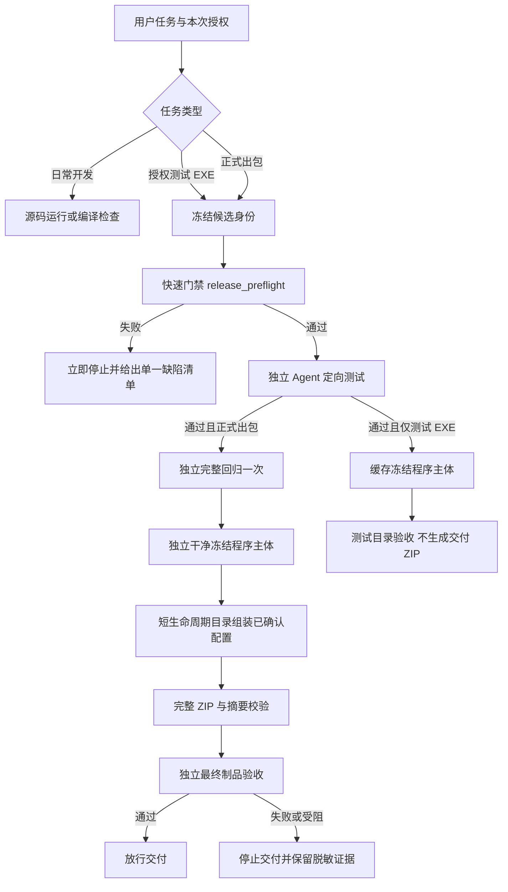

# OnlineTrader 测试与便携交付流水线优化方案

> 日期：2026-11-20  
> 状态：**IMPLEMENTED_CANDIDATE / 批次 1–3 已进入工作树并通过编译/语法检查，行为测试与构建均未运行**  
> 适用范围：Standalone Trading Runtime 的开发检查、授权测试、Windows x64 便携程序冻结、配置组装与最终制品验收  
> 不改变：交易业务逻辑、Workbench/Runtime 权限边界、`onedir` 布局、两个 EXE 入口、Runtime 配置结构、SQLite 合同及 GitLab 更新协议

## 1. 结论与目标

本方案把当前“每次都从源码完整冻结、复制配置、生成 ZIP、再逐项临时检查”的流程拆成三条明确路径：

1. **开发路径**：源码运行与编译检查；除非本次获得测试授权，不运行测试、不冻结 EXE、不生成 ZIP。
2. **测试制品路径**：复用受控 PyInstaller 工作缓存，生成可执行目录；需要验证真实 EXE 时使用，不默认压缩 ZIP，不可作为正式交付件。
3. **正式发行路径**：冻结候选后执行独立全局测试，使用独立干净构建生成程序主体，再组装已确认配置、生成 ZIP，并对最终 ZIP 做独立验收。

核心目标：

- 在昂贵步骤前用一秒级脚本发现版本、配置、文件清单和发行身份问题。
- 对一个冻结候选只执行一次有效的完整回归，修复后才按规则重建候选并复测。
- 源码与依赖相同时，不因更换客户配置而重新运行 PyInstaller。
- 测试制品默认不生成 ZIP；正式交付仍生成并验证完整 ZIP。
- 每个阶段记录实际耗时、缓存状态、候选身份和制品 SHA-256。
- 客户配置、口令和账号私有文件不进入持久缓存，失败路径也不长期残留秘密。

## 2. 当前基线与瓶颈

### 2.1 2026-11-20 实际交付时间线

从首次预构建测试到最终停止验收约 1 小时 48 分。主要阶段如下：

| 阶段 | 实际耗时 | 观察 |
| --- | ---: | --- |
| 初始候选测试、修复、复测 | 15 分 45 秒 | 完整回归两次 |
| dev36 构建及未完成验收 | 约 7 分 38 秒 | 后续候选合同变化，制品不再是最终候选 |
| 被取消的 manual-only 测试 | 13 分 24 秒 | 完整回归一次，发现旧验证合同未更新 |
| dev37 预构建测试 | 9 分 36 秒 | 完整回归约 4 分 28 秒 |
| 发行身份修复后的复测 | 7 分 03 秒 | 因 dev36/dev37 不一致再次执行完整回归 |
| 最终便携构建 | 约 1 分 38 秒 | PyInstaller 是主要耗时 |
| 最终 ZIP 验收 | 22 分 31 秒 | 约 13 分钟消耗于托盘退出自动化重试 |

完整回归共执行 5 次，每次约 264–270 秒，合计约 22 分 20 秒。单次完整回归并非异常慢，主要问题是候选变化和迟到的快速失败条件导致重复执行。

### 2.2 PyInstaller 实际耗时

当前 [`scripts/build-portable.ps1`](../../scripts/build-portable.ps1) 每次创建随机 staging，并把 `--workpath` 放在该目录中；成功后删除整个 staging。下一次构建无法复用 Analysis、PYZ、EXE 等工作结果。

现有构建日志显示：

- Analysis、Qt/TqSdk/NumPy/Pandas/SciPy Hook 和动态库分析约占 96 秒；
- PYZ、两个 EXE 与 COLLECT 合计约 3–4 秒；
- ZIP 压缩及交付校验约占约 10 秒；
- `.spec` 中 `collect_data_files('tqsdk')` 和 SDK Hook 会带入较大的依赖分析范围。

PyInstaller 官方将 `workpath` 定义为临时工作文件、日志和 `.pyz` 的目录，并通过 TOC、输入和 mtime 判断目标是否需要重建；`--clean` 会清理缓存和临时工作目录。因此，固定且受控的 `workpath` 可以复用无变化目标，但它不是编译器级逐模块增量：任一被 Analysis 收集的 Python 源码变化，仍可能触发完整依赖分析。

### 2.3 当前流程问题

| ID | 问题 | 影响 | 优先级 |
| --- | --- | --- | --- |
| P-01 | 缺少构建前统一快速门禁 | 版本不一致、旧模块引用等问题在完整回归后才暴露 | P0 |
| P-02 | 每次使用随机 PyInstaller `workpath` 并删除 | 无变化重建、配置变更和失败重试仍重复 Analysis | P0 |
| P-03 | 程序冻结与客户配置组装耦合 | 同一程序交付不同配置也重新冻结 Qt/TqSdk/Python | P0 |
| P-04 | 完整回归围绕变化候选重复执行 | 五次完整回归中存在可通过早期门禁避免的重复 | P0 |
| P-05 | 开发/测试场景默认生成完整 ZIP | 额外压缩和校验，且容易把测试目录误认成交付件 | P1 |
| P-06 | 检查脚本按任务临时生成并串行执行 | 重复设计、报告与交接开销大，口径不稳定 | P1 |
| P-07 | GUI 自动化无阶段超时和人工接管点 | 工具能力限制导致十余分钟重试，仍无法形成结论 | P1 |
| P-08 | 缺少结构化阶段耗时和缓存报告 | 无法区分 Analysis、COLLECT、组装、ZIP 和验收耗时 | P1 |
| P-09 | 失败 staging 可能包含客户配置 | 组装或压缩失败后秘密可能残留 | P0 安全 |

## 3. 目标流水线



### 3.1 开发路径

- 使用源码入口或现有开发入口运行需要的程序。
- 日常修改完成后仅执行仓库规定的编译检查。
- 未获得本次测试授权时，不运行定向测试、完整回归、GUI 验收或打包。
- 不创建可被误传给用户的 `*-Configured.zip`。

### 3.2 测试制品路径

- 使用持久化 PyInstaller 工作缓存。
- 输出新的、隔离的 `onedir` 目录，不覆盖已验收制品。
- 默认不生成 ZIP；只运行 EXE 身份探针和本次授权范围内的行为验收。
- 输出目录必须显式标为 `TEST-ONLY`，manifest 中记录 `deliverable=false`。
- 缓存命中不代表测试通过，测试 Agent 仍从实际目录入口执行被授权的场景。

### 3.3 正式发行路径

- 候选、配置和版本在测试前冻结。
- 由独立测试 Agent 完成打包前全局测试。
- PyInstaller 使用独立干净工作目录；不得把开发热缓存直接当作正式发行证据。
- 程序主体冻结一次，再按交付模式组装配置。
- 生成 ZIP 后，从最终 ZIP 隔离解压并执行独立验收。
- 任一必测项失败或受阻时停止交付。

## 4. 第一层：一秒级快速门禁

新增建议入口：

```powershell
.venv\Scripts\python.exe -I scripts/release_preflight.py `
  --candidate-source . `
  --delivery-mode RuntimeConfigured `
  --config-directory <confirmed-config> `
  --output <evidence>/release-preflight.json
```

该脚本只做确定性静态检查，不连接账户、不启动 Qt、不构建、不压缩 ZIP：

1. `pyproject.toml`、`online_trader.__version__`、更新默认版本和发行入口版本一致。
2. Python 3.13 x64、PyInstaller、PySide6、TqSdk、jsonschema、referencing 版本符合冻结要求。
3. `.spec`、发行入口、启动文件和交付脚本存在。
4. Runtime 配置严格包含 `runtime.json`、`OnlineTrader-parameters.json`、`private/OnlineTrader-defaults.json`，允许明确的用户 overrides。
5. 使用产品解析器读取配置，检查 schema、账号引用、参数及文件大小。
6. 排除白银、`runtime-control.json`、`operators.json`、watchdog、handoff、执行账本及数据库/WAL/SHM。
7. 用唯一规范算法把 tracked、modified、deleted 和 untracked 文件的路径、类型及内容摘要合成为 `candidate_tree_sha256`，并与 HEAD、spec hash、配置文件 hash 和版本一同写入 manifest。
8. 通过 AST 和文件元数据检查关键发行入口，不在静态门禁进程中导入产品模块。确需导入探针时另用有限时、禁止 Qt/账户/写盘的隔离子进程。

输出为单一 JSON 和明确退出码。所有机械检查一次读取、一次报告，不再为每项临时生成脚本。

### 快速门禁与测试的边界

快速门禁不是功能测试，也不替代独立完整回归或最终制品验收。它的职责是在昂贵测试前发现确定性错误。预期由独立测试 Agent 读取并复核其输入和结果，但脚本本身由仓库维护，不能在每轮交付中临时改写预期以适配当前输出。

## 5. 第二层：测试分层与只跑一次原则

### 5.1 测试顺序

| Gate | 内容 | 失败处理 | 典型预算 |
| --- | --- | --- | ---: |
| G0 | 授权、执行路径、候选与配置冻结 | 不满足则不执行测试 | 10 秒 |
| G1 | `release_preflight.py` | 立即停止；不跑全量 | 1–3 秒 |
| G2a | 开发 Agent 编译检查 | 立即修复编译错误 | 10–30 秒 |
| G2b | 独立测试 Agent 执行受影响模块定向测试 | 汇总定向缺陷 | 30–120 秒 |
| G3 | 独立完整回归 | 同一候选全部用例执行后交接缺陷 | 约 4.5 分钟 |
| G4 | 程序冻结 | 失败时不组装配置 | 冷构建约 1.5–2 分钟；热构建待测 |
| G5 | 最终目录/ZIP 静态验收 | 失败时不启动账户连接 | 5–20 秒 |
| G6 | 实际入口、GUI、连接与退出验收 | 失败/受阻则停止交付 | 按授权和场景设预算 |

### 5.2 完整回归只对冻结候选有效

- 完整回归开始后，主 Agent 不再修改候选文件。
- 快速门禁、完整回归、构建和制品验收记录同一 candidate manifest。
- 修复导致候选变化时，原完整回归变为历史证据；修复后先重新执行 G1/G2，再按仓库规则决定和执行完整复测。
- 版本号、spec、发行入口、依赖或配置合同不一致必须在 G1 阻断，避免在 G3 后发现。

### 5.3 可安全并行的检查

以下只读、互不写共享状态的检查可并行：

- 候选身份与版本一致性；
- 配置 schema、白银和禁止文件扫描；
- `.spec`/依赖环境指纹；
- ZIP 成员、CRC、路径安全和摘要；
- 多个使用独立临时目录的定向模块。

完整回归、使用同一 PyInstaller 缓存的冻结、同一账户连接和同一制品 GUI 操作保持串行。

## 6. 第三层：程序冻结与配置组装解耦

### 6.1 程序主体冻结

建议新增兼容入口：

```powershell
scripts/freeze-portable.ps1 `
  -Python .venv\Scripts\python.exe `
  -BuildMode CachedTest `
  -Output <base-bundle>
```

或正式发行：

```powershell
scripts/freeze-portable.ps1 `
  -Python .venv\Scripts\python.exe `
  -BuildMode ReleaseClean `
  -Output <base-bundle>
```

基础程序主体只包含：

- `OnlineTrader.exe`；
- `OnlineTraderCLI.exe`；
- `_internal`；
- 无秘密的通用便携文件；
- `base-build-manifest.json`。

程序冻结阶段不接受 `DeliveryConfigDirectory`，不读取、复制或缓存账户配置。

### 6.2 交付组装

现有 [`scripts/portable_delivery.py`](../../scripts/portable_delivery.py) 拆分为清晰子命令，或保留兼容入口并在内部调用：

```text
validate-config   校验已确认配置
verify-base       校验基础程序主体及 manifest
assemble          从基础程序主体组装 RuntimeConfigured 目录
verify-bundle     检查最终目录、配置和禁止项
archive           仅正式交付时压缩、CRC 和摘要校验
verify-archive    重新打开最终 ZIP 并验证成员与重要摘要
```

同一个基础程序主体可以组装多个客户或设备配置，但每个最终 ZIP 都必须带入该接收方已确认的完整配置，并具有独立配置 hash、最终 SHA-256 和验收记录。无配置基础程序主体仅是 deliverable=false 的内部中间件，禁止生成或发布为 ZIP。

### 6.3 兼容入口

[`scripts/build-portable.ps1`](../../scripts/build-portable.ps1) 暂时保留，作为正式发行兼容包装器：

```text
build-portable.ps1
  -> release_preflight
  -> freeze-portable -BuildMode ReleaseClean
  -> portable_delivery assemble/archive/verify
```

不要使用一个含义模糊的 `-Fast` 参数同时控制缓存、ZIP 和验证范围。模式必须使用不可混淆的枚举，例如 `CachedTest` 与 `ReleaseClean`。

## 7. PyInstaller 持久缓存设计

### 7.1 缓存目录

```text
output/build-cache/pyinstaller/
└── win-x64-py313-pyi6.22.3-<environment-key>/
    ├── work/OnlineTrader/
    ├── cache-manifest.json
    └── build.lock
```

`environment-key` 至少包含：

- 操作系统和架构；
- Python 主次版本、实现和解释器路径身份；
- PyInstaller、PySide6、TqSdk 及 hooks 版本；
- 依赖锁或安装清单 hash；
- `OnlineTrader.spec` hash；
- 缓存 schema 版本。

不要把完整源码 SHA 直接作为缓存目录键，否则每次修改源码都会创建全新缓存。源码变化由 PyInstaller 的 TOC/mtime 规则判断；候选源码身份写入 build manifest，用于审计而不是切碎缓存。

### 7.2 并发与失效

- 同一缓存目录由跨进程独占锁保护。
- 获取锁超时后明确失败，不并发写入。
- Python、PyInstaller、hooks、依赖或 spec 指纹变化时切换缓存命名空间。
- 提供显式 `-CleanCache`，只删除已解析并验证位于项目 `output/build-cache/pyinstaller` 下的目标缓存。
- 缓存读取异常时自动进行一次干净重试；第二次失败保留脱敏日志并停止。
- `ReleaseClean` 使用独立新工作目录和干净构建，不把热缓存结果直接提升为正式制品。

### 7.3 缓存能与不能保证的收益

| 场景 | 预期 |
| --- | --- |
| 源码、spec、环境均未变化，仅重新执行 | 应跳过 Analysis/PYZ/EXE，主要重新 COLLECT 到新目录 |
| 仅更换 Runtime 客户配置 | 不应调用 PyInstaller，只执行组装和 ZIP |
| 仅修改非冻结文档 | 应复用程序主体；是否需要重新交付由任务决定 |
| 修改任一冻结 Python 源码 | Analysis 可能整体重跑，必须实测，不承诺逐模块增量 |
| Python/Qt/TqSdk/PyInstaller/spec 变化 | 使用新缓存或干净构建 |

## 8. ZIP 与目录策略

- `CachedTest` 默认只生成目录，不生成 ZIP。
- 只有明确要求最终交付时生成 `*-Configured.zip`；无配置基础主体不得生成发布 ZIP。
- ZIP 继续使用临时文件、Deflate、CRC、成员集合和重要文件摘要校验。
- ZIP 生成前必须完成 bundle 校验；ZIP 生成后必须重新打开验证。
- 构建目录、测试目录和正式交付目录使用不同命名空间，避免误传。

本机基线表明 ZIP 约占十秒，并非首要瓶颈；跳过开发 ZIP 是低风险收益，但优先级低于 Analysis 缓存与配置组装解耦。

## 9. 配置与秘密安全

### 9.1 禁止进入持久区域

以下内容不得进入 PyInstaller 缓存或无配置基础程序主体：

- `private/OnlineTrader-defaults.json`；
- 任何账户口令、operator/token；
- `runtime-control.json`、watchdog、handoff；
- 执行 ledger、数据库、WAL/SHM；
- 运行日志、柜台历史缓存和收益缓存。

### 9.2 短生命周期组装目录

- 配置只在程序主体冻结成功后复制到私有组装目录。
- 组装入口使用 `try/finally`，无论校验、压缩或移动是否成功，都清理含秘密的临时目录。
- 默认不提供“保留失败配置目录”开关；如确需诊断，只保留脱敏 manifest 和错误日志。
- 清理目标必须解析为明确绝对路径，并验证位于本次组装根目录下。
- 日志只记录配置 hash、文件名、大小和脱敏账号，不记录口令或完整账号。

### 9.3 制品身份链

最终 manifest 记录：

```json
{
  "schema_version": "ONLINE_TRADER_DELIVERY_BUILD/1",
  "candidate": {
    "head": "<full-sha>",
    "tracked_patch_sha": "<sha>",
    "untracked_manifest_sha": "<sha>",
    "version": "0.1.0.devNN"
  },
  "toolchain": {
    "python": "3.13.x",
    "pyinstaller": "6.22.3",
    "platform": "windows-x64"
  },
  "base_bundle": {
    "manifest_sha256": "<sha256>",
    "build_mode": "ReleaseClean",
    "cache_status": "NOT_USED"
  },
  "delivery": {
    "mode": "RuntimeConfigured",
    "config_hashes": {},
    "silver_check": "PASS",
    "retired_file_check": "PASS"
  },
  "artifact": {
    "filename": "<zip>",
    "sha256": "<sha256>"
  }
}
```

manifest 不包含任何秘密值。

## 10. 阶段耗时与性能报告

所有构建模式输出 `build-performance.json`：

| 阶段 | 记录内容 |
| --- | --- |
| preflight | 耗时、退出码、候选和配置 manifest hash |
| pyinstaller_analysis | 冷/热模式、缓存键、是否重建 Analysis、耗时 |
| pyz_exe | PYZ、桌面 EXE、CLI EXE 耗时 |
| collect | `_internal` 和目录收集耗时、文件数、大小 |
| overlay | 通用便携文件和 Runtime 配置组装耗时 |
| executable_probe | `--verify-runtime` 和离线启动探针耗时 |
| bundle_verify | 必需文件、配置、禁止项和摘要耗时 |
| archive | 压缩耗时、成员数和大小 |
| archive_verify | CRC、路径安全和重要摘要耗时 |
| total | 总耗时、最终 SHA-256、结果 |

PyInstaller INFO 日志可以作为重建原因证据；报告中区分 `COLD`、`WARM_HIT`、`SOURCE_INVALIDATED`、`ENVIRONMENT_INVALIDATED`、`FORCED_CLEAN`，不凭“目录已存在”推断缓存命中。

## 11. GUI 与连接验收超时策略

真实 GUI 和柜台同步不能由静态脚本替代，但需要明确的时间边界：

- 启动、同步、GUI、托盘退出分别设定阶段 deadline。
- UI 操作最多重试两次；每次操作后重新观察窗口状态，不复用过期坐标。
- 工具无法枚举系统托盘等环境限制时，立即记录 `BLOCKED` 并请求一次人工接管，不进行无上限重试。
- 用户停止测试时立即安全结束连接并清理本次隔离进程，不继续后台尝试。
- 退出验收优先通过用户真实入口；强制终止只能用于安全收束，不能判定 PASS。

建议初始预算：静态制品检查 30 秒、首次启动与柜台同步 5 分钟、GUI 关键流程 3 分钟、正常退出 2 分钟。预算是停止和升级决策点，不是把超时自动判为产品缺陷。

## 12. 实施批次

### 批次 1：快速门禁与可观测性（低风险）

交付：

- `scripts/release_preflight.py`；
- 统一 JSON 输出和退出码；
- 当前构建脚本的阶段 Stopwatch 与 `build-performance.json`；
- GUI/连接验收阶段 deadline 和人工接管点；
- 失败 staging 的 `finally` 清理。

验收：使用已知错误样本证明版本不一致、缺配置、白银和旧文件能在完整回归前被阻断；正常样本在数秒内通过。

### 批次 2：受控 PyInstaller 缓存

交付：

- `freeze-portable.ps1 -BuildMode CachedTest|ReleaseClean`；
- 缓存键、锁、失效、清理和一次性干净回退；
- 冷构建、无变化热构建、单 Python 文件变化的性能对比。

验收：缓存不含配置；并发写入被拒绝；环境变化进入新缓存；相同候选热构建确实显示 Analysis/PYZ/EXE 未重建。

### 批次 3：程序主体与配置组装解耦

交付：

- 无秘密基础程序主体和 manifest；
- `validate-config / assemble / verify-bundle / archive / verify-archive`；
- 同一基础程序主体组装多个 RuntimeConfigured 的隔离验证；
- 原 `build-portable.ps1` 兼容包装器。

验收：仅换配置时不调用 PyInstaller；每个最终 ZIP 配置精确一致、无白银和禁止文件；无配置基础主体保持 deliverable=false 且不能归档发布。

### 批次 4：条件性资源精简

只有前三批实测后 Analysis 或包大小仍是主要问题时，才审计 Qt 插件、TqSdk 数据及 Pandas/SciPy 引入来源。任何删除都必须覆盖真实 Qt 启动、行情连接、Runtime 同步、策略和更新入口；不得凭文件名或体积直接删除。

暂不迁移 Nuitka，不改变 `onedir`、双 EXE、Runtime 配置和更新协议。

## 13. 验收指标

### 13.1 正确性

- 快速门禁能重现并提前阻止 2026-11-20 的 dev36/dev37 发行身份不一致。
- 配置、白银、retired 文件和账本检查与现有正式交付规则一致。
- CachedTest 不能生成或被命名成正式交付 ZIP。
- ReleaseClean 最终 ZIP 重新执行现有独立验收范围；包括正常托盘退出在内的任一必测项 BLOCKED 时禁止交付。
- 基础程序主体、配置输入、最终 ZIP 形成可追踪的 hash 链。

### 13.2 性能

在相同机器、相同候选、相同杀毒与磁盘条件下至少测量三轮并报告中位数：

1. 冷缓存干净冻结；
2. 无变化热缓存冻结；
3. 仅更换配置并组装 ZIP；
4. 修改一个冻结 Python 文件后的缓存冻结；
5. 正式 ReleaseClean。

不预先承诺固定倍数。最低成功标准：

- 仅更换配置时 PyInstaller 调用次数为 0；
- 无变化热构建日志证明 Analysis/PYZ/EXE 未重建；
- 快速门禁在完整回归前发现确定性错误；
- 每次流水线可直接定位最长阶段。

### 13.3 安全

- 缓存和基础程序主体扫描不到账户私有配置及运行数据库。
- 失败组装后秘密 staging 被清理。
- 日志和 manifest 不含口令、token 或完整账号。
- 测试/构建路径不扩大柜台连接或订单授权。

## 14. 回滚

- 每个批次独立提交并可单独回滚。
- 缓存出现不一致时切换 `ReleaseClean`，不阻塞正式发行。
- 拆分组装失败时，兼容包装器可临时调用旧单体流程，但仍必须使用 `finally` 清理秘密。
- 新性能报告不参与运行时业务判断，删除报告功能不影响产品。
- 不迁移制品格式和更新协议，因此回滚无需客户数据转换。

## 15. 明确不在本方案内

- 不通过减少必测范围来伪造提速。
- 不取消正式出包前的独立全局测试或最终制品验收。
- 不让测试 Agent 与实现 Agent 合并角色。
- 不把热缓存目录直接交付给用户。
- 不在未授权时连接账户、启动交易策略或发送订单。
- 不修改 SQLite、订单、保护、Runtime 单实例或 Workbench 权限合同。
- 不因包体积大就直接删除 Qt/TqSdk/NumPy/Pandas/SciPy 文件。

## 16. 推荐执行顺序

1. 先实现批次 1，把版本、配置和候选问题在一秒级阻断，并获得真实阶段耗时。
2. 实现批次 2，对冷构建、热构建和单文件变化做同机对照。
3. 在缓存收益明确后实施批次 3，使配置变更完全绕过 PyInstaller。
4. 只有测量证明仍有必要时才进入批次 4。

该顺序能在不改变交易产品架构和正式发行门槛的前提下，先消除已确认的重复劳动，再用实测决定后续投入。

## 17. 依据

项目依据：

- [`AGENTS.md`](../../AGENTS.md)：测试授权、开发/测试分离、完整制品和配置交付规则。
- [`scripts/build-portable.ps1`](../../scripts/build-portable.ps1)：当前随机 staging、PyInstaller、组装与 ZIP 单体流程。
- [`release/OnlineTrader.spec`](../../release/OnlineTrader.spec)：Analysis、Qt/TqSdk 数据、双 EXE 与 onedir COLLECT。
- [`scripts/portable_delivery.py`](../../scripts/portable_delivery.py)：配置验证、白银排除、组装、ZIP 与摘要校验。
- [`output/delivery/manual-only-dev37-20261120/prebuild-independent/test-report.md`](../../output/delivery/manual-only-dev37-20261120/prebuild-independent/test-report.md)：预构建全局测试证据。
- [`output/delivery/manual-only-dev37-20261120/prebuild-independent-retest/test-report.md`](../../output/delivery/manual-only-dev37-20261120/prebuild-independent-retest/test-report.md)：发行身份修复后的完整复测。
- [`output/delivery/manual-only-dev37-20261120/artifact-independent-acceptance/test-report.md`](../../output/delivery/manual-only-dev37-20261120/artifact-independent-acceptance/test-report.md)：最终 ZIP、真实连接与托盘退出受阻证据。

外部依据：

- [PyInstaller 6.22.3：Using PyInstaller](https://www.pyinstaller.org/en/stable/usage.html)
- [PyInstaller 6.22.3：Using Spec Files](https://pyinstaller.org/en/stable/spec-files.html)

