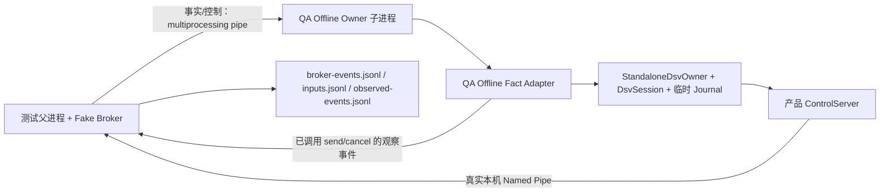
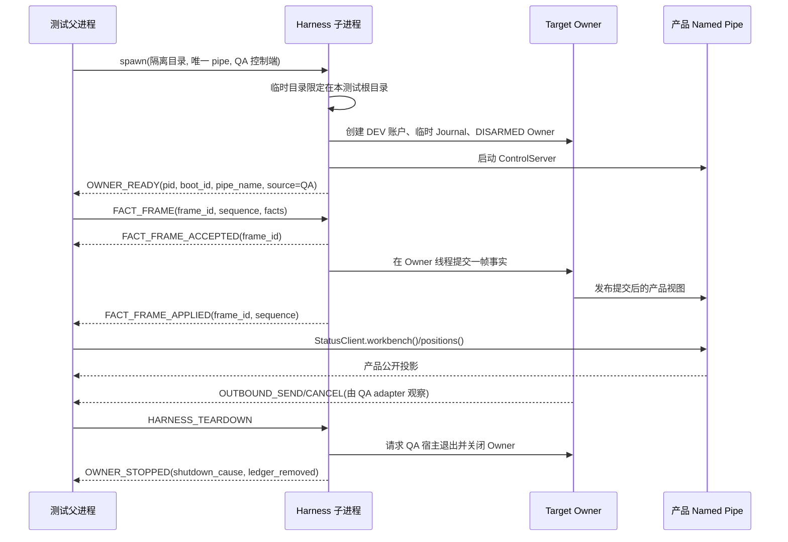

# Testing System PR2：Standalone Target Owner 子进程 Harness

> 状态：`CURRENT DESIGN / PROCESS LIFECYCLE OFFLINE-VERIFIED`
> 日期：2026-11-21（2026-11-23 补跑生命周期回归）
> 范围：仅 `qa/target_owner/` 的离线 Owner 进程、父进程 Fake Broker、事实驱动通道、产品 Named Pipe 客户端路径与事件证据。
> 边界：不改生产 Runtime、SDK、Target Controller 或产品 IPC；不接真实账户、不发送真实订单、不打包。

## 1. 目标与可行性

PR2 的关键目标是把当前 `OfflineTargetRuntime` 从“测试进程内的 Owner 线程”提升为独立 Owner 子进程，同时保持其通过真实产品 `ControlServer` Named Pipe 提供 Workbench 投影。父测试进程不能读取 Owner 对象或执行器内部数量；它只能给 QA 事实适配器送入明确的离线事件，并通过产品客户端观察结果。

此路径可复用 `StandaloneDsvOwner`、`DsvSession`、`ControlServer` 和现有 `StatusClient`，无需给生产 Runtime 增加假事实入口。子进程宿主和单合约父进程 Fake Broker 状态模型已进入候选工作树，且 `tests/test_target_owner_runtime.py::test_process_runtime_harness_lifecycle_and_public_pipe_control` 已在本机 Windows 离线回归中验证进程隔离、公共 Named Pipe 控制、fact 帧应用和正常 teardown 清理。5 手开仓、3+2 成交、撤单和退出仍须补更多场景驱动与独立验收。

## 2. 架构与信任边界

- 事实通道和产品 Named Pipe 必须是两个独立通道。QA 事实通道只存在于 `qa/target_owner/` 的子进程宿主，不被生产启动器接受或创建。
- 子进程用随机 `DEV:target-owner-*` 账户、QA Profile 和 `RecordingPort`；不调用 `run_target_owner`、`strategy_port(...).connect()` 或 `create_standalone_owner()` 的真实 SDK 构造路径。
- `RecordingPort.send/cancel` 事件只证明假适配器收到执行请求，不证明柜台接受、成交或终态。`fake_broker.py` 只在显式调用 `accept_order`、`report_order`、`report_trade` 或 `confirm_cancel` 后生成 Broker 事实。
- 行为断言通过独立 `StatusClient` 从产品 Named Pipe 读取。PR2 子进程 API 不暴露 `owner`、`session`、`adapter` 或 `call_owner`。

## 3. 启动和运行时序

Owner 的产品 `FLATTEN_THEN_STOP` 与 Harness 的 `HARNESS_TEARDOWN` 必须使用不同的 `shutdown_cause`。Harness teardown 不能被记录成产品安全停机证据。

## 4. 输入、输出与身份契约

每次 Harness 创建唯一 `run_id`、产品 pipe、测试根目录和 Owner boot。Owner 子进程 PID、`runtime_boot_id`、`configuration_revision`、Profile hash 和交易日都在 `OWNER_READY` 中记录。每次输入帧带 `frame_id`、单调递增 `sequence`、明确交易日、同步完整性及 `native` 事实；父进程保存到 `inputs.jsonl` 后才发送。子进程分别回报接收和应用，不将“已发送给子进程”误记成“Owner 已处理”。

场景时间由事实帧中的 `wall_time` 和 `monotonic_ms` 显式推进，并只影响 DSV round 的输入。OS 进程超时、pipe liveness、启动和 teardown deadline 继续使用真实 `time.monotonic()`；Harness 不 monkey-patch 产品时钟或系统时钟。

`observed-events.jsonl` 只写子进程观察到的事件：Owner 就绪/停止、事实接收/应用、假适配器 send/cancel 请求、子进程异常和退出码。每条事件带 `run_id`、`owner_pid`、`runtime_boot_id`（就绪后）、`event_seq`、来源及单调时间。异常记录异常类型、源码文件名/行/函数和异常消息 SHA-256，不写原始异常消息。

Broker position/order/trade 输入与 Owner outbound 请求分开保存。Harness 不允许根据 outbound 请求推造“已受理”事实；Fake Broker 模型已提供显式 accept/order-update/trade/cancel 操作，并在事实帧中保留唯一 `native_trade_id`。交易 Oracle、场景驱动和行为验收仍留在后续工作。

父进程模型位于 `qa/target_owner/fake_broker.py`，限定单账户、单合约、同一交易日和初始空仓。它分别保存已观察到的 send/cancel、柜台订单状态、逐笔成交和由成交推导的多空持仓；订单累计成交与逐笔成交可分开推进，以保留“订单已报 3 手、逐笔只证实 2 手”这样的异步状态。每次状态转移写入独立的 `broker-events.jsonl`。`prepare_frame` 显式绑定场景 UTC 时间及单调时间；`deliver_frame` 只在 Owner 回报该事实帧已应用后消费事实队列。模型不从 send/cancel 请求推演柜台结果，也不直接读取 Owner 内部字段。

## 5. 生命周期、故障与清理

| 情况 | Harness 动作 | 必留证据 |
|---|---|---|
| 正常产品停机 | 通过产品 pipe 发命令，等待 Owner 自行退出 | 最终公开投影、`OWNER_STOPPED`、`shutdown_cause=PRODUCT_OWNER_STOP_EVENT`、临时 Journal 已删除 |
| 测试收尾 | 发送独立 `HARNESS_TEARDOWN` | `shutdown_cause=HARNESS_TEARDOWN`，不能用于产品停机结论 |
| Owner 卡死 | 等待有界超时，再 terminate/kill 此 Owner 子进程 | 进程 PID、超时、退出码、最后输入/输出事件；状态标为强杀，不伪造正常关闭 |
| 启动失败/崩溃 | 捕获子进程退出或脱敏错误事件 | boot 是否建立、失败阶段、错误类型和消息 hash |
| 强杀后重启 | 在新隔离根目录启动新子进程 | 新 boot、新临时 Journal；不得交接旧 Journal 或旧命令责任 |

本 Harness 子进程不创建自己的子进程；Named Pipe 服务器的工作线程由 `ControlServer` 关闭并回收。正常退出由 `RuntimeSessionStorage` 删除临时 Journal。异常强杀时，残留临时文件只能由父测试的专属临时根目录统一清理，不得按构造路径递归删除工作区或共享目录。

## 6. 兼容、回退及实现界限

- 现有 `qa/target_owner/offline_runtime.py` 线程夹具保留为 T2；本设计新增独立进程夹具，不替换生产启动路径。
- 新夹具独立出错时，选择回退到旧 T2 夹具并如实降低证据等级；不能把 T2 结果重标为 T3。
- 不改 `ControlServer` 协议，不增加生产事实注入开关，不引入第二个在线 sender，不改 account/Runtime 锁合同。
- PR2 基础设施完成不代表 5 手闭环、慢部分成交、撤单、退出、崩溃恢复或发行验收完成。

## 7. 可执行验收条件

后续经用户明确授权后，由未参与实现的独立测试 Agent 在 Windows 隔离环境验收：

1. Owner PID 与测试 PID 不同；真实产品 Named Pipe 客户端能读到新 boot 的 DISARMED/同步后投影。
2. 父进程提交的每个事实都有独立 `ACCEPTED` 与 `APPLIED` 证据；观察视图与输入序列可关联。
3. outbound send/cancel 是 Fake Adapter 的观察事件；不会被误记为 Broker 接受、成交或终态。
4. 5 手正常、3+2 慢部分成交、撤单终态和退出路径均由公共 pipe 可观察，Oracle 依据明确 Broker 事实计算，不读取 Owner 内部状态。
5. 产品 `FLATTEN_THEN_STOP` 与 Harness teardown 可区分；正常结束后 Owner 进程退出且当前 boot Journal 删除。
6. 强杀后报告为强杀/未正常关闭；重启创建新 boot 和新 Journal，不继承旧命令或发送责任；测试退出后无 Owner 子进程残留。
7. 固定代表性故障能从脱敏事件日志反查输入、失败边界、退出状态和处理结果。

本次代码阶段只允许编译检查；未执行以上行为验收。Windows Named Pipe、进程强杀、5 手/3+2/撤单/退出场景、独立 Oracle 与真实柜台仍为 `NOT_RUN`。
