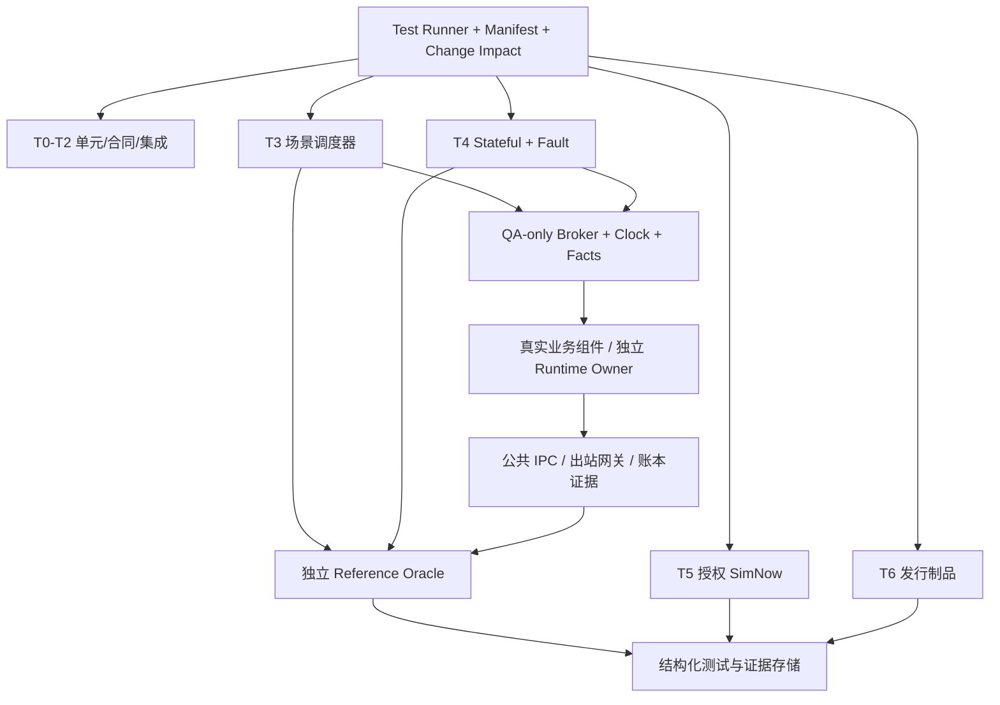

# OnlineTrader 测试体系重构设计 V2.0

> 日期：2026-11-21  
> 状态：**DESIGN / NOT IMPLEMENTED**  
> 适用：Standalone Trading Runtime、DSV、Workbench、SimNow、Windows 发行  
> 范围：重构测试组织、测试执行器、交易场景与证据；**本文不批准连接账户、真实发单、自动启用 CI、修改交易行为或发行制品**。  
> 关联：[测试入口迁移](standalone-trading-runtime-test-migration-20261119.md) · [流水线与便携交付优化](testing-and-portable-delivery-pipeline-optimization-20261120.md) · [行情竞态 P0](runtime-market-race-entry-exit-remediation-20261120.md) · [验证证据规则](../validation/README.md)

## 1. 决策摘要

当前仓库已有大量 `tests/test_*.py`、`qa/*.py`、Runtime IPC rehearsal、DSV 对照回放、SimNow 现场验证和发行脚本。主要问题不是绝对测试数量不足，而是组件断言、离线产品路径、真实柜台及最终制品验收混在一起，使“测试通过”的含义不清；`qa/check.py` 仍通过 `unittest.defaultTestLoader.discover(tests)` 执行整套离线检查，难以按风险快速选择。

**目标**：不推翻现有有效测试，把验证重心从“函数数量/总 PASS 数”提高到“交易目标—订单在途—柜台事实—退出责任”的安全不变量、可重现故障事件序列和真实入口验证。测试框架是独立验证系统，不能为了测试方便给生产 Runtime 增加虚假柜台事实入口。

优先级：**PR1 运行器/清单 → PR2 Harness → PR3 Oracle+关键场景 → PR4 Stateful/故障 → PR5 证据/发行收口**。每批只对本批目标作声明；PR2/PR3 是降低交易 P0 风险的核心。

### 非目标

- 本方案不实现生产环境的目标持仓核对器，不改变 DSV 策略计算规则或生产执行器重试政策。
- 不处理多账户冲突，也不专门设计人为手动开仓模拟。
- 不要求全部迁移至 pytest；保留现有 `unittest`，可增量引入 Hypothesis。
- 不默认恢复 GitHub Actions/CI/CD；现有项目明确采用本地/测试机与独立 Agent 验证。
- 不把离线回放、假柜台、Linux 仿真或 Qt 替身当作真实 Windows、SimNow 或最终 ZIP 的证据。

## 2. 当前基线与具体债务

| 现有资产 | 本次定位 | 迁移要求 |
|---|---|---|
| `qa/check.py`, `scripts/check.ps1` | 离线全量门禁 | 保留兼容包装，拆分 Quick/Affected/FullOffline；保留检查源码及验证资产哈希的能力 |
| `qa/runtime_fixture.py`, `qa/runtime_replay.py` | Kernel / DsvSimulationSession 离线夹具及公共 IPC rehearsal | 保留其组件或旧执行路径覆盖；不能据此证明当前 Standalone Target Owner |
| `qa/target_owner/offline_runtime.py`, `tests/test_target_owner_runtime.py` | 当前 StandaloneDsvOwner + ControlServer 公共 pipe 的 QA-only 夹具；Owner 在测试进程内的线程运行 | 作为 T2 起点；增加独立 Owner 子进程与跨进程事实通道后才能计入 T3/T4 进程证据 |
| `tests/test_dsv_execution_regressions.py` | 组件回归 | 保留内部状态断言；关键 P0 行为另以公共接口场景验证 |
| `tests/test_runtime_client_foundation.py` | Runtime Client/Windows pipe 合同 | 保留，按 test case 区分平台，不能把整模块笼统标 Windows |
| `tests/test_runtime_parallel_ledger_guard.py` | 会话账本隔离 | 归 T1/T2；不冒充柜台恢复验收 |
| `tests/test_online_dsv_processes.py` | 独立进程 rehearsal | 归 T2/T3；记录实际入口及 broker_connected=false |
| `qa/dsv_parity/` | 独立 DSV 行为对照 | 保留参考版本/批准差异，不与执行安全 Oracle 混淆 |
| `qa/workbench_rehearsal.py` | Legacy | 不得作为当前 Runtime 产品验收 |
| `qa/build_audit.py` | 旧交付验证 | 包含调用 Legacy rehearsal 与硬编码历史 `output/artifacts/.../smoke-source.py`；先消除历史输出依赖，再归档或替代 |
| `scripts/release_preflight.py`, 便携构建脚本 | 发行静态门禁/制品构建 | 与新的 Release Profile 协调，保留正式候选冻结与无秘密缓存要求 |

以上基线随 2026-11-21 Target Owner 冷切换源码更新。当前 `desktop_bootstrap.py` 的版本固定核心是 `DSV_TARGET`；旧 Kernel fixture 即使使用 ControlServer 和公共客户端，也只证明它实际运行的旧 owner 路径。当前 Target fixture 已走真实 `StandaloneDsvOwner` 与产品 pipe，但进程仍在同一 Python 进程中，不能证明 Owner 崩溃、重启、孤儿清理或生产启动链。历史 PASS 数量仍不向新候选转移。现有 [Runtime 测试迁移文档](standalone-trading-runtime-test-migration-20261119.md) 的公共入口原则继续适用，但其旧 Owner 证据须按本表重新归类。

## 3. 分层验证合同

| Tier | 验证内容 | 环境/网络 | 证据边界 |
|---|---|---|---|
| T0 Static | 编译、版本、依赖方向、schema、静态发行条件 | 离线 | 不证明运行行为 |
| T1 Unit/Contract | DSV 规则、算量、订单数学、协议合同 | 离线 | 组件行为 |
| T2 Integration | SQLite、IPC、Owner/Workbench、线程退出、跨进程 | 离线，部分 Windows | 集成行为 |
| T3 Trading Scenario | 真实业务链 + 假柜台事实 + 公共产品视图 | 离线，独立 Runtime 进程优先 | 不证明真实柜台 |
| T4 Stateful/Fault | 随机序列、顺序故障、真实线程/进程竞态 | 离线，指定 Windows | 反例与可重放轨迹 |
| T5 Live Broker | 实际 SimNow/TqKq/后续获批 CTP 接入、委托/成交/恢复 | 联网且明确授权 | 仅适用所测账户/交易日/合约 |
| T6 Product/Release | Windows EXE、Qt、更新、退出、打包与最终 ZIP | 按范围 | 仅适用冻结候选与实际制品 |

每个验证项必须有 `test_id`、`tier`、`domain`、`risk`、`entry_point`、`platform`、`broker_mode`、`requirements`。组合结果保留 `PASS/FAIL/ERROR/SKIP/BLOCKED/NOT_RUN`，同时独立记录 `evidence_status`；禁止把跳过和阻断当通过。发布门禁由候选明确的必测场景集合决定，不以普通测试总量替代。

## 4. 目标架构



**严格边界**：
1. Mode A `Component Harness` 可以观察内部字段，证据只能标 T1/T2；Mode B `Runtime Process Harness` 用独立 Owner、真实 IPC 和真实公共客户端，作为 T3/T4 主路径；Mode C 使用真实 SDK/EXE，不允许注入伪造事实。
2. 生产 `runtime run` 的 SDK 和权限边界保持不变；Fake Broker、虚拟时间、强制成交等仅在未打包的 QA-only 宿主中使用。
3. 测试驱动输入事件与实际观测输出事件分开记录。不得预置“已发送订单”然后当作观察到的系统输出。
4. 每测试独享 `runtime_root/config_root/ledger/history/pipe/process/clock/output`；真实进程测试必须清理子进程与孤儿进程。
5. 不允许通过直接读取被测 Runtime 内部 `remaining_quantity` 字段生成 Oracle 的预期。

## 5. Reference Oracle：模型与计算

### 5.1 输入及输出

Oracle 从 **Strategy Target、独立 Fake Broker 事实与订单逐笔记录** 计算参考状态，不照抄执行器内部派生数量。第一版仅单账户/单合约/单方向，分别验证开仓与退出；日后扩展今昨仓与多方向。此处的“账户”是绑定的柜台观测范围，不表示把账户全部净持仓归给当前 Runtime。

```text
Strategy Target + Broker Position Snapshot + Runtime-Owned Attribution + Orders/Fills/Cancel Facts
      -> Reference Reducer -> Expected State + Violated Invariants
```

逐笔事实至少记录：`order_ref`、关联 `intent_ref`、Owner boot / 目标身份、方向、开平类型、原始数量、唯一 `fill_id`、累计成交、确定/不确定的潜在剩余、已知发送状态、柜台终态、交易日、同步水位及事实版本。数量必须按订单唯一身份去重，避免把同一份剩余在 `WORKING` 和 `CANCEL_PENDING` 中重复占量。测试快照须区分 Runtime 已证明持仓与外部或无法归属持仓；不得按价格、数量或时间相似性认领另一台电脑或人工产生的事实。

### 5.2 安全容量与不确定性

在同一方向、有效且完整的柜台快照下：

```text
potential_target_owned_position = runtime_proved_position
                                + sum(max_possible_remaining_of_distinct_owned_open_orders)

safe_additional_capacity = max(0, desired_position - potential_target_owned_position)
```

- 公式中的 `runtime_proved_position` 仅包含当前 boot 有证据承担的持仓，不得替换成柜台全账户净持仓。外部或无法归属持仓/委托单独保留；与目标冲突时要求核对并阻止冲突发送，不可被 Oracle 当成目标已覆盖。
- `safe_additional_capacity` **只是一条数量上界**，不是新开仓许可；还需策略授权、行情、风险、配置、柜台日和事实水位有效。
- 发送 UNKNOWN：按尚不能排除的剩余上界占量；必须核对，不能视为 DEFINITELY_NOT_SENT。
- CANCEL_REQUESTED / CANCEL_PENDING：终态未确认时继续占量；撤单请求或超时不释放。
- 可靠终态 CANCELLED / REJECTED / FILLED：结合成交累计及柜台可信度更新在途数量。
- 若已证实仓位超过目标，系统不能“抹掉”超额，应停止新增风险、显示偏差并按既有批准规则推进撤单/减仓。
- 柜台快照不完整、存在身份冲突或恢复中时，不允许 Oracle 给出乐观的“可补单”结论。

退出路径要额外建模 **exit responsibility**：柜台仍有应退出的持仓时，拒单、行情变化、重启或界面消失不能把退出目标当成已完成；既有自动重试次数与人工介入政策仍然有效，Oracle 不要求无限重试。

### 5.3 核心不变量（第一批 12 条）

| ID | 安全合同 | 风险 |
|---|---|---|
| INV-001 | 同一有效目标不应产生额外独立的重复开仓责任 | P0 |
| INV-002 | 未解决的 UNKNOWN 开仓占量不得乐观补单 | P0 |
| INV-003 | 撤单未到可信终态不得释放在途占量 | P0 |
| INV-004 | 同一 `fill_id` 的重复回报不能重复增加成交 | P0 |
| INV-005 | 超额有效开仓单须识别并发起受控撤销；撤单中仍占量 | P0 |
| INV-006 | 行情变化不得抹掉未完成的退出责任 | P0 |
| INV-007 | 平仓拒单不能把退出目标标记为已完成 | P0 |
| INV-008 | 重启不得凭空推定 UNKNOWN 已失败；需柜台权威同步 | P0 |
| INV-009 | 旧 owner boot、配置版本或账号绑定的命令不得重获执行权限 | P0 |
| INV-010 | 失效行情/不可信授时不得授权不安全的新开仓 | P0 |
| INV-011 | 同一 `command_id` 不能触发第二次业务执行；异文需冲突 | P0 |
| INV-012 | Workbench 断线、关闭、重启不能制造额外交易委托 | P0 |

注意：这些是测试合同，是否允许某次重新定价、补足缺口或减仓，仍须依当前 DSV 与执行政策判断；不允许通过改 Oracle 来“适配”错误输出。对 INV-005，只有在相关事实被可靠观察后才要求明确撤销动作；受 IPC、柜台及终态延迟影响的动作须有界等待并按状态判定。

## 6. Scenario Harness 详细设计

### 6.1 组件

- `Scenario DSL/Parser`：固定输入场景、步骤标号和参数版本；
- `VirtualClock`：区分虚拟 UTC、虚拟 monotonic 和真实 monotonic；订单业务定时可跳时，Windows I/O 取消时限必须用真实单调时间；
- `FakeBroker`：维护独立订单真相、唯一成交、接单/拒单/撤单结果和柜台查询快照；
- `GatewayAdapter`：仅 QA-only 端口，捕获真实业务链发出的发送/撤销请求；
- `RuntimeOwnerManager`：隔离 IPC/数据路径，子进程启动、强杀、重连及清理；
- `ObservationCollector`：公共 RuntimeViewClient、RuntimeAccountClient、RuntimeWorkbenchClient、出站网关及状态证据；
- `ReferenceOracle`：消费输入及 Broker 权威事实产生独立预期；
- `TraceRecorder`：以 JSONL 记录所有步骤、请求、回报、断言与首次差异。

### 6.2 建议事件 schema

```json
{
  "schema_version": "TRADING_TEST_EVENT/1",
  "sequence": 12,
  "logical_time_ms": 1500,
  "kind": "BROKER_PARTIAL_FILL",
  "order_ref": "order-001",
  "payload": {"fill_id": "fill-003", "quantity": 3, "price": "1055"}
}
```

允许测试输入：`MARKET_TICK/CLOCK_ADVANCE/CLOCK_INVALID/STRATEGY_TARGET/BROKER_ACCEPT/BROKER_FILL/BROKER_REJECT/BROKER_CANCEL_CONFIRMED/BROKER_SNAPSHOT/NETWORK_DROP/RUNTIME_STOP/RUNTIME_RESTART/IPC_DISCONNECT/STORAGE_FAULT`。输出 `ORDER_SEND_ATTEMPT/CANCEL_REQUEST/COMMAND_RECEIPT/VIEW_SNAPSHOT` 应由被测系统观测采集，不能由预期文件伪造。

测试数据须遵守 Broker 因果约束；延迟或乱序通知可以发生，但不可凭空生成没有订单依据的成交。对于发送 UNKNOWN，可以让 Fake Broker 已经收单但丢失 ACK，再通过查询证明其真实状态。

### 6.3 场景 DSL 示例（目标 API）

```python
scenario = TradingScenario(contract="DCE.p2701", target_long=5, seed=20261121)
scenario.market(last=1055, bid=1054, ask=1056)
scenario.expect_order(effect="OPEN", quantity=5)
scenario.broker.accept()
scenario.broker.fill(quantity=3, fill_id="f1")
scenario.market(last=1057)
scenario.expect_no_duplicate_open()
scenario.broker.fill(quantity=2, fill_id="f2")
scenario.expect_position(long=5)
scenario.assert_invariant("INV-001")
```

这是**待实现接口示意**，当前仓库并无该 API。断言完成必须等待观察条件或有界截止时间，不能用 `sleep` 猜状态。任何无响应、未满足的条件必须区分 `FAIL` 与 `TIMEOUT`。

### 6.4 P0 竞态固定轨迹

`EXEC-RACE-001`：行情 A → 策略 OPEN 5 Intent → 行情 B 重新定价 → 发送 → ACK 丢失 → 行情 C → 部分成交 3 → 撤单/改价责任等待 → 剩余 2 成交。断言真实发送责任未复制成另一套 5 手，最终已确认持仓 5、无额外有效开仓单、UNKNOWN 仅在可靠核对后解除。需追加反向时序（成交先于 ACK、撤单前/中/后成交、订单已接收但 ACK 断线）。

## 7. 第一版 48 项 Trading Critical Suite

本表是**建设清单而不是已通过的测试数量**；先复用现有有效覆盖，再增量补公共 Runtime/Oracle 场景。每个场景要绑定至少一个 INV、独立输入、入口、期待轨迹与失败证明。

| 分组 | 编号与场景 | 验证重点 |
|---|---|---|
| ENTRY (8) | ENTRY-001 正常目标 5 手；002 已有 3 手；003 重复行情；004 行情变化重新定价；005 UNKNOWN 发送；006 已证实未发送；007 发送前目标改变；008 行情/回报竞态 | 不重复开仓、不超过安全占量 |
| FILL (6) | FILL-001 一次全成；002 3+2 部分成交；003 重复成交回报；004 成交/订单状态乱序；005 撤单过程中成交；006 重启后历史成交重放 | `fill_id` 去重与仓位一致 |
| CANCEL (6) | CANCEL-001 正常撤单；002 无撤单回报；003 撤单中全成；004 撤单拒绝；005 撤单终态超时；006 目标满足后的多余订单 | 终态与在途占量 |
| EXIT (8) | EXIT-001 正常全平；002 分批平仓；003 行情变动；004 拒单；005 UNKNOWN 平仓；006 撤单/平仓成交交错；007 今昨仓路由；008 重试上限后的人工介入 | 退出目标连续、遵守重试政策 |
| RECOVERY (7) | REC-001 空仓重启；002 有仓重启；003 部分成交重启；004 UNKNOWN 重启；005 撤单未决强杀；006 退出责任重启；007 历史库损坏/只读 | 从柜台权威重建，不读旧执行库当真相 |
| MARKET/CLOCK (6) | MC-001 正常行情；002 重复/乱序 tick；003 陈旧行情；004 不可信 UTC；005 墙上时钟跳变；006 授时恢复 | 不安全开仓阻断、授权不被意外恢复 |
| RUNTIME/IPC (7) | RT-001 Owner 启动；002 单机单 Owner；003 Workbench 重开；004 回执丢失同 ID 查询；005 阻塞 I/O 可取消；006 旧 boot/config/account 命令；007 Runtime 崩溃恢复 | 真实 IPC/进程边界与幂等 |

### 每项验收统一模板

```yaml
id: ENTRY-005
tier: T3
risk: P0
invariants: [INV-001, INV-002]
profile: Trading
entry_point: Runtime public IPC
broker_mode: OFFLINE_FAKE_BROKER
preconditions: [broker snapshot synchronized, strategy authorized]
input_fixture: tests/scenarios/entry/entry-005.json
expected:
  - no second equivalent OPEN send while original send is UNKNOWN
  - reconciliation visible
  - order quantity remains reserved until reliable terminal fact
negative_control: force UNKNOWN treated as rejected; test must fail
```

与 DSV 参考行为是否一致由 `qa/dsv_parity/` 独立验证；经批准的差异保留版本化记录，不能拿 Oracle 结果擅自覆盖 DSV 基准。

## 8. 故障注入与 Stateful 测试

### 8.1 故障域

1. 交易：ACK 丢失、重复成交、回报乱序、撤单终态延迟、拒单；
2. 行情：重复/乱序、跳价、停更、盘口缺失；
3. 进程/IPC：Workbench 退出、Owner 强杀、响应丢失、慢客户端；
4. 存储：SQLITE_BUSY、提交延迟、读锁、只读、历史库损坏；
5. 时间：授时过期、墙上时钟前跳/后跳、授权恢复。

故障必须作用于**有意义的真实边界**：例如 ACK 丢失时 Fake Broker 应保留可能已受理的报单；Runtime 强杀必须终止真正子进程；IPC 线程取消测试使用真实 monotonic 测时。不得仅修改一个“模拟失败”布尔字段便宣称覆盖该故障。

### 8.2 双套件

- `stateful_model`：Hypothesis RuleBasedStateMachine + 约束合法的 Broker 事件；每一步验证 INV，失败时保留 seed 与缩减序列。
- `concurrency_stress`：真实线程/进程/IO 交错，记录 barrier、时间线、进程身份；相同 seed 不保证完全重演，因此必须保留发生过的事件轨迹。

初始建议预算：Short 50×30 步，Standard 300×100 步，Extended 2,000×200 步；Stress 按运行时长授权。预算是优化起点，不是通过证明；根据运行成本和缺陷发现率调整。

每个新 P0 固化成可执行复现 ID，关联受影响 INV，并建立显式 negative control：例如故意“撤单请求即释放占量”“UNKNOWN=失败”“重复 fill 计两次”“拒单删除退出责任”，对应测试**必须**失败。变异测试仅对关键不变量定向执行，不要求全仓库高成本 mutation。

## 9. 目录、注册表与运行器

### 9.1 阶段一：先分类，不立即移动所有文件

现有测试互相 `import test_xxx` 复用 fixture；直接大迁移会造成导入和 discovery 故障。先添加：

```text
qa/
  test_registry.py      # PR1: AST inventory and manifest validation
  test_runner.py        # PR1: explicit offline profiles and evidence
  test_manifest.json    # PR1: registered unittest IDs and metadata
  target_owner/
    process_runtime.py  # PR2: QA-only independent Owner process and fact channel
  harness/              # PR2: QA-only broker, clock and scenarios
scripts/
  test.ps1              # PR1: required Profile, no implicit execution
```

`test_manifest.json` 使用模块默认元数据和逐 case override 规范化出 `test_id/module/case/tier/domains/profiles/requirements/platform/broker_mode/legacy/risk/timeout`。混合模块的 Windows 限制与额外依赖必须逐 case 标记，不可以用单一模块标签屏蔽差异。`qa/test_registry.py` 以 AST 检查实际测试 ID，不导入测试模块；新增、删除或改名造成清单差异时，Runner 在导入前失败。`broker_mode: OFFLINE` 是清单约束；PR1 Runner 自身不连接柜台、不下真实订单，但没有给用例及其子进程安装操作系统级网络沙箱，不能把它视为对任意测试代码的强制断网证明。

阶段二在所有导入/运行入口适配完成后，逐步迁移到 `tests/unit`、`contract`、`integration`、`scenarios`、`stateful`、`legacy`；`qa/harness`、`fixtures`、`live`、`release` 分责。对于 Python 3.13 的 `unittest` 子目录 discovery 要补齐 package `__init__.py` 或使用显式 loader。

### 9.2 Profile

```powershell
.\scripts\test.ps1 -Profile Quick
.\scripts\test.ps1 -Profile Affected
.\scripts\test.ps1 -Profile Trading
.\scripts\test.ps1 -Profile Runtime
.\scripts\test.ps1 -Profile FullOffline
.\scripts\test.ps1 -Profile Affected -BaseRef <commit>
```

这是 PR1 的离线 Runner 命令；必须显式指定 Profile，没有默认测试 Profile。`-ListOnly` 只展示选择结果，不执行用例。当前 Affected 选择在依赖映射尚未验证前一律回退 `FullOffline`，不能以文件名启发式缩小范围。`Stateful`、`Scenario`、`SimNow` 和 `Release` 尚未开放；未来的 Release Profile 也只选择验证集，不得自行构建、安装或生成 ZIP。单独的测试授权仍须来自本次用户指令；授权文件、默认模拟账号和参数配置均不能自行授予在线连接、发单或打包权限。

初始清单位于 `qa/test_manifest.json`，静态识别到 1,919 个用例、133 个模块；风险目前标为 `UNTRIAGED` 并保留在 `FullOffline`。`Quick`、`Trading` 和 `Runtime` 只供显式的开发定位使用，不能作为发布放行；未完成影响映射的 `Affected` 仍回退全量。清单不代表风险审查已完成。PR1 的 `Quick` 组合尚未计时，不能据此宣称达到 15 秒目标。timeout 目前保存在 manifest，独立子进程超时与进程树清理留待 PR2。

### 9.3 Affected 影响分析

显式维护 `path -> domains -> mandatory suites`，在 Git diff 基础上合并依赖变化；不能仅按文件名片段推断。建议基线：

| 代码域 | 最小受影响套件 |
|---|---|
| `dsv_core/` | 规则 + parity + 相关 T3 |
| `kernel/execution/` | ENTRY/FILL/CANCEL/EXIT/UNKNOWN |
| `gateway/` | Gateway 合同 + 乱序 + 恢复 |
| `runtime/` | Owner/IPC/恢复 + 交易核心 |
| `desktop/runtime_client/` | Workbench/IPC/幂等/关闭 |
| `configuration/` | schema + 参数变更 + 绑定 |
| `storage/`、账本相关 | 并发、UNKNOWN、恢复 |
| `clock/`、`scheduling/` | MC 组 + 日历/授时 |
| `release/` | preflight + 制品入口 |

未知影响、缺失 manifest 或跨域的高风险修改 → 扩展至 FullOffline，不能默认为小集合。Affected 只能加速开发，不能充当最终发行证明。

### 9.4 执行稳定性

- 每个场景独立目录、pipe、配置、账本、子进程和资源清理；
- 支持 test/case timeout、进程树强杀和残留进程检测；
- 候选及测试文件执行前后计算身份；PR1 Runner 对比前后 commit 与 tracked/untracked tree SHA，变化即失败；失败时留存脱敏证据，不能静默重跑掩盖；
- 并行仅用于真正只读且互不共享状态的测试；同一真实账户、Build Cache、GUI 测试串行；
- 失败汇总按 `test_id` 和首次差异，不能只输出单个 `unittest` 总数；
- T0/T1/T2 的快速检查不自动升级为 T3/T5/T6 证据。

## 10. 报告与审计格式

每次运行产生独立目录：

```text
output/tests/<run-id>/
  manifest.json
  selection.json
  environment.json
  summary.json
  test-results.json
  evidence-hashes.json
  logs/
    run.log               # PR1: sanitized IDs/statuses only
  scenarios/              # PR2/PR3
  failures/<case-id>/     # PR2/PR3
    scenario.json
    inputs.jsonl
    observed-events.jsonl
    expected-state.json
    actual-state.json
    diff.json
    diagnostics.txt
```

PR1 报告记录完整 `candidate_commit`、含 tracked/modified/untracked 的 `candidate_tree_sha256`、manifest 和已选测试模块 hash、实际 Python/OS/Qt/SDK 版本、Runner 自身的能力边界与入口。报告明确 `OFFLINE_MANIFEST_ONLY`、Runner 无账户连接/真实报单能力、无 OS 级网络沙箱、无打包能力；它不代表用户已授权执行测试。Git HEAD 不能单独证明工作树未修改；Runner 比较测试前后的 commit/tree hash，变化即失败。异常报告保留源码行和异常消息 hash，不写原始异常消息；日志只记测试 ID 与状态。结果 `PASS/FAIL/ERROR/SKIP/BLOCKED/NOT_RUN` 独立计数；与 `evidence_status`、`reported_result` 分开。关键用例缺结果不能视为成功。Runtime boot/owner 身份、事件轨迹和失败场景证据由后续 Harness 增加。

失效归因建议：`ASSERTION_FAILED`、`INVARIANT_VIOLATED`、`PRODUCT_ERROR`、`TEST_HARNESS_ERROR`、`ENVIRONMENT_ERROR`、`TIMEOUT`、`PROCESS_CRASH`、`UNEXPECTED_SKIP`、`NOT_EXECUTED`。记录首次偏离序号和原始输入/实际出站，便于独立 Agent 重跑。

`evidence_source` 区分 `OFFLINE_FAKE_BROKER`、`REAL_RUNTIME_IPC`、`SIMNOW_BROKER`、`WINDOWS_PACKAGED_EXE`。脱敏账号、路径、密钥，原始真实账本和凭据不上传 Git。真实柜台/制品未测维持 NOT_RUN。

## 11. Agent 流程、隔离与发布门禁

1. **开发 Agent** 只修改本次授权的代码、测试与文档，提供变更范围和初步编译证据；不得因自编单测通过声称产品验收。
2. **独立测试 Agent** 冻结候选完整 SHA/tree hash，检查 manifest 与测试资产版本，按风险选择范围、运行并留下原始报告。
3. **独立审核** 复核强制 P0 场景、证据来源、SKIP/BLOCKED、历史误用、失败反例；确定是否允许进入下一关。
4. **修复后** 重新冻结候选并重新运行受影响套件；旧候选结果保留历史身份，不可继承新的 PASS。
5. **发行** 继续遵守既有 `release_preflight` + 独立完整测试 + 干净冻结 + 最终 ZIP 隔离解压验收；不启用 GitHub Actions。

对于 SimNow：测试设备、账户、交易时段、合约、下单数量/最大风险、停止条件均须显式授权；真实 SDK 不接受 QA-only 假事实入口。Live 验证必须由柜台真实订单/成交/撤单查询交叉证明，不以 UI 展示或日志宣称代替。

## 12. 分批交付及退出条件

| PR | 交付 | 必须完成的验收 | 不在本批声明 |
|---|---|---|---|
| PR1 基础 | Runner、manifest、Profile、兼容 check.ps1、选择规则 | 已登记现有有效测试且无静默遗漏；默认离线；报告清晰区分跳过 | 交易闭环改进 |
| PR2 Harness | Fake Broker、虚拟时间、Mode A/B、事件录制、进程管理 | 5手正常/3+2/撤单/退出场景可从真实 Runtime 公共接口核对；进程清理无残留 | SimNow 实盘验证 |
| PR3 Oracle | 12 INV、48 项场景、独立事实计算及负向控制 | 目标场景齐备且通过；故意引入关键错误时能判失败；与 DSV parity 边界明确 | 性能压测全覆盖 |
| PR4 Fault | Hypothesis、确定性回放、真实进程竞态、故障矩阵 | P0 回归轨迹可重放；seed/步骤/证据完整；压力测试结果单列 | 真实成交可靠性 |
| PR5 收口 | 统一证据、Live/Release Profile、归档旧脚本、Agent 文档 | 干净 Windows 环境可按授权范围执行、无历史 output 硬依赖；发行路径严格身份一致 | 自动切换生产资金账户 |

不得把某批 `NOT_RUN` 的测试写成 PASS。PR1 是基础设施变更，PR2/PR3 是关键 P0 安全收益核心；PR4/PR5 增强探索与交付质量。允许保留旧 `unittest`，迁移时要求原有效断言零丢失。

### 最终质量目标（非现状声称）

- 所有发现的测试有 tier/平台/数据来源/安全标签，未分类 0；
- 48 项关键交易场景及 12 条不变量有可执行验证；
- 每条 P0 缺陷有稳定回归 ID、最小重放和至少一个负向控制；
- Harness 测试退出后残留 Runtime 子进程 0；
- 每份报告可定位源码/脚本/fixture/环境/授权/实际入口；
- 关键场景的 NOT_RUN/BLOCKED/SKIP 会阻断相应放行决定；
- 开发快速目标：Quick ≤15 秒、Affected 常规 ≤60 秒、Trading Critical 目标 ≤180 秒；FullOffline 初期参考现有约 4.5 分钟基线。**这些仅为优化目标，须实测，不得通过减少必测覆盖达标。**
- T5 与 T6 独立验收，不以 T0–T4 的大量 PASS 替代。

## 13. 开始实施前的检查清单

- [ ] 锁定一份当前 main 的测试文件/实际测试 ID 清单；PR1 已生成静态清单，运行耗时和实际 skip 原因仍须在获准的测试中采集；
- [ ] 以历史 P0 的真实日志确定 Oracle 事实边界、订单唯一标识和 terminal 证据；
- [ ] 将已有 DSV 批准差异与核心安全 invariant 分离，防止测试预期自证；
- [ ] 明确用于 T3 的 QA-only Runtime 宿主与产品 Runtime 的二进制/入口隔离；
- [ ] 将当前 Target Owner 的 T2 同进程线程夹具升级为 T3 独立 Owner 子进程；生产 Runtime 不增加假事实入口；
- [ ] 确认 Windows 子进程强杀、IPC 命名、SQLite 清理和超时契约；
- [ ] 明确 PR1 前后 FullOffline 测试数量与被执行实际 test ID 的等价映射；
- [ ] 将有风险的在线测试独立授权，默认所有非 Live Profile 禁止真实 SDK 连接和报单；
- [ ] 最后才删除/归档不再使用的 Legacy 脚本，并保留必要历史证据索引。

**设计状态：PR1 清单一致性校验与 Profile 仅列出检查已通过；PR2 独立 Owner 子进程与单合约 Fake Broker 状态模型已进入候选工作树。5 手/3+2/撤单/退出场景驱动、Oracle、强杀后恢复场景及独立行为验收仍未完成。48 项新场景、stateful/fault 与 Live/Release Profile 尚未实现。本次未执行功能用例。详见 [PR2 Harness 设计](testing-system-pr2-harness-20261121.md)。**
