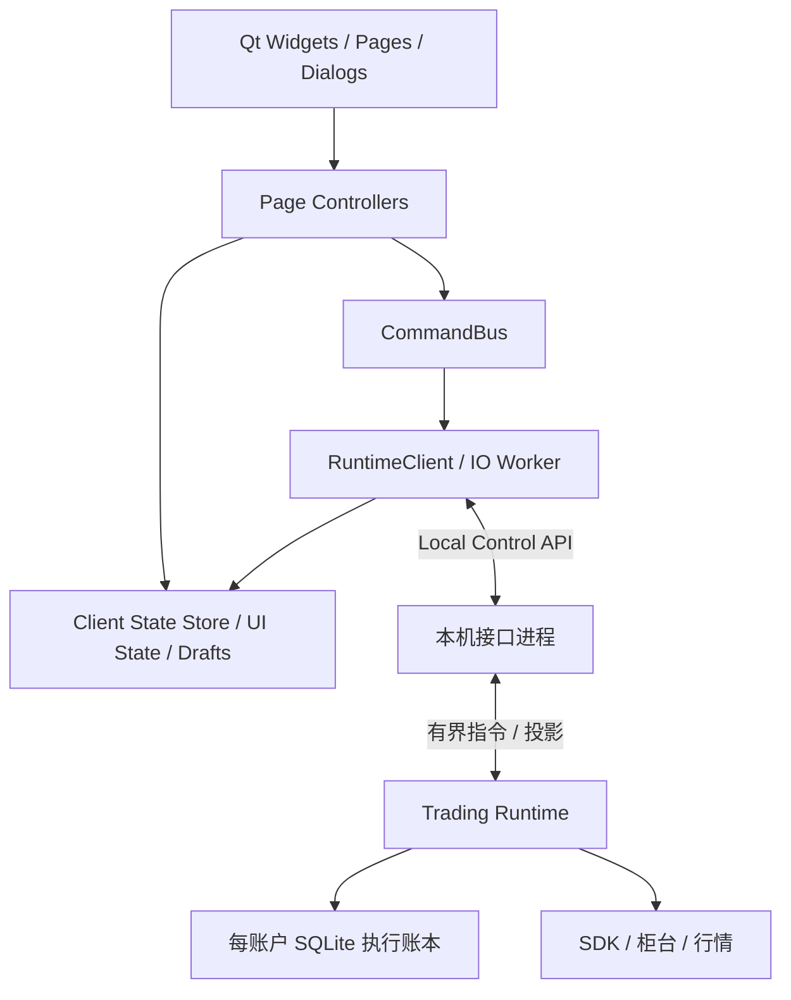
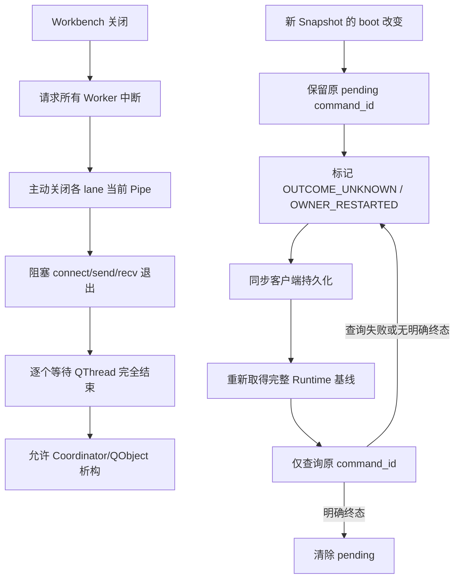
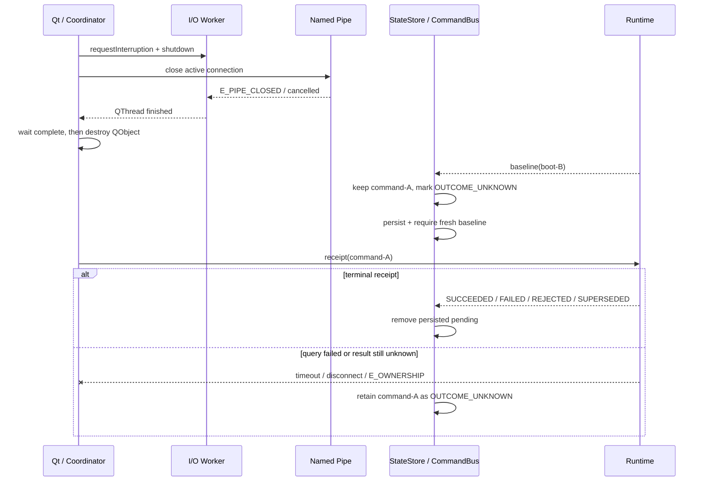

# OnlineTrader Trading Workbench（Client）重构设计与实施计划

> 状态：Phase 1 三项 Integration Gate 已通过独立定向自动化；Phase 2 已开始把账号历史慢查询接入既有 Workbench，状态订阅和交易控制仍未迁移 · 2026-11-19；未打包
> 范围：Qt/PySide6 客户端及其与 Trading Runtime 的接口适配  
> 设计基线：`1f0ab648136519e364bf3267c6dab51ffdd76e15`；实施起点：`c891e512ed6559505160cccd80bfd90a40ae5262`
> 本文所列实现状态不代表最终独立复测、模拟柜台交易闭环或最终制品已经通过。

> 2026-11-20 实施更新：Workbench 不再显示操作员或令牌，使用受 Windows 本机身份边界约束的通道；该检查不能证明真实按钮点击，当前服务端还允许 `LocalSystem`。CLI、调度和受托工具的操作员协议保留。源码候选已按[架构收敛与安全改造计划](runtime-architecture-hardening-plan-20261120.md)完成 CommandBus 安全整改和生产接管，但尚未获得功能测试或真实柜台验收。

**关联文档：** [独立交易运行时与交易工作台设计](standalone-trading-runtime-20261119.md) · [架构收敛与安全改造计划](runtime-architecture-hardening-plan-20261120.md) · [Runtime 运维、配置与账本](../runtime-operations-and-storage-20261119.md) · [账户数据与历史查询](../account-data-sync-design-20261119.md)

### 2026-11-19 源码实施候选

- `online-trader-desktop --runtime-pipe` 与普通 dev 入口共用原 `WorkbenchWindow`/`WorkbenchLayout`；窗口、导航、页面、控件、文案和位置只有一份实现。Runtime 兼容启动器也只委托该窗口，不保留第二套可见页面。
- 客户端基础层已提供版本化状态 Store、状态订阅/命令/慢查询分离、CommandBus、原命令回执恢复及稳定行 ID 模型。pending 静默截断、持久化未核验、损坏记录忽略、队列失败状态、回执身份核对和 `--allow-multi` 整表覆盖缺口已在源码中修复；注册表在跨进程锁内重读、合并、写回并核验。Runtime Capability 与封闭 allowlist 已补齐，顶层、人工交易和在线参数控件均消费 Capability，并通过既有 Workbench 单向接管，不替换 UI。
- 账号历史是首个接入既有 Workbench 的慢查询：只在 `RuntimeQueryWorker` 中分页调用 `history-days`，结果按账号、Owner boot、柜台日和本地 generation 绑定；Qt 不直接打开账本。自有订单/成交与账号观察历史分开展示，资金历史按交易日并入权益曲线。该接入和增量表格刷新本轮仅做源码编译检查，尚未获得新的 GUI/行为验收证据。
- Runtime 投影新增说明性 Capability、结构化 Diagnostic 和 Owner 已有行情缓存中的合约目录；命令仍由 Runtime 逐次最终校验。
- 参数草稿必须先通过带账号、boot 和配置版本绑定的 Runtime 预览，再使用原 `SAVE_DSV_PARAMETERS` 命令提交；Qt 不直接写生效配置。
- Runtime 接口日志通过有界、脱敏的只读页返回；新客户端不直接读取执行器日志文件。
- 首轮独立验收曾发现替代 UI 偏离 dev；该替代窗口已撤除。后续真实 TQKQ 验收确认 Runtime 入口实际类、标题、尺寸、五任务区、二级页签、首页 5 列行情表、K 线、解释、事件和状态栏均来自同一 dev 实现。已进一步修复 F5/F6 固定文案、脱敏账户显示、原“订阅行情（新主力）”入口及 DISARMED 开仓控件禁用；这些最新修复等待独立复测。
- 未执行任何开仓、平仓、撤单或其他交易操作，未打包；模拟柜台交易闭环和最终制品仍为 `NOT_RUN`。

### Phase 1 接入结论与门禁

原审核时新 `runtime_client` 基础层尚未接入实际 Workbench。2026-11-20 源码候选已补齐 pending 容量/损坏/同步、enqueue 未送达状态、账号与 command ID 严格匹配、Capability 完整性和显式 allowlist，并接管状态订阅、交易控制和慢查询。以下旧 Phase 1 结果仍只能作为历史证据，不能替代本次候选的独立测试：

1. 关闭协调器必须主动取消三个 I/O lane 当前持有的 Named Pipe，使阻塞中的 `recv` 立即返回；所有 QThread 必须在其父 QObject 析构前确认结束。
2. Runtime owner boot 改变时保留全部未决 `command_id`，将其状态降级为 `OUTCOME_UNKNOWN / OWNER_RESTARTED`，持久化后重新认证并查询原回执；boot 改变不是删除未知责任的证据。
3. 原命令的 receipt 查询失败只表示本次查询未完成。超时、断线、鉴权失败或暂未找到回执均不得把原命令标成 `REJECTED`，也不得清除 pending；只有 Runtime 返回明确终态回执后才可清除。

“尚未接入”是分阶段迁移状态，不单列为产品缺陷。原 `dd85523` 只能称为 Phase 1 初步落地；当前账号历史的局部接入也不能称为 Workbench Client 重构完成。

2026-11-19 独立测试 Agent 在基线 `dd8552366db6f91140b590850503cb31a4847f3c`、源码 patch identity `4f9825bfa5fd2419019aaca77f2157edcce0f74f` 上执行隔离 Windows/Qt/Named Pipe 定向测试。新增 9 项门禁用例并连同受影响既有用例共执行 25 项：25 PASS、0 FAIL、0 SKIP、0 NOT_RUN。覆盖阻塞 command/subscription/history 主动取消、全部 QThread 退出、重复关闭、排队请求不续发、unknown 跨 boot 与客户端重建恢复、receipt 查询失败保留、明确终态清除、非终态保留及同范围重复意图阻断；Windows 原生管道验证关闭未等待 8 秒业务接收超时。实际 Workbench 接入、可见 GUI、真实 Owner/账号/柜台、SimNow、打包与制品均不在本轮范围，不能据此声称整体重构完成。

## 1. 背景、目标与不变约束

OnlineTrader 已采用独立 Trading Runtime + Qt Trading Workbench 的 C/S 方向。Runtime 单独维持 SDK、账户、策略、风险、订单、持仓保护、定时计划及原账户 SQLite 执行账本；本机接口进程提供版本化控制、只读投影、订阅、查询与回执。Qt 退出、强杀、崩溃或重启不应改变 Runtime 已确认的交易责任。

但目前桌面层仍保留一体化结构的遗留：`src/online_trader/desktop/workbench_layout.py` 集中承载页面布局、配置草稿和本地文件读取、行情参考读取、人工交易入口、表格全量填充、日志 tail 与状态渲染。相关模块如 `desktop/startup.py` 中的 `QuoteReferenceWorker` 也可能从 GUI 侧建立独立行情读取路径。

本次目标：

1. GUI 成为 **Runtime 的可视化终端**，而非第二套交易控制器。
2. View 不直接调用 SDK、运行时 SQLite 或写入 Runtime 生效配置；业务事实由 Runtime 唯一裁决。
3. 建立单一客户端数据入口和命令入口，恢复 Snapshot / Delta / Receipt / History 的完整语义。
4. 拆除 God Object：页面组件、控制器、客户端状态和通讯独立，可分层测试。
5. 将错误码变成机器可读、语义稳定的诊断合同；用户默认只看到中文原因、影响及处理建议。
6. 降低 Qt 主线程负荷，支持高频行情、小批增量、异步查询与稳定选择。
7. 分阶段迁移和验收，保留现有白底 Qt Widgets 外观、快捷键、操作流程与 DSV 交易语义。

**不在本轮范围：** 改写 DSV 信号算法、重定义下单/撤单状态机、迁移或重建账户 SQLite、改变持仓保护归属、放松风控、同时切换真实资金账户、以 Fake Runtime 替代 SimNow 验收。需要增加的 Runtime 协议字段须独立评审、版本化、向后兼容。

## 2. 总体架构与所有权



| 组件 | 拥有的状态 | 不得承担 |
| --- | --- | --- |
| Runtime | 账户与连接证据、有效配置、策略、权限、交易日、订单、成交、持仓、恢复/保护与账本 | 页面选择、Qt 对话框 |
| 本机接口进程 | 只读投影、订阅窗口、分页查询和通信生命周期 | 第二套交易裁决 |
| RuntimeClient + I/O Worker | 握手、连接、请求发送、订阅、重连、协议验证 | 决定是否允许交易 |
| ClientStateStore | 已核实的不可变业务快照、代次/水位/数据时效 | 修改交易事实 |
| UiState | 账户选择、筛选、排序、窗口/图表布局、未提交表单 | 声称订单已成交 |
| Controllers | UI 交互编排、局部输入校验、命令提交和回执处理 | 直接写账本或发 SDK 指令 |
| Pages/Models | Qt 呈现和轻量本地过滤 | 直接连接 Runtime 内部对象 |

客户端存储应明确区分 `RuntimeState`、`UiState`、`DraftState` 和 `PendingCommandState`。只有 RuntimeState 对应权威业务事实。界面里“选中 ag2612”是 UI 状态；“ag2612 持有 3 手”是 Runtime 事实；“输入买开 1 手尚未提交”是 Draft；“命令已受理但柜台待核对”是 PendingCommand。不得混用。

### 2.1 现有协议优先

保留已有 Windows Named Pipe、分帧、会话/身份校验、Snapshot / Delta 顺序、账户附着、历史分页和版本控制。新类名、代码样例及示例操作名均为目标抽象，**不自动等同于已存在的 API**。接口欠缺记录到 Phase 0 缺口表，由 Runtime 侧单独扩展；严禁为赶 GUI 进度直接访问 SDK、runtime 配置或账本。

## 3. 目标目录和依赖方向

```text
src/online_trader/desktop/
  app.py
  main_window.py
  client/
    runtime_client.py
    io_worker.py
    connection_manager.py
    subscription_manager.py
    command_bus.py
  state/
    runtime_state.py
    state_store.py
    ui_state.py
    receipt_state.py
    config_draft.py
  controllers/
    account_controller.py
    strategy_controller.py
    manual_trade_controller.py
    settings_controller.py
    history_controller.py
    diagnostics_controller.py
  models/
    market_model.py
    contract_model.py
    order_model.py
    trade_model.py
    position_model.py
    history_model.py
  pages/
    dashboard_page.py
    market_page.py
    manual_trade_page.py
    position_page.py
    order_page.py
    trade_page.py
    strategy_page.py
    settings_page.py
    history_page.py
    diagnostics_page.py
    account_page.py
  dialogs/
    settings_dialog.py
    symbol_editor_dialog.py
    order_confirm_dialog.py
  diagnostics/
    error_presenter.py
    messages_zh_cn.py
    notification_center.py
  widgets/
    status_indicator.py
    contract_search.py
    price_display.py
    money_display.py
```

目录为建议落点，不强求一个 PR 一次性建立空目录。稳定的纯函数可复用原模块，不为“分层”增加空壳或深层封装。最终 `MainWindow` 只负责窗口、导航、页面生命周期和跨页面入口；旧 `WorkbenchLayout` 迁完后删除，避免新旧业务路径长期并存。

依赖方向为 **View → Controller → Store / CommandBus → RuntimeClient → 公共协议**。Store/Controller 不持有具体页面 QWidget；页面不能反向 import Runtime 内部执行器。

## 4. 通信、线程与资源预算

### 4.1 RuntimeClient

客户端统一提供逻辑能力：`connect / disconnect / subscribe / get_snapshot / submit_command / query_command / get_account / query_history`。方法应复用仓库已有合同，不能在客户端自行创造与服务端不兼容的协议。

逻辑上隔离三种流量：实时状态订阅、交易控制/回执、慢查询（账户全量、历史、日志、合约目录）。不强制底层恰好三条物理管道；但 **慢查询不得阻塞命令回执**，优先采用已有接口进程的有界并发与读侧缓存。

### 4.2 Qt 线程模型

长期存活的 `RuntimeIoWorker` 在专用线程处理阻塞通信、解帧、连接恢复。Qt GUI 线程只接受入站 Signal、更新轻量模型和绘制。使用 QObject `moveToThread` 或明确定义所有权的线程循环，避免误以为 QThread 对象任意方法自动运行在工作线程。所有跨线程业务数据采用不可变传输对象，避免异步修改 Qt model。

UI 主线程禁止：阻塞 Named Pipe、SDK 登录/订阅、大规模 JSON 编解码、账本查询、大文件 tail、长时排序/全表重建、同步等待 receipt。

### 4.3 有界性

对每个客户端请求设置帧/消息大小、超时、排队数量、查询并发和缓冲区预算。状态流队列满或丢失片段时进入 `RESYNC_REQUIRED`，不能静默遗漏。长时间不活跃或慢订阅可被读侧终止；业务 Runtime 不等待 Qt 消费。

工作台发布和账户采样节奏仍遵循 Runtime 现有机制（当前独立运行路径包含约 750ms 工作台发布、2.5s 账户截面采集），不要求 GUI 将其强制改成每 tick 刷新。UI 绘制节流不得篡改业务数据观察时间。

## 5. ClientStateStore：快照、差量和账号隔离

首次连接为 `CONNECT → HANDSHAKE → SYNCHRONIZE → READY`。新快照必须携带/关联账户、Runtime 启动身份、发布代次、基线水位、观察时间和相应完整性/新鲜度；字段以现有协议为准。

后续增量必须校验顺序与对应 Snapshot 版本。收到不连续 seq、错误 epoch、错误 account key、无法识别 schema 或不完整批次时：

1. 保留最后可信快照仅作为 **陈旧历史观察**，标注时间；
2. 停止使用旧数据作为交易权限依据；
3. 进入 `RESYNC_REQUIRED`，请求完整 Snapshot；
4. 仅在完整恢复并通过身份/版本核对后进入 `READY`。

异步响应增加本地 `selection_generation` 或等效 token，防止上一账号的合约目录、查询结果、配置草稿覆盖当前选中账号。不能只检查选中名称，需同时核对规范账户身份及 Runtime owner/boot identity。

Store 以 `markets_changed / orders_changed / positions_changed / authority_changed / configuration_changed / receipts_changed` 等语义增量通知相关页面；不每次刷新整个 MainWindow。不可变数据由 Store 更新，页面仅保存筛选和选中业务 ID。

## 6. CommandBus 与订单结果安全

所有按钮和快捷键只进入 Controller，Controller 做表单格式检查并生成一次用户意图，由 CommandBus 发送：

```text
ManualTradePage.click
  -> ManualTradeController.validate_input
  -> CommandBus.submit(command_id, operation, account, payload, expected_version)
  -> RuntimeClient
  -> Runtime 最终校验权限/行情/风控/当前账户/重复命令
  -> Receipt / 订单事实 / 后续柜台回报
  -> StateStore -> View
```

**指令状态不可合并：**

| UI 状态 | 含义 |
| --- | --- |
| LOCAL_DRAFT | 尚未发送 |
| SUBMITTING | 本地正在提交 |
| SUBMISSION_UNKNOWN | 客户端断线/超时，无法确认 Runtime 是否受理 |
| REJECTED | Runtime 明确拒绝 |
| ACCEPTED | Runtime 已受理，**不代表柜台成交** |
| PROCESSING | 执行中 |
| COMPLETED | 有足够权威证据确认目标操作完成 |
| OUTCOME_UNKNOWN | 已受理后执行或柜台结果待核 |

这些是客户端展示状态，须映射现有 Runtime 原生命令/委托状态，不得覆盖 `UNKNOWN`、`SEND_POSSIBLE` 或账本恢复语义。

- 发生提交超时，**禁止生成新 Command ID 自动重复下单**；保留原 ID、账户身份与操作范围，重连后查询原命令/柜台状态。
- 只有协议承诺幂等且服务端能去重时，才允许按合同用原 ID 重传。
- 快捷按钮不能因为纯 UI 超时被重新启用为自动重发；用户再次主动操作应获得清晰的待核提示。
- 撤单、批量撤单和人工平仓同样按未知结果处理；避免重复占量或错误确认已撤。
- 来源 `source`、操作员 `actor`、授权范围由 Runtime 基于经认证的会话确认，UI 不能自称权限。
- 人工禁开由 Runtime 持久化并否决策略新增；策略重连、重试、启动与参数加载不允许客户端暗中解除。
- 关闭 Qt 只断开工作台，不等于停止 Runtime，也不结束已有持仓保护。

## 7. Capability：可操作性由 Runtime 裁定

GUI 不应重复用 `connected && manual_workbench && symbol_bound` 构造真正的业务权限。优先由 Runtime 发布版本化 `capabilities`（按账号/合约/操作范围），例如 `manual_open.allowed=false, reason=RECONCILIATION_REQUIRED`。

Capability 用于 **显示禁用态和解释**，不是授权票据：Runtime 接到每次命令时仍须以最新状态再次验证。Capability 缺失、过期或账户不一致时采取保守展示，不以“按钮可用”推断真实允许。

区分账户连接、策略运行、手工交易权限、策略新增权限、已有保护责任：停止新增不得使已有平仓/保护责任自动消失。界面解释由 Runtime 事实驱动。

## 8. 配置与草稿：版本化修改

`Runtime Effective Config`（运行时已生效）与 `ConfigDraft`（客户端本地未提交）及 `Pending Config Change`（提交中）必须分开。

流程：读取带版本/哈希的有效配置 → 本地草稿编辑 → 客户端仅做类型/格式校验 → Runtime 预览/验证 → 带预期版本提交 → Runtime 进行最终授权和安全生效 → 收到新版本/冲突回执 → Store 更新。

若提交基础版本已改变，返回冲突，保留本地草稿并要求用户核对；不能以 GUI 直接 `write_text` 更新生效配置。模板和布局可以存客户端偏好，但模板“应用到 Runtime”必须经过统一合同。配置重读不得意外改写人工禁开等 Runtime 权威状态。

## 9. 合约自动补全与行情

保留“输入 ag 返回 ag2612/ag2701 等候选”的用户体验。候选目录来源为 Runtime/只读服务合同，Qt 端通过 `ContractCatalogState + ContractSearchModel + QCompleter` 做本地轻量过滤（代码、简称、中文名、交易所）。目录关联账户/数据来源、更新时间、完整性；目录缺失不证明合约永久不存在，允许输入完整合法合约待 Runtime 核验。

避免在已有 Runtime 所有权账户运行时由 GUI 的 `QuoteReferenceWorker` 再次建立相竞争的 SDK 连接。旧独立读取路径迁移完成后删除。行情报价、盘口、quote age 与可交易新鲜度从 Runtime 投影来；UI 不自行得出独立的时钟/柜台可信结论。

## 10. 页面职责与拆分顺序

| 页面 | 展示和客户端交互 | 业务依赖 |
| --- | --- | --- |
| Dashboard | 账户/权益摘要、持仓、策略状态、重要提示 | Store 聚合；详情按需拉取 |
| Market | 监控合约、盘口、时间、策略原因 | Runtime 行情和策略投影 |
| ManualTrade | 草稿、确认、快捷开平、撤单、回执 | ManualTradeController + CommandBus |
| Positions | 策略自有周期 vs 原生持仓、保护、平仓 | Runtime 所有权/仓位事实 |
| Orders / Trades | 订单/成交和筛选、选择 | 稳定业务 ID + 增量模型 |
| Strategy | 启停、有效参数、限制和阻断原因 | Runtime authority/status |
| Settings | 草稿、模板、预览、冲突处理 | Runtime config contract |
| History | 资金、仓位、委托、成交、覆盖情况 | 稳定账本水位的分页查询 |
| Diagnostics | Qt 客户端、Runtime、时钟、错误、回执 | 统一诊断合同和日志查询 |
| Account | 选择/附着账户，连接、登录与同步状态 | Runtime 账户身份与权限 |

旧 `workbench_layout.py` 中的 `quick_open / close_manual_position / cancel_manual_order` 应只迁出用户输入编排；例如 `suggested_lots` 可保留明确标注“参考值”的纯展示算法，但实际下单量与风控必须仍由 Runtime 判定。

## 11. 表格和性能设计

高频/大列表从 `QTableWidget` 渐进迁移到 `QTableView + QAbstractTableModel + QSortFilterProxyModel`，优先行情、委托、成交、持仓；历史数据采用分页/按需加载。

Model 应按稳定身份维护行映射，不依赖 row index 保存所选订单。变更调用 `dataChanged` 和成对的 `beginInsertRows/endInsertRows`、`beginRemoveRows/endRemoveRows`，保留选中 ID、列宽、排序、滚动位置及筛选。

区分入站更新频率与 UI 绘制节奏：订单/成交/权限改变须可靠通知，不得因为图表节流而漏掉；行情和图表可合并绘制。避免每个 Snapshot 都调用整表 `setRowCount + QTableWidgetItem`。

建议初始性能验收目标（工程预算，须在目标 Windows 环境实测）：普通页面点击反馈约 100ms 内、常见页面切换约 100ms 内、单次典型 UI 更新尽量控制在 16–33ms、慢历史查询不会阻塞交易按钮。此处不是 SDK/柜台下单延迟承诺。

## 12. 统一错误码、诊断事件与中文提示机制

### 12.1 设计边界

错误码为 **开发、跨进程通信、日志和自动化测试所用的内部诊断标识**；普通界面只显示简明中文“问题类型 + 影响 + 可采取的行动”。不将 Python traceback、`E_*` 或原始 SDK 异常直接显示在首页。诊断详情允许复制脱敏问题报告。

区分三种语义，不能把所有“不能开仓”都判为程序错误：

- **ERROR / FAULT**：运行异常，例如账本写入失败、命令结果未知。
- **WARNING / BLOCK**：运行受限，例如未取得完整柜台截面、人工禁止策略新增。
- **BUSINESS STATE / INFO**：正常策略状态，例如未达到入场条件、休市、等待新行情。

业务状态机仍是权威；Diagnostic 是结构化解释和事件关联，不代替委托状态机或 Runtime 的风控。

### 12.2 错误注册表

建议引入稳定编号 `OT-<AREA>-<NNNN>`，其中 `CON` 连接、`TRD` 交易、`RSK` 风控/授权、`CFG` 配置、`DB` 账本/存储、`MKT` 行情/时间、`STG` 策略、`UI` 客户端、`SYS` 系统。举例：

| 稳定编号（提议，尚未实现） | 原因示例 | 中文呈现 |
| --- | --- | --- |
| OT-CON-1001 | GATEWAY_DISCONNECTED | 交易连接已中断 |
| OT-CON-1003 | E_ACCOUNT_SYNC | 账户正在同步与核对 |
| OT-TRD-2101 | E_UNKNOWN_SEND | 订单结果暂时无法确认，勿重复提交 |
| OT-TRD-2104 | RECONCILIATION_REQUIRED | 账户委托和持仓待核对，暂不能新开 |
| OT-CFG-4002 | CONFIG_CONFLICT | 当前配置已变化，请重新核对后提交 |
| OT-DB-5001 | LEDGER_WRITE_FAILED | 交易记录存储出现问题 |
| OT-UI-7001 | SNAPSHOT_SEQUENCE_GAP | 状态更新暂时不完整，正在重新同步 |

**注册规则：** 首次分配后不得复用编号或改变其核心含义；新增错误使用新编号。原有 `E_UNKNOWN_SEND`、`E_CONFIG_EDIT` 等 `E_*` 继续作为底层原生 `reason`，新增注册表映射，避免破坏既有协议与测试。未知原因用通用降级提示，并在内部诊断中保留原始已脱敏原因。

### 12.3 诊断数据合同

建议版本化的 `Diagnostic`（实际 JSON Schema 与当前协议兼容）：

```json
{
  "diagnostic_version": 1,
  "code": "OT-TRD-2101",
  "reason": "E_UNKNOWN_SEND",
  "kind": "FAULT",
  "category": "ORDER_OUTCOME_UNKNOWN",
  "severity": "WARNING",
  "source": "RUNTIME",
  "operation": "manual.open",
  "account_key": "<redacted>",
  "command_id": "<command-id>",
  "trace_id": "<trace-id>",
  "impact_scope": "ORDER",
  "recovery_state": "VERIFYING",
  "retry_policy": "QUERY_ORIGINAL_COMMAND",
  "occurred_at": "2026-11-19T09:35:41Z",
  "context": {}
}
```

此示例的 `account_key`/ID 均为占位符，正式代码需按保密策略脱敏。上下文只允许白名单字段；私有凭据、Token、完整账户秘密、异常堆栈不进入普通业务投影。详细 stack trace 留在访问受控的诊断日志。

区分 `retryable` 与 **可重试的行为**，建议用明确策略：
`NO_RETRY`、`SAFE_QUERY_RETRY`、`RECONNECT_AND_RESYNC`、`QUERY_ORIGINAL_COMMAND`、`REQUIRE_USER_ACTION`、`RUNTIME_RECOVERY_ONLY`。

对于 `E_UNKNOWN_SEND`：可重试的是查询原指令，不是创建新委托；任何 UI 层自动重发必须由已验收的 Runtime 幂等合同严格限定。

### 12.4 ErrorPresenter 与通知中心

`desktop/diagnostics/error_presenter.py` 将稳定错误语义映射为中文标题、说明、影响、建议动作；`messages_zh_cn.py` 保存界面文案，不能用 SDK 原始字符串直接插值。普通状态在组件/状态栏轻量显示；需处理的阻断在页面附近展示；严重且影响账户安全的故障用持续醒目提示。避免断线重试导致模态弹窗风暴。

`NotificationCenter` 按稳定错误码、账户、操作范围、Runtime 身份和恢复周期聚合重复问题：保留首次/最近时间、次数、当前状态；底层每条诊断事件仍可追踪。仅收到 **明确恢复事件或可靠的当前状态证据** 才标记“已恢复”，不能纯粹到时自动恢复。未解决的关键交易/保护/订单待核事项必须来自 Runtime，可在 Qt 重启后恢复；纯本地 UI 错误不写入执行账本。

日志分为 Workbench 客户端日志和 Runtime 业务诊断。Runtime 日志与历史最终通过版本化只读查询/订阅接口访问，不直接由 Qt tail 执行器文件；旧 `JsonLogTail` 作为迁移期兼容入口，完成对等验收后删除。

## 13. 客户端连接状态与生命周期

客户端连接状态建议：`DISCONNECTED → CONNECTING → HANDSHAKING → SYNCHRONIZING → READY`，异常包含 `STALE / RESYNC_REQUIRED / INCOMPATIBLE`。它们与 Runtime SDK 连接、账户同步、策略运行状态严格分离。

重连处理：

1. 标记旧观察为 STALE，保留事实时间和未完成命令；
2. 连接并核验接口版本、账户、Runtime boot id 和授权；
3. 获取完整 Snapshot，再启动/恢复增量订阅；
4. 查询原 Command ID 的未决结果；
5. 按 Runtime 有效权限重新计算 UI 控件状态；
6. 不因 Qt 重连自动触发策略启动、放开人工禁开或重复下单。

界面关闭 = 断开客户端；“停止 Runtime”必须作为明确不同的命令和确认操作，展示已有委托、持仓保护及未知发送责任，最终由 Runtime 裁决。Qt 强杀后 Runtime 独立执行不受影响。

## 14. 分阶段实施、PR 边界与回退

| 阶段 | 主要内容 | 验收门禁 |
| --- | --- | --- |
| Phase 0：现状审计 | 映射 GUI→Runtime 调用、`E_*` 注册、接口缺口、原 UI 功能和测试基线 | 提交依赖清单和分类，不修改交易行为 |
| Phase 1：客户端基础 | RuntimeClient、I/O Worker、StateStore、CommandBus、Diagnostic Contract/Presenter、Fake Runtime 协议夹具 | Snapshot/Delta/回执、失序重同步、未知结果、账号隔离单测 |
| Phase 2：交易页面 | ManualTrade/Order/Position/Strategy 控制器和页面、Capability 展示、统一命令 | SimNow 人工开/平/撤、禁开、指令结果待核；无重复动作 |
| Phase 3：配置和行情 | Settings Draft、版本冲突、账户附着、合约目录、移除 Qt 的竞争 SDK 读取 | 配置冲突不覆盖；ag 自动补全；多账户异步返回不串号 |
| Phase 4：数据模型与诊断 | QAbstractTableModel、历史分页、客户端问题中心、Runtime 日志查询 | 大量事件仍流畅；订单选择/历史游标稳定；诊断可追踪 |
| Phase 5：清理与总验收 | 删除旧 God Object 业务路径、旧直接文件/SDK/账本路径，更新文档、回退指引 | Qt 独立附着/强退/重启、状态准确，模拟盘闭环 |

每阶段单独 PR，先引入新路径和测试，再切换页面，最后删除旧路径。禁止“旧按钮和新 Controller 同时发送同一命令”。新 API 扩展与 GUI 改动尽量分 PR，确保可回退；回退 GUI 不得删除或回滚 Runtime 已提交账本事实。开发开关仅用于迁移期，不应长期向最终发行版暴露两套功能。

### 14.1 Phase 1 Integration Gate 设计走读





| 项目 | 接入契约 |
| --- | --- |
| 状态所有者 | Runtime 账本拥有命令事实；客户端只持久化待查询的原 ID、账号和操作提示，不创造终态。 |
| 关闭顺序 | 先请求中断，再关闭活动 Pipe，最后等待线程退出；不以固定 `wait(ms)` 超时后继续析构。 |
| boot 迁移 | 同账号的新 boot 使客户端观察与命令绑定失效，但不使旧账本回执或未知责任失效。 |
| 查询失败 | 只更新本次查询的诊断原因；pending 保持未知，禁止映射成原命令拒绝。 |
| 兼容与回退 | 当前 Workbench 使用 `RuntimeClientCoordinator`/本机交互用户通道；门禁失败时不回退操作员提示或直连 Owner，不迁移或改写账本。旧版单槽 pending 先在跨进程锁内写入并核验 v2 注册表，再清理旧键，恢复后仍只按原 ID 查询。 |
| 诊断点 | 关闭可核对每个 lane 的 finished 状态；boot 变化与查询失败通过 `command_changed`/feedback 暴露原 command_id 和保留原因，内容不得含凭据或完整敏感载荷。 |

可执行验收条件：阻塞 command、history/query 和 subscription 时关闭均能在受控时间内结束全部线程；`SUBMISSION_UNKNOWN` 经 boot 变化及 UI 重建仍保留原 ID；receipt 查询超时、断线、鉴权失败和暂未找到均保留 pending；仅明确终态回执清除；测试不连接账号、不发送交易命令、不构建制品。

### 14.2 Phase 0 必须交付的接口缺口表

至少逐项检查：权限 Capability 投影、命令回执查询/幂等保证、合约目录只读查询、运行中配置预览/提交、Runtime 日志查询、诊断事件订阅、账户截面时效与完整性、历史分页稳定游标。注明“已有/部分已有/缺失”和真实代码位置，不凭设计稿声称接口已实现。

## 15. 测试矩阵与验收证据

**纯单测：** Store 顺序、错 epoch、Snapshot 覆盖、账户 generation、CommandBus 去重、错误码唯一性/兼容、中文兜底、配置草稿和冲突、合约搜索、模型行身份。Controller 测试可不创建 QWidget。

**Qt / Fake Runtime：** 页面渲染、表单快捷键、指令待核、回执迟到、连续断线、慢历史页、1000+ 行模型增量、通知聚合、主线程阻塞检测。Fake Runtime 只证明客户端协议/交互，不证明真实柜台交易。

**Windows / SimNow E2E：** Runtime 先启 Qt 后附着、Qt 先启自动连接、Qt 强退仍保留持仓保护、Qt 重启恢复、人工开平撤、受理后断线的原命令核对、人工禁开不被策略自动恢复撤销、配置竞争冲突、账号切换不串数据、历史分页与日志隔离。应分别记录源码/协议测试、Qt/IPC 验收、SimNow 柜台闭环，**不得混写为真实资金账户验证**。

错误码专门验收：

- 已注册编号语义唯一、版本向后兼容，旧 `E_*` 不丢失；
- 普通用户文案没有敏感内容或 Python traceback；
- 未知下单结果绝不误报为失败或成交；
- 同类错误合并不丢原始诊断和因果关联；
- 恢复必须有真实 Runtime 证据；
- 即使 GUI 自己崩溃，也不会产生额外交易动作。

每次 PR 报告候选 SHA、系统环境、实际命令、PASS/FAIL/SKIP/NOT_RUN、脱敏报告及剩余风险。未实际运行的测试不得写成“通过”。

## 16. 代码评审禁止项和最终完成定义

**禁止：** 页面 import SDK 并调用 `insert_order`；Qt 直接 `sqlite3.connect` 执行账本；GUI `write_text` 改写运行时生效配置；主线程阻塞等待管道回执；从 UI button enabled 推断业务权限；命令超时后生成新下单 ID；每轮 Snapshot 全量重建所有表格；利用 Qt 重连解除人工禁开；普通界面直接泄露内部堆栈与账户秘密。

**最终完成：** Workbench 可单独启动连接已有 Runtime；交易控制只能走 CommandBus；全部业务事实由 Runtime 状态和回执支撑；Qt 退出/强退不改变交易责任；断线和未知结果安全展示与恢复；历史、日志、行情有界且不堵塞主线程；已迁移页面不依赖 `WorkbenchLayout` 的混合业务编排；全部关键路径具备独立自动化测试及 Windows 模拟盘证据。

---

### 本文设计优先级

**路径/权限事实审计、CommandBus 修复、Capability/白名单补齐和生产 Workbench 源码切换已经完成；下一门禁是经授权的指令、状态、关闭与重连独立测试，不是继续扩大重构范围。** 保留当前简洁白底 Qt Widgets；后续优化 UI 外观不得突破 Runtime 唯一业务权威的边界。
