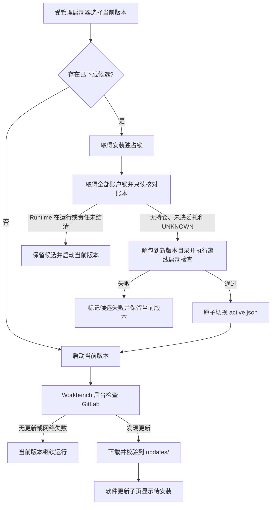
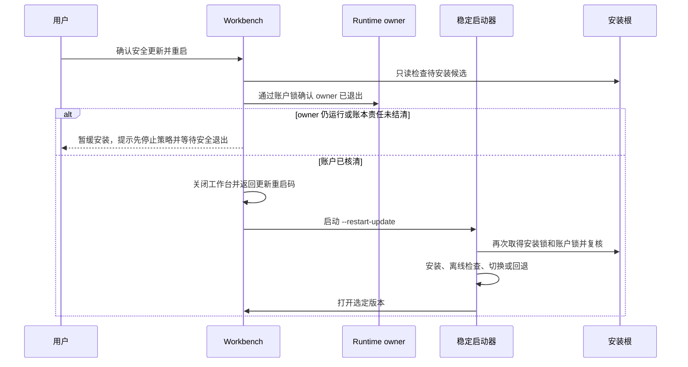

# Windows 安装版、便携版与 GitLab 更新

> **2026-11-20 Runtime 收口：** Standalone Runtime 只由当前 Windows 用户主动启动。安装切换只取得安装锁、Runtime 单实例锁和已配置账号的本机进程锁，不再读取旧执行账本判断持仓、委托或 UNKNOWN。下文仍描述旧账本门禁的段落仅是历史设计；当前合同见[手动启动收口](refactor/runtime-manual-only-cleanup-20261120.md)。

安装版从 Windows 开始菜单启动。带更新配置的便携版直接双击解压目录根部的 `OnlineTrader.exe`。两种版本都会在工作台打开时后台检查预览渠道，也可以点「软件更新 → 检查更新」主动检查和下载。

下载完成并校验完整 ZIP 后，可从同一菜单选择「更新并重启」并确认，也可以继续使用当前版本，下次正常打开时再切换。更新要求相关进程退出，账户账本中的持仓、委托及未知结果已核对。条件不足时暂缓切换，继续使用当前版本。新版启动失败时回退上一版，并标记失败版本，避免启动时反复尝试。

安装根目录保存 `active.json`、`update-source.json` 和安装版共用的 `OnlineTrader.ini`。程序及配套工具位于 `versions/<版本>` 下。账户目录、账本和外部参数文件沿用原路径。旧便携版偏好仍在便携目录，可在首次安装后、运行前将旧 `OnlineTrader.ini` 复制到安装根目录。手工启动的外部 CLI、自定义账户目录或其他独立执行环境应先正常停止再启动安装版。

便携版需要解压到可写目录。根目录里的原 EXE 保持为启动入口，下载的版本解包到 `versions/<版本>`，根目录的偏好、参数及随包配置继续使用。便携版自启动守护也从根目录启动。原来缺少更新配置的便携版需要先换用一次带更新配置的完整包。

## 制品和发布

1. 默认历史公开项目为 `gitlab.com` 的 [Yoruto/OnlineTrader-Releases](https://gitlab.com/Yoruto/onlinetrader-releases)（项目 ID `89047383`）；中国大陆受控分发优先使用 **极狐 GitLab（`jihulab.com`）** 私有项目（如 `x3185248/onlinetrader-releases`，项目 ID `389806`，默认分支 `main`）。`update-source.json` 支持 `host`（`gitlab.com` / `jihulab.com`，默认 `gitlab.com`）、`project_id`、`channel`（`preview` / `stable`）、`portable_version` 与可选只读 `read_token`（仅用于私有更新源认证，禁止携带写权限令牌，且严禁跨域名跳转透传）。
2. 旧的无标记通用 ZIP 已停用：它缺少接收方配置且可被误当作独立程序启动。当前支持两类明确区分的制品：
   - **首次/全量私有交付**：`scripts/build-portable.ps1 -DeliveryMode RuntimeConfigured -DeliveryConfigDirectory <confirmed-config>`，产出完整 `*-Runtime-Configured.zip`（含 `runtime/` 与已确认配置，可通过 `-UpdateHost` / `-UpdateProjectId` / `-UpdateChannel` / `-UpdateReadTokenFile` 绑定受控更新源），只通过获准私有渠道交付。
   - **不可独立启动的程序更新载荷（`ONLINE_TRADER_UPDATE_PAYLOAD/1`）**：`scripts/build-update-payload.ps1`（或 `scripts/portable_delivery.py --update-payload`）产出的 `OnlineTrader-<版本>-windows-x64.zip`。ZIP 根包含程序本体与 `update-payload.json`（`{"schema_version":"ONLINE_TRADER_UPDATE_PAYLOAD/1","version":"<版本>","standalone":false,"requires_managed_root":true}`），**严禁包含** `runtime/`、`OnlineTrader-defaults.json`、`OnlineTrader-parameters.json`、`OnlineTrader-overrides.json`、`update-source.json`、`active.json`、`OnlineTrader.ini` 及任何历史预设；除安装期 `_offline_check`（`--verify-runtime` / `--update-smoke`）外，单独解压后直接双击或启动 `OnlineTrader.exe` / `OnlineTraderCLI.exe` 一律 fail-closed 拒绝运行（必须由已有受管理根目录通过 `versions/<版本>/` 启动并沿用根目录既有 `runtime/`）。不得把无配置基础程序主体改名为更新 ZIP。
3. 使用 `python scripts/publish_gitlab_update.py --host <jihulab.com|gitlab.com> --version <版本> --archive <ZIP>` 检查本地载荷与 `update-payload.json`。实际发布时增传 `--publish --project-id <ID> --ref main`（发布端通过 `GITLAB_TOKEN` 或 `--token-file` 提供发布令牌，私有仓库回读校验可传 `--read-token` / `--read-token-file`）。脚本将 ZIP 上传到 `online-trader-windows-x64`，按客户端同款逻辑回读摘要、验证文件大小、校验完整 ZIP 后才创建 `onlinetrader-<版本>` Release。

上线验证使用干净 Windows 和两个实包，核对任务守护、Qt 可见窗口、实际执行文件路径、已有 `runtime/` 配置数据保留、退出全进程关闭及回退。源码样本可以验证请求契约、域名白名单、非独立载荷阻断与切换控制，实包路径仍需在获准出包后验证。

## 指定设备的配置版

使用 `-DeliveryMode Configured -DeliveryConfigDirectory <配置目录>`。输入目录必须包含 `OnlineTrader-defaults.json` 和 `OnlineTrader-parameters.json`，前者提供 SimNow 和快期行情的账号口令，后者提供已确认的交易参数。构建前检查输入，构建后核对便携目录中的配置与输入文件一致，同时校验 ZIP 的文件列表、CRC 与关键成员摘要。配置版 ZIP 和安装器名称都以 `-Configured` 标识。公开更新入口拒绝包含默认账号配置的 ZIP。

普通双击配置版工作台首次启动时登记默认账号。已有档案时只为匹配身份补齐缺失的凭据，保留已保存的口令和当前账号选择。配置版含可读取的凭据，应存放和交付在获准的范围内。

## Standalone Trading Runtime 更新接入

默认 Runtime 桌面入口也使用同一套受管理安装根：`src/online_trader/desktop/entrypoint.py` 在 `resolved_runtime_root` 位于 `managed_root(sys.executable)` 下时，向 `WorkbenchWindow(..., runtime_view=True, update_root=..., update_restart=...)` 注入受管理更新控制器。Runtime 更新复用现有下载、ZIP 路径与非独立载荷限制、大小和 SHA-256 校验、`versions/<版本>/` 目录、启动检查、安全停机退出及回退机制，不在 Qt 或 Runtime owner 中新增第二套下载器或安装状态。

自动检查和下载运行在 Workbench 的后台线程，不进入交易 owner，不阻塞行情、订单或保护。它只产生安装根下的下载缓存、`pending.json` 和脱敏的 `status.json`。自动流程不会提交 `STOP_DSV_STRATEGY`，也不会为了安装撤单、平仓或终止进程。

用户从「账户与设置 → 软件更新」选择「安全更新并重启」时，顺序如下：

状态和职责固定如下：

| 状态 | 唯一拥有者 | 约束 |
| --- | --- | --- |
| 当前与上一程序版本 | 安装根 `active.json` | 只由稳定启动器在安装独占锁内切换 |
| 更新来源与渠道 | 安装根 `update-source.json` | Workbench 只读；无此文件时不显示受管理更新入口 |
| 下载候选 | 安装根 `updates/pending.json` 与校验后的 ZIP | 可在 Runtime 运行时写入，不获得安装权 |
| 检查状态 | 安装根 `updates/status.json` | 仅用于诊断和界面恢复，不是安装或交易权威事实 |
| 持仓、委托、UNKNOWN 和恢复责任 | Runtime 的原每账户 SQLite 及唯一 owner | 更新器只读核对，不修改账本、不删除 WAL |
| 页面显示状态 | Workbench 更新控制器 | 可丢弃重建，不参与交易或安装裁决 |

受管理 Runtime 配置必须位于安装根稳定的 `runtime/`。便携 Runtime 原本就是该布局。安装版后续制品也应把客户 Runtime 配置放在安装根，而不是不可变的 `versions/<版本>/`；若检测到仅版本目录内存在 Runtime 配置，更新保持阻断并提示先完成受控迁移，不能在更新过程中自行移动账本或秘密配置。

失败处理保持 fail-closed：网络或 GitLab 故障不阻止当前版本运行；下载中断可续传；安装锁、账户锁、账本核对或离线检查失败均保留当前版本；新版在工作台就绪期限内失败则回退 `previous`。更新不会清除人工停开、策略日停、账本事实或 Runtime 配置。

实现后的验收至少覆盖：启动自动检查、手动检查、无更新、断网、续传、摘要不符、Runtime 运行中延后、flat 且终态后切换、UNKNOWN 阻断、Qt 关闭但 owner 仍运行、更新后读取同一 Runtime 配置和账本、新版早期失败回退。源码编译不能替代这些 Windows 最终制品场景；未获本次测试和打包授权时统一记录为 `NOT_RUN`。

## 2026-11-23 `0.1.0.dev40` 极狐接入与实包验证记录

- **全量离线回归**：`qa/test_runner.py --profile FullOffline`（非沙箱本机，含 `tests.test_update_install` 7/7）**1948 PASS / 0 FAIL / 0 SKIP / 0 NOT_RUN**（归档 `output/tests/20261123T081808Z-42744639/test-results.json`）。
- **私有首次配置包**：`OnlineTrader-0.1.0.dev40-windows-x64-Runtime-Configured.zip`（`124,158,673` 字节，`SHA-256: 987b793343cdca8f2b775b38d85b25a75432716005e80cd61ad8067098b60fbd`，预检候选 `tree_sha256: f1b3dc65a0d7c7b3ecd828a7630153909a39f726b1b9077de30a194bc9b4f00a`），已写入 `jihulab.com`（项目 `389806`、`preview` 渠道）与只读令牌，白银检查 PASS。
- **非独立程序更新载荷**：`OnlineTrader-0.1.0.dev40-windows-x64.zip`（`123,993,880` 字节，`SHA-256: bc6899f3a5d877712d2148b1593188e01104912da2a8127eebc54a8bb899a01e`，预检候选 `tree_sha256: 1879ff6d45190cb7cd949ec2a5740ad62ef7f78aca4a897d9e132be5f0d77187`），已上传极狐项目 `389806` 并创建 Release `onlinetrader-0.1.0.dev40`。
- **实包独立核验**：载荷解包通过 `--verify-runtime 0.1.0.dev40` 与 `--update-smoke 0.1.0.dev40`；单独执行 `OnlineTraderCLI.exe runtime run` 触发 fail-closed 拦截（退出码 2）。模拟 `0.1.0.dev39` 根目录直连极狐下载 `0.1.0.dev40` 通过，在隔离中绕过本机既有历史 `dev39` 实例锁后完成 `apply_pending` 与 `active.json` 切换，根目录 6 份配置与偏好文件 SHA-256 全量保留。真实期货柜台与远程目标机交互升级为 `NOT_RUN`。
